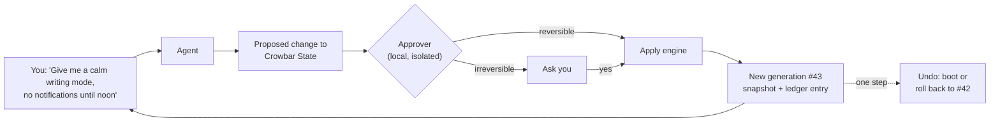
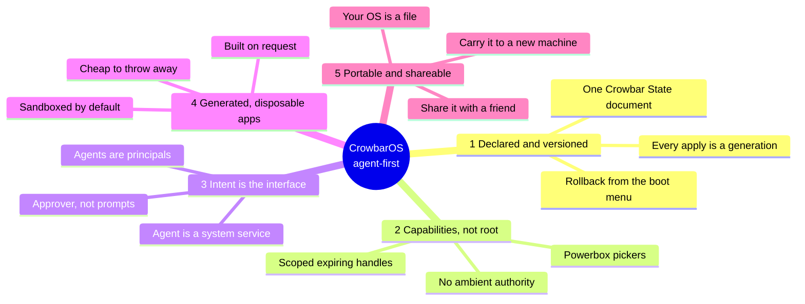
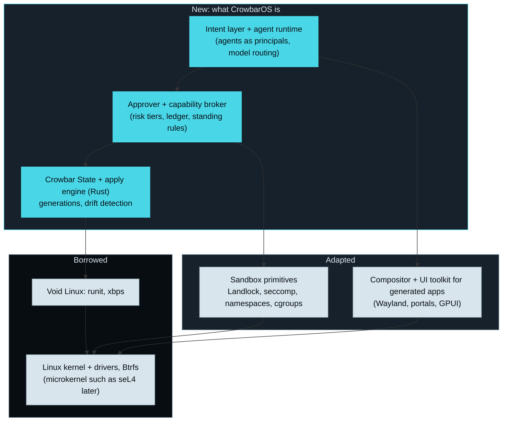
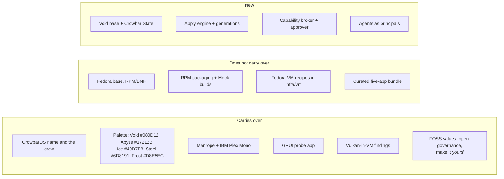
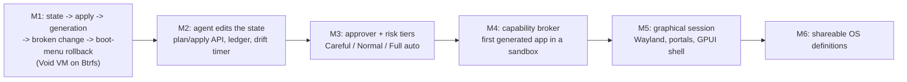

# CrowbarOS, agent-first: vision

**Status:** working direction agreed by Jim Martin and Jason Alexander, November 2026.
It replaces the Fedora-based curated desktop in
[`community_foss_distro_plan.md`](../community_foss_distro_plan.md) as the plan of
record. That document stays in the repository for reference. The one-page
[pitch](pitch.html) is the short version of this document.

## Thesis

People increasingly **build bespoke software instead of installing it.** Today that
is mostly developers working with agents. The cost of a small tool that fits one
person exactly is falling fast, and within a few years most people will make
software this way.

When software is something you describe instead of something you install, the
operating system has a different job. A curated set of default apps matters less.
What matters is the **substrate**:

- a tiny, stable base;
- an agent that can build and change things **safely, without babysitting**;
- a way to keep, undo, and share what you make.

So CrowbarOS ships the ability to make a desktop, not a finished desktop. It starts
extremely basic. Each person speaks their ideal OS into existence with an agent.

## Five first principles

### 1. Everything is declared and versioned

The whole system is described by one document, the **Crowbar State**: packages,
services, apps, capabilities, and desktop configuration. The agent edits that
document. Only the **apply engine** changes the system, and every apply produces a
new **generation**: a Btrfs snapshot that you can select in the boot menu. History
and rollback are part of the base design. They are not an extra tool.

Design: [state and apply engine](design/state-and-apply-engine.md).

### 2. Capabilities, not root

Nothing gets ambient authority. A generated app gets only what it was granted: this
folder, the camera, the network to one host. Grants are **scoped, expiring,
unforgeable handles** with a plain-language manifest. Where possible a **powerbox
picker** replaces a permission prompt: choosing the file *is* the grant. A buggy
bespoke app cannot damage the machine.

Design: [capability model](design/capability-model.md).

### 3. Intent is a first-class interface

The agent is a system service with a stable API to the whole OS. It is not a chat
app on top of the OS. Agents are **first-class principals**: each has its own
identity, workspace, budget, and capability set. It is the agent's OS too.

The default is **auto-approve with no babysitting.** A small, isolated, local
**approver** checks every action against your original request and a fixed rule
set. Reversible actions just happen and are snapshotted. Irreversible ones (send as
you, spend money, share off the machine, touch credentials) ask you.

Design: [approver and autonomy](design/approver-and-autonomy.md).

### 4. Apps are generated and disposable

The OS is optimized for building, sandboxing, testing, and swapping many small
programs, not for installing a few big ones. A generated app is declared in the
Crowbar State like anything else, so it is versioned, reviewable, and removable in
one step. Installing existing software stays possible.

### 5. Your OS is portable and shareable

Your whole setup is a definition you can carry to a new machine, or share so that a
friend can try your OS in one step. The Community Gallery can share prompts, apps,
and whole OS definitions.

## The stack: invent the top, borrow the bottom

Nothing about agent-first needs a new Wi-Fi driver, and drivers are what kill new
operating systems. We build what is new and borrow what is solved. The kernel stays
swappable.

### Why Void Linux

- **Small and plain.** The Milestone 1 lab root, `base-minimal` plus kernel,
  GRUB, Btrfs tools, SSH, and DHCP, is 114 packages.
  runit services are directories and symlinks, so the engine can diff and write
  them directly.
- **Easy to drive from a program.** `xbps` installs into any root
  (`xbps-install -r`), and the engine needs exactly that to build a new
  generation next to the running one.
- **No init or packaging opinions to work around.** We build our own declarative
  state and rollback layer instead of adopting NixOS's. That keeps the state
  document small enough for an agent and a person to read, and lets rollback
  be a plain Btrfs snapshot plus a boot entry.

### Hybrid model routing

A small local model handles cheap and private work: classification, the approver,
quick edits. A bigger local model or a cloud model handles heavy builds. The user
chooses the policy, and the choice is part of the Crowbar State. The hardware floor
is an open question (see below).

### Ideas to evaluate from Microsoft's October 2026 agent announcements

Microsoft's October 2026 Windows agent announcements cover the same problem space.
We should evaluate them, not copy them. We have not verified any details beyond
what was announced.

- **Microsoft Execution Containers (MXC):** composable sandboxes for agent work,
  reported to be cross-platform, including Linux. Evaluate whether MXC could be a
  sandbox backend under our capability broker. Do not assume features until we have
  read the specification or code.
- **Hybrid local/cloud model routing** as an OS-level service, the same idea as ours.
- **Search as an action surface:** find things and act on them from one place. This
  is relevant to the intent layer.

## What carries over and what changes

| Area | Fedora blueprint | Agent-first CrowbarOS |
| --- | --- | --- |
| Core idea | A calm, curated desktop for creative people | A tiny substrate each person shapes by talking to an agent |
| Base | Fedora, non-Atomic, DNF | Void Linux (runit, xbps) with our own declarative state and rollback layer |
| Change model | Packages and settings, changed in place | One Crowbar State document; every apply is a bootable Btrfs generation |
| Apps | Five essentials plus Flathub | Generated on request, sandboxed by capabilities; installing existing software still possible |
| Security | SELinux, signed RPMs | No ambient authority: capability handles, Landlock, seccomp, namespaces, portals |
| AI | Neutral; no bundled AI | The agent is the primary interface; the user picks local or cloud models |
| Customizing | Settings panels, themes, Community Gallery | Say what you want; share whole OS definitions |

Notes on what carries over:

- **GPUI** ([`apps/gpui-probe`](../../apps/gpui-probe/README.md)) is still the
  candidate toolkit for the shell and for generated apps. Its RPM packaging does
  not carry over.
- **Vulkan in a VM:** the Intel VirtIO native-context findings in
  [`gpu-vulkan.md`](../development/gpu-vulkan.md) depend on the host and Mesa
  build, not on Fedora. They apply when the Void lab gains a graphical guest.
- **Hyprland** was chosen for the Fedora plan. The agent-first compositor is an
  open question. Wayland and portals are fixed requirements because the capability
  model depends on them.

## Roadmap

[Milestone 1](milestone-1.md) is the first build target. It records exactly what
has been verified so far.

## Open questions

- **Trust:** what can the agent change without asking, and how does a person who is
  not a developer stay in control? (See the approver design.)
- **Where the model runs:** what is the hardware floor for a useful local approver
  and a useful local builder model?
- **Recovery:** when something breaks, how does a person get back to a good state
  without knowing what a config file is? Generations are the base; the experience on
  top of them is still to be designed.
- **Sharing:** what is safe to share in an OS definition, and how do we keep
  secrets and personal data out of it?
- **AI neutrality:** the Fedora plan promised no bundled AI. Do we ship an
  agent-first edition next to a classic one, or does this replace it?
