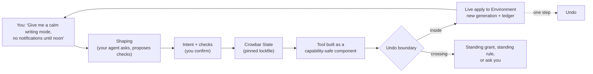
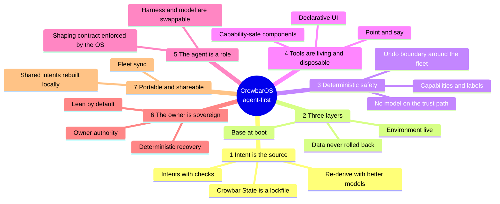
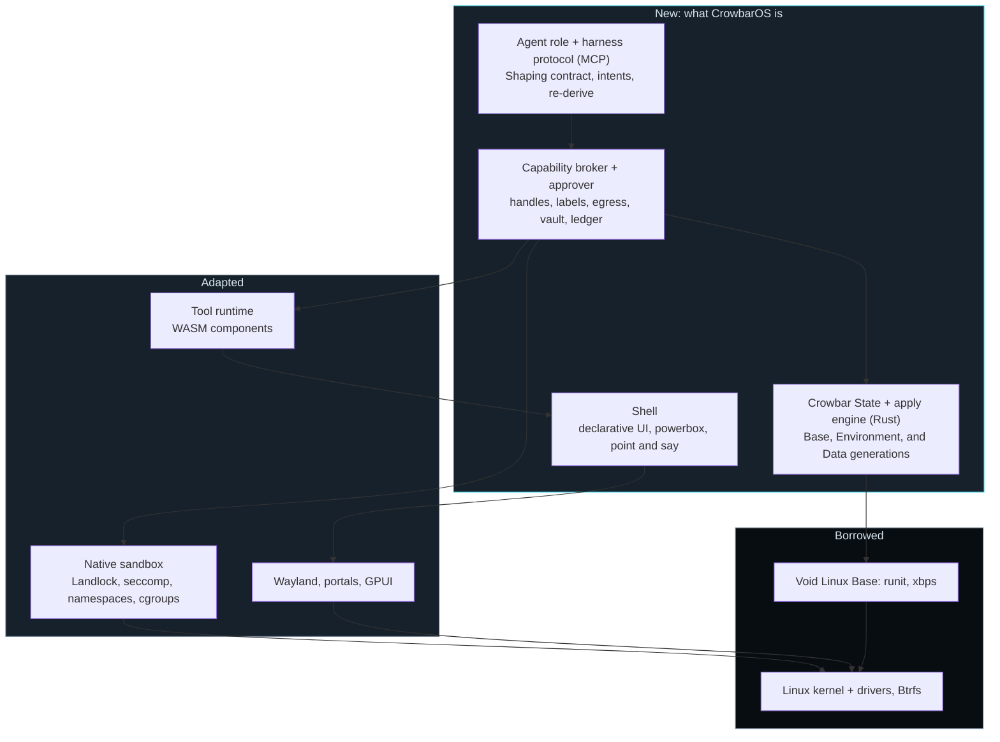
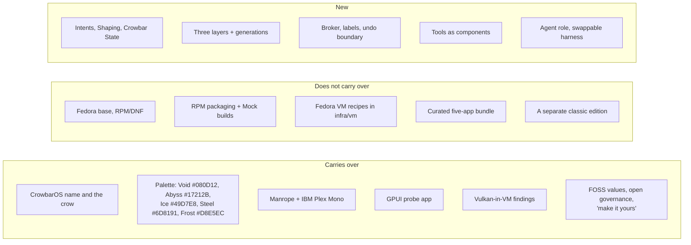
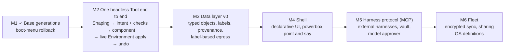

# CrowbarOS, agent-first: vision

**Status:** working direction agreed by Jim Martin and Jason Alexander, November 2026.
Revised November 14, 2026; decisions recorded in ADRs 0001–0006
([`docs/adr/`](../adr/)). Terms are defined in the [glossary](../../GLOSSARY.md).

This replaces the Fedora-based curated desktop in
[`community_foss_distro_plan.md`](../community_foss_distro_plan.md) as the plan of
record. That document stays in the repository for reference. The one-page
[pitch](pitch.html) is the short version of this document.

## Thesis

People increasingly **build bespoke software instead of installing it.** Today that
is mostly developers working with agents. The cost of a small tool that fits one
person exactly is falling fast, and within a few years most people will make
software this way.

When software is something you describe instead of something you install, the
operating system has a different job. A curated set of default apps matters less.
What matters is the **substrate**:

- a small, stable base that stays out of the way;
- an agent that helps you work out what you want, then builds and changes it
  **safely, without babysitting**;
- a way to keep, undo, carry, and share what you make.

So CrowbarOS ships the ability to make an OS, not a finished desktop. It starts
lean. Each person shapes it into their own OS with their agent, and it stays as
lean or grows as heavy as they choose.

The durable thing a person owns is **what they asked for**, not the code that came
out of it. Their **intents** are the source of their OS. Everything else is built
from them, and can be built again with a better model.

## First principles

### 1. Intent is the source

A person's OS starts from their **intents**. An intent is the person's words plus
a few **checks** they confirmed in plain language, for example "a notification from
Sam at 9:00 shows up; one from Slack at 9:00 waits until noon." The intents are a
curated, living set. When the person asks for something new, the agent merges it
into the existing intents as a diff the person can see. The ledger keeps the
history.

The **Crowbar State** is compiled from the intents. It is a lockfile: it pins
everything exactly, including a package repository snapshot for each Base
generation and a content hash for every Tool. **Generations** are builds of the
State.

Compiling happens only when an intent changes or the person asks to **re-derive**.
A better model never rewrites the OS silently. It can only offer a re-derive as a
diff, and the diff must pass the existing checks.

Decision: [ADR 0001](../adr/0001-intent-is-the-source.md).

### 2. Three layers that change on their own

| Layer | What it holds | How it changes |
| --- | --- | --- |
| **Base** | Kernel, drivers, core services. Built with `xbps`. | Rarely. A change is a Btrfs generation that takes effect at boot. This is what [Milestone 1](milestone-1.md) built. |
| **Environment** | Tools, services, desktop, automations. | Often. Almost all agent work happens here. Changes apply live and atomically, with instant undo. |
| **Data** | The person's own things. | Has its own history and undo window. Rolling back Base or Environment never rolls it back. |

`xbps` packages live only in Base. An agent request reaches Base only when the
person really needs to get close to the metal (a driver, a kernel feature, a core
service). That is a deliberate change that needs a reboot, and it is always
possible.

The Data layer holds **typed objects with provenance**, not only files. A small core
vocabulary (person, message, document, event, media, place, task) is part of Base
and changes slowly. Tools can add their own types and map them onto the core.
Files remain a view for software that expects them.

Decision: [ADR 0002](../adr/0002-three-layers.md).

### 3. Safety is deterministic

A person's **fleet** is the set of machines they own and have deliberately joined
together, linked by encrypted connections: a laptop, a DGX Spark at home, their own
cloud machine. Everything inside the fleet counts as local.

The **undo boundary** is the line between effects the system can fully undo and
effects it cannot. One rule decides every action:

- **Inside the boundary** (stays in the fleet, recorded, undoable): do it, record it
  in the ledger.
- **Crossing the boundary** (data leaving the fleet, acting as the person, money,
  credentials, hardware): allowed only by a standing grant, a standing rule, or the
  person's answer.

Security comes from deterministic parts:

- **Handles.** No ambient authority. A principal can reach only what it holds an
  unforgeable, scoped, expiring handle for. Only the capability broker issues them.
- **Labels.** Data carries a label that comes from where it came from (messages,
  health, and finance are private by default) and carries over to anything derived
  from it. The agent may make a label stricter. Only the person can
  **declassify**.
- **The broker owns all egress.** Everything leaving the fleet goes through the
  broker, which makes the outbound connection itself and checks labels. Calling a
  cloud model is egress like any other: a model provider is a standing grant scoped
  by label. Private data goes to a model running in the fleet unless the person
  allows otherwise.
- **Secrets live in a vault.** Agents, harnesses, models, and Tools never see secret
  values. API secrets appear as placeholders that the broker fills in only for the
  hosts they are tied to. Logins use an approved fill: the person approves in
  trusted system UI, and the OS fills the form. Existing password managers such as
  1Password or Bitwarden can be the vault's backend.

The **approver** is an isolated principal that checks one thing: is this concrete
action what the person asked for? It sees the intent and the action, never the
agent's argument. It is defense in depth, not the security boundary. **No model is
on the trust path**: State, apply, rollback, capabilities, and deterministic
approval all work with no model at all.

"Mode" controls only how much the person is told. The system **notifies only on
surprises**: something a background agent did that the person did not directly ask
for, anything blocked or refused, and requests to cross the boundary. Everything
else is in the ledger, and the agent can summarize it on request.

**Money crosses the boundary.** A budget for cloud model use is a standing grant
with a cap; reaching the cap asks. For spending, the person can give their agent an
**Allowance**: a standing amount of money in a separately funded account whose
limit the card issuer or wallet enforces. The agent spends inside it without asking,
and refilling it always asks. The worst case is bounded by what the person put in,
even if our software fails. Prior art:
[agent payments research](research/agent-payments-prior-art.md).

Decisions: [ADR 0003](../adr/0003-approver-is-not-the-security-boundary.md),
[ADR 0006](../adr/0006-broker-owns-all-egress.md). Prior art:
[agent credentials research](research/agent-credentials-prior-art.md).

### 4. Tools are living and disposable

The unit of generated software is a **Tool**: something derived from intents that
may have a UI, a schedule, both, or neither. A writing surface, a rule that holds
notifications until noon, and a photo sorter are all Tools.

- **Capability-safe by default.** Tools run as WASM components. A component can only
  use what it was handed, so its imports are its manifest, and "does this Tool only
  do what it says?" can be checked. Native code in a Linux sandbox (Landlock,
  seccomp, namespaces) with real Wayland windows stays available for legacy software
  and for raw performance or GPU work.
- **Declarative UI.** A Tool describes its UI, and a trusted shell draws it. Every
  Tool is themed and accessible, cannot spoof system UI, and can render on any
  machine in the fleet. The **powerbox** is part of the shell: choosing a file in
  system UI is the grant.
- **Living.** The person can point at any part of any Tool and say what to change:
  "sort this by date", "move this up here". That becomes an edit to the intent, and
  the checks keep earlier behavior intact. The agent can also run a design session
  with the person for larger UI work.
- **Local-first perception.** The OS does speech-to-text and resolves pointing on
  the fleet. The harness receives the words plus a structured reference ("Tool:
  Morning Pages, element: sort control, intent #12"), not a stream of pixels and
  audio. Pixels are sent only for native windows, and only when the person allows
  it. A visible indicator shows whenever the OS is listening or watching.

Decision: [ADR 0004](../adr/0004-capability-safe-tools.md).

### 5. The agent is a role

- The **Agent** is the person's own principal. The OS defines the role: it has an
  identity, a workspace, signs its ledger entries, and is the only principal that
  edits intents, and only with the person.
- A **harness** fills the role: the loop, tools, memory, and conversation around a
  model. CrowbarOS ships a default harness. An external harness, such as Grok Bot,
  can replace it.
- A **model** is what a harness thinks with: open weights on the person's own
  hardware, or a cloud model.

All authority stays with the role. A harness can only propose. External harnesses
connect through one open **harness protocol** built on MCP, and get no more trust
than the default harness. A harness that runs in someone else's cloud is outside the
fleet, so everything it sees is egress.

**Shaping** is the conversation in which the agent helps the person work out what
they want before it builds. Its depth scales with how unclear and how far-reaching
the request is. "Make the text bigger" just happens, with the checks shown
afterward. "Build me a budgeting system" gets real questions. The person can always
say "just build it" or "ask me more". The OS enforces the Shaping contract (every
intent has checks, and the person confirms them). The harness decides how the
conversation goes. A harness that tries to write an intent without confirmed checks
is refused, the same way an action without a handle is refused.

Other agents (background workers, agents that come with shared Tools) are principals
with handles. They can never edit intents. The person's Agent may propose a new
intent ("You've muted Slack every morning this week. Make it an intent?") but never
adopts one silently.

### 6. The owner is sovereign

- **Owner authority.** The owner can always take full control of their machine: a
  root shell, Base changes, any guard turned off. It is a deliberate step, it is
  recorded in the ledger, and it can never be held by an agent. CrowbarOS never locks
  out its owner.
- **Lean by default.** There is no minimum hardware spec. The system is sound with
  no model at all. A laptop alone runs the deterministic system and a small model.
  One capable inference machine in the fleet makes everything private and fast.
  Each person builds their OS as lean or as heavy as they want.
- **Recovery never depends on a model.** A new Base generation boots once on
  probation and becomes the default only after a health check passes; otherwise the
  machine falls back to the previous one on its own. Environment safe mode starts the
  last good Environment with the default harness and a local model, so a broken
  external harness can never lock the person out. A plain recovery screen lists
  recent changes in words ("Tuesday: added writing mode") with one-press undo.
- **One person per machine first.** The first version supports one owner per
  machine. Everything is tied to an explicit person, so several people on one
  machine stays possible later. Decision:
  [ADR 0005](../adr/0005-one-person-first.md).

### 7. Your OS is portable and shareable

- **One OS, many machines.** Base is per machine. The Environment is shared across
  the fleet, built from the same intents and State. Data syncs local-first and
  end-to-end encrypted: the person's machines hold the keys, and any relay or backup
  service sees only ciphertext.
- **Sharing.** An **OS definition** is what a person carries or shares: their
  intents, optionally with the pinned State. A shared definition is a suggestion,
  not an install. The recipient's agent goes through Shaping on each intent and
  builds it locally. Standing grants and standing rules never transfer. Data
  transfers only when explicitly included. Secrets are named, never included; the
  recipient fills them in.
- The **Community Gallery** shares intents, Tools, and whole OS definitions on
  those terms.

## The stack: invent the top, borrow the bottom

Nothing about agent-first needs a new Wi-Fi driver, and drivers are what kill new
operating systems. Isolation lives in the component runtime and the capability
broker, so the kernel is a replaceable driver host. We choose Linux for its drivers.

### Why Void Linux for Base

- **Small and plain.** The Milestone 1 lab root, `base-minimal` plus kernel, GRUB,
  Btrfs tools, SSH, and DHCP, is 114 packages. runit services are directories and
  symlinks, so the engine can diff and write them directly.
- **Easy to drive from a program.** `xbps` installs into any root
  (`xbps-install -r`), which is how the engine builds a new Base generation next to
  the running one.
- **No opinions to work around.** We build our own declarative layer and rollback
  instead of adopting NixOS's. That keeps the State small enough for an agent and a
  person to read, and keeps a Base rollback to a plain Btrfs snapshot plus a boot
  entry.

`xbps` builds Base only. Tools and the Environment do not use it.

### Microsoft's October 2026 agent announcements

Microsoft's announcements cover the same problem space. We evaluate them; we do not
copy them.

- **Microsoft Execution Containers (MXC)** are composable sandboxes for agent work,
  reported to run on Linux. MXC could be a backend for the native sandbox. Check its
  real specification and license first.
- MXC's stated principle, "an agent cannot be its own security authority", is the
  same as ours: policy lives outside the agent.

## What carries over and what changes

| Area | Fedora blueprint | Agent-first CrowbarOS |
| --- | --- | --- |
| Core idea | A calm, curated desktop for creative people | A lean substrate each person shapes into their own OS with their agent |
| Source of truth | Installed packages and settings | The person's intents; the Crowbar State is a pinned lockfile |
| Base | Fedora, non-Atomic, DNF | Void Linux (runit, xbps), Base layer only |
| Change model | Packages and settings, changed in place | Base at boot; Environment live; Data with its own history |
| Software | Five essentials plus Flathub | Tools built on request as capability-safe components; native software still possible |
| Security | SELinux, signed RPMs | Handles, labels, an undo boundary, broker-owned egress, a vault |
| AI | Neutral; no bundled AI | One edition, model-neutral; the person picks the harness and models, and the system is sound with none |
| Customizing | Settings panels, themes, Community Gallery | Say or point at what you want; share OS definitions |

Notes:

- **One edition.** The agent-first direction replaces the classic edition. AI
  neutrality is kept a different way: no model is on the trust path, the person
  chooses the harness and models, and intents and the State can be edited by hand.
- **GPUI** ([`apps/gpui-probe`](../../apps/gpui-probe/README.md)) is the candidate
  toolkit for the shell that draws Tool UI. Its RPM packaging does not carry over.
- **Vulkan in a VM:** the Intel VirtIO native-context findings in
  [`gpu-vulkan.md`](../development/gpu-vulkan.md) depend on the host and Mesa build,
  not on Fedora. They apply when the Void lab gains a graphical guest.
- **Compositor:** Hyprland was chosen for the Fedora plan. The agent-first compositor
  is still open. Wayland and portals are fixed requirements.

## Roadmap

Each milestone removes the riskiest assumption that is left.

| Milestone | Scope | Proves |
| --- | --- | --- |
| **M1** (done) | State → apply → Base generation → broken change → boot-menu rollback, in a Void VM on Btrfs. See [Milestone 1](milestone-1.md). | The Base layer |
| **M2** | One headless Tool end to end, such as "hold notifications until noon" or a file-sorting rule. Shaping → intent with checks → Tool as a component → live Environment apply → checks pass → one-step undo. A deterministic undo-boundary gate. The default harness with two models, one open-weight in the fleet and one cloud. Pinning in the State. | ADRs 0001, 0002, 0004, and the core of 0003; harness and model are swappable; no model on the trust path |
| **M3** | Data layer v0: typed objects, labels, provenance, its own history. Handles name objects. Label-based egress, including model calls. | Information-flow control |
| **M4** | Shell: declarative UI renderer, powerbox, point and say with local perception. Boot probation and recovery screen. | Living software |
| **M5** | Harness protocol on MCP, external harnesses such as Grok Bot, the vault and broker-owned egress, the model approver, the Allowance. | The Agent role, ADR 0006 |
| **M6** | Fleet: joining machines, local-first encrypted Data sync, sharing OS definitions rebuilt by the recipient. | "Your OS is portable and shareable" |

The model approver comes late on purpose. The deterministic gate has to stand on its
own first.

## Open questions

- **Writing checks.** How do people who are not developers confirm checks that are
  precise enough to catch a bad re-derive, without it feeling like writing tests?
- **Merging intents.** How does the agent show an intent diff that a person can
  judge at a glance, and what happens when two intents conflict?
- **Live apply.** What exactly is atomic for the Environment layer, and how does a
  Tool that is running get swapped without losing its state?
- **The declarative UI vocabulary.** How rich must it be before generated Tools stop
  needing native windows? Which parts can GPUI provide?
- **Core types.** What is the minimum core vocabulary for the Data layer, and how is
  it versioned when Tools depend on it?
- **Data newer than code.** When the Environment rolls back, how do Tools handle Data
  written by a newer version of themselves?
- **Approver model.** Which small model is good enough, and what fixed test set
  (including adversarial cases) proves it?
- **Allowance backing.** Which mechanism backs an Allowance first: a capped virtual
  card on a dedicated funding account, an agent wallet, or a payment protocol such as
  x402? See the [payments research](research/agent-payments-prior-art.md).
- **Revocation.** Linux cannot revoke an open file descriptor. Is "restart the
  sandbox" enough for native software?
- **Harness quality.** If an external harness Shapes badly but follows the contract,
  how does the person notice and compare?
- **Several people per machine.** Deferred by ADR 0005. Which parts of the design
  would need to change first when we take it on?
