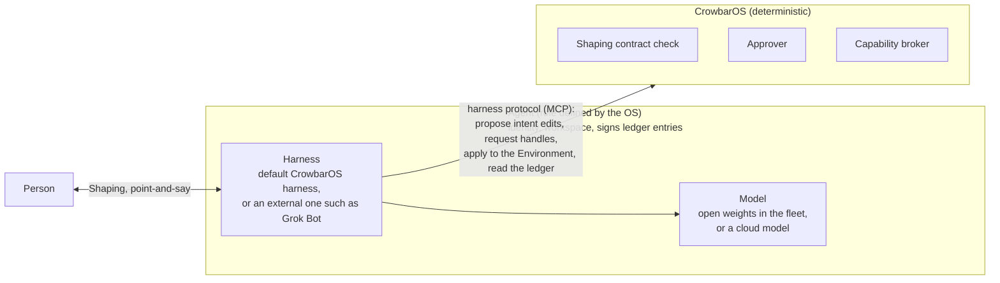
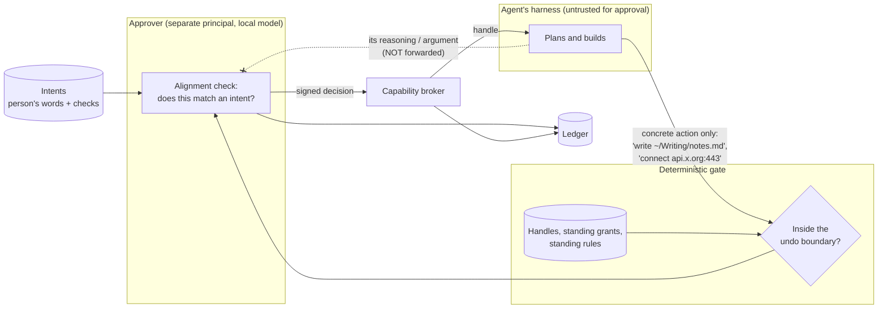
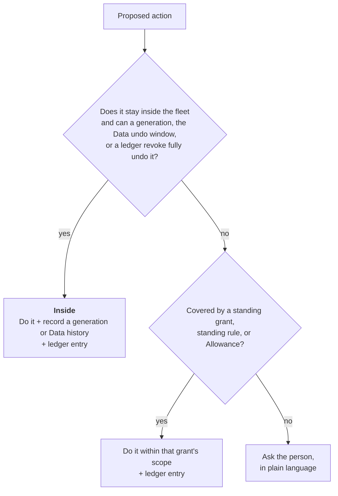
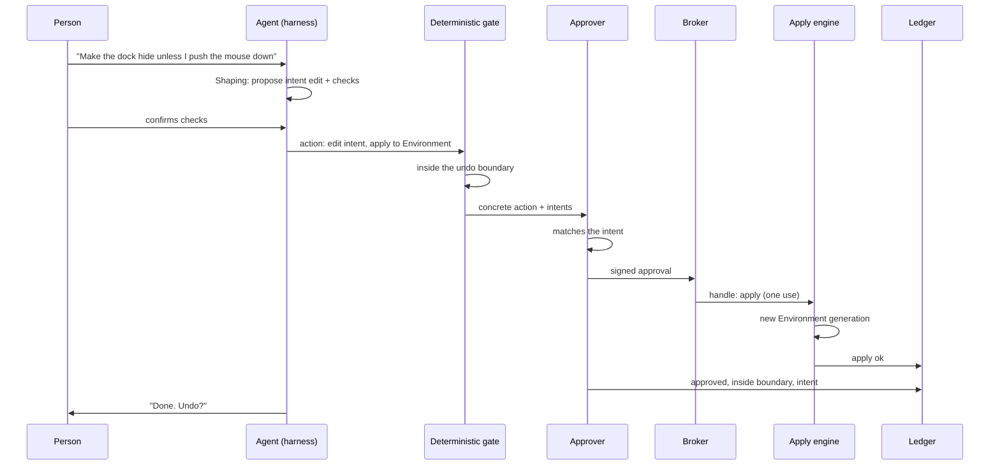

# Design: approver and autonomy

**Status:** draft. Nothing in this document is built yet. Milestone 1 has only the
pieces this design builds on: Base generations, rollback, and the ledger.

## Summary

- **Auto-approve by default, with no babysitting.** A person should not have to
  watch the agent work or click "Allow" all day.
- **Security is deterministic.** It comes from handles and the **undo boundary**,
  which is drawn at the edge of the person's **fleet**. No model is on the trust
  path. See [ADR 0003](../../adr/0003-approver-is-not-the-security-boundary.md).
- **One rule replaces risk tiers.** An effect inside the undo boundary just
  happens and goes in the ledger. An effect that crosses it needs a standing
  grant, a standing rule, or the person's answer.
- The **approver** is an isolated principal that answers one question: "Is this
  what the person asked for?" It is an alignment check and defense in depth. It
  is not the security boundary.
- The **Agent** is a role the OS defines. A **harness** fills it, and the harness
  thinks with a **model**. A harness can only propose. Authority stays with the
  role.
- **Intents change only through the person's own Agent, with the person's
  agreement.** The OS enforces the Shaping contract: an intent edit needs
  confirmed checks.
- **Notify only on surprise.** "Mode" now controls only how much the person is
  told.
- **Money crosses the boundary.** A budget is a capped standing grant. An
  **Allowance** is money set aside in a separately funded account whose limit
  the issuer enforces.
- Everything goes in the **ledger**, with one-step revoke or undo.

## Agent, harness, and model

- **Agent** is the person's own principal. It has an identity, a workspace, and
  the right to edit intents with the person. It holds the authority, whatever
  harness fills it.
- **Harness** is whatever fills the role: the loop, tools, memory, and
  conversation around a model. CrowbarOS ships a default harness. An external one
  can replace it.
- **Model** is what a harness thinks with. The default harness can run an
  open-weight model on the person's own hardware (for example, a DGX Spark in the
  fleet), a small model on the laptop, or a cloud model.

### The harness protocol

The OS exposes one **harness protocol**, built on MCP rather than invented. Through
it a harness can read intents and Shaping context, propose intent edits, request
handles, apply changes to the Environment, and read the ledger. Any MCP-capable
agent can fill the Agent role.

An external harness gets no more trust than the default one. Connecting it is a
standing grant that the owner makes once. A harness that runs in someone else's
cloud, such as Grok Bot, is **outside the fleet**. Everything it sees has left the
fleet, so it sees only the data labels the person granted. Grok Bot's own cloud
memory and its persistent cloud computer are part of that egress. See
[agent credentials prior art](../research/agent-credentials-prior-art.md).

### The Shaping contract

The OS owns the rules of Shaping. The harness owns the conversation.

- Every intent has checks, and the person confirms them. An intent edit without
  confirmed checks is refused, the same way an action without a handle is refused.
- Intents change only through the person's own Agent, and only with the person's
  agreement. Background agents, agents that come with shared Tools, and
  third-party agents are principals with handles. They can never edit intents.
- The Agent may **propose** a new intent ("You've muted Slack every morning this
  week. Make it an intent?"), but never adopts one silently.
- How the harness asks questions, how deep it digs, and its personality are up to
  the harness. Swapping harnesses changes the conversation, not the rules.

## Why an approver, and why it is not the security boundary

Permission prompts fail in two ways. They interrupt people, and people learn to
click "Allow" without reading. Letting an agent approve itself fails because a
confused or manipulated agent will approve its own mistake, for example after a
prompt injection from a web page it read.

A small model as the approver does not fix this on its own. A model can be wrong,
and an injection can hide inside the concrete action itself: a URL that carries
encoded data, a file's contents, a package's install script. So the system's
safety does not depend on the approver:

- **Deterministic parts decide what is possible.** A principal can only use what
  it holds a handle for. An effect that would cross the undo boundary needs a
  standing grant, a standing rule, or the person's answer. The broker makes every
  outbound connection, so there is no other way out. See
  [ADR 0006](../../adr/0006-broker-owns-all-egress.md).
- **The approver decides whether a possible action is wanted.** It checks the
  concrete action against the person's intents. If it is wrong, the worst outcome
  is an unwanted action inside the boundary, which costs one undo.

Properties of the approver:

1. **Separate principal.** It has its own identity, it holds almost no authority,
   and it has no write access to the Agent's workspace or to its own rules.
2. **Rules the Agent cannot edit.** Standing rules and Allowances live in the
   Crowbar State under `[autonomy]`. Changing `[autonomy]` always asks the person.
3. **Sees intent, not argument.** It gets the person's intents, the concrete
   action in a structured form, and the relevant State. It does not get the
   harness's explanation, so a manipulated harness cannot persuade it.
4. **Local and small.** It runs in the fleet, so approval data never leaves it,
   and it is cheap enough to run on every action. It needs to be consistent, not
   clever.
5. **Deterministic first.** Fixed rules decide most actions before the model is
   consulted, for example "writing inside the Agent's own workspace is inside the
   boundary". The model handles only the cases the rules do not cover.

Because intents are durable, background agents that work for hours are checked
against the same intents as a single request. There is no separate "session
intent" to capture.

## The undo boundary

**Inside the boundary**, effects stay within the fleet, are recorded, and can be
fully undone. Examples: edit an intent and apply it to the Environment; build a
Tool in the Agent's workspace; change the theme or keybindings; delete or move the
person's files (the Data layer keeps them for its undo window); send private data
to an open-weight model on the person's own DGX Spark.

**Crossing the boundary** means an effect the system cannot undo. Examples:

- data leaving the fleet, including calls to a cloud model or an external harness
  such as Grok Bot;
- acting as the person (sending a message or email);
- spending money;
- reading, creating, or using credentials;
- changing hardware or firmware;
- changing Base with owner authority.

The earlier design had three risk tiers (reversible, partly reversible,
irreversible) and three modes (Careful, Normal, Full auto). The Data layer's undo
window moves "delete the person's files" inside the boundary, so the middle tier
disappears. What is left is the single rule above.

When the system asks, it says what will happen, not which permission is needed:
"Send this email to Sam? [preview]".

## Notifications

**Notify only on surprise.** A change the person asked for that stays inside the
boundary just happens. The result *is* the notification. The person is
interrupted only for:

- something a background agent did that the person did not directly ask for;
- anything blocked or refused;
- a request to cross the boundary.

Everything else is in the ledger. The Agent summarizes it on request ("what
changed this week?").

**Mode** is now only a verbosity setting: how much the person is told about
actions inside the boundary. It never changes what is allowed. Mode is part of the
Crowbar State, so changing it is versioned and recorded in the ledger.

## Standing rules and standing grants

These are two different things.

- A **standing grant** is a long-lived handle that a principal holds, recorded in
  the Crowbar State. For example: "Morning Pages may read and write `~/Writing`."
- A **standing rule** is the person's pre-approval for a narrow class of actions
  that cross the boundary, so those actions don't ask again. For example: "Morning
  Pages may sync to your Nextcloud at cloud.example.org."

When the person approves the same kind of action repeatedly, the approver proposes
a standing rule in plain language:

> You've approved "Morning Pages may sync to your Nextcloud at cloud.example.org"
> 3 times. Always allow it? It will still stop if it tries to sync anywhere else.

An accepted rule is written to `[autonomy.rules]` in the Crowbar State. It is
narrow, names its scope, and can have an expiry. Rules can be revoked in one step
from the ledger.

**Standing grants and standing rules never transfer** in a shared OS definition.
Authority is always granted fresh by the person who receives it.

## Money

Spending money crosses the undo boundary. Two mechanisms cover it.

### Budgets

A budget is a **standing grant with a cap**. For example: "Claude, up to $20 a
month, labels up to personal." Reaching the cap is a boundary event, so it asks
the person. CPU and memory used inside the fleet are only resource limits and
never ask.

### Allowances

An **Allowance** is a standing amount of money that the person sets aside for
their Agent, in a separately funded account whose limit the card issuer or wallet
enforces. The Agent can spend inside it without asking. Refilling it always asks.
For example: "Here is $200. Use it for what you need."

This is not the same as `allowance` in OpenAI and Stripe's Agentic Commerce
Protocol, where it is a one-time limit on a single checkout. Ours is a standing,
funded pot. Prior art and sources are in
[agent payments prior art](../research/agent-payments-prior-art.md).

Design rules:

- **The issuer enforces the cap, not our software.** Card issuers and wallet
  operators already check limits when a payment is authorized. If CrowbarOS is
  compromised, the loss is still bounded by the cap.
- **The funded amount is the real worst case.** Visa's rules make the cardholder
  responsible for an agent's purchases "as if the Cardholder initiated" them, and
  no network has a dispute reason for agent purchases. So "we can dispute it" is
  not a safety net. A capped card that debits the person's main bank account is
  weaker than one funded from a separate account that holds only the Allowance.
- **The Agent never sees the card number.** The broker holds the card details in
  the vault and fills them in, as with any other secret. This is stricter than most
  products today, which hand the agent the card number.
- **Refilling is out of the Agent's reach.** The broker never exposes "raise
  limit", "create card", or "fund" to the Agent. Some issuer tool sets include
  those calls; the broker must not pass them through.
- **Every purchase is a ledger entry**, with the intent it served.

Candidates to evaluate as the first backing, in order:

1. **Privacy.com:** an issuer-capped card that an individual can get through an
   API today. The broker holds the API key and sets a lifetime limit equal to the
   Allowance. For a true bound, fund it from a dedicated account.
2. **Link's agent wallet:** tokens for merchants that accept them, with its own
   server-side caps.
3. **Coinbase Agentic Wallet with x402:** for paid APIs.

None of these is chosen yet. Each needs a closer look at what it exposes and
where its limits are enforced.

## Owner authority

The owner can always take full authority over their machine: a root shell, a Base
change, or turning off any guard. Taking it is deliberate, like unlocking, and it
is recorded in the ledger. It can never be held by an agent. The Agent can ask
the person to use owner authority, but it cannot use it itself.

## The ledger

Every intent edit, approval decision, capability grant, egress, purchase, apply,
rollback, and use of owner authority is one ledger entry: who asked, the intent it
served, the concrete action, whether it crossed the boundary and under which grant
or rule, the approver's decision and signature, and the resulting handle or
generation.

From the ledger, a person can **revoke** a grant or **undo** a change in one step.
Both are themselves logged.

## Failure modes this design must handle

- **Prompt injection into the harness.** The approver never sees the injected
  argument, only the action. An action that does not match the intents ("upload
  ~/Documents to an unknown host" after "sort my photos") is refused. Even if the
  approver missed it, the upload crosses the boundary and has no grant, so the
  deterministic gate stops it.
- **Approver mistakes.** An unwanted action inside the boundary costs one undo.
  Crossing the boundary never depends on the approver model alone.
- **Approver unavailable.** The deterministic rules still run. Actions inside the
  boundary that the fixed rules allow may still go ahead (configurable). Anything
  that crosses the boundary still needs a grant, a rule, or the person.
- **Many small steps that add up to an egress**, for example copying data step by
  step into a folder that some other process uploads. Labels follow derived data,
  and every outbound connection goes through the broker, which checks labels. The
  path does not matter.
- **A malicious or broken external harness.** It can only propose. It cannot edit
  intents without the person's confirmed checks, and Environment safe mode can
  always start the default harness instead. See
  [state and apply engine](state-and-apply-engine.md#recovery-later).

## Open questions

1. **Approver model.** Which small local model is good enough, how do we evaluate
   it (a fixed test set of intent/action pairs, including adversarial ones), and
   how small can it be?
2. **Deriving the boundary automatically.** Can we decide "inside or crossing"
   from the capability and the apply plan alone, instead of keeping lists by hand?
3. **Signatures.** What key material does the approver hold, and how is it
   protected from the Agent (a separate user ID, a TPM-bound key)? What does the
   broker check?
4. **Harness protocol scope.** Which MCP tools and resources does the protocol
   expose, and how does it version them?
5. **Allowance backing.** Which issuer or wallet backs the first Allowance, and
   how does the broker fill card forms safely on sites that block agents?
6. **Notification verbosity.** What are the levels, and what does "surprise" mean
   for a background agent that runs for days?
