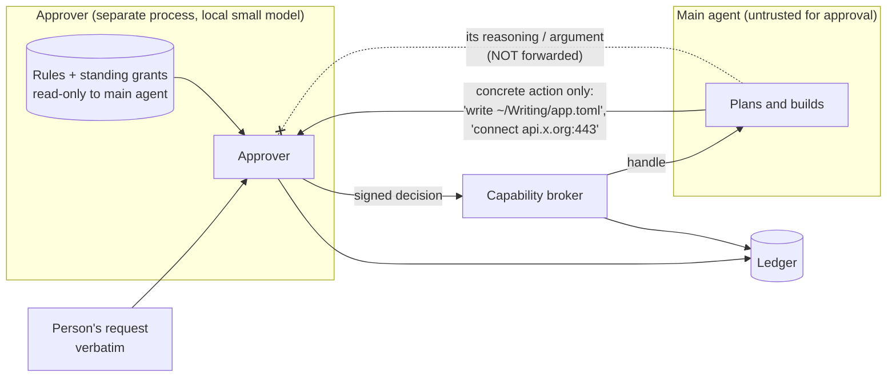
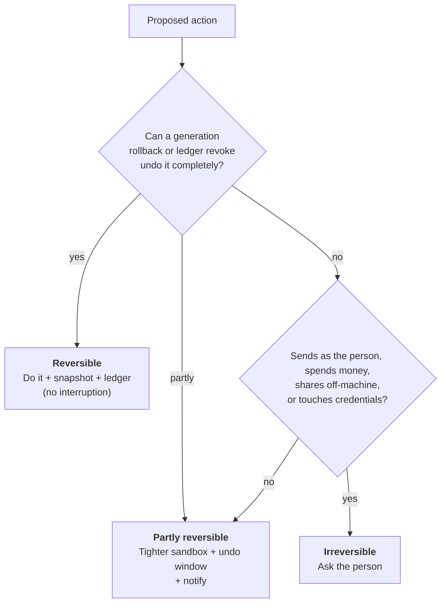
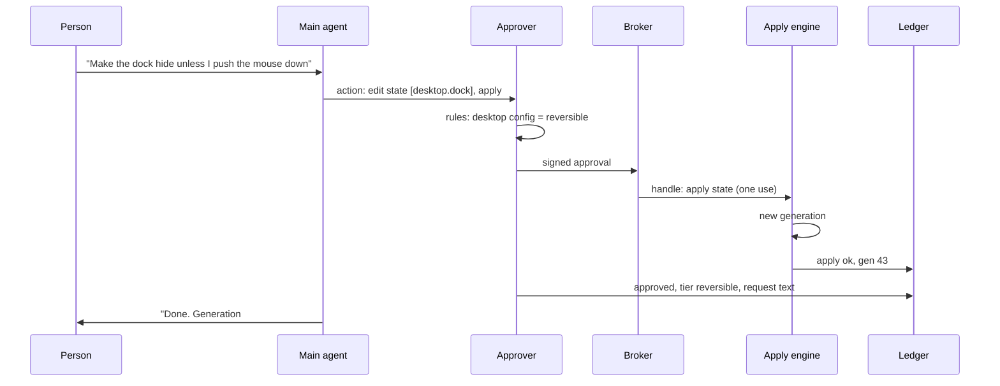

# Design: approver and autonomy

**Status:** draft. Nothing in this document is built yet. Milestone 1 has only the
pieces this design builds on: generations, rollback, and the ledger.

## Summary

- **Auto-approve by default, with no babysitting.** A person should not have to
  watch the agent work or click "Allow" all day.
- A small, **isolated, local approver agent** reviews every action the main agent
  wants to take. It is a separate process with rules the main agent cannot edit.
  It sees the **concrete action** and the **person's original request**, not the
  main agent's argument for the action.
- The **capability broker issues handles only with an approver signature.** Without
  a signature, nothing happens.
- Actions are sorted into **risk tiers** by how reversible they are. Reversible
  actions just happen. Irreversible ones ask the person.
- **Modes:** Careful, Normal, Full auto.
- Approvals that repeat become **proposed standing rules**, which the person accepts
  once.
- Everything goes in the **ledger**, with one-step revoke or rollback.

## Why an approver, and why isolated

Permission prompts fail in two ways. They interrupt people, and people learn to
click "Allow" without reading. Letting an agent approve itself fails because a
confused or manipulated agent will approve its own mistake, for example after a
prompt injection from a web page it read.

The approver sits between those two. It is cheap enough to run on every action,
and it is isolated in the ways that matter:

Isolation properties:

1. **Separate process and principal.** It has its own identity, it holds almost
   no authority, and it has no write access to the main agent's workspace or to its
   own rules.
2. **Rules the main agent cannot edit.** Rules and standing grants live in the
   Crowbar State under `[autonomy]`. A change to `[autonomy]` is itself always in
   the "ask the person" tier.
3. **Sees intent, not argument.** The approver gets the person's original
   request, the concrete action in a structured form, and the relevant state. It
   does not get the main agent's explanation. A manipulated main agent cannot
   persuade it.
4. **Local and small.** It runs on the machine, so approval data never leaves
   it, and it is cheap enough to run on every action. It does not need to be
   clever. It needs to be consistent.
5. **Deterministic first.** Fixed rules decide most actions before the model is
   consulted, for example "writing inside the agent's own workspace is always
   reversible". The model handles only the cases the rules do not cover.

## Risk tiers

The tier depends on **how reversible the action is**, not on how dangerous it
sounds.

| Tier | Examples | What happens |
| --- | --- | --- |
| **Reversible** | Edit the Crowbar State and apply it (a new generation); build an app in the agent's workspace; install a package; change theme or keybindings. | Approver signs, the action runs, a snapshot or generation is recorded, and a ledger entry is written. The person is not interrupted. |
| **Partly reversible** | Delete or move the person's files (recoverable from a snapshot, but other apps may already have seen the change); start a long-running background service; download from the network. | Runs in a tighter sandbox, with an **undo window** (for example, deletes go to a holding area for N days), and the person is **notified** after the fact. |
| **Irreversible** | Send a message or email as the person; spend money; share or upload data off the machine; read, create, or use credentials. | **Ask the person**, in plain language: "Send this email to Sam? [preview]". The prompt says what will happen, not which permission is needed. |

## Modes

| Mode | Reversible | Partly reversible | Irreversible |
| --- | --- | --- | --- |
| **Careful** | Notify | Ask | Ask |
| **Normal** (default) | Auto | Auto + notify + undo window | Ask |
| **Full auto** | Auto | Auto | Auto *only* for standing rules the person has accepted; otherwise ask |

Even in Full auto, nothing irreversible happens without a rule the person approved.
The mode is part of the Crowbar State, so changing it is versioned and appears in
the ledger.

## Standing rules

When the person approves the same kind of action repeatedly, the approver
proposes a rule in plain language:

> You've approved "Morning Pages may sync to your Nextcloud at cloud.example.org"
> 3 times. Always allow it? It will still stop if it tries to sync anywhere else.

An accepted rule is written to `[autonomy.rules]` in the Crowbar State, as a new
generation. It is narrow, names its scope, and can have an expiry. Rules can be
revoked in one step from the ledger.

## The ledger

Every approval decision, capability grant, apply, and rollback is one ledger entry:
who asked, the person's request, the concrete action, the tier, the approver's
decision and signature, and the resulting handle or generation.

From the ledger, a person can **revoke** a grant or **roll back** a generation in
one step. Both are themselves logged.

## Failure modes this design must handle

- **Prompt injection into the main agent.** The approver never sees the injected
  argument, only the action. An action that does not match the person's request
  ("upload ~/Documents to an unknown host" after "sort my photos") is refused or
  escalated.
- **Approver mistakes.** A reversible action approved by mistake costs one undo.
  Irreversible actions never depend on the approver model alone: they always need
  a person or a standing rule the person accepted.
- **Approver unavailable.** If the approver is not running, it fails closed for
  partly reversible and irreversible actions. Reversible actions may still be
  allowed by deterministic rules alone (configurable).
- **Many small reversible actions that add up to an irreversible one**, for
  example copying data step by step into a folder that some other process uploads.
  The broker tracks flows per principal. Any off-machine sharing is irreversible,
  whatever the path.

## Open questions

1. **Approver model.** Which small local model is good enough, how do we
   evaluate it (a fixed test set of intent/action pairs, including adversarial
   ones), and what is the hardware floor?
2. **Classifying reversibility automatically.** Can we derive the tier from the
   capability and the apply plan (for example, `affects_boot` changes, deletes
   outside a snapshot) instead of maintaining lists by hand?
3. **Intent capture.** The person's "original intent" is clear for one request.
   How do we represent it for long sessions and background agents that work
   for hours?
4. **Notification design.** How does "notify" avoid becoming the next permission
   prompt that people learn to ignore? Daily digest? Only on surprise?
5. **Signatures.** What key material does the approver hold, how is it protected
   from the main agent (a separate user ID? TPM?), and what does the broker check?
6. **Budgets.** Should spending (tokens, cloud model use, money) have per-agent
   budgets that also gate actions, and which tier is a budget increase?
7. **Multi-person machines.** Whose intent counts when two people share a machine
   or a family shares an OS definition?
8. **Shared rules.** Can standing rules be shared as part of an OS definition, or
   must every person accept them again?
