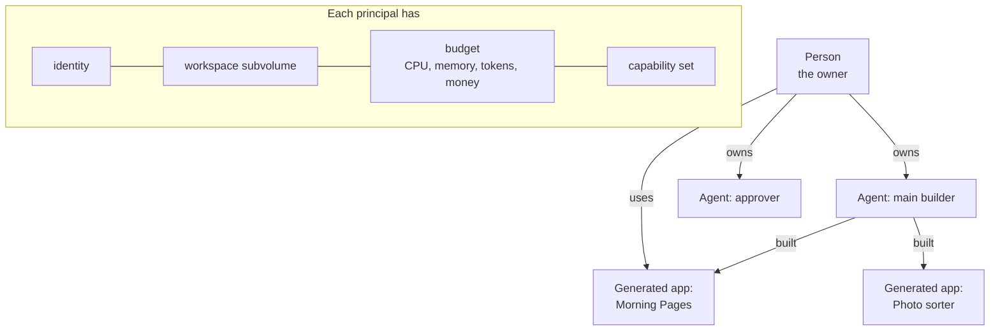
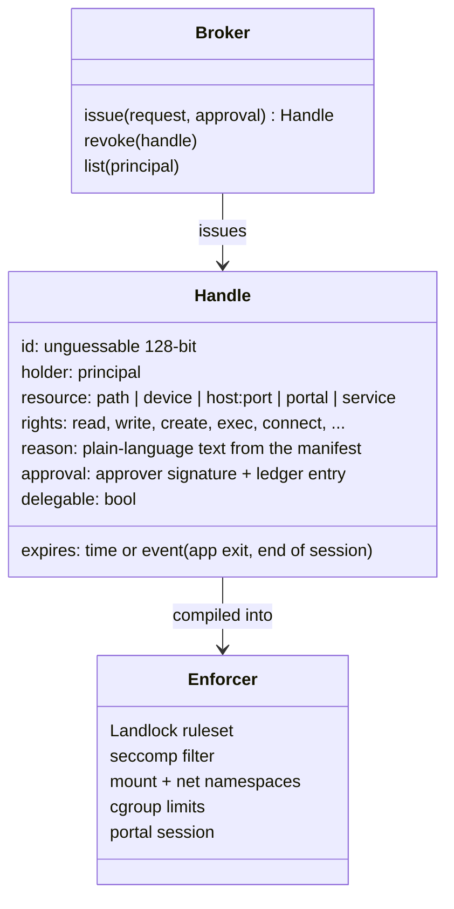
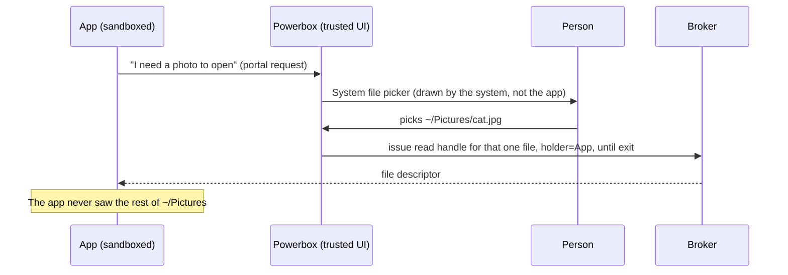

# Design: capability model

**Status:** draft. Nothing in this document is built yet. Milestone 1 runs
everything as root inside the VM.

## Summary

- **No ambient authority.** A process cannot reach a file, device, or network
  host just because its user can. It can reach only what it holds a handle for.
- **Handles are scoped, expiring, and unforgeable.** A handle names one resource,
  the operations allowed on it, a lifetime, and the principal that holds it. Only
  the **capability broker** creates handles.
- **Plain-language manifests.** Every generated app declares what it needs in
  words a person can check: "Read and write files in `~/Writing`. No network."
- **Powerbox, not prompts.** Wherever possible, the person picking something *is*
  the grant: choosing a file in the system file picker gives the app that one file.
  No separate "Allow access?" dialog appears.
- **Enforced by the kernel**, with standard Linux mechanisms (Landlock, seccomp,
  namespaces, cgroups) and Wayland plus portals for the desktop. The kernel stays
  swappable. A capability microkernel such as seL4 could enforce the same model
  later.
- **The broker only issues handles that carry an approver signature.**
  See [approver and autonomy](approver-and-autonomy.md).

## Principals

A principal is anything that can hold a handle.



- **Agents are first-class principals.** An agent has its own identity, workspace,
  budget, and capability set. The main agent cannot use the person's authority. It
  can only ask for handles, and each request goes through the approver.
- **Generated apps are principals** with an identity derived from their declaration
  in the Crowbar State. An app gets no authority from the agent that built it.
- **The approver is a principal with almost no authority.** It can read proposed
  actions and the person's original request, and it can sign or refuse. Nothing else.

## Handles



- **Unforgeable:** at the operating-system level a handle is a file descriptor or
  a kernel object passed over a Unix socket (`SCM_RIGHTS`), or a portal session.
  A process cannot make one from a string. The broker's table is the source of
  truth. The 128-bit id exists only for the ledger and for revocation.
- **Scoped:** one resource, explicit rights. "Network" is never a single right;
  it is "connect to `api.example.org:443`".
- **Expiring:** every handle has a lifetime. Short lifetimes are the default:
  until the app exits, or until the end of the session. Grants that last longer
  are written into the Crowbar State as **standing grants**, so they are versioned
  and visible.
- **Revocable in one step** from the ledger. For file descriptors, the broker
  revokes by tearing down the sandbox's mount namespace or Landlock domain and
  restarting the app with the reduced set. True in-place revocation of an open
  descriptor needs more work (see Open questions).

## Manifests

Each generated app ships a manifest in its Crowbar State entry:

```toml
[[app]]
name = "morning-pages"
summary = "A calm full-screen writing app."
source = "apps/morning-pages"      # built by the agent, versioned with the state

[[app.needs]]
what = "folder"
path = "~/Writing"
rights = ["read", "write", "create"]
why = "Saves your pages as Markdown files."

[[app.needs]]
what = "notifications"
rights = ["suppress"]
why = "Holds notifications until noon while you write."
```

The `why` text is what the person sees. The approver checks that the request
matches the original intent ("a writing mode") and that the `why` is accurate for
the code. The broker turns each `needs` entry into handles when the app starts.

## Powerbox



The person's choice is the authorization, so no separate prompt is needed. This
works with the xdg-desktop-portal FileChooser/Documents model that Flatpak apps
already use. We adopt the portal protocol instead of inventing one.

## Enforcement on Linux

| Mechanism | Used for |
| --- | --- |
| Mount, PID, IPC, UTS namespaces | An empty filesystem view. Only granted paths are bind-mounted in. |
| Network namespace + broker proxy | No network by default. Granted hosts go through a filtering proxy or a socket the broker supplies. |
| Landlock | A second filesystem check inside the namespace. It is stackable, needs no privileges, and also limits TCP bind and connect on recent kernels. |
| seccomp | Removes system calls apps do not need, for example `ptrace`, `mount`, and kernel module loading. |
| cgroups v2 | Budgets: CPU, memory, I/O, and process count per principal. |
| Wayland + portals | No reading other windows, keystrokes, or the screen. Screen capture, camera, and microphone go through portals, which are powerbox-style. |
| User IDs | One user ID per principal, as an extra boundary. They are not the main control. |

We should evaluate **Microsoft Execution Containers (MXC)**, which were announced
as composable sandboxes and are reported to be cross-platform, including Linux.
MXC might be an `Enforcer` backend. We have not assessed what it provides; check its
real specification before relying on it. Also compare existing Linux tools, such
as bubblewrap, as possible backends.

## Kernel swappability

The model is defined in terms of principals, handles, and the broker. It does not
depend on Linux mechanisms. On seL4, handles map onto real kernel capabilities, and
Landlock, seccomp, and namespaces become unnecessary. On Linux, the broker
approximates capabilities with the mechanisms above. The ledger, manifests,
approver, and powerbox stay the same.

## Open questions

1. **Revocation of open handles.** Linux has no general "revoke this fd". Do we
   accept "revoke means restart the sandbox", use FUSE or a proxy for revocable file
   access, or build on newer kernel features?
2. **Delegation.** Can an app pass a handle to another app? If yes, does the new
   holder need approval, and how does the ledger show the chain?
3. **The agent's own sandbox.** The main agent writes and runs code. Which handles
   does it hold while building, and what does a build sandbox look like
   (network to package registries, its workspace, nothing else)?
4. **Legacy apps.** Existing software installed with `xbps` expects ambient
   authority. Do we run it unconfined (the classic edition), in a broad sandbox, or
   only through Flatpak with portals?
5. **Network granularity.** Is a host:port allowlist enough, or do we need
   per-request policy (for example, "can upload only to this one bucket")?
6. **Manifest honesty.** How do we check that an app's code does only what its
   `why` says? The approver can read the code, but a static guarantee may need
   language-level capabilities (for example, WASI components for some generated
   apps).
7. **MXC.** Does MXC exist on Linux in a form we can use, under what license, and
   does it fit the broker model or replace part of it?
8. **Usability of standing grants.** How do we show someone "what can this app
   do?" in one screen, and make "less" a single click?
