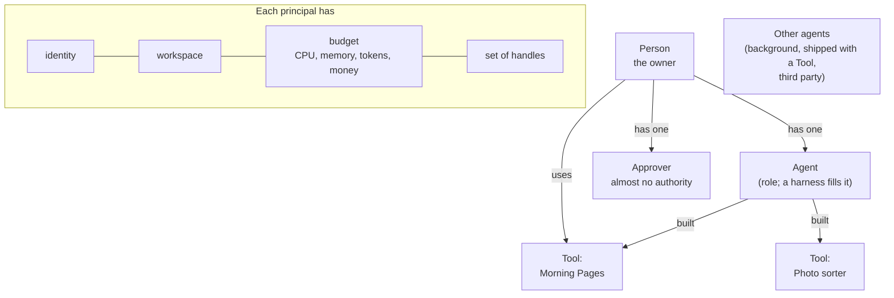
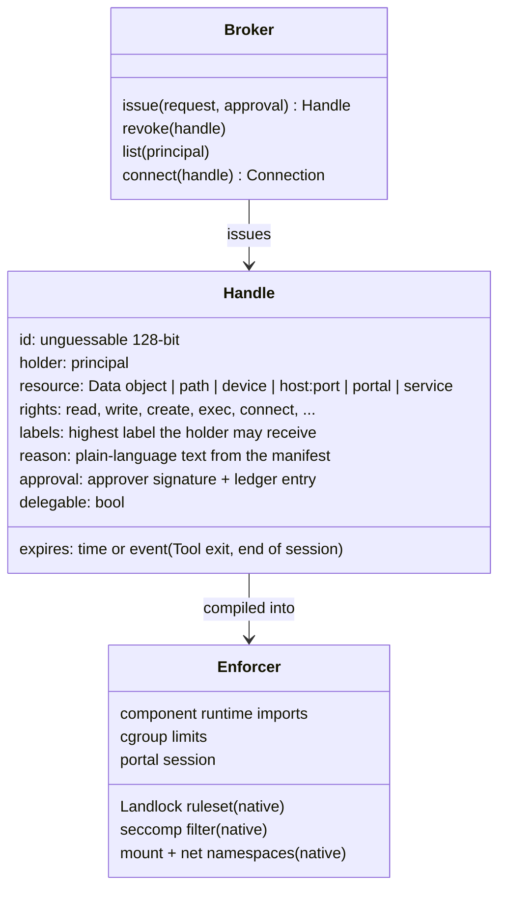
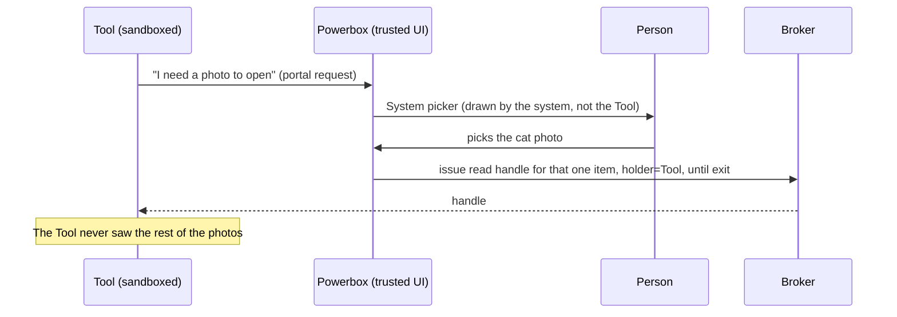
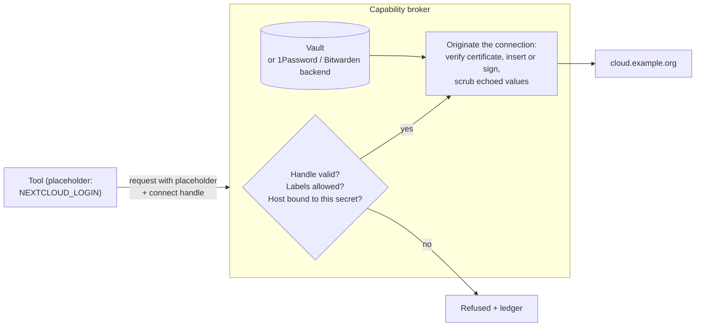

# Design: capability model

**Status:** draft. Nothing in this document is built yet. Milestone 1 runs
everything as root inside the VM.

## Summary

- **No ambient authority.** A process cannot reach a file, device, network host,
  or piece of Data just because its user can. It can reach only what it holds a
  handle for. The exception is **owner authority**, which the owner takes
  deliberately and which is recorded in the ledger.
- **Handles are scoped, expiring, and unforgeable.** A handle names one resource,
  the operations allowed on it, a lifetime, and the principal that holds it. Only
  the **capability broker** creates handles.
- **Tools are capability-safe components by default.** A Tool's imports are its
  manifest: it cannot reach anything it was not handed. Native code in a Linux
  sandbox is the escape hatch. See
  [ADR 0004](../../adr/0004-capability-safe-tools.md).
- **Tools describe their UI; the trusted shell draws it.** Raw Wayland surfaces
  are only for native code.
- **Powerbox, not prompts.** Wherever possible, the person picking something *is*
  the grant.
- **Labels follow the data.** Every piece of Data carries a label. Anything
  derived from it inherits the label. Only the person can declassify.
- **The broker makes every outbound connection and holds every secret.** See
  [ADR 0006](../../adr/0006-broker-owns-all-egress.md).
- **The broker only issues handles that carry an approver signature.** See
  [approver and autonomy](approver-and-autonomy.md).

## Principals

A principal is anything that can hold authority.



- **The Agent** is the person's own principal. A harness fills the role, but the
  harness only proposes actions. Every handle the Agent holds came through the
  approver and the broker. The Agent cannot use the person's authority, and it can
  never hold owner authority.
- **Tools are principals** with an identity derived from their declaration in the
  Crowbar State. A Tool gets no authority from the Agent that built it.
- **Other agents** (background workers, agents that come with shared Tools,
  third-party agents) are principals with their own handles. They can never edit
  intents.
- **The approver is a principal with almost no authority.** It can read proposed
  actions and the person's intents, and it can sign or refuse. Nothing else.

Every principal and handle is tied to an explicit person. The first version
supports one person per machine, but nothing here assumes there is only one. See
[ADR 0005](../../adr/0005-one-person-first.md).

## Handles



- **Unforgeable:** for a component, a handle is an import the runtime links in
  when the Tool starts. For native code, it is a file descriptor or a kernel object
  passed over a Unix socket (`SCM_RIGHTS`), or a portal session. A process cannot
  make one from a string. The broker's table is the source of truth. The 128-bit
  id exists only for the ledger and for revocation.
- **Scoped:** one resource, explicit rights. "Network" is never a single right;
  it is "connect to `api.example.org:443`". A handle can name a **Data object or a
  set of them** ("this person's photos"), not only a path.
- **Expiring:** every handle has a lifetime. Short lifetimes are the default:
  until the Tool exits, or until the end of the session. Grants that last longer
  are written into the Crowbar State as **standing grants**, so they are versioned
  and visible.
- **Revocable in one step** from the ledger. For a component, the runtime drops
  the import. For native file descriptors, the broker tears down the sandbox's
  mount namespace or Landlock domain and restarts the Tool with the reduced set.

## Tools

A **Tool** is a piece of generated software derived from intents. It may have a
UI, a schedule, both, or neither. A writing surface, a rule that holds
notifications until noon, and a photo sorter are all Tools.

### Capability-safe components by default

Generated Tools run as **WASM components**, not as native Linux processes. In a
component, what it imports is all it can reach. So:

- **The imports are the manifest.** "Does this Tool only do what its manifest
  says?" becomes a check the system can make, not a judgment a model has to make.
- Tools are portable across machines in the fleet and across kernels.
- Tools are cheap to build, test, swap, and throw away.

**Native code is the escape hatch**, for legacy apps and for work that needs raw
performance or the GPU. It runs in a Linux sandbox (see
[Enforcement on Linux](#enforcement-on-linux)) and lives in the Environment as a
sandboxed bundle, never as a package installed into Base.

### Manifests

Each Tool has a manifest in its Crowbar State entry:

```toml
[[tool]]
name = "morning-pages"
summary = "A calm full-screen writing surface."
source = "tools/morning-pages"     # built by the Agent, versioned with the state
hash = "sha256:…"                  # pinned content hash (see the state design)
intent = "writing-mode"            # the intent this Tool serves

[[tool.needs]]
what = "data"
type = "document"
scope = "~/Writing"
rights = ["read", "write", "create"]
why = "Saves your pages as Markdown files."

[[tool.needs]]
what = "notifications"
rights = ["suppress"]
why = "Holds notifications until noon while you write."
```

The `why` text is what the person sees. For a component, the system checks that
the Tool's imports match its `needs` exactly. The approver checks that the
`needs` match the intent ("a writing mode"). The broker turns each `needs` entry
into handles when the Tool starts.

### Declarative UI

A component Tool does not draw its own pixels. It emits a **UI description**, and
the trusted shell renders it (with GPUI underneath). This means:

- Every Tool is themed and accessible automatically.
- A Tool cannot spoof system UI, so the powerbox stays trustworthy.
- The Agent can read and change any Tool's UI.
- The same Tool can render on any device the person owns.

Native code still gets real Wayland windows.

### Point-and-say

Because the shell draws every component Tool's UI, the person can point at any
element and say what to change ("sort this list by date", "move this up here").
That becomes a proposed edit to the Tool's intent, and the intent's checks keep
the earlier behavior intact.

**Perception belongs to the OS and runs locally.** Speech-to-text and pointing are
resolved inside the fleet. The harness receives the transcript plus **structured
references** ("Tool: Morning Pages, element: the sort control, intent: writing
mode"), not screenshots or audio. Pixels go to the harness only for native
windows, and only when the person allows it. A **visible indicator** is always
shown while the OS is listening or watching.

## Powerbox



The person's choice is the authorization, so no separate prompt is needed. For
native code this uses the xdg-desktop-portal FileChooser/Documents model that
Flatpak apps already use. We adopt the portal protocol instead of inventing one.

## Data, labels, and types

The Data layer holds the person's own things as **typed objects with provenance**.
Files remain a view onto it for native code.

### Labels

- A **label** says how private a piece of Data is. It comes from **where the data
  came from and what type it is**: messages, health, finance, and anything near
  credentials are private by default; something the person wrote is personal;
  downloaded public content is public.
- **Derived data inherits labels.** Anything computed from private data is
  private. Labels follow the data through Tools, so the broker can check them at
  egress.
- The Agent may **raise** a label without asking. **Lowering** one is
  **declassifying**. It lets data cross the undo boundary, so only the person can
  do it.

### Types

- **Core shared types** (person, message, document, event, media, place, task) are
  part of Base and change slowly, so Tools can work together without coordinating.
- **Tool-local types** belong to one Tool and can be thrown away with it. The Agent
  can map them onto core types.

## Egress and secrets

**The broker makes every outbound connection.** Tools and harnesses never open
their own. That is the only way data leaves the fleet, so every egress is checked
against handles, labels, and the undo boundary, and recorded in the ledger.



### Model calls are egress

Calling a cloud model, or using an external harness that runs in someone else's
cloud, sends data out of the fleet. A model provider is a **standing grant scoped
by label**. For example: "the cloud model may see Environment config and code,
but not Data labeled private." Private data goes to a model running in the fleet,
such as open weights on the person's DGX Spark, unless the person allows
otherwise. That makes hybrid model routing a security property, not only a cost
choice.

### Secrets

Secret values live in the **vault**, which the broker holds. Existing password
managers such as 1Password or Bitwarden can plug in as its backend. Agents,
harnesses, models, and Tools never see the values. Prior art and sources are in
[agent credentials prior art](../research/agent-credentials-prior-art.md).

- **API secrets:** a Tool holds only a placeholder. The broker inserts the real
  value only for the hosts the secret is tied to, and refuses anything else.
- **Interactive logins:** an approved fill. The person approves in trusted system
  UI, the OS fills and submits the form, and the Agent learns only that it
  succeeded.
- **No environment-variable mode.** Real secret values never go into environment
  variables, because code an agent wrote can read them.

Header-rewriting proxies, which most products use today, have known holes. The
broker closes them by making the connection itself:

| Hole in header-rewriting proxies | How the broker closes it |
| --- | --- |
| Request signing (AWS SigV4) breaks | The broker does the signing |
| A service echoes the secret back in its response | The broker scrubs the value from responses |
| Host rules trust DNS | The broker verifies the server's certificate |
| WebSocket frames after the handshake are not rewritten | The broker owns the whole connection |

One hole stays open: a token that a Tool fetches *using* a brokered secret comes
back as an ordinary value. See Open questions.

### Hardware-bound keys

Keys that matter are bound to the TPM or secure enclave where the machine has one,
with protected software keys as the fallback:

- each machine's membership in the fleet,
- the approver's signing key,
- the key that records owner authority in the ledger, and
- each Agent's identity.

We track the FIDO Alliance's agent working group and will align when it
publishes.

## Enforcement on Linux

Component Tools are confined by the component runtime. These mechanisms confine
native code, and they confine the runtime itself as a second layer.

| Mechanism | Used for |
| --- | --- |
| Mount, PID, IPC, UTS namespaces | An empty filesystem view. Only granted paths are bind-mounted in. |
| Network namespace + broker | No network by default. All egress goes through the broker. |
| Landlock | A second filesystem check inside the namespace. It is stackable, needs no privileges, and also limits TCP bind and connect on recent kernels. |
| seccomp | Removes system calls Tools do not need, for example `ptrace`, `mount`, and kernel module loading. |
| cgroups v2 | Budgets: CPU, memory, I/O, and process count per principal. |
| Wayland + portals | No reading other windows, keystrokes, or the screen. Screen capture, camera, and microphone go through portals, which are powerbox-style. |
| User IDs | One user ID per principal, as an extra boundary. They are not the main control. |

We should evaluate **Microsoft Execution Containers (MXC)**, which became generally
available in October 2026 as composable sandboxes for agents. MXC might be a
backend for the native sandbox. Check its real specification and license before
relying on it. Also compare existing Linux tools, such as bubblewrap.

## Where isolation lives

Isolation lives in the **component runtime and the capability broker**, not in the
kernel. The kernel's job is to host drivers and run the Base. That makes the kernel
a replaceable driver host. We choose Linux for its drivers.

## Open questions

1. **Revocation of open native handles.** Linux has no general "revoke this fd".
   Do we accept "revoke means restart the sandbox", use FUSE or a proxy for
   revocable file access, or build on newer kernel features?
2. **Delegation.** Can a Tool pass a handle to another Tool? If yes, does the new
   holder need approval, and how does the ledger show the chain?
3. **The Agent's build sandbox.** The Agent writes and runs code. Which handles
   does it hold while building (its workspace, package registries through the
   broker), and how are build tools confined?
4. **Component UI and GPU.** How expressive is the declarative UI, and what is the
   path for a component Tool that needs the GPU without becoming native?
5. **Network granularity.** Is a host:port binding enough, or do we need
   per-request policy (for example, "can upload only to this one bucket")?
6. **Tokens derived from secrets.** A token that a Tool fetches with a brokered
   secret comes back unredacted. Should the broker capture such tokens into the
   vault automatically?
7. **Label inference.** How reliably can labels be assigned from source and type,
   and how does the person correct a wrong label?
8. **MXC.** Does MXC exist on Linux in a form we can use, under what license, and
   does it fit the broker model?
9. **Usability of standing grants.** How do we show someone "what can this Tool
   do?" on one screen, and make "less" a single click?
