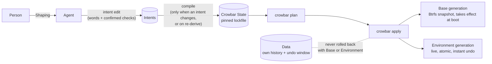
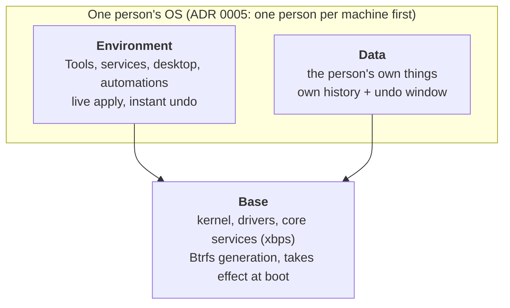
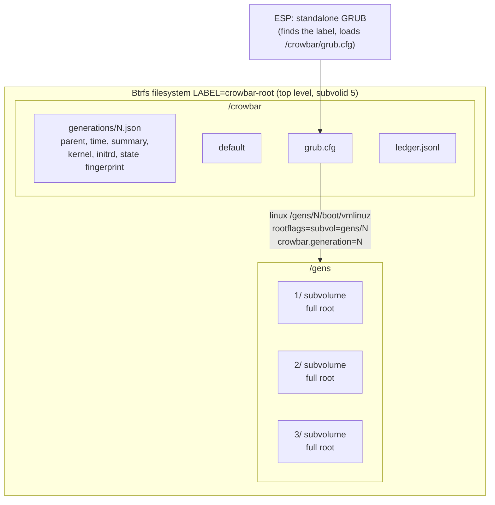
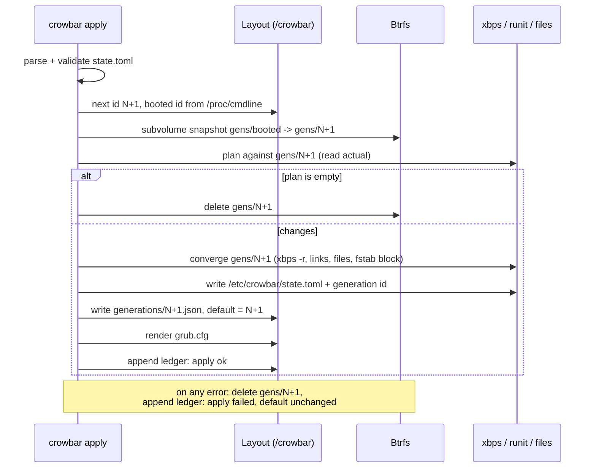
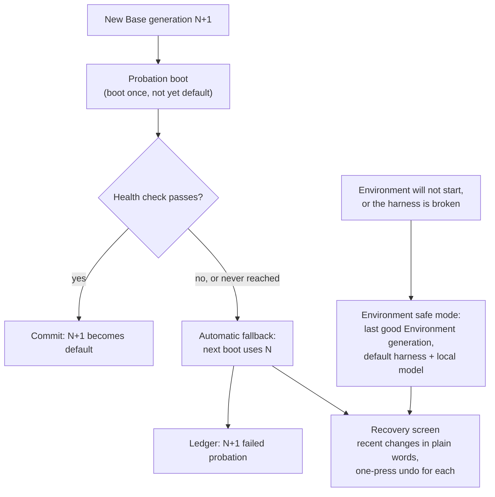

# Design: intents, the Crowbar State, and the apply engine

**Status:** draft. Milestone 1 implements the Base layer of this design in
[`agent-first/`](../../../agent-first/) (crates `crowbar-state` and
`crowbar-apply`). Sections marked **Later** are not built yet. Intents, the
Environment and Data layers, pinning, and recovery are all **Later**.

## Summary

- **Intents are the source.** An intent is the person's words plus the checks
  they confirmed. The **Crowbar State** is compiled from the intents and pins the
  result exactly. It is a lockfile for the OS. See
  [ADR 0001](../../adr/0001-intent-is-the-source.md).
- A person's OS has **three layers**: Base, Environment, and Data. Each one
  changes and rolls back on its own. See
  [ADR 0002](../../adr/0002-three-layers.md).
- The **apply engine** (Rust, the `crowbar` command) is the only code path that
  changes the system. Every apply records a **generation** of the layer it
  changed.
- **Base** generations are Btrfs snapshots that you choose in the boot menu.
  This is what Milestone 1 built.
- **Environment** generations apply live and atomically, with instant undo and
  no reboot. **Later.**
- **Data** is never rolled back with the other two layers. It has its own
  history and undo window. **Later.**
- **Recovery never needs a model.** Probation boot, automatic fallback,
  Environment safe mode, and a plain recovery screen are all deterministic.
  **Later.**



## Intents

An intent is a durable statement of what the person wants: their words plus the
**checks** they confirmed. A check is a concrete, plain-language example that any
build from the intent must satisfy. For example: "a notification from Sam at 9:00
shows up; one from Slack at 9:00 waits until noon."

- **Intents come from Shaping.** The person's Agent helps them work out what they
  want before anything is built. The depth of Shaping scales with how unclear
  and how far-reaching the request is. "Make the text bigger" applies at once and
  shows the checks it inferred afterward. "Build me a budgeting system" gets a
  real design conversation.
- **The intents are a curated, current set, not a log of requests.** When the
  person says "…except from Sam", the Agent merges that into the existing intent
  and shows the diff. The ledger keeps the history. Software stays living: the
  person can adjust any intent later, including by pointing at a Tool and saying
  what to change.
- **Only the person's own Agent edits intents, and only with the person's
  agreement.** Other agents can never edit them. The OS enforces this. An intent
  edit without confirmed checks is refused. See
  [approver and autonomy](approver-and-autonomy.md).
- **No secret values appear in intents.** An intent names the secret it needs
  ("a Nextcloud login"). The value lives in the vault. See
  [ADR 0006](../../adr/0006-broker-owns-all-egress.md).

### Compiling and re-deriving

Compiling intents into the Crowbar State is not deterministic, because a model
does it. So it happens only when:

1. an intent changes, or
2. the person explicitly asks to **re-derive**, for example after moving to a
   better model.

A re-derive is shown to the person as a diff of the Crowbar State. It is accepted
only if every check still passes. A better model never rewrites the OS silently.

### Sharing

An OS definition is the person's intents, optionally with the Crowbar State that
pins them exactly. By default, a shared OS definition is **intents with checks**.
The recipient's Agent goes through Shaping on each one and builds it locally, so
no compiled code from someone else runs unless the recipient chooses the pinned
State. Standing grants, standing rules, and Data never transfer.

## The Crowbar State document

TOML, because people can read and edit it and it diffs well. One file,
`/etc/crowbar/state.toml`, is stored inside each Base generation, so every
generation records the State that built it.

In Milestone 1 a person writes the State by hand. **Later**, the Agent compiles it
from intents, and a person can still read and edit it.

Milestone 1 schema (version 1). It covers the Base layer only:

```toml
version = 1                      # schema version; the engine rejects others

[system]
hostname = "crowbar-lab"

[packages]
install = ["jq", "htop"]         # packages the state owns (see ownership)

[services]
enabled = ["dhcpcd", "sshd", "udevd", "agetty-tty1", "agetty-ttyS0"]  # exact set

[[file]]                         # whole managed files
path = "/etc/motd"
content = "..."
mode = "0644"                    # optional, default 0644

[[mount]]                        # rendered into a marked block of /etc/fstab
device = "LABEL=crowbar-data"
target = "/srv/data"
fstype = "ext4"
options = "defaults"             # optional
```

**Later** sections, in rough order:

- `[pin]`: the package repository snapshot for the Base generation (see
  [Pinning](#pinning-later)).
- `[[tool]]`: Tools, each with its source, content hash, and manifest. See the
  [capability model](capability-model.md).
- `[capabilities]`: standing grants.
- `[agent]`: the harness, models, and which data labels each model may see.
- `[autonomy]`: standing rules, Allowances, and notification verbosity. See
  [approver and autonomy](approver-and-autonomy.md).
- `[desktop]`: shell, theme, and keybindings.

Every section that describes a person's OS is tied to an explicit person, never
to "the" user. The first version supports one person per machine, but the State
must not make more people impossible later. See
[ADR 0005](../../adr/0005-one-person-first.md).

**Secrets are never in the State.** It refers to them by name only.

### Validation

`State::from_toml_str` parses and validates before anything else runs:

- Unknown fields are errors (`deny_unknown_fields`). A typo fails; it is not
  silently ignored.
- Names are checked (hostname, xbps package names, runit service names).
- File paths must be clean absolute paths. Protected locations are rejected:
  `/proc`, `/sys`, `/dev`, `/run`, `/boot`, `/etc/crowbar`, and files that another
  section owns (`/etc/fstab`, `/etc/hostname`).
- A mount target cannot be `/`, and mount fields cannot contain spaces.

### Ownership rules

The engine must never remove something it does not own. That is how a declarative
layer avoids destroying a system it only partly describes.

| Section | What the state owns |
| --- | --- |
| `system.hostname` | `/etc/hostname` |
| `packages.install` | Only the listed packages. A package is removed only if a *previous* state listed it and the new state does not. Base-image packages are never removed by accident. |
| `services.enabled` | The **exact** set of links in `/etc/runit/runsvdir/default`. |
| `[[file]]` | Each declared path. A file is deleted only if the previous state declared it. |
| `[[mount]]` | A marked block in `/etc/fstab`. Base lines outside the block are untouched. |

### Pinning (Later)

The State is a lockfile, so it must describe a system exactly. Today `xbps`
installs whatever is current in the repository, so Milestone 1 is not yet
reproducible. The State will pin:

- **a package repository snapshot for each Base generation**, so rebuilding
  generation *N* fetches the same package versions, and
- **a content hash for every Tool**, so an exact copy of an OS runs the same code.

Without pinning, "an exact copy of my OS" and safe re-derive diffs do not hold.

## Three layers



| Layer | What it holds | How a change applies | How undo works | Built |
| --- | --- | --- | --- | --- |
| **Base** | Kernel, drivers, core services, Void packages | A new Btrfs generation, built off to the side; it takes effect at the next boot | Boot an older generation, or `crowbar rollback` | Milestone 1 |
| **Environment** | Tools, services, desktop, automations | Live and atomic, as a new Environment generation | Instant, one step | Later |
| **Data** | The person's own things | The person and their Tools change it directly | Its own history and undo window; never rolled back with Base or Environment | Later |

### Base

- **xbps belongs to Base only.** Agent requests change the Environment. A request
  reaches Base only when the person really needs to get close to the metal: a
  driver, a kernel feature, or a core service. That is a deliberate change made
  with owner authority, and it needs a reboot.
- Legacy native apps are not installed into Base. They live in the Environment as
  sandboxed bundles.
- Base is per machine, because it depends on the hardware. Each machine in a
  fleet has its own Base.

### Environment (Later)

Almost all agent work happens here. Changes apply live and atomically, as a new
Environment generation, with instant undo. Tools are capability-safe components
by default ([ADR 0004](../../adr/0004-capability-safe-tools.md)), so swapping one
does not touch Base. The Environment is compiled from the same intents and State
on every machine in the fleet, with per-machine overrides.

### Data (Later)

Data is the person's own things. Rolling back Base or Environment never rolls it
back. It has its own history and an undo window, for example deletes go to a
holding area for some number of days. Data is typed and carries labels and
provenance. See the [capability model](capability-model.md). It syncs
local-first, with end-to-end encryption, across the machines in the fleet.

Milestone 1 does not separate Data yet. Everything is inside the Base generation,
so a rollback also rolls back `/var` and `/home`. Separating them is part of the
Data layer work.

## Base generations (Milestone 1)



Design choices:

- **A generation is a full writable subvolume.** Booting generation *N* means
  `rootflags=subvol=gens/N`. There is no overlay and no union filesystem, so a
  generation is an ordinary Void root that you can inspect, `chroot` into, or copy.
- **Each generation is built off to the side.** `apply` snapshots the *booted*
  generation to `gens/N+1` and converges the snapshot (`xbps-install -r`, file
  writes, runit links). The running system is never changed in place. The new
  generation takes effect at the next boot. A failed build deletes the half-built
  subvolume and leaves the default unchanged.
- **The kernel lives in the generation.** GRUB reads `/gens/N/boot/vmlinuz-*`
  directly from Btrfs, so a kernel update is a normal package change that a
  rollback undoes.
- **The boot menu is generated** from the records in `/crowbar/generations`,
  newest first, with the default marked. The ESP holds only a small, fixed GRUB.
  It never changes after the image is built.
- **The booted generation is known exactly** from `crowbar.generation=N` on the
  kernel command line.
- **A no-op apply creates nothing.** If the plan is empty, the snapshot is deleted.

### Why "build off to the side" for Base

The other common approach is to snapshot the running root first and then change
the running root in place. We build off to the side because:

1. The running system stays consistent. A half-applied change never runs.
2. The result does not depend on what was running at the time. Service restarts
   and file locks do not affect the build.
3. A generation that boots is the test. Probation boot (below) builds on this.

The cost is a reboot. That is acceptable for Base because Base changes rarely.
Everyday changes go to the Environment, which applies live.

## The apply sequence (Base, Milestone 1)



The plan lists every change. Changes that can stop the next boot are flagged
with `!`: mount changes, disabled services, and package removals. Milestone 1 only
displays the flag. **Later**, a flagged change always goes through probation boot.

## Commands (Milestone 1)

| Command | What it does |
| --- | --- |
| `crowbar plan STATE` | Show what `apply` would change compared with the booted system. |
| `crowbar apply STATE` | Build a new generation from the booted one and make it the boot default. |
| `crowbar generations` | List generations, parent, time, summary, `default` and `booted`. |
| `crowbar rollback [ID]` | Make `ID` (by default the booted generation) the boot default. |
| `crowbar drift` | Compare the booted system with its recorded state. Exit 2 if they differ. |
| `crowbar ledger` | Print the apply and rollback history. |
| `crowbar render-boot-menu` | Regenerate `grub.cfg` from the records. |

## Recovery (Later)

When something breaks, the Agent may be the thing that is broken. So recovery
never depends on the Agent, a harness, or a model. Everything below is
deterministic and lives in Base.



- **Probation boot and automatic fallback.** A new Base generation boots once on
  probation (GRUB `next_entry`). It becomes the default only after a health check
  passes. If the check fails, or the boot never reaches it, the next boot uses
  the previous generation. This makes the Milestone 1 manual rollback automatic.
- **Environment safe mode.** It starts the last good Environment generation with
  the default harness and a local model. A broken external harness can never lock
  the person out.
- **A plain recovery screen.** It lists recent changes in human words
  ("Tuesday: added writing mode") with a one-press undo for each. It reads the
  ledger and generation records, not a model.

## Drift detection

`crowbar drift` replans the recorded state against `/`. If the plan is not empty,
something changed the system outside the engine, for example a manual
`xbps-install` that changed a declared package, or an edited managed file.

**Later:**

- A nightly runit-scheduled job (Void has no systemd timers; use `snooze` or a
  small runit service) that runs `crowbar drift` and writes the result to the ledger.
- Drift is shown to the person in plain language. The Agent can offer two fixes:
  turn the change into an intent, or revert it with a new generation.
- Drift also covers things the State does not own yet, as an "unmanaged" report,
  so the Agent can suggest what to declare.
- A change made with owner authority is expected drift. It is recorded in the
  ledger, and the Agent offers to fold it into the intents.

## The ledger

`/crowbar/ledger.jsonl` is append-only, one JSON object per event: time, actor
(`CROWBAR_ACTOR`, later the authenticated principal), action (`init`, `apply`,
`rollback`), generation, from, outcome, and detail. It lives on the top level, not
inside a generation, so rolling back does not rewrite history.

**Later:** the ledger also records intent edits, Environment applies, capability
grants, approver decisions, egress, and uses of owner authority, with one-step
revoke and undo. It also gets tamper evidence: hash chaining, and signatures from
the broker and approver, with hardware-bound keys where the machine has them.

## Garbage collection (Later)

Generations share data through Btrfs copy-on-write, but they still add up.
Policy: keep the booted, default, and last *K* generations, plus every generation
marked as pinned. Collection never deletes the booted or default generation. The
same rule applies to Environment generations.

## Open questions

1. **Live apply for the Environment.** What exactly makes an Environment change
   atomic (swap a set of Tool versions and config in one step), and how do running
   Tools move from the old generation to the new one?
2. **Health checks.** What does the Base health check test (reached the shell,
   network up, the Environment started), and how long does probation last?
3. **What the base image owns.** Base packages are not owned by the State in
   Milestone 1. Should the State eventually own the full Base package set, or keep
   a "base image + declared delta" model?
4. **Pinning mechanics.** A full repository mirror per generation, a content-
   addressed package cache, or recorded versions plus a long-lived archive?
5. **Schema evolution.** How do we migrate `version = 1` documents, and does an
   old generation keep the schema it was built with? How do intents written for
   an old schema re-derive?
6. **Data that is newer than code.** When the Environment rolls back, a Tool may
   meet Data written by its newer version. Who migrates, and in which direction?
7. **Space and GC policy.** How many generations of each layer do we keep by
   default on small disks?
8. **Undo window for Data.** How long do deletes stay recoverable, and how is
   that budgeted against disk space?
