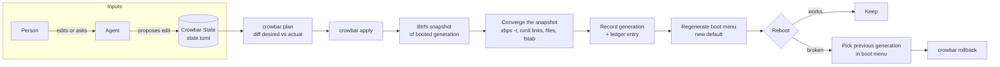
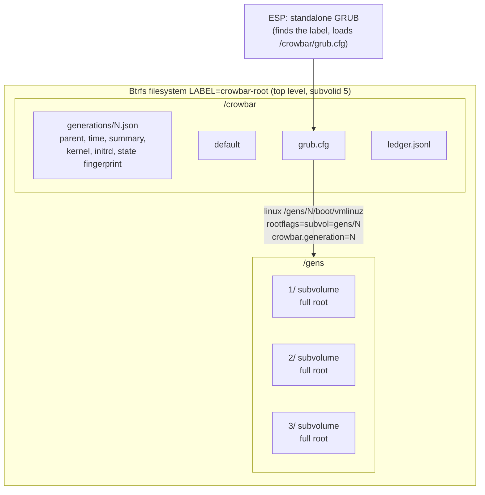
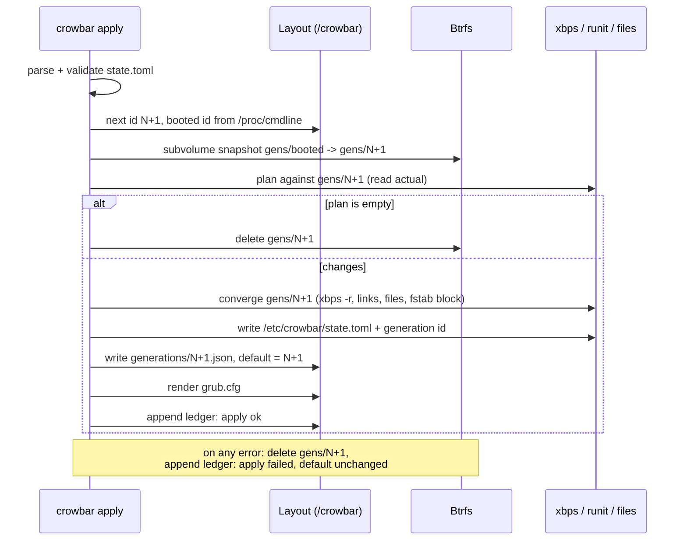

# Design: Crowbar State and the apply engine

**Status:** draft. Milestone 1 implements the core of this design in
[`agent-first/`](../../../agent-first/) (crates `crowbar-state` and
`crowbar-apply`). Sections marked **Later** are not built yet.

## Summary

- The **Crowbar State** is one declared, versioned document that describes the
  whole system. People and agents change the system only by editing it.
- The **apply engine** (Rust, the `crowbar` command) is the only code path that
  changes the system. It diffs the desired state against the actual system and
  converges with `xbps` and runit.
- Every apply builds a **generation**: a Btrfs snapshot of the current system,
  converged to the new state. Each generation is a bootable entry in the boot
  menu. Rollback is booting, or setting as default, an older generation.
- **Drift detection** compares the running system with the state it was built
  from. **Later:** this runs nightly.



## The Crowbar State document

TOML, because people can read and edit it and it diffs well. One file,
`/etc/crowbar/state.toml`, is stored inside each generation, so every generation
records the state that built it.

Milestone 1 schema (version 1):

```toml
version = 1                      # schema version; the engine rejects others

[system]
hostname = "crowbar-lab"

[packages]
install = ["jq", "htop"]         # packages the state owns (see ownership)

[services]
enabled = ["dhcpcd", "sshd", "udevd", "agetty-tty1", "agetty-ttyS0"]  # exact set

[[file]]                         # whole managed files
path = "/etc/motd"
content = "..."
mode = "0644"                    # optional, default 0644

[[mount]]                        # rendered into a marked block of /etc/fstab
device = "LABEL=crowbar-data"
target = "/srv/data"
fstype = "ext4"
options = "defaults"             # optional
```

**Later** sections, in rough order: `[apps]` (generated apps and their sources),
`[capabilities]` (standing grants; see the [capability model](capability-model.md)),
`[agents]` (principals, budgets, model routing), `[autonomy]` (mode and standing
rules; see [approver and autonomy](approver-and-autonomy.md)), `[desktop]`
(compositor, theme, keybindings), and `[users]`.

### Validation

`State::from_toml_str` parses and validates before anything else runs:

- Unknown fields are errors (`deny_unknown_fields`). A typo fails; it is not
  silently ignored.
- Names are checked (hostname, xbps package names, runit service names).
- File paths must be clean absolute paths. Protected locations are rejected:
  `/proc`, `/sys`, `/dev`, `/run`, `/boot`, `/etc/crowbar`, and files that another
  section owns (`/etc/fstab`, `/etc/hostname`).
- A mount target cannot be `/`, and mount fields cannot contain spaces.

### Ownership rules

The engine must never remove something it does not own. That is how a declarative
layer avoids destroying a system it only partly describes.

| Section | What the state owns |
| --- | --- |
| `system.hostname` | `/etc/hostname` |
| `packages.install` | Only the listed packages. A package is removed only if a *previous* state listed it and the new state does not. Base-image packages are never removed by accident. |
| `services.enabled` | The **exact** set of links in `/etc/runit/runsvdir/default`. |
| `[[file]]` | Each declared path. A file is deleted only if the previous state declared it. |
| `[[mount]]` | A marked block in `/etc/fstab`. Base lines outside the block are untouched. |

## Generations



Design choices:

- **A generation is a full writable subvolume.** Booting generation *N* means
  `rootflags=subvol=gens/N`. There is no overlay and no union filesystem, so a
  generation is an ordinary Void root that you can inspect, `chroot` into, or copy.
- **Each generation is built off to the side.** `apply` snapshots the *booted*
  generation to `gens/N+1` and converges the snapshot (`xbps-install -r`, file
  writes, runit links). The running system is never changed in place. The new
  generation takes effect at the next boot. A failed build deletes the half-built
  subvolume and leaves the default unchanged.
- **The kernel lives in the generation.** GRUB reads `/gens/N/boot/vmlinuz-*`
  directly from Btrfs, so a kernel update is a normal package change that a
  rollback undoes.
- **The boot menu is generated** from the records in `/crowbar/generations`,
  newest first, with the default marked. The ESP holds only a small, fixed GRUB.
  It never changes after the image is built.
- **The booted generation is known exactly** from `crowbar.generation=N` on the
  kernel command line.
- **A no-op apply creates nothing.** If the plan is empty, the snapshot is deleted.

### Why "build off to the side" instead of "snapshot, then change live"

The other common approach is to snapshot the running root first and then change
the running root in place. We build off to the side because:

1. The running system stays consistent. A half-applied change never runs.
2. The result does not depend on what was running at the time. Service restarts
   and file locks do not affect the build.
3. A generation that boots is the test. The next layer can add automatic
   health checks and automatic fallback to the previous generation.

The cost is that changes need a reboot. **Later:** a "live apply" path for changes
that can be applied safely in place (a file, a user service). It must still record
a generation and change the running system to match it exactly.

## The apply sequence



The plan lists every change. Changes that can stop the next boot are flagged
with `!`: mount changes, disabled services, and package removals. Milestone 1 only
displays the flag. In the approver design, it raises the risk tier.

## Commands (Milestone 1)

| Command | What it does |
| --- | --- |
| `crowbar plan STATE` | Show what `apply` would change compared with the booted system. |
| `crowbar apply STATE` | Build a new generation from the booted one and make it the boot default. |
| `crowbar generations` | List generations, parent, time, summary, `default` and `booted`. |
| `crowbar rollback [ID]` | Make `ID` (by default the booted generation) the boot default. |
| `crowbar drift` | Compare the booted system with its recorded state. Exit 2 if they differ. |
| `crowbar ledger` | Print the apply and rollback history. |
| `crowbar render-boot-menu` | Regenerate `grub.cfg` from the records. |

## Drift detection

`crowbar drift` replans the recorded state against `/`. If the plan is not empty,
something changed the system outside the engine, for example a manual
`xbps-install` that changed a declared package, or an edited managed file.

**Later:**

- A nightly runit-scheduled job (Void has no systemd timers; use `snooze` or a
  small runit service) that runs `crowbar drift` and writes the result to the ledger.
- Drift is shown to the person in plain language. The agent can offer two fixes:
  adopt the change into the state, or revert it with a new generation.
- Drift also covers things the state does not own yet, as an "unmanaged" report,
  so the agent can suggest what to declare.

## The ledger

`/crowbar/ledger.jsonl` is append-only, one JSON object per event: time, actor
(`CROWBAR_ACTOR`, later the authenticated principal), action (`init`, `apply`,
`rollback`), generation, from, outcome, and detail. It lives on the top level, not
inside a generation, so rolling back does not rewrite history. **Later:** the
ledger also records capability grants and approver decisions, with one-step revoke
and undo. It also gets tamper evidence: hash chaining, and signatures from the
broker and approver.

## Garbage collection (Later)

Generations share data through Btrfs copy-on-write, but they still add up.
Policy: keep the booted, default, and last *K* generations, plus every generation
marked as pinned. Collection never deletes the booted or default generation.

## Open questions

1. **Live apply.** Which changes are safe to apply without a reboot, and how do we
   make sure the running system matches the recorded generation afterward?
2. **Automatic boot health and fallback.** Should a new generation get a "boot
   once, confirm health, then become default" flow (GRUB `next_entry` plus a health
   check that commits)? That would make the Milestone 1 manual rollback automatic.
3. **What the base image owns.** Base packages are not owned by the state in
   Milestone 1. Should the state eventually own everything (a full package set,
   like a lockfile), or keep a "base + declared delta" model?
4. **Version pinning.** `xbps` installs whatever is current in the repository.
   Reproducibility needs pinned versions or a snapshot of the repository per
   generation. Which one, and where is it recorded?
5. **Secrets.** The state must be shareable. Where do secrets live (a separate
   store referenced by name?), and how does a shared OS definition ask for them?
6. **Per-user state vs system state.** One document, or a system document plus
   one document per user that the user's agent can edit with fewer approvals?
7. **Schema evolution.** How do we migrate `version = 1` documents, and does an
   old generation keep the schema it was built with?
8. **/var and user data.** Today everything is inside the generation, so a
   rollback also rolls back `/var` and `/home`. User data should move to separate
   subvolumes that are never rolled back. Which paths, and how do database-like
   services handle the case where data is newer than the code?
9. **Space and GC policy.** How many generations do we keep by default on small disks?
