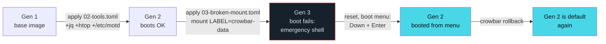
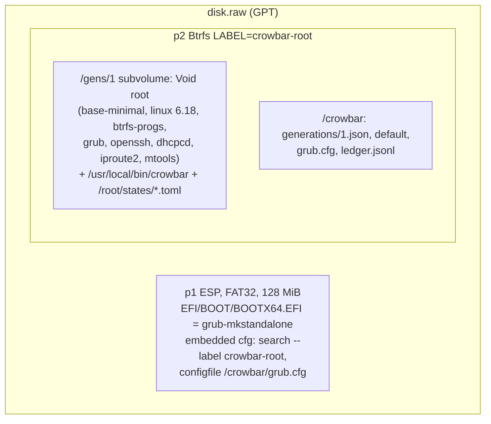

# Milestone 1: state → apply → generation → broken change → boot-menu rollback

**Result (November 14, 2026): the full loop works in a Void Linux VM on Btrfs.**
The scripted run passed **21 of 21 checks**. The run was not edited. Its log is in
[`evidence/milestone-1-2026-11-14.log`](evidence/milestone-1-2026-11-14.log).
This page states exactly what was verified and what was not.

## Goal

A Void Linux VM on Btrfs where:

1. a TOML state file is edited,
2. the Rust apply engine applies it as a new bootable generation,
3. a deliberately broken change is applied,
4. the system is recovered by choosing the previous generation in the boot menu.



## How to run it

Requirements: QEMU with `/dev/kvm`, OVMF at the paths in
[`agent-first/lab/config.json`](../../agent-first/lab/config.json), `unshare`,
`mkfs.btrfs` with `--subvol` (btrfs-progs 6.11 or later), `mkfs.vfat`, `sfdisk`, a
Rust toolchain with the `x86_64-unknown-linux-musl` target, and network access to
the Void repository. **No sudo is needed.** Work that needs root runs as fake root
in an `unshare -r` user namespace.

```sh
agent-first/lab/void_lab.py milestone   # build everything, run the loop, record evidence
```

Or step by step:

```sh
agent-first/lab/void_lab.py fetch       # static xbps, pinned SHA-256, into ~/.cache/crowbaros/void
agent-first/lab/void_lab.py rootfs      # Void root via xbps-install.static (rootless)
agent-first/lab/void_lab.py image       # musl crowbar binary + bootable GPT/ESP/Btrfs disk
agent-first/lab/void_lab.py start       # boot a fresh copy of the base disk
agent-first/lab/void_lab.py ssh crowbar generations
agent-first/lab/void_lab.py stop
```

Downloads go to `~/.cache/crowbaros/void`. The rootfs, disk images, VM sockets,
and evidence logs go to `.lab/void/`. Both locations are outside git
(`.lab/` is in `.gitignore`). The raw disk is 8.2 GiB sparse, about 1.4 GiB on disk.

### What the image is



- The image is built with no root and no loop devices. `xbps-install.static`
  installs the root in a user namespace. `mkfs.btrfs --rootdir … --subvol rw:gens/1`
  creates the filesystem from a directory, `sfdisk` and `dd` assemble the GPT disk,
  and GRUB and `mtools` from the guest root (run with `chroot` in the user
  namespace) build the ESP.
- The same `crowbar` binary registers generation 1 at build time
  (`crowbar --top <staging> init-image`) and runs in the guest. It is a static musl
  executable (861 KB).
- QEMU runs directly, not through libvirt. The script needs the serial console as
  a socket so it can read boot output and press keys in GRUB. It also uses a
  monitor socket for `system_reset`, and forwards host port `127.0.0.1:22230` to
  guest SSH. Like `infra/vm/lab.py`, the script uses only the Python standard
  library, reads a JSON config, and keeps local state out of git.

### The three states

| File | Change | Expected |
| --- | --- | --- |
| [`01-base.toml`](../../agent-first/lab/states/01-base.toml) | Base image: hostname and services | Generation 1 |
| [`02-tools.toml`](../../agent-first/lab/states/02-tools.toml) | Adds `jq`, `htop`, and a managed `/etc/motd` | Generation 2 boots |
| [`03-broken-mount.toml`](../../agent-first/lab/states/03-broken-mount.toml) | Adds an fstab mount of `LABEL=crowbar-data`, a disk that does not exist | Generation 3 does not boot: Void's stage 1 runs `mount -a … \|\| emergency_shell` |

## Verified

The final run (`void_lab.py milestone`, 14:43–14:46 local time, about 2.5 minutes)
had these results. Every row is an automated check in the log, unless the row is
marked as observed.

| # | Check | Evidence |
| --- | --- | --- |
| 1 | The GRUB menu, generated by `crowbar`, lists generation 1 | Serial console |
| 2 | Generation 1 boots on UEFI (OVMF) from Btrfs subvolume `gens/1` | SSH up about 25 s after QEMU start; `findmnt /` = `/dev/vda2[/gens/1]` |
| 3 | The booted generation is known | `/proc/cmdline` has `crowbar.generation=1` |
| 4 | No drift on a fresh image | `crowbar drift` exit 0 |
| 5 | `crowbar apply 02-tools.toml` builds generation 2 **without changing the running system** | `jq` still absent on the running gen 1 after apply |
| 6–9 | Generation 2 boots by default; `jq` works; `/etc/motd` is the declared content; no drift | Automated checks |
| 10 | `crowbar plan 03-broken-mount.toml` flags the change as boot-affecting (`!`) | Plan output in log |
| 11 | **Generation 3 genuinely fails to boot** | Serial: `mount: /srv/data: can't find LABEL=crowbar-data.` then `Cannot continue due to errors above, starting emergency shell.` |
| 12 | SSH is unreachable while generation 3 is stuck | Automated check |
| 13 | After a reset, the GRUB menu shows generation 2 | Serial console |
| 14–15 | **Choosing generation 2 in the boot menu** (Down, Enter over the serial console; the default was gen 3) boots it | `/proc/cmdline` has `crowbar.generation=2` |
| 16 | The broken mount is absent in generation 2 | `/etc/fstab` |
| 17–18 | `crowbar rollback` makes the booted generation the default; an untouched reboot comes back on generation 2 | `crowbar generations` shows `default,booted`; cmdline |
| 19 | Drift detects a hand edit made outside the engine | `echo … >> /etc/motd`, then `crowbar drift` exits 2 and reports `/etc/motd` |
| 20–21 | An apply that fails inside real `xbps` (nonexistent package) leaves no generation and keeps the default | `ERROR: Package 'crowbar-no-such-package' not found`; `gens/` has only 1–3; ledger records `apply failed gen 4` |

The ledger at the end of the run:

```text
2026-11-14T20:43:28Z  init     ok      gen 1    registered base image as generation 1
2026-11-14T20:44:03Z  apply    ok      gen 2    install packages: htop, jq; write file /etc/motd (mode 0644)
2026-11-14T20:44:32Z  apply    ok      gen 3    managed mounts: 0 -> 1
2026-11-14T20:45:12Z  rollback ok      gen 2    boot default 3 -> 2 (booted: 2)
2026-11-14T20:45:42Z  apply    failed  gen 4    "xbps-install" ... ERROR: Package 'crowbar-no-such-package' not found
```

The loop also passed two earlier complete runs (18 of 18 checks each), before the
drift and failed-apply checks were added.

Unit tests: `cargo test --workspace` runs 18 tests: 7 in `crowbar-state` for parsing,
validation, protected paths, and fingerprints, and 11 in `crowbar-apply` for the
full loop on a scratch tree with fake xbps and a copy-based snapshotter, failed
applies, removals, the fstab block, the GRUB menu, cmdline parsing, version
ordering, and time formatting. All pass. `cargo clippy --all-targets -D warnings`
and `cargo fmt --check` are clean.

Environment: host kernel 7.2.15 (Omarchy), QEMU 11.1.3 with KVM, edk2 OVMF
`OVMF_CODE.4m.fd` (non-Secure-Boot), btrfs-progs 7.3, Rust 1.99.1. Guest: Void
`current` as of today, kernel 6.18.63_1, GRUB 2.12, xbps 0.60.

## Not verified (yet)

- **Package removal and service enable/disable on a real guest.** The states in the
  run only add packages and files. Removing a declared package, and enabling or
  disabling a runit service, are covered only by unit tests with fakes.
- **A kernel update inside a generation.** The engine selects the newest
  `vmlinuz`/`initramfs` pair in the new generation, but no run installed a new
  kernel, so the in-chroot dracut hook was not exercised.
- **Boot-menu selection on a graphical console.** GRUB was driven over the serial
  console only. The menu is configured for both serial and console output, but the
  VM ran with `-display none`, so no one looked at a screen.
- **Real hardware, Secure Boot, other firmware.** Only OVMF in QEMU, with Secure
  Boot off.
- **Nightly drift detection.** `crowbar drift` works on demand. Nothing schedules it.
- **Crash safety.** Power loss or `kill -9` during an apply was not tested. Design
  intent: the half-built subvolume is ignored by the boot menu and its id is never
  reused, but no stale-subvolume cleanup exists yet.
- **Concurrent applies.** There is no lock. Two simultaneous applies could choose
  the same generation id.
- **Rootless-build artifacts.** Because the image is built in a user namespace:
  every file in the image is owned by root (a `chown` to `_dhcpcd` failed during
  the rootfs install), and the base initramfs was built without `/dev` nodes
  (`mknod` is not permitted). Both were harmless in this run: DHCP and SSH worked
  and the guest booted every time. Generations built *inside* the guest do not have
  this limitation.
- **Everything beyond the apply engine**: the agent, approver, capability broker,
  sandboxes, and desktop exist only as design documents.

## Known limitations of the Milestone 1 engine

- Changes take effect only after a reboot. There is no live apply.
- `/var` and `/home` live inside each generation, so a rollback also rolls back
  user data. Separate data subvolumes are future work.
- `xbps` installs the current repository versions. Generations are not
  reproducible from the state alone.
- No garbage collection of old generations.
- The base image's packages are not owned by the state. Only declared packages
  can be removed.

## Code

| Path | What it is |
| --- | --- |
| [`agent-first/crates/crowbar-state`](../../agent-first/crates/crowbar-state/src/lib.rs) | The Crowbar State schema, parsing, and validation |
| [`agent-first/crates/crowbar-apply`](../../agent-first/crates/crowbar-apply/src/) | Plan, apply, generations, GRUB menu, fstab block, ledger, and the `crowbar` command |
| [`agent-first/lab/void_lab.py`](../../agent-first/lab/void_lab.py) | VM lab: fetch, rootfs, image, start, ssh, stop, milestone |
| [`agent-first/lab/host/`](../../agent-first/lab/host/) | Rootless rootfs and disk-image build scripts (run inside `unshare -r`) |
| [`agent-first/lab/states/`](../../agent-first/lab/states/) | The three Milestone 1 states |

Design background: [state and apply engine](design/state-and-apply-engine.md).
