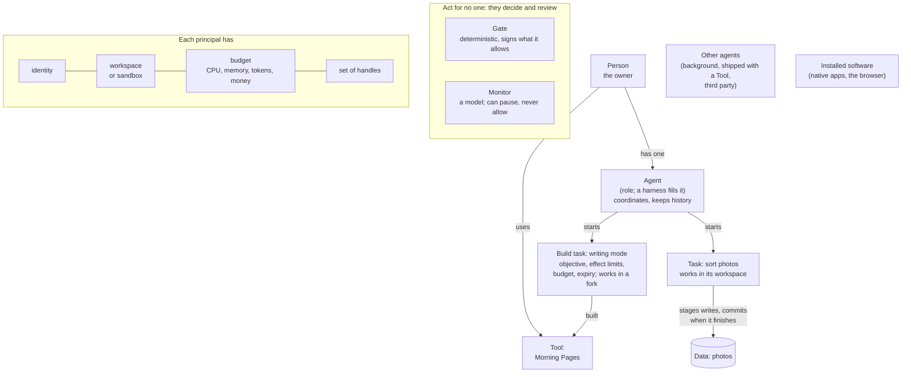
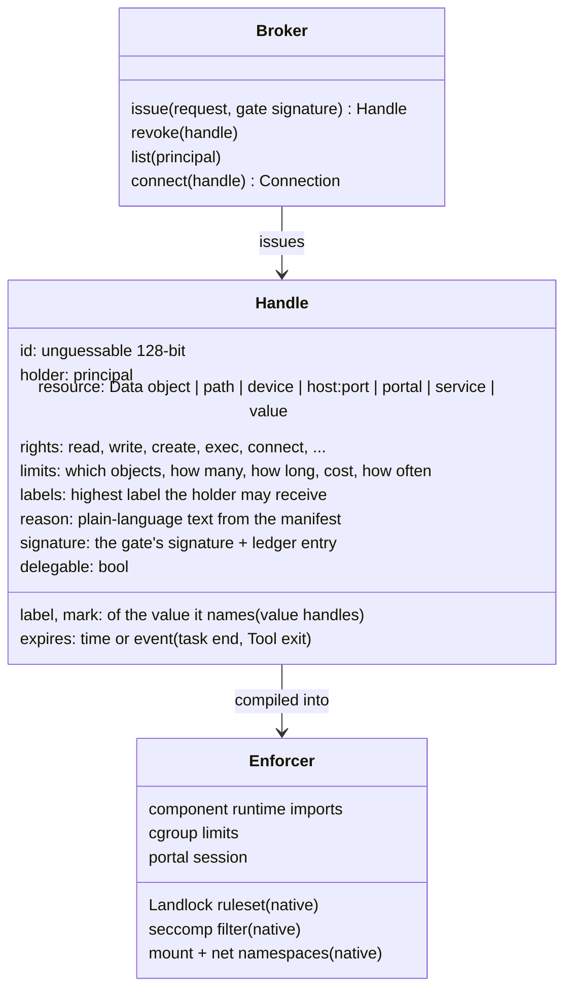
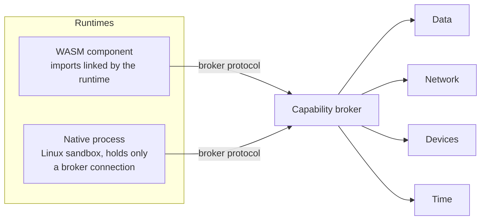
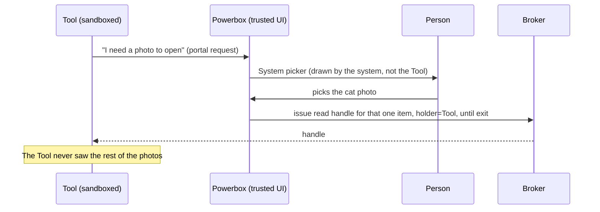
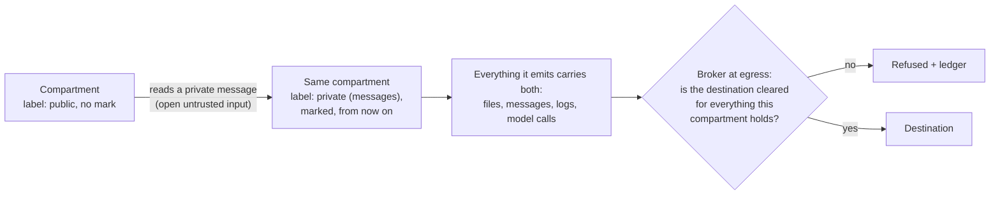
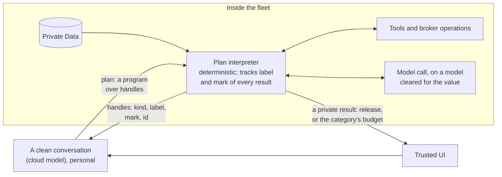
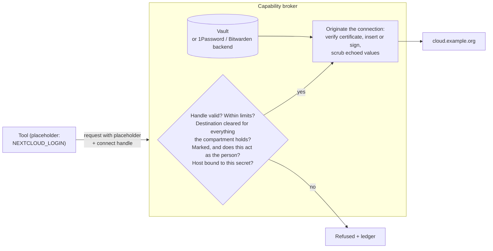

# Design: capability model

**Status:** draft, revised after council rounds
[1](../reviews/council-round-1.md), [2](../reviews/council-round-2.md),
[3](../reviews/council-round-3.md), [4](../reviews/council-round-4.md), and
[5](../reviews/council-round-5.md). Nothing
in this document is built yet. Milestone 1 runs everything as root inside the VM.
What the design defends against, and what it does not, is in the
[threat model](../threat-model.md).

## Summary

- **No ambient authority.** A process cannot reach a file, device, network host,
  or piece of Data just because its user can. It can reach only what it holds a
  handle for. The exception is **owner authority**, which the owner takes
  deliberately and which is recorded in the ledger.
- **Handles are scoped, expiring, and unforgeable.** A handle names one resource,
  the operations allowed on it, its **effect limits**, a lifetime, and the
  principal that holds it. Only the **capability broker** creates handles, and
  only for actions the **gate** has signed.
- **The Tool contract is the broker protocol.** A Tool starts with nothing and
  gets everything through the broker. WASM components and sandboxed native
  processes are both runtimes for that contract. Native code is promised only
  what Linux can enforce. See
  [ADR 0004](../adr/0004-capability-safe-tools.md).
- **Each task is its own principal.** The Agent coordinates tasks and does not
  collect their authority. See [ADR 0011](../adr/0011-task-principals.md).
- **Tools describe their UI; the trusted shell draws it** inside system chrome a
  Tool cannot imitate.
- **Powerbox, not prompts.** Wherever possible, the person picking something *is*
  the grant.
- **What the person does by hand is the answer.** A paste, a drop, a pick, and
  a link they click in an app are never refused, and are never followed by an
  ask about that same act. A request they type starts with no ask, and what the
  Agent then does across the boundary asks once. See
  [ADR 0025](../adr/0025-what-the-person-does-by-hand-is-the-answer.md).
- **A "yes" comes from the person.** Only the shell delivers input, and no
  principal can synthesize it. An ask waits for the person and takes one of
  three answers. See
  [ADR 0014](../adr/0014-a-yes-comes-from-the-person.md) and
  [ADR 0026](../adr/0026-asks-wait-and-take-one-of-three-answers.md).
- **Labels and marks apply to execution contexts, not only to stored Data.** A
  **compartment** that reads a value is at that value's label and carries its
  mark from then on. Nothing a model does removes either, nothing crosses
  freely, and marks persist in storage. Each **conversation** is a compartment
  of its own, and it rises only by the person's act. In a clean conversation, the Agent works by **plan over handles**, so private values stay
  out of it. See
  [ADR 0008](../adr/0008-private-values-stay-out-of-the-agent-context.md).
- **Open untrusted input costs a task its standing authority.** The task keeps
  thinking. Build tasks are clean by construction. See ADR 0011.
- **Standing authority binds to a Tool, a standing task, a workbench, or
  installed software, never to the Agent.** See ADR 0011.
- **Every outside party has a clearance.** A compartment may connect only to
  parties cleared for everything it holds. See ADR 0008.
- **Agents never drive the person's browser profile.** See
  [ADR 0013](../adr/0013-agents-never-drive-the-persons-browser.md).
- **The broker makes every outbound connection and holds every secret.** See
  [ADR 0006](../adr/0006-broker-owns-all-egress.md).
- **What was granted is stored outside the Crowbar State.** See
  [ADR 0012](../adr/0012-authority-outside-the-state.md).
- **Every rule is also held to the friction bar:** the most asks and refusals a
  person may meet in one task and in one day. A rule that misses it is
  redesigned, and where no design passes both, the Agent hands that work back to
  the person. See
  [ADR 0024](../adr/0024-the-friction-bar-ranks-with-the-attack-list.md).

## Principals

A principal is anything that can hold authority.



- **The Agent** is the person's own principal. A harness fills the role, but the
  harness only proposes actions. The Agent keeps the person's history and starts
  tasks. It does not hold the authority of the tasks it has run, it cannot use the
  person's authority, and it can never hold owner authority. It holds no
  standing grant and no standing rule (see
  [Who holds standing authority](#who-holds-standing-authority)). Each exchange
  with the person is a **conversation**, a compartment of its own that starts
  personal and unmarked (see [Conversations](#conversations)). In a clean conversation, it works by plan over handles (see
  [Plan over handles](#plan-over-handles)).
- **A task** is a fresh principal for one piece of work. It has a stated
  objective, effect limits, a budget, and an expiry. Every handle a task holds was
  signed by the gate and issued by the broker. When the task ends, its handles
  end with it. Every task has a **workspace**: a private scratch area and a view
  of the Data it was given. Only a task that changes installed behaviour also
  gets a **fork** of the Environment. See
  [ADR 0007](../adr/0007-fork-verify-promote.md).
- **A standing task** is a recurring task the person defined by name, with a
  fixed objective and limits. The Agent can start it and cannot change it.
- **A build task** writes or changes a Tool's code. It is clean by construction
  (see [Untrusted input and marks](#untrusted-input-and-marks)).
- **Tools are principals** with an identity derived from their declaration in the
  Crowbar State. A Tool gets no authority from the task that built it.
- **Installed software** (a native app, the browser) is a principal too, and runs
  under the same sandbox and broker as a Tool. The person's own browser profile
  is driven only by the person (see [The browser](#the-browser)).
- **A workbench** is a changeable Linux system for one project's dev tools. It
  is a principal, and each opening is a compartment. See
  [ADR 0017](../adr/0017-a-pinned-catalog-and-workbenches.md).
- **Other agents** (background workers, agents that come with shared Tools,
  third-party agents) are principals with their own handles. They can never edit
  intents.

Two parts act for no one. They decide and review:

- **The gate** is a deterministic rules engine. It checks each broker operation,
  and each commit of staged writes, against handles, effect limits, standing
  grants, and standing rules, and signs what it allows. It is the only thing that
  allows. It does not see what a native process does inside the view it was
  given. The kernel enforces that view.
- **The monitor** is a model, isolated from the Agent. It reviews actions against
  the person's intents and the task. It can pause a task and raise a surprise. It
  can never allow anything, so the system is sound without it.

Every principal and handle is tied to an explicit person. The first version
supports one person per machine, but nothing here assumes there is only one. See
[ADR 0005](../adr/0005-one-person-first.md).

How the gate and the monitor decide is in
[the gate, the monitor, and autonomy](gate-monitor-and-autonomy.md).

### The gate explains itself to agents

The harness protocol requires four things of the gate. See
[ADR 0003](../adr/0003-security-is-deterministic.md).

- **A dry run.** "Would this be allowed?", with no side effects. A dry run must
  not itself reveal a value.
- **Refusals that name the rule and the limit.**
- **Idempotency keys,** so a resumed task knows what already happened.
- **Reading a handle's label and mark** without reading its value.

## Handles



- **Unforgeable:** for a component, a handle is an import the runtime links in
  when the Tool starts. For native code, it is a file descriptor or a kernel object
  passed over a Unix socket (`SCM_RIGHTS`), or a portal session. A process cannot
  make one from a string. The broker's table is the source of truth. The 128-bit
  id exists only for the ledger and for revocation.
- **Scoped:** one resource, explicit rights. "Network" is never a single right;
  it is "connect to `api.example.org:443`". A handle can name a **Data object or a
  set of them** ("this person's photos"), not only a path.
- **Limited:** a handle carries **effect limits**: which objects, how many, for
  how long, at what cost, and how often. "Sort my photos" gives handles on the
  photos, not on the disk. The gate enforces the limits on every broker
  operation and on every commit of staged writes. For native code, see
  [What native code is promised](#what-native-code-is-promised).
- **A handle can name a value without revealing it.** The plan interpreter keeps
  the value's label and mark on the handle. Reading the value a handle names
  gives the reader that label and mark. What a handle shows the Agent is listed
  under [Plan over handles](#plan-over-handles).
- **Expiring:** every handle has a lifetime. Short lifetimes are the default:
  until the task ends, or until the Tool exits. Grants that last longer are
  **standing grants**. They are recorded in the authority domain, so they have
  their own history and are visible to the person.
- **Passed on only narrowed.** A holder may pass a copy of a handle to another
  principal only when the handle was issued delegable. The copy carries the
  original's rights or fewer and effect limits within the original's, and its
  uses count against the original's limits too. It carries the label and mark of
  what it names joined with the delegator's compartment, because a copy is
  something that compartment emits. It ends when the original ends, and it is
  never passed on again. No handle passes to the Agent, which holds none of its
  tasks' authority. The gate decides each copy, and its ledger entry names its
  original. The rules are written out on `HandleTable::delegate` in
  [`crates/crowbar-broker`](../../crates/crowbar-broker/src/handle.rs).
- **Revocable in one step** from the ledger. For a component, the runtime drops
  the import. Linux cannot revoke an open file descriptor, so for native code
  revoking means stopping the sandbox. The broker then restarts the Tool with the
  reduced set.

## Tools

A **Tool** is a piece of generated software derived from intents. It may have a
UI, a schedule, both, or neither. A writing surface, a rule that holds
notifications until noon, and a photo sorter are all Tools.

### The contract is the broker protocol

A Tool starts with nothing and gets everything through the broker: Data, network,
devices, and time. That is what makes a Tool capability-safe, and it is the same
for every runtime.



- **A WASM component** can reach only what it imports, and the broker binds each
  import. WASM gives deterministic execution and replay, and one build that runs
  on an x86 laptop and an ARM inference machine.
- **A native process** runs in a Linux sandbox (see
  [Enforcement on Linux](#enforcement-on-linux)) with an empty filesystem view, no
  network, and one broker connection. Native code gives the whole Linux ecosystem
  and the GPU. It is routine, not an escape hatch.

A component's imports show the *kind* of authority it has. The *scope* comes from
what the broker binds, and that works the same for a sandboxed native process.

**Installed software uses the same rules.** A native app or a browser runs in the
sandbox with broker-owned egress. It lives in the Environment as a sandboxed
bundle, never as a package installed into Base. The broker cannot see inside this
software, so its checks there are per principal and per destination, not per
value. We say so plainly.

**A Tool from a stranger runs only as WASM**, unless the recipient rebuilds it
locally. The build task that reads the stranger's words is marked, so the rebuilt
Tool gets no grant without the person's answer. See
[ADR 0010](../adr/0010-share-the-pinned-build.md).

### What native code is promised

Native code is promised only what Linux can enforce.

- A native sandbox is a **compartment whose label and mark are fixed when it
  starts**, from everything in the view it is given. It is given Data at or below
  that label, and everything it writes carries that label and mark. The gate
  cannot see a native process open a file inside its view, so it cannot change
  the mark at that moment.
- **A value the person moves in by hand is the one exception.** It is not
  refused. The compartment keeps its label and takes the value's mark. The
  broker records the mark on the compartment before it delivers the value, so
  every write it records afterwards carries the mark, and a write it recorded
  earlier keeps what it had. See
  [ADR 0025](../adr/0025-what-the-person-does-by-hand-is-the-answer.md).
- **The view is a snapshot taken at start.** A file that arrives later in a
  shared directory, such as a download, is not in it.
- The gate checks every broker operation and every commit of staged writes. Inside
  the view the sandbox was given, the kernel enforces, and the gate does not see
  each read or write.

| Limit | What enforces it for native code |
| --- | --- |
| Which objects | The view the sandbox is given (mount namespace and Landlock), or a broker operation |
| How many, how often | Broker operations as they happen. Writes made inside a view are staged and counted when they are committed |
| For how long | Handle expiry for broker operations. For an open view, the sandbox is stopped |
| At what cost | The broker, which is the only way to reach a model or money |
| Egress | A network namespace with no interfaces. The broker connection is the only way out |

A limit on count or rate inside a view holds at commit, not at each write. Reads
inside the view are not counted.

### Manifests

Each Tool has a manifest in its Crowbar State entry. The manifest says what the
Tool **needs**:

```toml
[[tool]]
name = "morning-pages"
summary = "A calm full-screen writing surface."
source = "tools/morning-pages"     # built by a task, versioned with the state
hash = "sha256:…"                  # pinned content hash (see the state design)
intent = "writing-mode"            # the intent this Tool serves

[[tool.needs]]
what = "data"
type = "document"
scope = "~/Writing"
rights = ["read", "write", "create"]
why = "Saves your pages as Markdown files."

[[tool.needs]]
what = "notifications"
rights = ["suppress"]
why = "Holds notifications until noon while you write."
```

The person sees each need stated by the OS in fixed words, with the `why` text
next to it. For a Tool from a stranger, the `why` text is shown as the author's
claim.

- **Needs live in the State. Grants do not.** What the person actually granted is
  recorded in the **authority domain**, outside the State and its generations.
  Rolling back software never restores a revoked grant, and a shared State carries
  no authority. See [ADR 0012](../adr/0012-authority-outside-the-state.md).
- **For a component**, the system checks that the Tool's imports match its `needs`
  exactly.
- **For native code**, the sandbox is built from the `needs`: nothing else is
  mounted in or connected.
- The gate checks each `needs` entry against the person's grants. The monitor
  reviews whether the `needs` fit the intent ("a writing mode"). The broker turns
  each granted entry into handles when the Tool starts.
- **A grant binds to three things:** the Tool's identity in the State, the exact
  needs the person saw when they granted, and a clean build. A rebuild that keeps
  all three keeps the grant. A rebuild that changes the needs, or that read open
  untrusted input, does not. The person is asked again, and until they answer the
  earlier build stays live. See ADR 0011.
- **A mark persists in a Tool's source.** Approving an unclean build does not
  clean it. Every later rebuild that reads that source is unclean, until the Tool
  is re-derived from the intent and the checks alone.

### Rehearsal

A check is a scenario in a fixed data format: the events the broker delivers at
stated simulated times, and the effects the Tool must and must not ask the broker
for. Checks run in **rehearsal**: the Tool runs against simulated time, simulated
events, and recorded inputs, with no real effects. A **runner** in Base runs them,
not the task that built the Tool. The runner signs the result together with the
content hash of the build and of every check, and a promote accepts only a build
whose hash carries a passing result. See
[ADR 0001](../adr/0001-intent-is-the-source.md).

So every interface the broker offers a Tool has three forms:

| Form | What it does |
| --- | --- |
| Real | The effect happens. |
| Simulated | The broker answers from a script: a fake clock, fake notifications, fake network replies, fixture Data. |
| Record and replay | The broker records what a Tool received in real use, and replays it into another build. |

"Waits until noon" can then be tested in a second. A re-derive is accepted only
when the frozen checks pass in rehearsal and a replay through the new build gives
the same results as the old one. This holds for both runtimes, because the
contract is the broker protocol.

### Declarative UI

A Tool does not draw its own pixels. It emits a **UI description**, and the
trusted shell renders it. This means:

- Every Tool is themed and accessible automatically.
- The shell draws Tool UI inside **system chrome a Tool cannot imitate**. System
  requests, the powerbox, and confirmations appear only in that chrome, so a Tool
  cannot pass its own content off as a system request.
- The UI description is also the **Tool's interface for agents**. What a person
  can point at, a task can call. A task operates a Tool through its elements,
  never through pixels and never through input events.
- The same Tool can render on any machine in the fleet.
- A change to a Tool is shown as a **preview**: the forked Tool running in the
  fork, drawn by the shell and marked as a preview. The checks are shown in
  plain words beside it. One plain answer freezes the checks and promotes
  exactly the build that was previewed. The preview stays open while the person
  asks for further changes, and one answer at the end promotes the last build.

Installed native software still gets real Wayland windows. An agent cannot drive
a native app that has no UI description (see Open questions).

The vocabulary of the UI description is not decided. See Open questions.

### Point-and-say

Because the shell draws every Tool's UI, the person can point at any element and
say what to change ("sort this list by date", "move this up here"). That becomes
a proposed edit to the Tool's intent, and the intent's checks keep the earlier
behavior intact.

**Perception belongs to the OS and runs locally.** Speech-to-text and pointing are
resolved inside the fleet. The harness receives the transcript plus **structured
references** ("Tool: Morning Pages, element: the sort control, intent: writing
mode"), not screenshots or audio. Pixels go to the harness only for native
windows, and only when the person allows it. A **visible indicator** is always
shown while the OS is listening or watching.

## Powerbox



The person's choice is the authorization, so no separate prompt is needed. For
native code this uses the xdg-desktop-portal FileChooser/Documents model that
Flatpak apps already use. We adopt the portal protocol instead of inventing one.

### What the person does by hand is the answer

The powerbox's rule is the general one. See
[ADR 0025](../adr/0025-what-the-person-does-by-hand-is-the-answer.md).

- **A paste, a drop, a pick, and a link the person clicks in an app are never
  refused**, and are never followed by an ask about that same act.
- **A request the person types starts with no ask.** It starts a lookup, or
  points a conversation at a source, as it stands. What the Agent then does
  across the boundary to carry it out is the Agent's act: it asks once, or is
  refused, by the rules for acts.
- **A link shown by a Tool, or by a conversation that is no longer clean, is
  that compartment's act.** A click on it asks, with the full address shown,
  unless a standing rule covers it.
- **Deterministic parts know the hand.** The compositor sees the key press, the
  click, and the drag. The shell sees the pick and the words typed into it. No
  model decides that the person did something. An act an agent makes, or one a
  client claims with no input behind it, is not the person's hand.
- **A value moved by hand is released, and keeps its mark.** It passes to the
  compartment the person moved it into, whatever its label. That compartment's
  label does not rise, and nothing is refused. The destination carries the
  value's mark from then on, and so does everything it writes afterwards. The
  ledger records the source, the destination, and which act moved it.
- **Four acts count as a paste:** a paste key in the destination's window; a
  middle click there, for the primary selection; a click in the window that
  holds the keyboard, followed at once by that window reading the clipboard,
  which is what Paste in a right-click menu does; and a drop, where a drag that
  starts in one compartment is released over a window of another. A read with
  none of these behind it gets nothing.
- **One exception.** The first time a conversation is pointed at a category of
  private data that its model provider is not cleared for, one ask opens in
  place and takes a signature (see [Conversations](#conversations)).
- **What remains.** A person tricked into pasting or typing something harmful.
  An app the person clicks in can read what they last copied. A private value
  the person pastes into an app can go wherever that app can send it.

### A "yes" comes from the person

A pick in the powerbox and an answer to an ask are only worth something if nothing
else can produce them. See
[ADR 0014](../adr/0014-a-yes-comes-from-the-person.md) and
[ADR 0026](../adr/0026-asks-wait-and-take-one-of-three-answers.md).

- **Only the shell delivers input.** No principal can synthesize keyboard,
  pointer, or touch input to a surface the shell draws, and nothing but the shell
  can read input meant for another surface. On Linux, Base has to close every
  route by which one process produces or reads another's input. The known ones:
  an X11 server shared between apps (each app gets its own XWayland, or none);
  the accessibility bus; virtual keyboard, virtual pointer, and input-method
  protocols; the remote desktop portal and its input emulation; creating or
  reading input devices; tracing the shell; pushing characters into a terminal;
  and owner authority in any terminal an agent can reach. A route that is not
  closed is a hole.
- **An ask waits for the person.** It does not open by itself. The task that
  raised it pauses, and for a Tool, installed software, or a workbench only the
  operation that asked waits. The shell's bar shows how many asks are waiting,
  and the keyboard stays where it is. The one ask that opens in place is the
  one for what the person just asked for, in the conversation they are in, when
  they have given it no input since. An ask from an app's window always waits.
  An ask lasts as long as the task or the running compartment that raised it.
- **Three answers, by what is at stake.**
  - What stays inside the undo boundary, such as keeping a preview or an undo,
    takes a **plain answer**: any ordinary input in trusted UI. The shell
    carries it.
  - Anything that crosses takes the **confirm gesture**: a secure key press that
    the compositor takes and never delivers to a Tool or app. An ask ignores the
    gesture for a moment after it appears. Authority that lasts only for this
    run takes it too: the start of a task above the ceiling, a task's answer for
    one logged-in site, and a host added to a workbench until it stops.
  - **Authority that lasts needs a signature:** a passkey, a security key, or
    approval on the phone, over the exact content shown. That covers a new
    standing grant, rule, or standing task, wider limits on any of them, a
    higher ceiling for tasks that do not cross, a higher clearance, a
    declassify, a refilled Allowance, and owner authority. A wide compartment
    keeps its signature, though it lasts for one start.
- **Nothing is refused for asking too often.** Asks are counted per task and
  across all the Agent's tasks together, and the ask that starts a task counts.
  Past one principal's limit, its further asks are held in one line. Past the
  Agent's limit, the further asks of the Agent and all its tasks are held
  together in one line. The person can open a line or dismiss it whole.
- **One ask can hold a list** of acts of one kind, such as three drafted
  replies. Each is shown in full, the person can strike any of them, and one
  answer covers the rest.
- **Standing authority is asked for at first use,** not up front. A list the
  person put together, such as the apps they chose for a new machine, is shown
  in full and takes one signature.
- **Voice never counts as confirmation.** Words that arrive by voice are marked
  until the person makes the confirm gesture. So nothing crosses for them, and
  nothing they say is kept as the person's own.
- **The trusted UI and the confirm gesture are part of Base.** They cannot be
  themed, rebound, or replaced by anything in the Environment.

## Data, labels, and compartments

The Data layer holds the person's own things as **objects with provenance,
labels, stable ids, and history**.

- **Files stay the truth** for software that expects them. The typed layer starts
  as an index over them.
- **Schemas are data.** Tools can add schemas and map between them. There is no
  fixed vocabulary of types in Base.
- **Writes are staged.** A task's writes to Data are staged in its workspace and
  committed together when the task finishes, inside its effect limits, as one
  entry in the Data history. The commit is where the gate counts them. See
  [ADR 0007](../adr/0007-fork-verify-promote.md).

### Labels

- A **label** says how private a piece of Data is. Labels are ordered: **public,
  personal, private**. Private data also carries a **category**, such as
  messages, health, or finance.
- A label comes from **where the data came from**: messages, health, finance, and
  anything near credentials are private by default; something the person wrote is
  personal; downloaded public content is public.
- The Agent may **raise** a label without asking. **Lowering** the label on stored
  data is **declassifying**. Only the person can do it.
- The **origin table** gives each origin its label and mark: typed text, pasted
  content, files, mail, web pages, admitted dependencies, and stored results. It
  is written out, next to the code that applies it, in
  [`crates/crowbar-labels/src/origin.rs`](../../crates/crowbar-labels/src/origin.rs).
  A file the person brings in by hand, such as photos from a camera card, is
  personal and marked as from outside
  ([ADR 0019](../adr/0019-the-origin-table-fails-closed.md)).

### Untrusted input and marks

Content written by someone other than the person or their OS is **untrusted
input**. It is graded. See [ADR 0011](../adr/0011-task-principals.md).

- **Admitted** input comes from a pinned set the person admitted in advance: the
  Base package snapshot, and the dependency set with its documentation that build
  tasks may use. Reading it does not mark a context. Admission is where that risk
  is taken, once, by a step that can be audited.
- **Open** input is everything else: web pages, mail, messages, shared intents,
  and files from outside. Reading it **marks** the context. What the person
  pastes keeps the mark of where it was copied from, and its label is released
  to where the person put it (see
  [What the person does by hand is the answer](#what-the-person-does-by-hand-is-the-answer)).

Untrusted input includes short strings. A file name, a mail subject, a label in a
stranger's Tool, error text from a server, and a ledger detail are data with
their origin's label and mark, unless the person typed them or a fixed template
produced them.

A **mark** is the record that a value was produced by a context that had read
open untrusted input. **Marks persist in storage.** A Tool's source and an entry
in Agent memory keep the mark of whatever wrote them.

**A marked task keeps thinking and loses authority.**

- It keeps its model, through a request the broker builds: to the provider the
  person chose, with the provider's own tools and retention off.
- It loses every standing grant and standing rule to cross the undo boundary: to
  act on the person's accounts, to send data out of the fleet, or to do anything
  inside the fleet that cannot be undone. From then on such an act needs the
  person's answer.
- One exception: a standing rule the person wrote for that source, carried out by
  a broker adapter that knows the operation ("pay this bill on this site, up to
  this amount each month"). The limits in that rule are then the only protection,
  and the rule says so.
- An act that depends on a result from a marked task is marked too (see
  [What crosses between compartments](#what-crosses-between-compartments)).

**Egress goes only to parties cleared for the data.** A compartment may connect
only to parties cleared for everything it holds (see [Clearance](#clearance)). No
principal may hold private read, open untrusted input, and a connection to a
party not cleared for that data. The gate refuses the third. Naming a site in a
task does not clear it.

**Build tasks are clean by construction.** A task that writes or changes a Tool's
code reads only the intent, the checks, the Tool's own source, and admitted
input. It has no web access. It sees results on synthetic inputs only: a replay
of real recorded inputs reaches it as pass or fail. That verdict is computed from
private, marked inputs. It is the one such result a build may read and stay
clean, and it is capped at a fixed number of replays per re-derive. Fixing a bug
that needs the
real input goes through the person, who turns that input into a new check. A
**lookup** may browse. It is marked, and its findings reach a build only
by a release from the person, or by making the build unclean. An unclean build
does not keep the Tool's grants (see [Manifests](#manifests)).

### Who holds standing authority

**Standing authority binds to a Tool, a standing task, a workbench, or installed
software, never to the Agent.**

- A grant to a Tool binds to the Tool's identity, the needs the person saw, and a
  clean build (see [Manifests](#manifests)).
- A standing task has a fixed objective and limits. The Agent can start it and
  cannot change it.
- **A workbench holds standing authority.** It installs from the open web, so it
  is always marked and never a clean build. Its grants bind to its identity in
  the State and the exact needs of its profile, and a new need asks the person
  again. Being marked, it crosses the undo boundary only through standing rules
  carried out by an adapter, or with the person's answer. See
  [ADR 0017](../adr/0017-a-pinned-catalog-and-workbenches.md).
- **Installed software holds standing authority too.** Its approval screen is
  its standing grant, and its standing rule for the hosts and folders that
  screen showed. The grant binds to its identity in the State and the needs the
  approval showed. Using what the approval showed never asks, and a new need
  asks the person again.
- **A task asks once for what it does across the boundary, and never twice for
  one act.**
  - Where the exact content of an act is known when the task starts, the person
    sees it then, and that answer covers the act.
  - Where the task composes the act later, it starts with no ask, and the act
    asks with its exact content when it is ready. A task that reads three mails
    and drafts three replies costs one ask: the replies, as a list.
  - A task on a logged-in site takes one answer for that site (see
    [The browser](#the-browser)).
  - Any other act that crosses, composed after the task was marked, asks with
    its exact content, or uses an adapter rule for that source.
  - An act the person answered leaves at once.
- **Work inside the boundary has a ceiling.** There is one default ceiling on
  the limits of tasks that do not cross: how many objects, and which parts of
  the person's Data. No setting changes it yet. A task proposed above the
  ceiling is authorized at its start, with its objective and limits shown in
  fixed words, by the confirm gesture.
- **A standing rule with a cap fires without an ask when the amount is under
  the cap.** The gate never reads the amount. It answers "allowed if within the
  cap", and the adapter checks the amount against the cap when it carries the
  act out. Over the cap, the adapter carries nothing out, and the act asks, with
  the amount shown. See
  [ADR 0021](../adr/0021-the-gate-decides-from-metadata-and-counts-from-the-ledger.md).
- **An Allowance is standing authority like any other.** A marked task spends
  from it only by the person's answer or through an adapter rule.
- The Agent proposes the limits of every task. Those limits bound a task's
  mistakes. They do not bound a steered Agent. What bounds the Agent is that it
  holds no standing authority itself, that a conversation rises only by the
  person's act, and the ceiling above.

Someone else's words are open untrusted input. A shared Tool arrives as its
pinned build with its intent and checks, and the words are never handed to the
recipient's Agent as instructions. See
[ADR 0010](../adr/0010-share-the-pinned-build.md).

### Compartments

A model's context cannot keep private and public apart. Once it has read one
private value, everything it writes may carry it. The same holds for a stranger's
instructions. A Tool has the same problem: its output may carry anything it read.
So labels and marks apply to whole execution contexts, not only to stored
objects.

A **compartment** is one execution context: a conversation, a task's model
context and its workspace, or a Tool's sandbox.



- Once a compartment reads a value, it is at least at that value's label and
  carries that value's mark. So is everything it emits: files, messages, logs,
  generated code, and model calls.
- The one exception is a value the person moved in by hand. It is released, so
  the compartment takes its mark and not its label (see
  [What the person does by hand is the answer](#what-the-person-does-by-hand-is-the-answer)).
- The broker checks the compartment's label and mark at every egress. It does not
  try to track either per value inside a model's context, because that cannot be
  enforced.
- A native sandbox is a compartment whose label and mark are fixed when it starts
  (see [What native code is promised](#what-native-code-is-promised)).

### Conversations

Each exchange between the person and the Agent is a **conversation**, a
compartment of its own. See
[ADR 0008](../adr/0008-private-values-stay-out-of-the-agent-context.md).

- **It starts personal and unmarked,** with the entries of Agent memory that are
  at most personal and unmarked.
- **It rises only by the person's act.** There are two:
  - *The person puts a value in:* a paste, a drop, or a pick. That is one exact
    value moved by hand, so it is released. The conversation stays at its label
    and takes the value's mark.
  - *The person points it at a source:* their mail, a folder, a Tool. They pick
    it in the powerbox, point at it, or name it in the words they type. The
    shell turns each of these into a reference to the source, by fixed rules and
    never by a model, and the broker opens only what a reference names. The
    conversation rises to the source's label and takes its mark.
- **The Agent cannot raise its own conversation.** A read it asks for with no
  reference from the person behind it is refused. It uses a lookup or a plan
  instead. Words that name no source the shell knows change nothing, and the
  Agent asks the person to pick one.
- **A conversation that is no longer clean stays that way for as long as it
  lives,** with its history and any summary of it. A conversation is clean
  while it is personal and unmarked. Its frame shows its label and mark. It can
  read and discuss what it was given.
- **Every act that crosses, from a conversation that is no longer clean,
  asks,** with the exact content shown. A lookup it starts is one of those
  acts, and so is a link it shows. A standing task started from it runs marked.
- **What it writes keeps its label and mark:** an entry in Agent memory, which
  a new conversation does not load, and an intent or a check. A build from such
  an intent or check is not clean, so the grant asks again, with a signature.
- **A clean conversation is one action away.**
- **Its provider must be cleared.** A conversation pointed at a category of
  private data thinks with a model provider cleared for that category. The first
  time, one ask opens in place and takes a signature: "let your provider hold
  messages". It is not asked again for that category. A typed request meets no
  other ask before its work starts.

### What crosses between compartments

**Nothing a model does removes a label or a mark, and nothing crosses freely.**
Summarizing does not clean a value, starting a new task does not, and passing
through the Agent does not. Marks persist in storage too.

The plan interpreter keeps the label and mark on every result. That includes
handles, and **bounded results**: a choice from a list, or a number in a range,
both fixed before the task read anything.

- A plan may branch on a bounded result. Everything that follows the branch
  carries that result's label and mark.
- An act that depends on a result from a marked task counts as marked. A steered
  choice cannot spend a standing rule.
- A clean conversation does not read a result from a marked task.
  The plan branches on it inside the interpreter, and the shell shows it to the
  person. To have the Agent read it, the person puts it into the conversation or
  points the conversation at it.
- A conversation that has read a marked value is marked for as long as it
  lives, together with its history and any summary of it. A new request clears
  nothing. Only a new conversation starts clean. A standing task started from a
  marked conversation runs marked.
- What can be observed about a result is a result. The size of a value, the
  number of handles a task returns, and whether a step succeeded or was refused
  carry the label and mark of what they were computed from. They are hidden from
  the Agent, or charged to the budget, like any other result.
- A private result reaches a clean conversation only by a
  **release**, or inside a budget for that category. The budget is counted in
  bits across all tasks. It is zero, and no interface sets it yet.
- A **release** is the person letting one exact value pass to one named
  destination despite its label: by answering an ask that shows the value in
  trusted UI, or by moving it there with their own hand. The value keeps its
  mark.
- The shell can always show the person a result directly, without it passing
  through the Agent.

### Plan over handles

We assume most people's Agent thinks with a cloud model. In a clean conversation, and in a standing task, the Agent works by plan over handles. See
[ADR 0008](../adr/0008-private-values-stay-out-of-the-agent-context.md).

- The Agent writes a **plan**: a small program whose variables are handles.
- A **deterministic interpreter** in the fleet runs the plan. It moves the actual
  values between Tools, broker operations, and model calls.
- The interpreter is not a model, so it tracks the label and mark of every
  result. A model's context cannot.
- A clean conversation holds handles, schemas, synthetic samples,
  results it is allowed to read, and the person's own words. **It is personal**:
  what the person types counts as personal by rule. A value put into a
  conversation goes to that conversation's model provider as well. When an ask
  releases the value, the ask says so.

The Agent can draft "Hi {name}, your appointment is {date}" without seeing either
value.

**What a handle shows the Agent.** Two things only:

- what the OS states about it: its kind, label, mark, and id, and its size only
  where that does not depend on a private or marked value;
- a name the person typed.

A name a stranger gave the thing is not shown to the Agent. The shell shows it to
the person.

**Only the person's own words are the person's words.** What the person types
reaches the Agent as theirs. What arrives by voice is marked until the person
makes the confirm gesture, because a speaker can produce it. What the person
pastes or drops into a conversation enters it, and the conversation carries its
mark from then on.

**Synthetic samples** are made by deterministic code from the schema, never by a
model from real Data.



A task may read a value and think with a model only when that model's provider or
machine is cleared for the value. With no model cleared for a category, values in
it are processed only by Tools.

### Clearance

The fleet is not one flat perimeter. A **clearance** is the highest label a
machine or an outside party may hold. For private data it names the categories.

- **Each machine has a clearance.** A rented cloud machine does not get what the
  desk gets. Data syncs only to machines whose clearance allows its label.
- **A machine whose disk is not encrypted has no clearance for private data.**
- **Every outside party has a clearance.** A model provider's default is
  personal. The person can raise it for one category at a time, with a
  signature.
- **A web site's default is public.** A site may also receive back what it
  supplied, and what the person released to it. Content fetched under a login is
  private to that site.
- **A compartment may connect only to parties cleared for everything it holds.**
  That is what "the destination is cleared for the label" means at egress. A
  compartment that has read private data cannot fetch a stranger's page.
- **A lookup holds only what the person typed and what it found.** A **lookup**
  is a task that answers a question from the open web. It runs in a compartment
  of its own, which holds the words the person typed, exactly as typed, and the
  pages it reads. It cannot see Agent memory or the person's Data. So it is
  public, and it starts, keeps searching, and takes the person's follow-ups with
  no ask. The broker checks its objective against what the shell recorded: it is
  one whole turn the person typed, unchanged. Any text the Agent adds to those
  words is shown to the person before it leaves, as a release in full: the exact
  text, and where it may go. A lookup started from a conversation that is no longer clean
  is one of that conversation's acts that cross, so it asks. A standing task
  that looks things up has a fixed objective.
- **A compartment that holds only public data and no login may reach any host
  on the open internet without asking.** Machines in the fleet and addresses on
  the home network are not among them. That covers a lookup, a task browser context that is not
  logged in, and a workbench for a project the person declared public when they
  made it. Nothing private is inside to leak. Secrets stay in the vault, and the
  broker fills them in only for the hosts they are tied to.
- **The phone is an approval device.** It answers asks through trusted UI.

**One machine leads.** In the first version the **lead machine** holds the
authority domain and puts promotes in order. The other machines work on leases
from it that expire, so a revoked grant stops working everywhere within a known
time. See [ADR 0012](../adr/0012-authority-outside-the-state.md).

### The browser

The person's browser profile holds their sessions, cookies, and history. Only the
person drives it. No agent, task, or Tool can drive it, read it, or receive its
cookies. See
[ADR 0013](../adr/0013-agents-never-drive-the-persons-browser.md).

- A task that needs the web gets a **task browser context**: a fresh browser
  context for one task, with no sessions.
- A login reaches it by approved fill. The session cookie stays in the broker,
  which attaches it to that context's requests. The task cannot read it, and it
  ends with the task.
- A page fetched under a login is private to that site.
- Each site is an outside party with a clearance: it receives public data, what
  it supplied itself, and what the person released to it. A context that is not
  logged in holds only public data, so it may reach any host on the open
  internet. A logged-in
  context reaches its one site, and the shared hosts below.
- The task drives its own context through the browser's automation interface
  inside its sandbox. That is not input to a surface the shell draws.
- Reading a page is open untrusted input, so the task is marked.
- **On a logged-in site, the person answers once for each task and each site.**
  One ask at the start names the site, shows the task's objective and limits in
  fixed words, and shows the exact values the task may send there, such as a
  name and a phone number. It includes the approved fill, and the confirm
  gesture answers it. The answer covers the task's requests to that one site
  until the task ends. A second site takes a second ask. The rule is
  deterministic: nothing has to judge what a request means.
- **What that answer does not change.** The task reaches that one site and the
  shared hosts, and a connection to any other host is dropped. The session
  cookie stays in the broker. The task holds only what the person released to it
  in that ask. The Allowance is the only payment credential the task can
  supply; a payment method the site already stores is not capped by it. A
  shared host is cleared, for that task, for what the task holds for its site
  and nothing else. The context runs in a framed
  window the person can watch. Every request is in the ledger.
- **Two lists come with the catalog.** On the person's machine, a change to
  either takes a signature, whether the person makes it or a new catalog
  snapshot brings it.
  - *Shared hosts:* the payment processors, content delivery networks, and font
    hosts a page may load from. A logged-in context reaches these as well as its
    site. A request to any other host, telemetry included, is dropped quietly,
    and does not count as a refusal.
  - *Adapter-only sites:* banks, mail providers, and identity providers, and any
    site the person adds. A task gets no browser context for one of these. It
    acts there only through an adapter, and where there is no adapter, the Agent
    hands the errand back to the person.
- A site that breaks without a host that is not on the shared list is handed
  back to the person.
- An act happens with no ask at all only through a broker adapter that knows the
  operation, under a standing rule for that operation ("pay this bill, up to this
  amount").
- **What remains.** While the task runs, an injected page on that site can make
  other changes on that one account: a second booking, a changed address. What a
  task holds for one site can reach a host on the shared list.

Inside the person's own browser, keeping one site's content from another is the
browser's job, and we rely on it.

## Egress and secrets

**The broker makes every outbound connection.** Tools and harnesses never open
their own. That is the only way data leaves the fleet, so every egress is checked
against handles, effect limits, the compartment's label and mark, and the undo
boundary, and recorded in the ledger.



Acts sent on the person's behalf under a standing rule (messages, posts,
purchases where the seller allows it) do not leave at once. They wait in the
broker's **outbox** for a delay the person can see, and can be cancelled until
they leave. An act the person answered leaves at once. A marked task has lost the
standing rules that would let such an act leave unasked. See
[the gate, the monitor, and autonomy](gate-monitor-and-autonomy.md).

### Model calls are egress

Calling a cloud model, or using an external harness that runs in someone else's
cloud, sends data out of the fleet. Every outside party has a **clearance** (see
[Clearance](#clearance)). A model provider's default is personal, and the person
can raise it for one category at a time.

**The broker builds every model request itself**, to the provider the person
chose, with the provider's own tools and retention switched off. Switching those
off is a setting and a contract, not something the OS can verify. A provider's
clearance is trust in that provider.

**A model request does not ask.** The broker makes it when the provider is
cleared for everything the compartment holds and the model budget is not spent.
The clearance and the budget are the standing authority for it, and each was the
person's signature. A request to a provider that is not cleared is refused, and
one over the budget asks. See [ADR 0011](../adr/0011-task-principals.md).

The cloud model is the common case for the Agent, so the design does not depend
on routing private data to a local model. It depends on plan over handles, which
keeps private values out of a conversation the person has not pointed at them
(see [above](#plan-over-handles)), and on the clearance the person gives a
provider, one category at a time, before a conversation pointed at that category
thinks with it (see [Conversations](#conversations)). A model in the fleet, such as open weights on the
person's DGX Spark, lets a model work on private values without their leaving.

### Secrets

Secret values live in the **vault**, which the broker holds. Existing password
managers such as 1Password or Bitwarden can plug in as its backend. Agents,
harnesses, models, and Tools never see the values. The vault is its own domain:
secrets are never in the State and never in a generation. Prior art and sources
are in [agent credentials prior art](../research/agent-credentials-prior-art.md).

- **API secrets:** a Tool holds only a placeholder. The broker inserts the real
  value only for the hosts the secret is tied to, and refuses anything else.
- **Interactive logins:** an approved fill. The person approves in trusted system
  UI, the OS fills and submits the form, and the Agent learns only that it
  succeeded. This is how a login reaches a task browser context.
- **No environment-variable mode.** Real secret values never go into environment
  variables, because code an agent wrote can read them.

Header-rewriting proxies, which most products use today, have known holes. The
broker closes them by making the connection itself:

| Hole in header-rewriting proxies | How the broker closes it |
| --- | --- |
| Request signing (AWS SigV4) breaks | The broker does the signing |
| A service echoes the secret back in its response | The broker scrubs the value from responses |
| Host rules trust DNS | The broker verifies the server's certificate |
| WebSocket frames after the handshake are not rewritten | The broker owns the whole connection |

**A secret obtained with a secret is a secret.** When an adapter obtains a
credential, with a vault secret (an OAuth exchange, a session cookie from a
login) or without one (a device flow, a sign-up, a reset link), it stores the
credential in the vault and returns a handle. A Tool does not get to hold the
credential as an ordinary value. A protocol with no such adapter is listed as
unsupported. See [ADR 0006](../adr/0006-broker-owns-all-egress.md).

One limit stays: a verified certificate identifies a host. It does not identify
the account, recipient, or bucket on that host. An unasked act on a person's
account therefore goes only through an adapter that knows the operation (see
[The browser](#the-browser)). See Open questions.

### Hardware-bound keys

Keys that matter are bound to the TPM or secure enclave where the machine has one,
with protected software keys as the fallback:

- each machine's membership in the fleet,
- the gate's signing key,
- the key that records owner authority in the ledger, and
- each Agent's identity.

Authority that lasts needs a hardware root of its own: a passkey, a security
key, or approval on the phone (see
[A "yes" comes from the person](#a-yes-comes-from-the-person)).

We track the FIDO Alliance's agent working group and will align when it
publishes.

## Enforcement on Linux

These mechanisms confine native Tools and installed software. They also confine
the component runtime itself, as a second layer.

| Mechanism | Used for |
| --- | --- |
| Mount, PID, IPC, UTS namespaces | An empty filesystem view. Only granted paths are bind-mounted in. |
| Network namespace + broker | No network by default. All egress goes through the broker. |
| Landlock | A second filesystem check inside the namespace. It is stackable, needs no privileges, and also limits TCP bind and connect on recent kernels. |
| seccomp | Removes system calls Tools do not need, for example `ptrace`, `mount`, and kernel module loading. |
| cgroups v2 | Budgets: CPU, memory, I/O, and process count per principal. |
| Wayland + portals | No reading other windows, keystrokes, or the screen. Wayland alone does not stop synthesized input: the remote desktop portal exists to produce it, and there are other routes. Base has to close every one (see [A "yes" comes from the person](#a-yes-comes-from-the-person)). Screen capture, camera, and microphone go through portals, which are powerbox-style. |
| User IDs | One user ID per compartment, or a block of them for a workbench, new at each start, as a second boundary. They are not the main control ([ADR 0016](../adr/0016-the-warden-starts-every-compartment.md), [ADR 0017](../adr/0017-a-pinned-catalog-and-workbenches.md)). |

We should evaluate **Microsoft Execution Containers (MXC)**, which became generally
available in October 2026 as composable sandboxes for agents. MXC might be a
backend for the native sandbox. Check its real specification and license before
relying on it. Also compare existing Linux tools, such as bubblewrap.

The first Warden ([`crates/crowbar-sandbox`](../../crates/README.md)) makes
these kernel calls itself and depends on no sandbox tool, so the code that runs
as root is small enough to read in one sitting. Both backends stay open.

## Where isolation lives

**The broker decides, and the kernel sandbox enforces.** Linux is part of the
trusted base, not only a host for drivers. The security of a native Tool, of
installed software, and of the component runtime itself rests on Linux
namespaces, Landlock, seccomp, and cgroups working as documented.

The trusted base is the list under "What is trusted" in the
[threat model](../threat-model.md). A failure in any of these breaks the claims
in this note:

- hardware, firmware, the bootloader, and the Linux kernel, including its sandbox
  mechanisms;
- Base: the shell and its trusted UI (with the powerbox), the broker and its
  adapters, the gate, the plan interpreter, the runner, the engine, the vault,
  and the Tool runtimes (the WASM runtime and the code that sets up a native
  sandbox);
- the lead machine, which holds authority for the fleet;
- the phone, as an approval device;
- the step that admits a pinned set (Base packages, the dependency set for build
  tasks), at the time it admits it;
- a model provider, only for data at or below the clearance the person gave it,
  and only to keep its promise about tools and retention;
- the browser engine, to keep one site's content from another inside the person's
  own browser;
- the labels. Data that arrives with the wrong label is protected at the wrong
  level.

No model is trusted to allow anything, and the monitor can only pause. Models are
not outside the system: the Agent's model proposes every task, its limits, and
its plan, and a build task's model writes every Tool. The threat model says what
bounds them.

## Open questions

1. **Delegation.** Closed by
   [ADR 0021](../adr/0021-the-gate-decides-from-metadata-and-counts-from-the-ledger.md):
   the gate decides each copy and gives it an `Allowed` of its own, the copy's
   ledger entry names its original, and every use of a copy counts against both.
2. **Admission.** Who admits the dependency set that build tasks read, how is it
   reviewed, and how does it receive updates? How are build tools confined?
3. **The plan language.** How much can a plan over handles express, when the
   Agent cannot read a stranger's file name or an error message?
4. **The UI vocabulary.** A new declarative vocabulary drawn by GPUI, or a
   constrained web subset (DOM and CSS, scripts with no network) drawn by a
   trusted engine? Agents write the second well on the first try. What is the
   path for a Tool that needs the GPU?
5. **The browser engine.** Which engine, and how is a task browser context built
   from it?
6. **Driving native apps.** An agent cannot send input events. Is there an
   accessibility interface, controlled by the shell, for apps with no UI
   description?
7. **Long content in an ask.** Closed by
   [ADR 0018](../adr/0018-one-gesture-answers-one-ask.md): an everyday ask about
   one act fits on one screen, and a list or an ask for authority that lasts is
   paged and armed only after its last page.
8. **Adapters.** An unasked act on an account needs an adapter that knows the
   operation and the resource (for example, "can upload only to this one
   bucket"). Which adapters come first, and who writes them?
9. **Logged-in task browser contexts.** Closed by
   [ADR 0013](../adr/0013-agents-never-drive-the-persons-browser.md) after
   council round 5: a context where every request that can change state waited
   for the person was not livable, so the person now answers once for each task
   and each site. Still open: which hosts belong on the shared list. A count of
   requests on real sites would tune it.
10. **Label inference.** How reliably can labels and categories be assigned from
    the source, and how does the person correct a wrong label?
11. **Releases and mark creep in practice.** How often does a real task need a
    release, and how much of real Data ends up marked, now that a value the
    person pastes carries its mark with it?
    [Milestone 2](../milestones/milestone-2.md) measures this against the
    friction bar
    ([ADR 0024](../adr/0024-the-friction-bar-ranks-with-the-attack-list.md)).
12. **Clearance.** Who sets a machine's clearance, and what does a phone hold?
13. **Leases.** How long does a lease from the lead machine last, and what happens
    when the lead machine is lost?
14. **Rehearsal fidelity.** How close must a simulated interface be to the real
    one before a passing check means anything, and how is recorded input stored
    given its labels?
15. **MXC.** Does MXC exist on Linux in a form we can use, under what license, and
    does it fit the broker model?
16. **Usability of standing grants.** How do we show someone "what can this Tool
    do?" on one screen, and make "less" a single click?
17. **Naming a source.** The shell matches the words a person typed to one of
    their sources by fixed rules. How often does it miss? Milestone 2 counts
    it.
