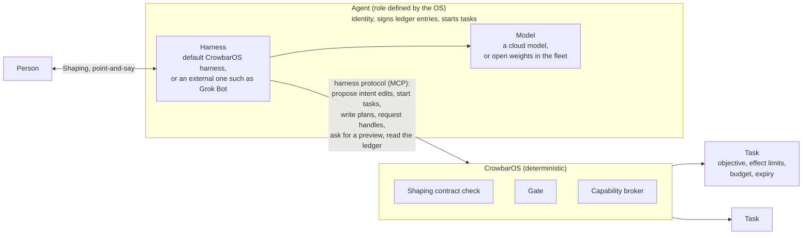
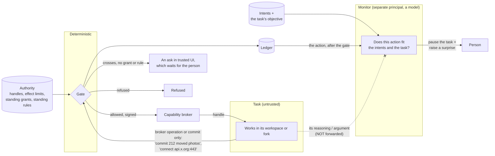
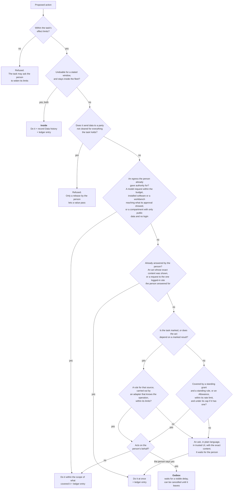
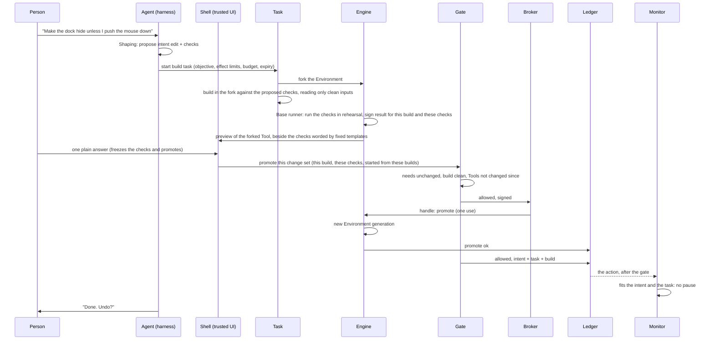

# Design: the gate, the monitor, and autonomy

**Status:** draft. Nothing in this document is built yet. Milestone 1 has only the
pieces this design builds on: Base generations, rollback, an apply lock, and the
ledger. Revised after council rounds [1](../reviews/council-round-1.md),
[2](../reviews/council-round-2.md), [3](../reviews/council-round-3.md),
[4](../reviews/council-round-4.md), and [5](../reviews/council-round-5.md).
Round 5 held every rule here to the friction bar and redesigned the ones that
missed it. The "approver" of the earlier
design is now two things, the gate and the monitor. What the design defends
against is in the [threat model](../threat-model.md).

## Summary

- **Security is deterministic, and every rule is also held to the friction
  bar.** No model is on the trust path. The friction bar is the most asks and
  refusals a person may meet in one task and in one day. A rule that misses it
  is redesigned, and where no design passes both, the Agent hands that work back
  to the person. See [ADR 0003](../adr/0003-security-is-deterministic.md) and
  [ADR 0024](../adr/0024-the-friction-bar-ranks-with-the-attack-list.md).
- **The gate allows; the monitor can only pause.** The **gate** is a deterministic
  rules engine and the only thing that allows an action. It checks every broker
  operation and every commit of staged writes. The **monitor** is a
  model that reviews actions afterwards. It can pause a task and raise a surprise.
  It can never allow.
- **Work happens in tasks.** A **task** is a fresh principal with a stated
  objective, effect limits, a budget, and an expiry. The Agent coordinates tasks
  and does not collect their authority. See
  [ADR 0011](../adr/0011-task-principals.md).
- **Effect limits bound every task and every grant:** which objects, how many, for
  how long, at what cost, and how often.
- **The undo boundary is the default for autonomy, not a safety property.** An
  effect needs no answer from the person only when it is within the task's limits,
  the system can undo it for a stated window, and it stays inside the fleet.
- **Acts sent under a standing rule wait in the outbox** for a visible delay and
  can be cancelled until they leave. An act the person answered leaves at once.
- **Untrusted input costs a task authority.** Reading open untrusted input
  **marks** a context. A marked task keeps its model and loses its standing
  grants and rules to cross the undo boundary, which includes anything inside
  the fleet that cannot be undone. An act that depends on a result from a marked
  task is marked too.
- **Labels and marks survive every handoff and storage, and nothing crosses
  freely.** Each **conversation** between the person and the Agent is a
  compartment of its own, and it rises only by the person's act. In a
  conversation that has not risen, and in a standing task, the Agent works by
  **plan** over handles, and the interpreter keeps the label and mark on every
  result, and on what can be observed about a result. Such a conversation does
  not read a result from a marked task. A private result reaches it only by a
  **release** or inside a budget, which stays at zero. See
  [ADR 0008](../adr/0008-private-values-stay-out-of-the-agent-context.md).
- **What the person does by hand is the answer.** A paste, a drop, a pick, a
  link they click, and a request they type are never refused, and are never
  followed by an ask about that same act. A value moved by hand is released and
  keeps its mark. See
  [ADR 0025](../adr/0025-what-the-person-does-by-hand-is-the-answer.md).
- **Egress goes only to parties cleared for the data.** A model provider's
  default clearance is personal. A web site's is public. A compartment that
  holds only public data and no login may reach any host without asking.
- **Standing authority binds to a Tool, a standing task, a workbench, or
  installed software, never to the Agent.** A task asks once for what it does
  across the boundary, and never twice for one act. A task that crosses nothing
  has one default ceiling.
- **A "yes" comes from the person.** Only the shell delivers input. An ask waits
  for the person and takes one of three answers: a plain answer for what stays
  inside the undo boundary, the confirm gesture for what crosses and for
  authority that lasts only for this run, and a signature for authority that
  lasts for good. See
  [ADR 0014](../adr/0014-a-yes-comes-from-the-person.md) and
  [ADR 0026](../adr/0026-asks-wait-and-take-one-of-three-answers.md).
- **The gate explains itself to agents:** a dry run, refusals that name the rule
  and the limit, idempotency keys, and a handle's label and mark.
- **Intents change only through the person's own Agent, with the person's
  confirmation in trusted UI.** The OS enforces the Shaping contract.
- **Nothing goes live unconfirmed.** Every change to installed behaviour is shown
  as a preview beside its checks, and one plain answer freezes the checks and
  promotes exactly what was previewed.
- **Notify only on surprise.** "Mode" controls only how much the person is told.
- **Authority has its own domain.** Standing grants, standing rules, effect
  limits, Allowances, and clearances are not in the Crowbar State and are never rolled back
  with software. See [ADR 0012](../adr/0012-authority-outside-the-state.md).
- Everything goes in the **ledger**, with one-step revoke or undo.

## Agent, harness, model, and tasks

- **Agent** is the person's own principal. It has an identity, signs its ledger
  entries, edits intents with the person, and starts tasks. The role holds the
  authority, whatever harness fills it.
- **Harness** is whatever fills the role: the loop, tools, and conversation around
  a model. CrowbarOS ships a default harness. An external one can replace it. A
  harness can only propose.
- **Model** is what a harness thinks with. We assume the common case is a cloud
  model. Open weights on the person's own hardware (for example, a DGX Spark in
  the fleet) are the other case. See
  [ADR 0008](../adr/0008-private-values-stay-out-of-the-agent-context.md).
- **Agent memory** is what the Agent has learned about the person. It is the
  person's Data, not the harness's, so changing the harness keeps it.
- **Conversation** is one exchange between the person and the Agent, run as a
  compartment of its own. It starts personal and unmarked, so what one
  conversation read does not mark the next. See "Labels and marks survive every
  handoff" below.

### Tasks

Each piece of agent work is a **task**: a fresh principal with

- a stated **objective** ("prepare this month's tax documents"),
- **effect limits**: which objects, how many, for how long, at what cost, and how
  often,
- a **budget**, and
- an **expiry**.

The Agent keeps the person's history and starts tasks. It does not hold the
authority of the tasks it has run. When a task ends, its handles end with it.

Durable intents and temporary tasks are separate things. "Help me manage my
finances" is an intent. "Prepare this month's tax documents, using these
accounts, without contacting anyone" is a task. An intent is too broad to judge
one action against. A task gives the gate and the monitor something narrow to
check: this objective, these objects, until this time.

A task's authority comes only from what the person has granted.

- **Standing authority binds to a Tool, a standing task, a workbench, or
  installed software, never to the Agent.** A **standing task** is a recurring
  task the person defined by name, with a fixed objective and limits. The Agent
  can start it and cannot change it.
- **Installed software holds standing authority too.** Its approval screen is
  its standing grant, and its standing rule for the hosts and folders that
  screen showed. Using what the approval showed never asks, and a new need asks
  the person again.
- **A model request does not ask.** The broker makes it when the provider is
  cleared for everything the compartment holds and the model budget is not
  spent. The clearance and the budget are the standing authority for it. A
  request to a provider that is not cleared is refused, and one over the budget
  asks.
- **A task asks once for what it does across the boundary, and never twice for
  one act.**
  - Where the exact content of an act is known when the task starts, the person
    sees it then, and that answer covers the act.
  - Where the task composes the act later, it starts with no ask, and the act
    asks with its exact content when it is ready. A task that reads three mails
    and drafts three replies costs one ask: the replies, as a list.
  - A task on a logged-in site takes one answer for that site
    ([ADR 0013](../adr/0013-agents-never-drive-the-persons-browser.md)).
  - Any other act that crosses, composed after the task was marked, asks with
    its exact content, or uses an adapter rule for that source.
  - An act the person answered leaves at once.
- **Work inside the boundary has a ceiling.** There is one default ceiling on
  the limits of tasks that do not cross: how many objects, and which parts of
  the person's Data. No setting changes it yet. A task proposed above the
  ceiling is authorized at its start, with its objective and limits shown in
  fixed words, by the confirm gesture. Without it, "rewrite every file" would
  ask no one.
- **The Agent proposes the limits of every task.** Those limits bound a task's
  mistakes. They do not bound a steered Agent. What bounds the Agent is that it
  holds no standing authority itself, that a conversation rises only by the
  person's act, and the ceiling. A steered Agent can start any standing task,
  which is bounded by that task's fixed limits, and can propose any ad hoc
  task, which is bounded by the ceiling or the person's answer.

Every task has a **workspace**: a private scratch area and a view of the Data it
was given. Its writes to Data are staged there and committed together when the
task finishes, inside its effect limits. Only a task that changes installed
behaviour (a Tool, a service, the desktop) also gets a **fork** of the
Environment. The person sees the result as a **preview** beside its checks, and
one plain answer freezes the checks and promotes exactly the build that was
previewed. See
[ADR 0007](../adr/0007-fork-verify-promote.md) and
[state and apply engine](state-and-apply-engine.md).

### Untrusted input costs a task authority

**Untrusted input** is content written by someone other than the person or their
OS. Injection arrives this way. It is graded
([ADR 0011](../adr/0011-task-principals.md)):

- **Admitted** input comes from a pinned set the person admitted in advance: the
  Base package snapshot, and the dependency set with its documentation that build
  tasks may use. Reading it does not mark a context.
- **Open** input is everything else: web pages, mail, messages, shared intents,
  and files from outside. It includes short strings: a file name, a mail
  subject, error text from a server. Reading it **marks** the context, and the
  mark follows everything the context emits. What the person pastes keeps the
  mark of where it was copied from
  ([ADR 0019](../adr/0019-the-origin-table-fails-closed.md)).

A marked task keeps thinking and loses authority:

- It **keeps its model**, through a request the broker builds: to the provider
  the person chose, with the provider's own tools and retention off.
- It **loses every standing grant and standing rule to cross the undo
  boundary**: to act on the person's accounts, to send data out of the fleet, or
  to do anything inside the fleet that cannot be undone. From then on such an
  act needs the person's answer.
- The one exception is **a standing rule the person wrote for that source,
  carried out by a broker adapter that knows the operation** ("pay this bill on
  this site, up to this amount each month"). The limits in that rule are then the
  only protection, and the rule says so.
- **An act that depends on a result from a marked task is marked too**, so a
  steered choice cannot spend a standing rule.
- **A standing task started from a marked conversation runs marked.**
- **An Allowance is standing authority like any other.** A marked task spends
  from it only by the person's answer or through an adapter rule.

**Egress goes only to parties cleared for the data.** A compartment may connect
only to parties cleared for everything it holds. A web site is cleared for
public data by default. It may also receive back what it supplied, and what the
person released to it. So a compartment that has read private data cannot fetch
a stranger's page. No principal may hold private read, open untrusted input, and
a connection to a party not cleared for that data. The gate refuses the third.

**A lookup holds only what the person typed and what it found.** A **lookup** is
a task that answers a question from the open web. It runs in a compartment of
its own, which holds the words the person typed, exactly as typed, and the pages
it reads. It cannot see Agent memory or the person's Data. So it is public, and
it starts, keeps searching, and takes the person's follow-ups with no ask
([ADR 0025](../adr/0025-what-the-person-does-by-hand-is-the-answer.md)). The
broker checks its objective against what the shell recorded: it is one whole
turn the person typed, unchanged. Any text the Agent adds to those words is
shown to the person before it leaves, as a release in full: the exact text, and
where it may go. A lookup started from a conversation that has risen is one of
that conversation's acts that cross, so it asks. A standing task that looks
things up has a fixed objective.

**A compartment that holds only public data and no login may reach any host
without asking.** That covers a lookup, a task browser context that is not
logged in, and a workbench for a project the person declared public when they
made it ([ADR 0017](../adr/0017-a-pinned-catalog-and-workbenches.md)). Nothing
private is inside to leak. Secrets stay in the vault, and the broker fills them
in only for the hosts they are tied to.

**Build tasks are clean by construction.** A task that writes or changes a
Tool's code reads only the intent, the checks, the Tool's own source, and
admitted input. It has no web access. It sees results on synthetic inputs only:
a replay of real recorded inputs reaches it as pass or fail. That verdict is
computed from private, marked inputs. It is the one such result a build may
read and stay clean, and it is capped at a fixed number of replays per
re-derive, so a build cannot search a real input one bit at a time. Fixing a bug that
needs the real input goes through the person, who turns that input into a new
check. A lookup may browse. It is marked, and its findings reach a build
only by a release from the person, or by making the build unclean.

**Marks persist in storage.** A Tool's source and an entry in Agent memory keep
the mark of whatever wrote them. Approving an unclean build does not clean it.
Every later rebuild that reads that source is unclean, until the Tool is
re-derived from the intent and the checks alone.

### Labels and marks survive every handoff

A **compartment** is one execution context: a conversation, a task's model
context and its workspace, or a Tool's sandbox. Once it reads a value, it is at
least at that value's label and carries that value's mark, and so is everything
it emits. The one exception is a value the person moved in by hand. It is
released, so the compartment takes its mark and not its label
([ADR 0025](../adr/0025-what-the-person-does-by-hand-is-the-answer.md)). See
[ADR 0008](../adr/0008-private-values-stay-out-of-the-agent-context.md) and
the [capability model](capability-model.md).

**Nothing a model does removes a label or a mark, and nothing crosses freely.**
Summarizing does not clean a value, starting a new task does not, and passing
through the Agent does not.

**Each conversation is a compartment of its own.** A **conversation** is one
exchange between the person and the Agent.

- **It starts personal and unmarked**, with the entries of Agent memory that are
  at most personal and unmarked.
- **It rises only by the person's act.** There are two:
  - *The person puts a value in:* a paste, a drop, or a pick. That is one exact
    value moved by hand, so it is released. The conversation stays at its label
    and takes the value's mark.
  - *The person points it at a source:* their mail, a folder, a Tool. They pick
    it in the powerbox, point at it, or name it in the words they type. The
    shell turns each of these into a reference to the source, by fixed rules
    and never by a model, and the broker opens only what a reference names. The
    conversation rises to the source's label and takes its mark.
- **The Agent cannot raise its own conversation.** A read it asks for with no
  reference from the person behind it is refused. It uses a lookup or a plan
  instead. Words that name no source the shell knows change nothing, and the
  Agent asks the person to pick one.
- **A conversation that has risen stays risen for as long as it lives**, with
  its history and any summary of it. Its frame shows its label and mark. It can
  read and discuss what it was pointed at.
- **It holds no standing authority, and every act of its that crosses asks**,
  with the exact content shown. A lookup it starts is one of those acts. What it
  writes to Agent memory keeps its label and mark, so a new conversation does
  not load it.
- **A clean conversation is one action away.**
- **Its provider must be cleared.** A conversation pointed at a category of
  private data thinks with a model provider cleared for that category. The
  first time, one ask opens in place and takes a signature: "let your provider
  hold messages". It is not asked again for that category. This is the one
  place a request the person typed is followed by an ask.

**In a conversation that has not risen, and in a standing task, the Agent works
by plan over handles.** The Agent writes a **plan**: a small
program whose variables are handles. A handle names a value without revealing
it. A deterministic interpreter in the fleet runs the plan and moves the actual
values between Tools, broker operations, and model calls. It tracks the label
and mark of every result. That includes handles, and **bounded results**: a
choice from a list, or a number in a range, both fixed before the task read
anything.

- A plan may branch on a bounded result. Everything that follows the branch
  carries that result's label and mark.
- An act that depends on a result from a marked task counts as marked.
- **A conversation that has not risen does not read a result from a marked
  task.** The plan branches on it inside the interpreter, and the shell shows it
  to the person. To have the Agent read it, the person puts it into the
  conversation or points the conversation at it. A new request clears nothing.
  Only a new conversation starts clean. A model's context cannot track what an
  act depends on, so a conversation is all or nothing: it is clean, or it is
  marked for as long as it lives.
- **What can be observed about a result is a result.** The size of a value, the
  number of handles a task returns, and whether a step succeeded or was refused
  carry the label and mark of what they were computed from. They are hidden from
  the Agent, or charged to the budget, like any other result.
- A private result reaches a conversation that has not risen only by a
  **release**, or inside a budget for that category. The budget is counted in
  bits across all tasks. It is zero, and no interface sets it yet. The shell can
  always show the person a result directly, without it passing through the
  Agent.
- A **release** is the person letting one exact value pass to one named
  destination despite its label: by answering an ask that shows the value in
  trusted UI, or by moving it there with their own hand. The value keeps its
  mark.

**Only the person's own words are the person's words.** What the person types
reaches the Agent as theirs. What arrives by voice is marked until the person
makes the confirm gesture, because a speaker can produce it. What the person
pastes or drops into a conversation enters it, and the conversation carries its
mark from then on. Every other string that the person did not type and a fixed template
did not produce is data with its origin's label and mark. The Agent sees what
the OS states about a handle (its kind, label, mark, and id, and its size only
where that does not depend on a private or marked value) and names the person
typed. Synthetic samples are made by deterministic code from the schema,
never by a model from real Data.

A conversation that has not risen holds handles, schemas, synthetic samples,
results it is allowed to read, and the person's own words. It is personal: what
the person types counts as personal by rule. A value put into a conversation
goes to that conversation's model provider as well. When an ask releases the
value, the ask says so.

**Every outside party has a clearance.** The default for a cloud model provider
is personal. The person can raise it for one category of private data at a time.
The default for a web site is public. Content fetched under a login is private
to that site. A task may read a value and think with a
model only when that model's provider or machine is cleared for the value.

### The harness protocol

The OS exposes one **harness protocol**, built on MCP rather than invented. Through
it a harness can read intents and Shaping context, propose intent edits, start
tasks, write plans, request handles, ask for a preview, and read the ledger. It
cannot promote: the person's confirmation does. Any MCP-capable agent
can fill the Agent role.

The gate must explain itself to agents
([ADR 0003](../adr/0003-security-is-deterministic.md)). The protocol requires:

- a "would this be allowed?" dry run with no side effects, which must not itself
  reveal a value;
- refusals that name the rule and the limit;
- idempotency keys, so a resumed task knows what already happened;
- a way to read a handle's label and mark without reading its value.

An external harness gets no more trust than the default one. Connecting it is a
change to authority that the owner makes once. A harness that runs in someone else's
cloud, such as Grok Bot, is **outside the fleet**. Everything it sees has left the
fleet, so it sees only data at or below the clearance the person gave it. Grok Bot's own cloud
memory and its persistent cloud computer are part of that egress. See
[agent credentials prior art](../research/agent-credentials-prior-art.md).

### The Shaping contract

The OS owns the rules of Shaping. The harness owns the conversation.

- **Every intent has checks, and the person confirms them in trusted UI.** The
  shell shows the checks in plain words beside the running preview and takes the
  answer. A harness cannot assert "the person confirmed".
- **Every change is shown as a preview.** The forked Tool runs in the fork,
  marked as a preview, with no effects outside the fork. One plain answer
  freezes the checks shown beside it and promotes exactly the build that was
  previewed. The preview stays open while the person asks for further changes,
  and one answer at the end promotes the last build. Nothing goes live
  unconfirmed, however small. See
  [ADR 0001](../adr/0001-intent-is-the-source.md) and
  [ADR 0007](../adr/0007-fork-verify-promote.md).
- **A change of authority is confirmed as well.** An intent edit that asks for
  new authority needs the authority change confirmed with a signature. See
  "The person's answer" below.
- **A promote without confirmed checks is refused**, the same way an action
  without a handle is refused. Until the person's answer, no proposed check is
  frozen and nothing is live.
- Intents change only through the person's own Agent, and only with the person's
  agreement. Tasks, background agents, agents that come with shared Tools, and
  third-party agents are principals with handles. They can never edit intents.
- The Agent may **propose** a new intent ("You've muted Slack every morning this
  week. Make it an intent?"), but never adopts one silently.
- How the harness asks questions, how deep it digs, and its personality are up to
  the harness. Swapping harnesses changes the conversation, not the rules.

The first text said both that small edits "just happen, with the checks shown
afterward" and that an edit without confirmed checks is refused. After council
round 1 this note let an edit that adds no authority go live unconfirmed and
expire. Council round 2 found the hole in that: an edit that adds no authority
can still rewrite the code of a Tool that already holds grants. So "make the
text bigger" costs the person one confirmation of a preview, like every other
change. Council round 5 kept that and made it lighter: the confirmation is one
plain answer, and it covers the checks as well. Before, the person confirmed
the checks, waited for the build, and then confirmed the preview.

## The gate and the monitor

Permission prompts fail in two ways. They interrupt people, and people learn to
click "Allow" without reading. Letting an agent approve itself fails because a
confused or manipulated agent will approve its own mistake, for example after a
prompt injection from a web page it read.

A model that approves does not fix this. A model can be wrong, and an injection
can hide inside the concrete action itself: a URL that carries encoded data, a
file's contents, a package's install script. So nothing that allows an action is a
model. The earlier design had one "approver" that was both the rules and a model
and signed every handle. That made a model an availability dependency for every
handle. It is now two parts with different powers.

### The gate

- **Deterministic.** It is a rules engine. It works with no model at all.
- **It checks every broker operation, and every commit of staged writes,**
  against the principal's handles, the task's effect limits, standing grants, and
  standing rules, and against the rules for labels, marks, and clearances.
- **It does not see inside a native sandbox.** A native process works inside the
  view it was given, and the kernel enforces that view. Writes made inside a view
  are staged, and the gate counts them when they are committed. See
  [ADR 0004](../adr/0004-capability-safe-tools.md).
- **It is the only thing that allows.** It signs what it allows, and the broker
  issues a handle only with that signature.
- **It reads authority; it does not write it.** Standing grants, standing rules,
  effect limits, and clearances live in the authority domain. Only the person
  changes them.
- **Three kinds of egress cross on authority the person already gave, and do not
  ask:**
  - a model request, when the provider is cleared for everything the compartment
    holds and the model budget is not spent;
  - installed software or a workbench reaching what its approval showed: the
    approval is its standing grant and standing rule;
  - a compartment that holds only public data and no login reaching any host.
    Every party is cleared for public data, so the clearance check is the whole
    decision.
- **A standing rule with a cap fires without an ask when the amount is under the
  cap.** The gate never reads the amount. It answers "allowed if within the
  cap", and the adapter checks the amount against the cap when it carries the
  act out. Over the cap, the adapter carries nothing out, and the act asks, with
  the amount shown. A dry run says only "allowed if within the cap".
- **An ask names the answer it takes:** a plain answer when the effect stays
  inside the undo boundary, the confirm gesture when it crosses or the authority
  lasts only for this run, and a signature when the authority lasts for good
  ([ADR 0026](../adr/0026-asks-wait-and-take-one-of-three-answers.md)).
- **It holds an ask that is over a limit, and does not refuse it.** A principal
  has one ask waiting at a time and pauses until it is answered. The limits are
  10 an hour for one principal, and 30 an hour for the Agent and all its tasks
  together, and the asks that start tasks count. Over a limit, the gate still
  answers "ask", and marks the ask as held. Nothing is refused for asking too
  often.
- **It is in the trusted base**, so it must stay small enough to test completely.

Built so far, in [`crates/crowbar-gate`](../../crates/crowbar-gate/src/lib.rs): the
decision on each issue, delegation, use, and egress, as a pure function of
authority, the use count, the operation, and the time; dry runs; one closed list
of reasons; the use count and idempotency keys, rebuilt from the ledger; and the
`Allowed` that stands in for a signature until the gate has a process of its own.
[ADR 0021](../adr/0021-the-gate-decides-from-metadata-and-counts-from-the-ledger.md)
records the order of the checks and what the gate decides from. The crate was
built to the text before council round 5: it still refuses an ask over a limit,
and it asks on every egress from the Agent, an ad hoc task, and installed
software. Those change through their own issues.

### The monitor

1. **Separate principal.** It has its own identity, it holds almost no authority,
   and it has no write access to a task's workspace or fork, or to the authority
   domain.
2. **Sees the action, never the argument.** It gets the person's intents, the
   task's objective and limits, and the concrete action in a structured form. It
   does not get the harness's explanation, so a manipulated harness cannot
   persuade it.
3. **Reviews after the gate.** No action waits for the monitor.
4. **Can pause, can never allow.** It can pause a task and raise a surprise for
   the person. It cannot issue, widen, or restore anything. A wrong monitor is
   therefore no worse than no monitor, apart from a pause the person has to
   clear.
5. **Runs in the fleet,** so what it reviews does not leave. It needs to be
   consistent, not clever.

The monitor comes late in the roadmap on purpose. The gate has to stand on its own
first.

## The undo boundary

The undo boundary is the **default for how much the agent does without asking**.
It is not a safety property. It answers one question: "does this need the person?"
The answer is no only when all three hold:

1. the effect is **within the task's limits**;
2. the system holds a **tested way to undo it, for a stated window**;
3. it **stays inside the fleet**.

The start of a task is not in this diagram. A task proposed above the ceiling
for tasks that do not cross is authorized by the person before it runs. A task
on a logged-in site takes one answer for that site. Where the exact content of
an act is known when a task starts, the person sees it then. Any other task
starts with no ask. A marked task keeps its model: the broker builds the
request, to a provider cleared for everything the task holds, and it does not
ask.

Only an act sent under a standing rule waits in the outbox. An act the person
answered leaves at once.

**Inside the boundary.** Examples: build a Tool in a task's fork; run its checks
in rehearsal; move the person's files within the task's limits (the writes are
staged, committed together when the task finishes, and the Data layer keeps the
earlier versions for its undo window).

**A change to installed behaviour is not decided by the boundary.** A new Tool, a
changed Tool, a service, the theme, and keybindings all go live only by a
preview and the person's answer: a plain answer, and a signature as well where
the change brings new needs or the build is not clean.

**Being inside the fleet does not make an effect undoable.** These stay in the
fleet and still cannot be taken back, so they are treated as crossing:

- a notification held past the moment it mattered;
- a delete after its undo window has passed;
- a command to a device on the home network (a lock, a printer, a robot).

A read cannot be taken back either. A read inside a task's limits does not ask.
Instead the reader takes on the label and mark of what it read, and those decide
where anything it writes may go.

**Crossing the boundary.** Further examples:

- data leaving the fleet, including calls to a cloud model or an external harness
  such as Grok Bot;
- acting as the person (sending a message or email);
- spending money;
- reading, creating, or using credentials;
- changing hardware or firmware.

Anything that crosses is allowed only by standing authority or the person's
answer. Standing authority means both a standing grant (access to the thing) and
a standing rule (this kind of act does not ask). A marked task has lost both for
every crossing: acts on the person's accounts, sending data out, and effects
inside the fleet that cannot be undone. So has any act that depends on a marked
result. The exception is a rule the person wrote for that source, carried out by
a broker adapter that knows the operation. An answer the person gave covers the
acts whose exact content it showed, and on a logged-in site the task's requests
to that one site. It does not cover any other act the task composed after it
was marked. A model request crosses on the provider's clearance and the model
budget, which are the standing authority for it, so it does not ask.

An action **outside the task's effect limits** also needs the person, but no
standing rule covers it: the gate refuses it, and the task may ask the person to
widen its limits. A task's limits are a ceiling, not a default.

The earlier design treated any recorded effect inside the fleet as safe to do
automatically. That fails because undo only helps a person who notices, and
"notify only on surprise" removes the noticing. Three things now carry the weight
instead: effect limits bound what a task can touch, a preview shows a change
before it is live, and the gate decides every crossing.

### Effect limits

Every task and every grant states what it may affect:

| Limit | Example |
| --- | --- |
| Which objects | "the photos in ~/Pictures/2026", not "the disk" |
| How many | "at most 500 files" |
| For how long | "until 18:00 today" |
| At what cost | "up to $2 of cloud model use" |
| How often | "at most five emails an hour to new recipients" |

"Sort my photos" is a task on the photos. The gate refuses an action outside the
limits, whatever the task's reasons. A task cannot widen its own. The Agent
proposes each task's limits, so they bound a task's mistakes, not a steered
Agent. For a task that crosses nothing, the ceiling bounds what the
Agent may propose without an ask.

For native code, each limit holds only where Linux or the broker can enforce it.
"Which objects" is the view the sandbox is given. "How many" and "how often"
hold on broker operations as they happen, and on writes inside a view when they
are committed, not at each write. "For how long" ends by stopping the sandbox.
[ADR 0004](../adr/0004-capability-safe-tools.md) has the table.

### The outbox

Acts sent on the person's behalf under a standing rule (messages, posts, and
purchases where the seller allows it) do not leave at once. They wait in the
broker's **outbox** for a delay the person can see, and can be cancelled until
they leave.

- The Agent keeps working while they wait. Nothing blocks.
- The person reviews what is waiting in batches, not one ask at a time.
- The person sets the delay per standing rule.
- **An act the person answered leaves at once.** The delay exists so the person
  can catch what they never saw, and they saw this one
  ([ADR 0003](../adr/0003-security-is-deterministic.md)).

The outbox pushes "can be undone" a little way past the edge of the fleet: an act
that would be final is cancellable for its delay.

When the system asks, it says what will happen, not which permission is needed:
"Send this email to Sam?", with the exact message shown.

## The person's answer

Every crossing the gate does not already allow ends in the person's answer. That
answer is only worth something if nothing else can produce it
([ADR 0014](../adr/0014-a-yes-comes-from-the-person.md)).

- **Only the shell delivers input.** No principal can synthesize keyboard,
  pointer, or touch input to a surface the shell draws. Agents operate Tools
  through the UI description, never through input events. On Linux, Base has to
  close every route by which one process produces or reads another's input.
  [ADR 0014](../adr/0014-a-yes-comes-from-the-person.md) lists the known
  ones. A route that is not closed is a hole.
- **An ask waits for the person.** The broker makes it, and the task or
  compartment that raised it pauses. The shell's bar shows how many asks are
  waiting. There is no sound, no popup, and nothing over the person's work, and
  the keyboard stays where it is. The person opens an ask when they choose. One
  ask opens in place: the one for what the person just asked for. An ask lasts
  as long as the task or the running compartment that raised it
  ([ADR 0026](../adr/0026-asks-wait-and-take-one-of-three-answers.md)).
- **There are three answers, and what is at stake decides which one an ask
  takes.**
  - *A plain answer* is any ordinary input in trusted UI: a click or a key. It
    answers what stays inside the undo boundary: keeping a preview whose needs
    did not change, which also freezes its checks, and an undo. The shell
    carries it.
  - *The confirm gesture* is a secure key press that the compositor takes and
    never delivers to a Tool or app. It answers each crossing: something leaves
    the fleet, money moves, or the effect cannot be undone. It also answers
    authority that lasts only for this run: the start of a task above the
    ceiling, a task's answer for one logged-in site, and a host added to a
    workbench until it stops.
  - *A signature* is made with a passkey, a security key, or the phone, over
    the exact content shown. It answers authority that lasts for good: a new
    standing grant, rule, or standing task, wider limits on any of them, a
    higher ceiling for tasks that do not cross, a higher clearance, a
    declassify, a refilled Allowance, and owner authority.
- **How long the authority lasts decides, not how small it seems.** A host added
  to a workbench's profile for good takes a signature, however minor the host. A
  wide compartment keeps its signature, though it lasts for one start.
- **Standing authority is asked for at first use.** Nothing is asked up front on
  a new machine. A list the person put together, such as the apps they chose to
  install, is shown in full and takes one signature.
- **One ask can hold a list.** Several acts of one kind, such as three drafted
  replies, arrive as one ask. Each is shown in full, the person can strike any
  of them, and one answer covers the rest.
- **An ask cannot be swapped or flooded.** An ask ignores the gesture for a
  moment after it appears, so one ask cannot be swapped under a key press. Asks
  are counted per task and across all the Agent's tasks together, and the ask
  that starts a task counts. Past the limits, a principal's further asks are
  held in one line, which the person can open, or dismiss whole to decline every
  ask in it. Nothing is refused for asking too often. So neither one task nor a
  stream of new tasks can flood the person until they stop reading.
- **Voice never counts as confirmation.** A voice can ask for something. It
  cannot say yes to an ask, because a speaker can produce it. Words that arrive
  by voice are marked until the person makes the confirm gesture, so nothing
  crosses for them and nothing they say is kept as the person's own.
- **The trusted UI and the confirm gesture are part of Base.** They cannot be
  themed, rebound, or replaced by anything in the Environment.

## Notifications

**Notify only on surprise.** Work the person asked for that stays inside the
boundary just happens. The result *is* the notification. A preview is part of
the conversation the person started, not an interruption. The person is
told only about:

- something a background task did that the person did not directly ask for;
- anything blocked or refused;
- anything the monitor paused;
- a request to cross the boundary.

A notice never takes the keyboard or covers the person's work. A request to
cross the boundary is an ask, and it waits: the bar shows how many are waiting.

Everything else is in the ledger. The Agent can summarize ordinary activity on
request ("what changed this week?"). **Entries that matter for security are
rendered by the OS in fixed words**, not summarized by the Agent they describe. A
compromised Agent must not be the one reporting on itself.

**Mode** is only a verbosity setting: how much the person is told about actions
inside the boundary. It never changes what is allowed. Changing it is recorded in
the ledger.

## Standing rules and standing grants

These are two different things.

- A **standing grant** is long-lived access to a thing, held by a Tool, a
  standing task, a workbench, or installed software, never by the Agent. For example: "Morning Pages may read and write `~/Writing`", or "Morning Pages may
  reach cloud.example.org".
- A **standing rule** is the person's pre-approval, with a rate limit, for a
  narrow kind of act that crosses the boundary, so that act doesn't ask again.
  For example: "Morning Pages may sync to your Nextcloud at cloud.example.org, at
  most once every ten minutes."

An act that crosses needs both: the grant gives the access, and the rule lets
the act happen without asking. Both bind to a Tool, a **standing task**, a
workbench, or installed software, never to the Agent
([ADR 0011](../adr/0011-task-principals.md)).

**A rule can carry a cap**, such as "pay the electric bill, up to $150". It
fires without an ask when the amount is under the cap. The gate never reads the
amount: the adapter checks it against the cap when it carries the act out, and
over the cap the act asks, with the amount shown
([ADR 0021](../adr/0021-the-gate-decides-from-metadata-and-counts-from-the-ledger.md)).

**A grant to a Tool binds to three things:** the Tool's identity in the State, the exact
needs the person saw when they granted, and a clean build. A rebuild that keeps
all three keeps the grant. A rebuild that changes the needs, or that read open
input, does not: the person is asked again, and until they answer the earlier
build stays live. The person cannot review code. When a rebuild asks again, they
see the needs and the check results, and the grant's effect limits bound what
the code can do.

A workbench's grants bind to its identity in the State and the exact needs of
its profile. Installed software's grant binds to its identity in the State and
the needs its approval screen showed. That approval is also its standing rule
for the hosts and folders it showed, so using them never asks. For both, a new
need asks the person again.

Both are recorded in the **authority domain**, with their effect limits. They are
not in the Crowbar State. The State says what each Tool *needs*; the authority
domain records what the person *granted*. Three consequences follow
([ADR 0012](../adr/0012-authority-outside-the-state.md)):

- **Undoing software never restores a revoked grant.** Rolling back to a
  generation whose Tools need a grant that has since been revoked leaves those
  Tools without it.
- **Authority never transfers.** A shared Tool or OS definition carries no
  grants and no rules. The person who receives it grants fresh.
- **Changing standing authority always asks the person**, in trusted UI, with a
  signature. No task and no Agent can write to the authority domain.

The store is [`crates/crowbar-authority`](../../crates/crowbar-authority/src/lib.rs).
Each change the person makes is one entry added to a file that is only appended
to, kept on the top level beside the generations and inside none of them.
Revoking adds an entry and takes nothing away, and no change brings a revoked
grant or rule back: granting the same thing again is a new grant. Each entry
carries a hash of itself and of the entry before it. A record with a changed,
removed, or reordered entry is refused whole, because reading around it could
leave out a revocation, and so is a record that is missing. With no authority
to read, every crossing asks. Not built yet: the person's signature over each
change, and a count kept outside the file, without which a record cut back or
replaced by an earlier copy of itself is not caught.

When the person approves the same kind of action repeatedly, the OS offers a
standing rule in fixed words:

> You've approved "Morning Pages may sync to your Nextcloud at cloud.example.org"
> 3 times. Always allow it? It will still stop if it tries to sync anywhere else,
> or more than once every ten minutes.

An accepted rule is narrow, names its scope and rate limit, and can have an
expiry. Rules and grants can be revoked in one step from the ledger.

## Money

Spending money crosses the undo boundary. Two mechanisms cover it.

### Budgets

A budget is a **cap the person sets in the authority domain**. For example: "Claude, up to $20 a
month." What data may go to that provider is its clearance, not the budget.
Under the cap, a model request to a cleared provider does not ask. Reaching
the cap is a boundary event, so it asks
the person. A task's own budget is part of its effect limits and can only be
smaller. CPU and memory used inside the fleet are only resource limits and never
ask.

### Allowances

An **Allowance** is a standing amount of money that the person sets aside, in a
separately funded account whose limit the card issuer or wallet enforces. It is
standing authority like any other. A Tool, a standing task, or a task the
person authorized can spend inside it without asking. A marked task spends from
it only by the person's answer or through an adapter rule, and most purchases
read a seller's page first. A task on a logged-in site moves money only from
the Allowance. Refilling it always asks.
For example: "Here is $200. Use it for what you need."

This is not the same as `allowance` in OpenAI and Stripe's Agentic Commerce
Protocol, where it is a one-time limit on a single checkout. Ours is a standing,
funded pot. Prior art and sources are in
[agent payments prior art](../research/agent-payments-prior-art.md).

Design rules:

- **The issuer enforces the cap, not our software.** Card issuers and wallet
  operators already check limits when a payment is authorized. The cap holds even
  if CrowbarOS is compromised.
- **The bound is as strong as the account behind it.** A card's authorization cap
  is not an exact settlement limit: the settled amount can differ from the
  authorized one. So the Allowance is funded separately, and what the person put
  in that account is what the bound rests on. A capped card that debits the
  person's main bank account is weaker. Visa's rules make the cardholder
  responsible for an agent's purchases "as if the Cardholder initiated" them, and
  no network has a dispute reason for agent purchases, so "we can dispute it" is
  not a safety net.
- **No task ever sees the card number.** The broker holds the card details in
  the vault and fills them in, as with any other secret. This is stricter than most
  products today, which hand the agent the card number.
- **Refilling is out of every agent's reach.** The broker never exposes "raise
  limit", "create card", or "fund". Some issuer tool sets include those calls;
  the broker must not pass them through.
- **Every purchase is a ledger entry**, with the intent and the task it served.
  Where the seller allows it, a purchase made under a standing rule waits in the
  outbox like any other act sent under one.

Candidates to evaluate as the first backing, in order:

1. **Privacy.com:** an issuer-capped card that an individual can get through an
   API today. The broker holds the API key and sets a lifetime limit equal to the
   Allowance. For the bound to hold, fund it from a dedicated account.
2. **Link's agent wallet:** tokens for merchants that accept them, with its own
   server-side caps.
3. **Coinbase Agentic Wallet with x402:** for paid APIs.

None of these is chosen yet. Each needs a closer look at what it exposes and
where its limits are enforced.

## Owner authority

The owner can always take full authority over their machine: a root shell, a Base
change, or turning off any guard. Taking it is deliberate, like unlocking, and it
is recorded in the ledger. It can never be held by an agent or a task. The Agent
can ask the person to use owner authority, but it cannot use it itself.

## The ledger

Every intent edit, task start and end, gate decision, monitor pause, capability
grant, release, egress, outbox entry, purchase, preview confirmation, promote,
undo, rollback, and use of owner
authority is one ledger entry: which principal asked, the intent and the task it
served, the concrete action, whether it crossed the boundary and under which
grant or rule, the gate's decision and signature, and the resulting handle or
generation.

Built so far, as the `Ledger` in
[`crates/crowbar-authority`](../../crates/crowbar-authority/src/lib.rs): an entry
for a gate decision or an effect, with the principal, the operation, and the
grant or rule it crossed under. An entry for a decision also names the handle,
its original, the task, how many objects it affected, its cost, and its
idempotency key, so the gate rebuilds its count of uses from the ledger when it
starts. A refusal names its rule and the limit that applied. Entries are chained
by hash and only ever added. A line that goes bad is reported by number, and the
rest is still read.

From the ledger, a person can **revoke** a grant or **undo** a change in one step.
Both are themselves logged. Undo reverts one change set and keeps later changes
to other Tools. It is a change like any other: the runner re-runs the checks of
every Tool it could affect, and the person confirms it with a plain answer. Rolling back the whole Environment to an earlier generation is a
recovery action.

## Failure modes this design must handle

- **Prompt injection into a task.** A task that has read open untrusted input is
  marked and has lost its standing grants and rules to cross the boundary, so the
  injected action ("upload ~/Documents to an unknown host" after "sort my
  photos") has nothing to cross with. It is also outside the task's effect
  limits, so the gate refuses it. The gate never sees the injected argument, only
  the action. What remains: a standing rule the person wrote for that source and
  operation, up to its limits.
- **An injection carried in a result.** A marked task's summary does not reach
  a conversation that has not risen, or a build task. Nothing crosses freely:
  the interpreter keeps the mark on every result, including handles and bounded
  results. An injection can steer a bounded choice, but an act that depends on
  it is marked, so it cannot spend a standing rule, in this request or a later
  one. A conversation that has not risen does not read a marked result, and one
  that does is marked for as long as it lives. What remains: a steered choice
  can still select among outcomes the person is asked about, and a person can
  release text they did not read.
- **A private value returned a few bits at a time**, as choices, as numbers, as
  the sizes of results, or as which steps fail. Bounded results keep their
  label, and what can be observed about a result is a result. A private result
  reaches a conversation that has not risen only by a release or inside a budget
  counted across all tasks, which is zero. What remains: nothing while the
  budget stays at zero. No interface sets it yet.
- **A task the person started composes different content after reading an
  injection.** An act that crosses is shown with its exact content before it
  leaves: at the start where it is known then, and when it is ready where the
  task composes it later. What remains: a person who answers without reading,
  and an item overlooked in a list of acts.
- **A task that crosses nothing and touches everything.** The ceiling on tasks
  that do not cross: above it the task is authorized at its start. Writes are
  staged, and the Data history can undo them for its window.
- **A lookup carries the Agent's personal context out in its search.** A lookup
  holds only the words the person typed, and the broker checks its objective
  against what the shell recorded. Text the Agent adds is shown in an ask before
  it leaves. A lookup started from a conversation that has risen asks. What
  remains: a wrong Agent sends out a turn the person typed for another purpose.
  It leaves exactly as typed, and nothing else leaves with it.
- **A build searches a real input through replay verdicts.** A replay reaches a
  build only as pass or fail, capped per re-derive.
- **An injection in a file name, a mail subject, an error message, or a paste.**
  Every string the person did not type and a template did not produce is data
  with a mark. A conversation rises only by the person's act, and the Agent
  cannot raise its own. One that has risen is marked for as long as it lives,
  shows it in its frame, holds no standing authority, and asks for every act
  that crosses. What remains: a conversation the person pointed at hostile text
  may be steered, so what it tells the person, and what it proposes, can be the
  stranger's. Also what the person types themselves after reading something
  hostile, and a paste of text they did not read.
- **A stranger's text reaches a task as the person's own, because the person
  pasted it.** A value moved by hand keeps its mark. The destination carries
  the mark from then on, and so does what it writes. What remains: the label is
  released, so a private value the person pastes into an app can go wherever
  that app can send it.
- **A video or a speaker tells the Agent to do something, or to remember
  something.** Words that arrive by voice are marked until the person makes the
  confirm gesture. Voice never answers an ask.
- **An injection that writes code into a Tool with grants.** Build tasks read
  only admitted input and synthetic results. A grant binds to a clean build with
  unchanged needs, so a rebuild that read open input asks the person again, and
  the mark persists in the Tool's source. What remains: hostile text inside an
  admitted set.
- **A steered Agent uses the person's standing authority.** The Agent holds
  none. It can start a standing task, which has a fixed objective and limits, or
  propose an ad hoc task, whose acts that cross each ask. What remains:
  everything the standing tasks allow, as often as their rate limits allow.
- **An agent, a Tool, or a harness answering its own ask.** Only the shell
  delivers input, Base closes the Linux routes around that, an ask for anything
  that crosses takes the confirm gesture, and authority that lasts needs a
  signature. What remains: a compromised Base, and an input route Base did not
  close. A plain answer has only the first of these defences, and a bug in the
  shell can make one up: it is accepted only for what can be undone.
- **A change to a Tool is promoted by a click the person did not mean.** A
  promote takes a plain answer only for a clean build whose needs did not
  change. An ask waits until the person opens it, so it cannot be put under
  their cursor. The change can be undone. What remains: a Tool that holds
  standing rules can act under them before the undo.
- **A task floods the person with asks, or swaps an ask under a key press.** An
  ask waits and never opens by itself, except the one for what the person just
  asked for. Past the limits, further asks are held in one line the person can
  dismiss whole. An ask ignores the gesture for a moment after it appears. What
  remains: a person trained to say yes by honest asks, which the friction bar
  caps, and a kind of ask answered yes more than 95 times in 100 is redesigned.
  A person who does not look at waiting asks: the task waits.
- **A page makes a logged-in task context change the person's account.** The
  person answers once for that task and that site. The task reaches that one
  site and the shared hosts, holds only what the person released to it, and
  spends only from the Allowance. Banks, mail providers, and identity providers
  are adapter-only. What remains: while the task runs, an injected page can make
  other changes on that one account on that one site, and what the task holds
  for the site can reach a shared host.
- **A task learns a private amount through the cap of a standing rule.** The
  gate never reads the amount. The adapter checks it against the cap when it
  carries the act out, and a dry run says only "allowed if within the cap". What
  remains: whether the act went through, which is one bit for each attempt, and
  the rule's rate limit bounds the attempts.
- **An unwanted action that is within the limits.** Effect limits bound how much
  it can touch. Changes to installed behaviour were previewed and confirmed
  before they went live. The monitor may pause the task. What is left is an
  effect inside the boundary, which can be undone for its window.
- **Monitor mistakes.** If it misses something, the outcome is the same as having
  no monitor, because it never allowed anything. If it pauses wrongly, the person
  clears the pause.
- **Monitor unavailable.** Nothing waits for it. The gate runs unchanged.
- **A wrong rule in the gate, or a rule the person granted too widely.** The gate
  is on the trust path, so this is the failure that matters most. Effect limits
  and rate limits bound each grant, the outbox delays acts sent under a standing
  rule, and the Allowance is bounded by the account behind it even if our software
  fails.
- **Many small steps that add up to an egress**, for example copying data step by
  step into a folder that some other process uploads. A compartment that has read
  private data is at that label from then on, and so is everything it emits,
  including the files in that folder. A principal that reads them enters the
  label and takes on any mark, and the broker checks the label at egress. For software the broker
  cannot see inside (a native app, a browser), the check is per principal and per
  destination, not per value.
- **An effect inside the fleet that cannot be undone.** It is treated as crossing:
  it needs a standing grant and a standing rule, or the person's answer.
- **Two tasks changing the Environment at once.** Each has its own fork. A promote
  carries a change set: the Tools it changes, and the build of each that the task
  started from. Two tasks on unrelated Tools both promote, and the runner re-runs
  the checks of every Tool the combined result could affect. The person is asked
  only when two change sets touch the same Tool or a check fails.
- **The build that goes live is not the build that was tested or previewed.** The
  runner signs the result for one content hash, the preview is bound to that
  hash, and a promote of anything else is refused.
- **Rollback that would restore authority.** It cannot. Authority is outside the
  State and its generations.
- **A malicious or broken external harness.** It can only propose. It cannot
  assert that the person confirmed, because confirmation happens in trusted UI,
  and it cannot produce input.
  Environment safe mode can always start the default harness instead. See
  [state and apply engine](state-and-apply-engine.md).

## Open questions

1. **Monitor model.** Which small model is good enough, how do we evaluate it (a
   fixed test set of intent, task, and action triples, including adversarial
   ones), and how small can it be?
2. **Monitor with no model in the fleet.** Is there simply no monitor, or may a
   cloud model review actions with the private values removed?
3. **Deriving the boundary.** Each adapter operation declares in a fixed table
   whether it stays inside, and one the table does not list crosses
   ([ADR 0021](../adr/0021-the-gate-decides-from-metadata-and-counts-from-the-ledger.md)).
   Still open: how the gate learns an undo's window, and how the checks and
   rehearsal work tests each declaration.
4. **Showing effect limits.** When a task above the ceiling is authorized at its
   start, or a task takes its answer for one logged-in site, how does the person
   see its limits at a glance in fixed words, and what are the units for "how
   many" across different kinds of objects?
5. **The gate's signature.** What key material does the gate hold, and how is it
   protected from tasks (a separate user ID, a TPM-bound key)? What does the
   broker check?
6. **Outbox rules.** What is the default delay? May a rule set no delay? When
   the person lets a waiting act go, how long does that answer last, and does it
   cover the next act of the same kind? Does pausing a task hold its outbox
   entries? What happens to purchases a seller will not let us delay? One part
   is answered: an act the person just answered "yes" to does not wait
   ([ADR 0003](../adr/0003-security-is-deterministic.md)).
7. **Too much asking.** Answered in part by
   [ADR 0024](../adr/0024-the-friction-bar-ranks-with-the-attack-list.md): the
   friction bar allows at most five asks on an ordinary day and eight on a day
   that makes a Tool or sets up a project, and the numbers were set before
   [Milestone 2](../milestones/milestone-2.md) runs. Still open: five is a
   judgement, not a measurement. Milestone 2 and the livability review test it,
   and neither day's script is written yet.
8. **Long content in an ask.** Answered by
   [ADR 0018](../adr/0018-one-gesture-answers-one-ask.md): an everyday ask for
   one act fits on one screen. A list, and an ask for authority that lasts, is
   paged, and armed only after its last page has been shown.
9. **Agents and Base.** Base changes need owner authority. May a task prepare an
   exact Base change that the owner approves and a narrow service applies, or
   must the person run the privileged step themselves?
10. **A stop switch.** One deterministic action that stops every task, revokes
    every handle, and shows what was running.
11. **Harness protocol scope.** Which MCP tools and resources does the protocol
    expose, and how does it version them?
12. **Allowance backing.** Which issuer or wallet backs the first Allowance, may
    an Allowance purchase start a recurring charge, and how does the broker fill
    card forms safely on sites that block agents?
13. **Notification verbosity.** What are the levels, where is the mode setting
    stored, and what does "surprise" mean for a background task that runs for
    days?
14. **The ceiling.** What is the default ceiling for tasks that do not cross,
    and in what units? There is one default, and no setting changes it yet
    ([ADR 0011](../adr/0011-task-principals.md)).
15. **The budget for private results.** It stays at zero, and no interface sets
    it yet
    ([ADR 0008](../adr/0008-private-values-stay-out-of-the-agent-context.md)).
    Still open if one is built: in what units does the person set it, and how do
    they see what it has spent?
16. **The chord with asks waiting.** With asks waiting and none open, the
    confirm chord locks the session. Should it open the first waiting ask
    instead ([ADR 0026](../adr/0026-asks-wait-and-take-one-of-three-answers.md))?
