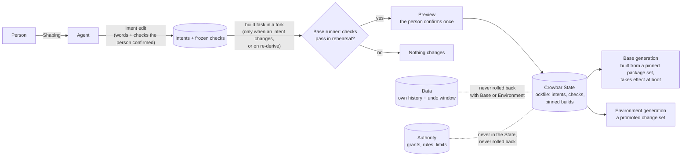
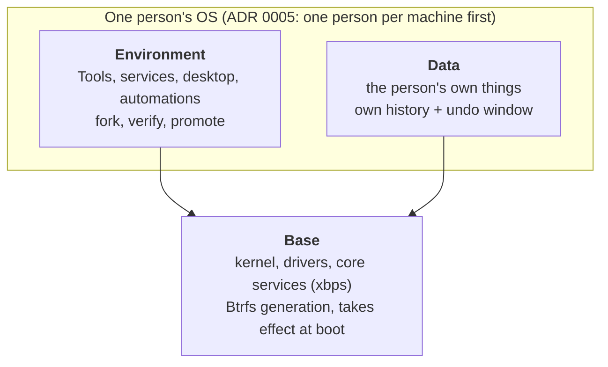
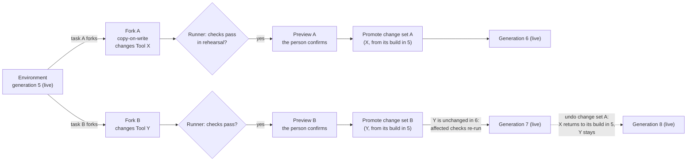
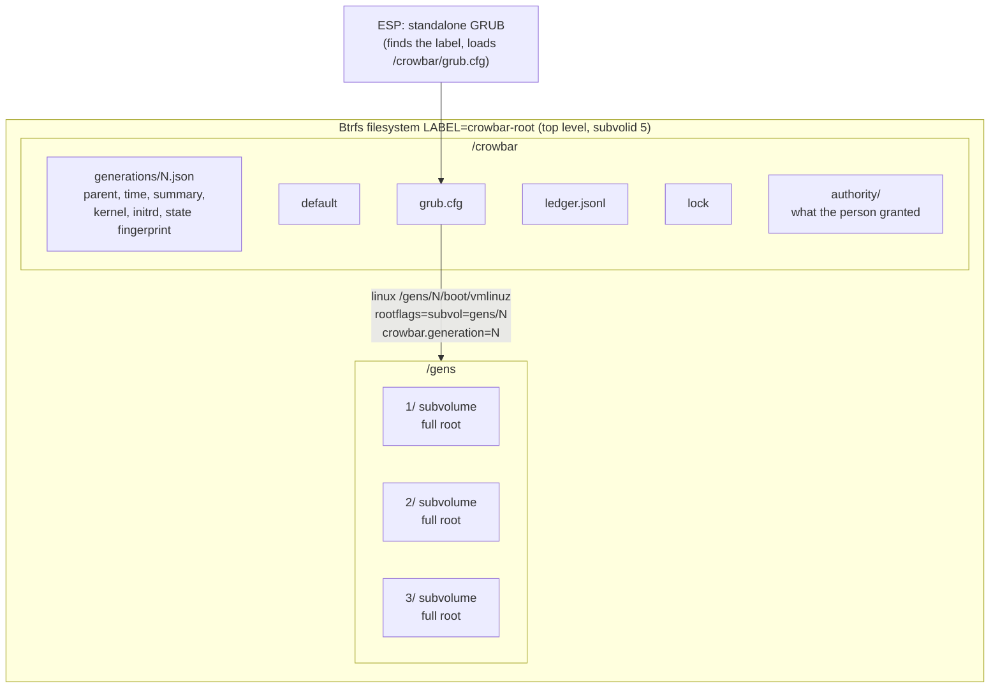
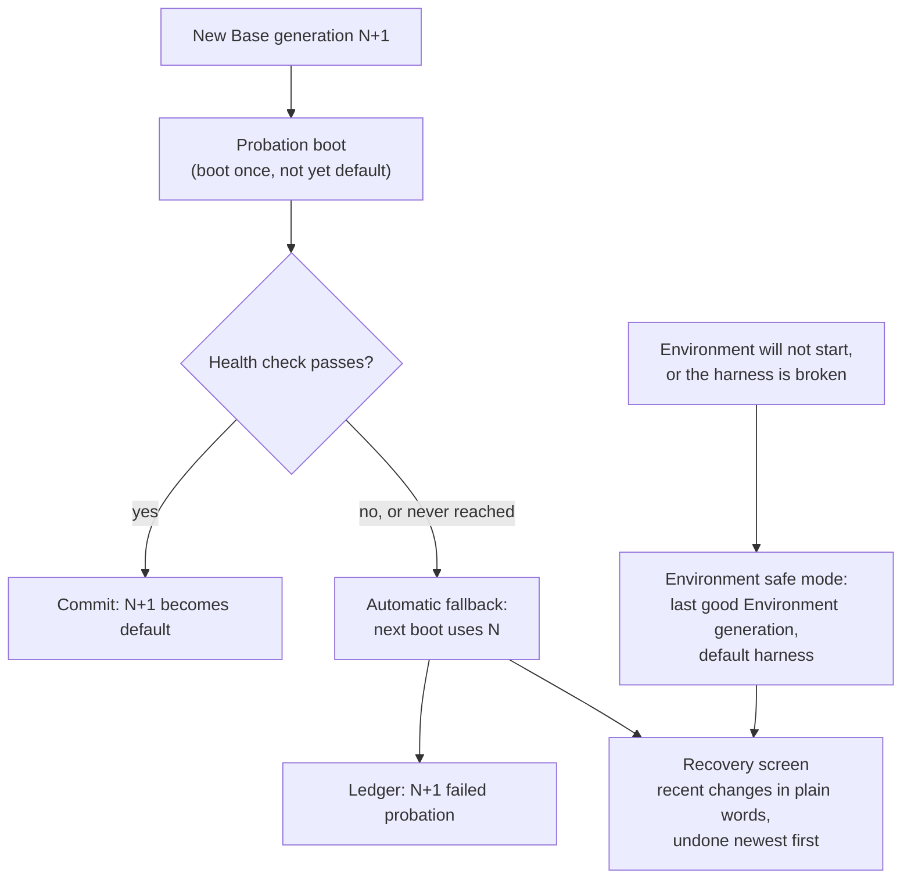

# Design: intents, the Crowbar State, and the apply engine

**Status:** draft, revised after
[council round 1](../reviews/council-round-1.md),
[council round 2](../reviews/council-round-2.md),
[council round 3](../reviews/council-round-3.md), and
[council round 4](../reviews/council-round-4.md). This note uses three tenses:

- **Milestone 1** is built. It is the Base layer only, in
  [`crates/`](../../crates/) (crates `crowbar-state` and
  `crowbar-apply`). Statements about it describe the code as it is now.
- **Milestone 1b** replaces how a Base generation is built and keeps the rest.
  See [ADR 0009](../adr/0009-base-from-a-pinned-package-set.md). It is not
  next. Council round 2 put Milestone 2 first: the adversarial slice, on stock
  Linux, which needs nothing from Base. See
  [Milestone 2](../milestones/milestone-2.md).
- **Later** is not built: intents, checks, rehearsal, the Environment and Data
  layers, and recovery. Milestone 2 prototypes parts of these on stock Linux.
  Its part one is the flow rules: labels, marks, and the plan over handles. Its
  part two is what this note describes: checks as scenarios, the runner, fork,
  preview, promote, and undo. Part two is cut first if the milestone slips.

## Summary

- **Intent, checks, and the pinned build are the source.** An intent is the
  person's words plus the checks they confirmed. A check is a scenario in a
  fixed data format. The **Crowbar State** is the lockfile that pins the intents, their frozen
  checks, and the exact builds. See
  [ADR 0001](../adr/0001-intent-is-the-source.md).
- A person's OS has **three layers**: Base, Environment, and Data. Each one
  changes and rolls back on its own. See
  [ADR 0002](../adr/0002-three-layers.md).
- **Authority is not in the State.** Grants, rules, effect limits, and clearances
  have their own domain and are never rolled back with software. See
  [ADR 0012](../adr/0012-authority-outside-the-state.md).
- The **engine** (Rust, the `crowbar` command) is the only code path that changes
  the system. Every change records a **generation** of the layer it changed.
- **Base** generations are Btrfs subvolumes that you choose in the boot menu.
  Milestone 1 built the layout, the boot menu, and rollback. Milestone 1b builds
  each generation from empty out of a complete pinned package set.
- The **Environment** changes by **fork, verify, promote**, one Tool at a time.
  Nothing is applied live and undone later, and nothing goes live unconfirmed.
  See [ADR 0007](../adr/0007-fork-verify-promote.md). **Later.**
- **Data** is never rolled back with the other two layers. It has its own
  history and undo window. Milestone 1b moves it out of the generations. The
  rest is **Later.**
- **Recovery never needs a model.** Probation boot, automatic fallback,
  Environment safe mode, and a plain recovery screen are all deterministic.
  **Later**, except automatic fallback, which is in Milestone 1b.



## Intents and checks (Later)

An intent is a durable statement of what the person wants: their words plus the
**checks** they confirmed.

**A check is a scenario in a fixed data format.** It lists the events the broker
delivers at stated simulated times, and the effects the Tool must and must not
ask the broker for. The person confirms it in plain language, for example "a
notification from Sam at 9:00 shows up; one from Slack at 9:00 waits until noon."
Fixed templates produce that wording from the scenario. No model writes or
translates it. A scenario with no expected effect is rejected.

- **A check can be written as code** when it needs logic the format cannot
  express. Wherever it is shown, it is marked "wording not verified".
- **A confirmed check is frozen in the Crowbar State.** The State stores the
  scenario itself, or the code, with its content hash. It does not store the
  wording, which the templates produce again each time. Changing a confirmed
  check is an intent edit. Nothing else can change one.

**Checks run in rehearsal.** The Tool runs against simulated time, simulated
events, and recorded inputs, with no real effects. Every interface the broker
offers a Tool has a simulated form and a record-and-replay form, so "waits until
noon" is tested in a second.

**A runner in Base runs the checks**, not the task that built the Tool. The
runner signs the result together with the content hash of the build and of every
check. A promote accepts only a build whose hash carries a passing result. What
passed is what goes live. See
[ADR 0001](../adr/0001-intent-is-the-source.md).

- **Intents come from Shaping.** The person's Agent helps them work out what they
  want before anything is built. The depth of Shaping scales with how unclear
  and how far-reaching the request is. "Build me a budgeting system" gets a real
  design conversation.
- **The person confirms checks in trusted UI.** A harness cannot assert "the
  person confirmed". An intent edit without confirmed checks is refused.
- **Every change is shown as a preview.** One confirmation in trusted UI
  promotes exactly the build that was previewed. Nothing goes live unconfirmed,
  however small. "Make the text bigger" costs one confirmation.
- **An edit that asks for new authority** needs the authority change confirmed
  as well, with a hardware root. See
  [ADR 0014](../adr/0014-a-yes-comes-from-the-person.md).
- **The intents are a curated, current set, not a log of requests.** When the
  person says "…except from Sam", the Agent merges that into the existing intent
  and shows the diff. The ledger keeps the history. The person can adjust any
  intent later, including by pointing at a Tool and saying what to change.
- **Only the person's own Agent edits intents, and only with the person's
  agreement.** Tasks and other agents can never edit them. The OS enforces this.
  See [the gate, the monitor, and autonomy](gate-monitor-and-autonomy.md).
- **No secret values appear in intents.** An intent names the secret it needs
  ("a Nextcloud login"). The value lives in the vault. See
  [ADR 0006](../adr/0006-broker-owns-all-egress.md).

### Compiling and re-deriving

Compiling intents into the Crowbar State is not deterministic, because a model
does it. So it happens only when:

1. an intent changes, or
2. the person explicitly asks to **re-derive**, for example after moving to a
   better model.

The words and the checks are not the whole source. The first build makes many
choices the person never stated and then relies on. So the **pinned build** the
person accepted is part of the source, and a re-derive has to earn its place. It
runs as a build task in a fork and is accepted only when:

1. every frozen check passes in rehearsal, and
2. replaying the Tool's recorded inputs through the new build gives the same
   results as the old one, apart from differences the person accepts.

Passing the checks is necessary evidence. It is not proof that nothing the person
relies on has changed. The old pinned build is kept until the replay matches. A
better model never rewrites the OS silently, and a re-derive can never change a
frozen check.

**The build task never sees real inputs.** Recorded inputs are real mail and real
web responses, so they are open untrusted input and often private. The runner
does the replay, not the build task. See
[ADR 0011](../adr/0011-task-principals.md).

- A build task sees results on synthetic inputs only.
- A replay of real recorded inputs reaches the build task as pass or fail. That
  verdict is capped at a fixed number of replays per re-derive, so a build cannot
  search a real input one bit at a time.
- Fixing a bug that needs the real input goes through the person, who turns that
  input into a new check.

**The State records whether each pinned build is clean.** A build is clean when
its build task read only the intent, the checks, the Tool's own source, and
admitted input. A grant binds to a clean build, so the engine must be able to
tell.

- A mark persists in a Tool's source. Approving an unclean build does not clean
  it.
- Every later rebuild that reads that source is unclean.
- The source stays marked until the Tool is re-derived from the intent and the
  checks alone.

### Sharing

A person shares a Tool as its **pinned build together with its intent and
checks**. The recipient's OS runs the checks in rehearsal, shows what the Tool
needs, and the recipient grants that fresh. See
[ADR 0010](../adr/0010-share-the-pinned-build.md).

- Someone else's words are untrusted input. They are never handed to the
  recipient's Agent as instructions.
- A Tool from a stranger runs only as WASM. Rebuilding it locally from its
  intent stays possible. The build task that reads the stranger's words is
  marked, so the result gets no grant without the person's answer. See
  [ADR 0011](../adr/0011-task-principals.md).
- The author's reason for each need is shown as the author's claim, next to the
  need itself in the OS's fixed words.
- An **OS definition** is the same thing for a whole OS: the intents and checks
  with the State that pins the builds.
- Standing grants and standing rules never transfer. The State holds no
  authority, so sharing a part of it transfers none. What is shared is chosen
  per Tool: sharing one Tool does not send the rest of the State, such as the
  `[agent]` and `[desktop]` sections. Data transfers only when explicitly
  included. Secrets are named, never included.

## The Crowbar State document

TOML, because people can read and edit it and it diffs well.

In Milestone 1 there is one file, `/etc/crowbar/state.toml`, written by hand and
stored inside each Base generation, so every generation records the State that
built it. **Later**, the Agent compiles the State from intents, and a person can
still read and edit it.

That one file cannot stay the home of the whole State. Base is per machine and
changes rarely. The Environment is shared across the fleet and changes many times
a day. Where the Environment part of the State lives is an open question below.

Milestone 1 schema (version 1). It covers the Base layer only:

```toml
version = 1                      # schema version; the engine rejects others

[system]
hostname = "crowbar-lab"

[packages]
install = ["jq", "htop"]         # packages the state owns (see ownership)

[services]
enabled = ["dhcpcd", "sshd", "udevd", "agetty-tty1", "agetty-ttyS0"]  # exact set

[[file]]                         # whole managed files
path = "/etc/motd"
content = "..."
mode = "0644"                    # optional, default 0644

[[mount]]                        # rendered into a marked block of /etc/fstab
device = "LABEL=crowbar-data"
target = "/srv/data"
fstype = "ext4"
options = "defaults"             # optional
```

Sections to come:

- **Milestone 1b:** `[pin]`, the package repository snapshot for the Base
  generation, and a `[packages]` section that lists the **complete** Base package
  set (see [Milestone 1b](#milestone-1b-base-from-a-pinned-package-set)).
- **Later:** the intents and their frozen checks. Each check is stored as its
  scenario, or as code, with a content hash.
- **Later:** `[[tool]]`: each Tool with its identity, source, content hash, and
  what it needs. A grant binds to the identity and the needs. See the
  [capability model](capability-model.md).
- **Later:** `[agent]`: the harness and models the person chose. It is the
  person's own choice and is not part of a shared Tool.
- **Later:** `[desktop]`: shell, theme, and keybindings. It is not part of a
  shared Tool either. The trusted UI and the confirm gesture are part of Base
  and cannot be themed or rebound from here.

**Authority is never in the State.** The earlier design had `[capabilities]`
(standing grants) and `[autonomy]` (standing rules and Allowances) here. They are
gone. Generations are builds of the State, so rolling back an unrelated software
change would have restored a revoked grant, and a shared State would have carried
authority that must never transfer. The State says what each Tool *needs*. The
authority domain records what the person *granted*: standing grants, standing
rules, effect limits, and clearances, with their own history. The vault, the
ledger, and Agent memory are separate domains too.

Every section that describes a person's OS is tied to an explicit person, never
to "the" user. The first version supports one person per machine, but the State
must not make more people impossible later. See
[ADR 0005](../adr/0005-one-person-first.md).

**Secrets are never in the State.** It refers to them by name only.

### Validation (Milestone 1)

`State::from_toml_str` parses and validates before anything else runs:

- Unknown fields are errors (`deny_unknown_fields`). A typo fails; it is not
  silently ignored.
- Names are checked (hostname, xbps package names, runit service names).
- File paths must be clean absolute paths. Protected locations are rejected:
  `/proc`, `/sys`, `/dev`, `/run`, `/boot`, `/etc/crowbar`, and files that another
  section owns (`/etc/fstab`, `/etc/hostname`).
- A mount target must be an absolute path other than `/`, and not at or under a
  protected location. A mount device cannot begin with `#`, which `/etc/fstab`
  reads as a comment. No mount field
  (`device`, `target`, `fstype`, `options`) may contain whitespace, control
  characters, or backslashes, because each is written as one word into
  `/etc/fstab`, which also reads `\040`-style escapes.

The engine checks a `[[file]]` path a second time, after it has resolved the path
inside the generation (see [confined paths](#confined-paths)). A symlink cannot
make an allowed path mean a protected location. This runs at plan time, so the
plan fails, not the apply.

### Ownership rules (Milestone 1; replaced in Milestone 1b)

Milestone 1 describes only part of a system: a base image plus a declared delta.
The engine must then never remove something it does not own.

| Section | What the state owns |
| --- | --- |
| `system.hostname` | `/etc/hostname` |
| `packages.install` | Only the listed packages. A package is removed only if a *previous* state listed it and the new state does not. |
| `services.enabled` | The **exact** set of links in `/etc/runit/runsvdir/default`. |
| `[[file]]` | Each declared path. A file is deleted only if the previous state declared it. |
| `[[mount]]` | A marked block in `/etc/fstab`. Base lines outside the block are untouched. |

Council round 1 found that these rules are where the defects are. They are listed
under [what is wrong with converging a copy](#what-is-wrong-with-converging-a-copy).
Milestone 1b removes the rules instead of repairing them: the State owns every
package in Base, so there is no "partly described" system to protect.

## Three layers



| Layer | What it holds | How a change applies | How undo works | Built |
| --- | --- | --- | --- | --- |
| **Base** | Kernel, drivers, core services, Void packages | A new Btrfs generation, built next to the running one; it takes effect at the next boot | Boot an older generation, or `crowbar rollback` | Milestone 1; rebuilt from a pinned set in Milestone 1b |
| **Environment** | Tools, services, desktop, automations | A change set is promoted from a task's fork, as a new Environment generation, after the person confirms the preview | Undo one change set and keep later changes to other Tools. Rolling back the whole Environment is a recovery action | Later |
| **Data** | The person's own things | The person changes it directly. A task stages its writes in its workspace and commits them together when it finishes | Its own history and undo window; never rolled back with Base or Environment | Own subvolume in Milestone 1b; the rest later |

### Base

- **xbps belongs to Base only.** Agent requests change the Environment. A request
  reaches Base only when the person really needs to get close to the metal: a
  driver, a kernel feature, or a core service. That is a deliberate change made
  with owner authority, and it needs a reboot.
- Installed native apps are not packages in Base. They live in the Environment,
  in the sandbox, under the same broker as generated Tools.
- Base is per machine, because it depends on the hardware. Each machine in a
  fleet has its own Base.

### Environment (Later)

It changes by **fork, verify, promote**, and the unit of change is the Tool:



- **Fork.** A task that changes installed behaviour (a Tool, a service, the
  desktop) works in a fork: a copy-on-write copy of the Environment. A fork has
  no egress of its own. The task reaches its model and its dependencies only
  through the broker.
- **Verify.** The task builds in the fork. The runner in Base proves the checks
  in rehearsal and signs the result for the content hash of the build.
- **Preview.** The person sees the forked Tool running in the fork, drawn by the
  shell and marked as a preview. It has no effects outside the fork. A preview
  is bound to the content hash of the build.
- **Promote.** One confirmation in trusted UI promotes exactly the build that
  was previewed. A promote of anything else is refused. It is the only way the
  Environment changes, and each promote makes a new Environment generation.
- **A promote carries a change set**: the Tools it changes, and the build of
  each that the task started from. It succeeds when none of those Tools has
  changed since. Two tasks on unrelated Tools both promote.
- **Affected checks run again.** The runner re-runs the checks of every Tool the
  combined result could affect. The person is asked only when two change sets
  touch the same Tool or a check fails. So the engine must know which Tools a
  change could affect.
- **Undo reverts one change set.** Each Tool in it returns to its earlier pinned
  build, as a new generation. Later change sets to other Tools stay.
- **An undo is a change like any other.** The runner re-runs the checks of every
  Tool the undo could affect, and the person confirms it. The undo is refused,
  and both are shown, when a later change set touched the same Tool, or when a
  Tool that depends on this one would fail its checks.
- **Rolling back the whole Environment** to an earlier generation remains as a
  recovery action.
- **One line of generations.** The live Environment has one line of generations.
  Forks branch from it and return as change sets.
- **The lead machine orders promotes.** In the first version one machine in the
  fleet puts promotes in order. See
  [ADR 0012](../adr/0012-authority-outside-the-state.md).
- **Leases.** Ports, devices, and model time are leased to a task by name.

**A task that changes no installed behaviour gets no fork.** Every task has a
**workspace**: a private scratch area and a view of the Data it was given. Its
writes to Data are staged in the workspace and committed together when the task
finishes, inside its effect limits, as one entry in the Data history. Sorting
photos is a task with a workspace, not an Environment change.

Undo only protects a person who notices a problem. A preview shows the change
before it is live.

The Environment is built from the same intents and State on every machine in the
fleet, with per-machine overrides.

### Data

Data is the person's own things. Rolling back Base or Environment never rolls it
back.

**Milestone 1 does not separate Data.** `/home`, `/root`, and `/var` are inside
each Base generation. So a rollback also rolls them back, and a successful apply
leaves behind whatever was written to them between the apply and the reboot (see
below).

**Milestone 1b** puts the person's Data and the machine's own writable state on
their own subvolumes, outside every generation.

**Later**, Data holds objects with provenance, labels, stable ids, and history.
Files stay the truth for software that expects them, and the typed layer starts
as an index over them. A task's writes are staged in its workspace and committed
together when it finishes, as one entry in the Data history. Data has an undo
window: for example, deletes go to a holding area for some number of days. It syncs local-first, with end-to-end
encryption, to the machines in the fleet whose clearance allows its label. See
the [capability model](capability-model.md).

## Base generations (Milestone 1)



What Milestone 1 built, and Milestone 1b keeps:

- **A generation is a full root in its own subvolume.** Booting generation *N*
  means `rootflags=subvol=gens/N`. There is no overlay and no union filesystem, so
  a generation is an ordinary Void root that you can inspect, `chroot` into, or
  copy.
- **Each generation is built next to the running one.** The new generation takes
  effect at the next boot.
- **The kernel lives in the generation.** GRUB reads `/gens/N/boot/vmlinuz-*`
  directly from Btrfs, so a kernel update is a normal package change that a
  rollback undoes.
- **The boot menu is generated** from the records in `/crowbar/generations`,
  newest first, with the default marked. The ESP holds only a small, fixed GRUB.
- **The booted generation is known exactly** from `crowbar.generation=N` on the
  kernel command line.
- **One apply or rollback at a time.** `/crowbar/lock` is held for the whole of
  an `init`, `apply`, `rollback`, or `render-boot-menu`. A second caller fails at
  once with a clear message; it does not wait.

What Milestone 1 built, and Milestone 1b replaces:

- **A generation is a copy of a running root, converged.** `apply` snapshots the
  *booted* generation (or `--from ID`) to `gens/N+1`, then changes the copy
  toward the State (`xbps-install -r`, file writes, runit links). The subvolume
  is writable, before and after.
- **A no-op apply creates nothing.** If the plan is empty, the snapshot is
  deleted.

### Confined paths

A generation is a full root, so it holds symlinks that are absolute in its own
namespace, for example `/etc/sv/sshd/supervise -> /run/runit/supervise.sshd`.
Joining such a path onto the generation directory and handing it to the kernel
would resolve the link against the host root, which is the running system. The
first version of the engine did exactly that.

Every managed path the engine reads or writes now resolves inside the
generation, the way `chroot` would:

- An absolute symlink target restarts at the generation root.
- `..` stops at the generation root.
- More than 40 links in one lookup is an error.
- Writes and removes act on the entry itself, so a symlink at the final name is
  replaced or removed, never written through.
- `plan` and `drift` look at the entry itself too. A managed path that is a
  symlink, a directory, a device, or anything else that is not a regular file
  counts as different and is never opened.
- The kernel and the initramfs are resolved inside the generation and must be
  regular files there. A boot path with a character outside `A-Z a-z 0-9 . _ / + -`
  is refused, so nothing inside a generation can add lines to the boot menu.
- `dev`, `proc`, and `sys` inside the generation must be real directories before
  the engine mounts the host's over them for package scripts. A symlink there is
  refused.
- Files are written to a temporary name created with "must not exist", then
  given their mode, renamed into place, and the directory is synced.

The walk is done in userspace. It does not defend against something else
changing the tree between the walk and the write. The engine builds a generation
that nothing else runs in, and holds the lock while it does. A root with a
hostile concurrent writer would need `openat2(RESOLVE_IN_ROOT)`.

### Why build next to the running system

The other common approach is to snapshot the running root first and then change
the running root in place. We build next to it because:

1. The running system stays consistent. A half-applied change never runs.
2. Service restarts and file locks do not affect the build.
3. A generation that boots is the test. Probation boot (below) builds on this.

The cost is a reboot. That is acceptable for Base because Base changes rarely.
Everyday changes go to the Environment.

### What is wrong with converging a copy

Building next to the running system is right. Building *from a copy of it* is
not. Council round 1 found these defects, and all of them come from that model:

- **Anything written between an apply and the reboot is left behind.** The new
  generation holds `/home`, `/root`, and `/var` as they were when the apply ran.
  Apply at 10:00, reboot at 18:00, and eight hours of writes stay in the old
  generation. This happens on every successful apply, not only on rollback.
- **Taking over a base file or package, then dropping it, deletes it.** Declare
  `/etc/sudoers` or `openssh` (both already in the base image), then remove the
  declaration: the engine plans to remove the file and the package.
- **A declared package that is already installed is never recorded as owned.** A
  plan with no changes creates no generation, so the declaration is lost.
  Dropping the package from a later State then does not remove it.
- **Omitting `[services]` plans to disable every service.** The section owns the
  exact set, and an absent section means the empty set.
- **A generation depends on the history of the root it was copied from.** It is
  generation *N* plus a delta, not a build of the State. Two machines with the
  same State can differ.

Other limits of the Milestone 1 engine, which Milestone 1b must also settle:

- `xbps` installs whatever is current in the repository, and there is no way to
  update a package that is already installed.
- Package scripts run with the host's `/dev`, `/proc`, and `/sys` bound into the
  build root. So "the running system is never changed" holds for the engine's
  own writes, not for what a package script chooses to do.
- The `!` flag in a plan covers mount changes, disabled services, and package
  removals. It does not cover `[[file]]` writes, which can stop a boot as easily.
- Drift detection covers only what the State declares.

## Milestone 1b: Base from a pinned package set

Decided by [ADR 0009](../adr/0009-base-from-a-pinned-package-set.md). It
follows Milestone 2 in the order of work.

- **Each Base generation is built from empty** out of a complete package set that
  the State pins. It does not start from a copy of any running root.
- **The State owns every package in Base.** The ownership rules above go away.
- **A generation is read-only once built.**
- **The person's Data and the machine's own writable state live on separate
  subvolumes**, outside every generation. An apply never drops what was written
  before the reboot.
- **Pinning.** The State pins a package repository snapshot for each Base
  generation, so rebuilding generation *N* fetches the same package versions.
  **Later**, it also pins a content hash for every Tool.
- **Automatic fallback** when a new generation fails to boot, and **crash
  safety** during an apply.

Kept from Milestone 1: the generation layout, the boot menu, the ledger, the
lock, confined paths, the publish sequence below, and the VM lab. Replaced: the
plan and ownership logic.

## The apply sequence (Base, Milestone 1)

An apply has two phases, with one commit point between them.

```mermaid
sequenceDiagram
    participant C as crowbar apply
    participant L as Layout (/crowbar)
    participant B as Btrfs
    participant X as xbps / runit / files
    C->>C: parse + validate state.toml
    C->>L: take the lock (fail at once if held)
    C->>L: read the current default, next id N+1
    C->>B: subvolume snapshot gens/booted -> gens/N+1
    rect rgb(23, 33, 43)
    Note over C,X: Build: touches only gens/N+1
    C->>X: plan against gens/N+1 (read actual)
    alt plan is empty
        C->>B: delete gens/N+1, done
    else changes
        C->>X: converge gens/N+1 (xbps -r, links, files, fstab block)
        C->>X: write /etc/crowbar/state.toml + generation id
        C->>X: find the kernel and initramfs in gens/N+1
        C->>B: sync gens/N+1 to disk
    end
    end
    rect rgb(23, 33, 43)
    Note over C,L: Publish
    C->>L: write generations/N+1.json
    C->>L: default = N+1
    C->>L: render grub.cfg (the rename is the commit point)
    end
    C->>L: append ledger: apply ok
```



- **A failure during build** deletes `gens/N+1` and appends "apply failed" to the
  ledger. The default, the boot menu, and the records were never touched.
- **A failure during publish, before the commit point,** is undone: the previous
  default is restored and the record is removed. The subvolume is deleted only
  once the boot menu on disk is known not to name it. If that cannot be
  established, the subvolume is kept and the error says so, because a menu entry
  for a root that is gone is worse than a spare subvolume.
- **The commit point is the atomic rename of `grub.cfg`**, because that file is
  the only one GRUB reads.
- **After the commit point, nothing removes the generation.** If a later step
  fails (syncing the menu's directory, or writing the ledger entry), the apply
  stands, the problem is printed, and `crowbar` exits with status 3.
- **The new generation is synced to disk before publish**, so the boot menu never
  names a generation whose files are still only in memory.

When a publish fails without reporting that the rename happened, the engine
reads the menu on disk before it undoes anything. Only a real `menuentry` line
for the generation, or the `set default` line, counts as naming it. If the menu
names the new generation, the apply is committed and the engine rolls forward.
`init-image` follows the same rule. `rollback` deletes nothing, so it does not read
the menu back: it relies on the write reporting whether the rename happened,
and restores the previous default if it did not.

The first version wrote the record, the default, and the menu, and then deleted
the subvolume on any later error. A failed ledger append left GRUB's default
pointing at a root that no longer existed.

The plan lists every change. Changes that can stop the next boot are flagged
with `!`. Milestone 1 only displays the flag. **Later**, every new Base
generation goes through probation boot.

## Commands (Milestone 1)

| Command | What it does |
| --- | --- |
| `crowbar plan STATE` | Show what `apply` would change compared with the booted system. |
| `crowbar apply STATE` | Build a new generation from the booted one and make it the boot default. Takes the lock. |
| `crowbar generations` | List generations, parent, time, summary, `default` and `booted`. |
| `crowbar rollback [ID]` | Make `ID` (by default the booted generation) the boot default. Takes the lock. |
| `crowbar drift` | Compare the booted system with its recorded state. |
| `crowbar ledger` | Print the apply and rollback history. Reports damaged lines on stderr. |
| `crowbar render-boot-menu` | Regenerate `grub.cfg` from the records. Takes the lock. |

Exit status:

| Status | Meaning |
| --- | --- |
| 0 | Done. |
| 1 | Failed. The menu, default, records, and subvolumes are as they were. This includes "another apply or rollback is running". |
| 2 | `drift` found a difference. |
| 3 | The change is committed, but a later step failed, such as writing the ledger entry. |
| 4 | Failed, and something could not be put back. The message says what was left. |

## Recovery (Later)

When something breaks, the Agent may be the thing that is broken. So recovery
never depends on the Agent, a harness, or a model. Everything below is
deterministic and lives in Base.



- **Probation boot and automatic fallback.** A new Base generation boots once on
  probation. It becomes the default only after a health check passes. If the
  check fails, or the boot never reaches it, the next boot uses the previous
  generation. Milestone 1 makes the new generation the default at once, and
  recovery is a person choosing an older entry in the boot menu. Automatic
  fallback is in Milestone 1b. The mechanism is an open question below.
- **Environment safe mode.** It starts the last good Environment generation with
  the default harness. A broken external harness can never lock the person out.
- **A plain recovery screen.** It lists recent changes in human words
  ("Tuesday: added writing mode") and undoes them **newest first**. For the
  Environment that is an undo of the newest change set, or a roll back to an
  earlier generation. For Base it is booting the generation before. Both return
  to pinned builds, so neither needs a model. The screen reads the ledger and
  generation records.

## Drift detection

`crowbar drift` replans the recorded state against `/`. If the plan is not empty,
something changed the system outside the engine, for example an edited managed
file. In Milestone 1 it sees only what the State declares: it misses extra
packages, upgraded versions, and modified binaries.

**Later:**

- With Milestone 1b, the State owns the whole Base package set and a generation
  is read-only, so drift can compare everything in Base.
- A nightly runit-scheduled job (Void has no systemd timers; use `snooze` or a
  small runit service) that runs `crowbar drift` and writes the result to the
  ledger.
- Drift is shown to the person in plain language. The Agent can offer two fixes:
  turn the change into an intent, or revert it with a new generation.
- A change made with owner authority is expected drift. It is recorded in the
  ledger, and the Agent offers to fold it into the intents.

## The ledger

`/crowbar/ledger.jsonl` is append-only, one JSON object per line: time, actor
(`CROWBAR_ACTOR`, later the authenticated principal), action (`init`, `apply`,
`rollback`), generation, from, outcome, and detail. It lives on the top level, not
inside a generation, so rolling back does not rewrite history.

- **A torn write does not hide the history.** A crash can leave a partial last
  line. Reading skips a line that is not a ledger entry and reports its number.
  The next append starts on a fresh line, and each entry is one write.
- **A failed apply is recorded** with the id it would have had.
- **Ids can be reused after a cleanly failed apply.** The next id is one past the
  highest id found in the records or the subvolumes. A cleanly failed apply
  leaves neither, so the ledger can show "apply failed gen 4" and later "apply ok
  gen 4". A subvolume that was abandoned and not deleted does keep its id from
  being reused.

**Later:** the ledger also records intent edits, promotes, grants, gate
decisions, egress, and uses of owner authority, with one-step revoke and undo. It
also gets tamper evidence: hash chaining, and signatures from the broker and the
gate, with hardware-bound keys where the machine has them. The ledger is its own
domain: it is never part of the State or of a generation.

The ledger of gate decisions and effects, chained by hash, is built in
[`crates/crowbar-authority`](../../crates/crowbar-authority/src/lib.rs), beside
the authority domain, which is kept in `/crowbar/authority/`. The entries above
have not moved onto it, and nothing is signed yet.

## Garbage collection (Later)

Generations share data through Btrfs copy-on-write, but they still add up.
Milestone 1 never deletes one, and a full disk is the most likely cause of a
failed apply. Policy: keep the booted, default, and last *K* generations, plus
every generation marked as pinned. Collection never deletes the booted or default
generation. The same rule applies to Environment generations. A fork or a
workspace whose task has ended is collected. An earlier pinned build must be kept
for as long as an undo of the change set that replaced it is offered.

## Open questions

1. **Promoting under a running Tool.** What exactly is swapped in one step when a
   change set is promoted, and how does a Tool that is running move to the new
   build without losing its state?
2. **Where the State lives.** One file inside a per-machine Base generation
   cannot hold a fleet-wide Environment State that changes many times a day.
   Does the State split into a Base part per machine and an Environment part per
   person, and where is the second one stored and versioned? The lead machine
   orders promotes in the first version; that does not settle where the State is
   kept.
3. **Probation boot on Btrfs.** The usual mechanism is GRUB's `next_entry`, which
   GRUB writes to its environment block. GRUB cannot write to Btrfs, and the ESP
   is meant never to change. Does probation need a writable `grubenv` on the ESP,
   or another mechanism such as boot counting? One reviewer raised this from
   knowledge of GRUB; it is untested here.
4. **Health checks.** What does the Base health check test (reached the shell,
   network up, the Environment started), and how long does probation last?
5. **Pinning mechanics.** A full repository mirror per generation, a content-
   addressed package cache, or recorded versions plus a long-lived archive?
6. **Base updates.** How does a pinned Base receive security updates, and how
   often?
7. **Writable state under a read-only Base.** Which paths are Data, which are the
   machine's own state, and where does each live? `xbps` keeps its database
   under `/var`, which must stay with the generation.
8. **Recorded inputs.** What does the OS record for replay, for how long, and
   under which label? A recording of private inputs is private Data, and a
   recording of open input is marked. The build task never reads either.
9. **Generation ids.** Should ids be strictly monotonic? That needs a high-water
   mark that does not depend on the ledger being readable.
10. **Schema evolution.** How do we migrate `version = 1` documents, and does an
    old generation keep the schema it was built with? How do intents written for
    an old schema re-derive?
11. **Data that is newer than code.** When a Tool is undone, or the Environment
    rolls back, the earlier build may meet Data written by the newer one. Who
    migrates, and in which direction?
12. **Space and GC policy.** How many generations of each layer, and how many
    forks, do we keep by default on small disks?
13. **Undo window for Data.** How long do deletes stay recoverable, and how is
    that budgeted against disk space?
14. **Notification verbosity.** It was a setting under `[autonomy]`. It is not
    authority. Does it stay in the State?
15. **Which Tools a change could affect.** A promote re-runs the checks of every
    Tool the combined result could affect. How does the engine know which those
    are?
16. **Desktop parts as Tools.** ADR 0007 treats a service, an automation, and
    each part of the desktop as a Tool for change sets. How is the desktop cut
    into parts, so that undoing a theme does not undo the keybindings?

Resolved: **what the base image owns.** The State owns the full Base package set
([ADR 0009](../adr/0009-base-from-a-pinned-package-set.md)).
