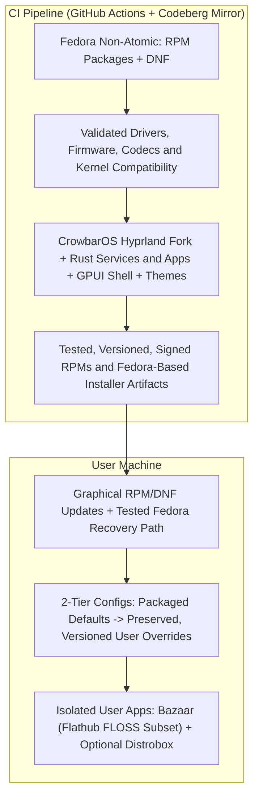
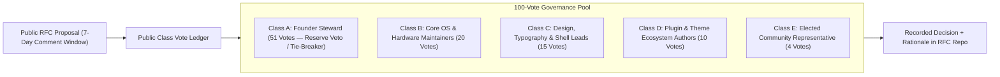

# CrowbarOS: Community-Built FOSS Desktop Plan

**Quiet surface. Sharp mind.**

This document captures CrowbarOS's agreed architecture, package bill of materials, desktop UX specification, brand direction, and multi-class governance charter. It describes the planned operating system; the accompanying brand kit and desktop mockups are design references for implementation.

**Architecture decisions — November 14, 2026:** **Fedora (non-Atomic), Hyprland, Rust, and GPUI** are the selected stack. Use Fedora's conventional RPM/DNF package-based system; maintain a CrowbarOS downstream Hyprland fork with floating windows and mouse controls by default. Use Rust for new CrowbarOS-owned native applications, services, and shared foundations, and GPUI for their graphical interfaces and the custom shell UI. Existing upstream components and necessary patches may retain their languages. These are implementation decisions, not claims that the native desktop or fork has shipped.

**CrowbarOS is a community-built Linux desktop for curious minds: a calm, studio-grade, mouse-and-trackpad-friendly Wayland environment for everyday users, writers, creatives, and technically fluent Linux users.** Its identity combines **Nullkeel's blue-black and cyan palette** with **Rookslash's engraved crow**. Dark surfaces, precise details, and a restrained accent give the desktop its hacker appeal, while proportional typography and discoverable controls keep daily work approachable for people switching from macOS or Windows.

---

## 1. Founding Identity & Core Pillars

| Pillar | Locked-In Decision |
| :--- | :--- |
| **Name & Brand Line** | **CrowbarOS** — one word, with capital **C**, **O**, and **S**. **"Quiet surface. Sharp mind."** Descriptor: **"A community-built Linux desktop."** Use `crowbaros` for technical namespaces. |
| **Owned Domains** | **`crowbaros.com`**, **`crowbaros.net`**, and **`crowbaros.org`** — purchased by the founder, confirmed November 14, 2026. |
| **Primary Audience** | Everyday desktop users, writers, illustrators, photographers, and makers switching from macOS/Windows, with a visual identity that also appeals to technically fluent Linux users, tinkerers, and hackers. GUI-first, zero terminal required for daily life. |
| **Distribution Base** | **Fedora, non-Atomic:** Conventional RPM packages and DNF-based system maintenance. Package CrowbarOS components for a supported Fedora release. |
| **Desktop Foundation** | **Hyprland**, with a maintained CrowbarOS downstream fork. Floating windows and discoverable mouse controls are the default; automatic tiling and scrolling are optional workflows. |
| **Implementation Language** | **Rust** for new CrowbarOS-owned native apps, services, and reusable foundations. Reuse upstream projects in their existing languages and allow necessary maintenance patches. |
| **Native UI Toolkit** | **GPUI** for CrowbarOS-owned application and shell interfaces, with a shared component library and design tokens. Wayland shell protocols and secure locking remain explicit implementation work. |
| **FOSS + Hardware Policy** | **FOSS Userland + Hardware QoL:** FOSS shell and default apps with zero telemetry. Target out-of-the-box support for essential GPU, Wi-Fi, media, printer, and drawing-tablet workflows; publish tested hardware coverage and driver requirements. |
| **App Store Boundary** | **Bazaar** configured to Flathub's `floss` subset by default (verified open-source apps + direct creator donation buttons), with a transparent 1-click user freedom toggle in Settings to unlock full Flathub if desired. |
| **Preload Philosophy** | **Ultra-Lean Core Only:** Ships strictly with **Zen Browser**, **Nautilus** (with Spacebar Quick Look), **Ghostty**, **System Studio Settings**, and **Bazaar**—zero pre-installed productivity or creative bloatware. |
| **AI Stance** | **Strictly Neutral:** Zero AI daemons, buttons, or prompts anywhere in the OS; rock-solid GPU/compute drivers underneath so users who want AI tools run them effortlessly, and users who don't enjoy a permanently calm, clutter-free sanctuary. |
| **Visual Personality** | **Quiet surface. Sharp mind.** Deep blue-black surfaces, controlled Ice cyan accents, an engraved crow, and crisp **Manrope** UI typography. **Dark is the brand default**; **Light** and **Warm Paper** remain first-class modes with auto-sunset switching. Optional wallpaper-derived accents and a **1-click Color-Accurate Studio Mode** preserve user choice and neutral chrome for visual work. |
| **Mascot & Mark** | A natural, right-facing engraved crow with a folded wing, slate perch, and one cyan wing feather. A simplified crow-head-and-slash symbol carries the identity at small sizes. The detailed crow is brand artwork, never an assistant or notification character. |
| **Governance Model** | **51% Founder Steward / 49% Role-Class Equity Model:** Transparent public RFC voting across four contributor classes (`49%`) paired with a `51%` Founder Steward reserve stake to anchor vision and break deadlocks cleanly. |

### CrowbarOS Brand System

The CrowbarOS identity combines dark technical styling with calm workflows, readable typography, creative work, and graphical control.

**Proposed primary web address:** `crowbaros.com`. The founder also owns `crowbaros.net` and `crowbaros.org`; their roles and redirects remain to be decided.

#### Palette and Color Roles

Preserve these five Nullkeel colors exactly in official logos, default theme tokens, and palette swatches:

| Color | Hex | Role |
| :--- | :--- | :--- |
| **Void** | `#080D12` | Main canvas, terminal background, boot screen, and deepest desktop surfaces. |
| **Abyss** | `#17212B` | Windows, dock, and raised dark surfaces. |
| **Ice** | `#49D7E8` | Logo slash, active-window outline, selected controls, progress feedback, and the crow's accent feather. |
| **Steel** | `#6D8191` | Decorative structure and muted graphical detail. |
| **Frost** | `#D8E5EC` | Primary text and light logo elements on dark surfaces. |

Dark surfaces dominate; Ice supplies a clear focus or action signal. Pair Ice-filled controls with Void text. Pair selection color with an outline, label, or state indicator so color is not the only cue.

Use **`#A8BAC7`** as the functional secondary-text color on dark surfaces. Steel on Abyss measures about **4.03:1**, below the **4.5:1** normal-text target; the secondary-text pairing measures about **8.16:1**. This support token improves readability without changing the five-color brand palette. Surface and separator tokens for Light, Warm Paper, and Studio Mode are documented in the brand kit.

#### Crow, Logo, and Wallpaper

- **Mascot:** Preserve the crow's natural silhouette, right-facing head, long beak, folded wing, engraved feather detail, slate perch, and single cyan feather accent. Use the full bird at generous sizes; keep the head and beak clear. Avoid mirrored poses, clothing, extra effects, or a glowing technological eye.
- **Logo:** Use the supplied outlined SVG masters for horizontal, stacked, wordmark-only, and symbol-only applications. The primary mark pairs an Ice slash with a Frost crow head and wordmark on Void or Abyss. Use the all-Void variant on light surfaces; Frost and Ice single-color variants are also supplied. Do not retype the wordmark or alter the mark's proportions and slash angle.
- **Small uses:** Keep clear space of at least one-quarter of the visible symbol height. Minimum digital widths are **160 px** for the horizontal logo and **140 px** for the stacked logo. Use the standard symbol at **24 px and above**, and the supplied micro symbol at **16–23 px**. Replace detailed mascot art with the symbol when feather detail becomes unreadable.
- **Wallpapers:** **Signal Feather** is the signature desktop treatment: engraved black feathers with cyan concentrated away from the main reading area. **Nightwatch** places the crow on the right with a quiet left field for lock-screen time and sign-in. **Quiet Signal** supplies sparse vector geometry for low-distraction and ultrawide setups; **CrowbarOS Signature** adds the logo. Keep raster artwork at its documented native resolution; use the vector masters for crisp 4K and ultrawide exports.
- **Voice:** Curious, capable, independent, and welcoming. Use clear sentence-case labels such as "Make it yours" and "Find your tools." Avoid gatekeeping slogans and unsupported security claims.

#### Typography

- **Interface and editorial text:** **Manrope**, locally supplied as a variable font. Use regular weight for body text and weights **600–700** for headings and emphasis. The wordmark is derived from Manrope 700 with custom spacing; its outlined master remains authoritative.
- **Terminal, code, paths, and technical data:** **IBM Plex Mono Regular**. Keep ordinary navigation and settings labels proportional.
- **Scale and accessibility:** Target **14–17 px** body/UI text, **24–42 px** headings, and at least **12 px** for compact metadata at the reference desktop scale. Respect user font scaling and display density. Use comfortable line spacing, visible keyboard focus, and the optional **Atkinson Hyperlegible** accessibility preset.
- **Distribution:** Bundle the supplied font files with their **SIL Open Font License** notices. The desktop must not depend on network font loading.

#### Brand References and Implementation Handoff

- [Brand overview](../../branding/crowbaros-brand-kit/CrowbarOS-brand-overview.png) and [14-page brand guide](../../branding/crowbaros-brand-kit/guide/CrowbarOS-brand-guide.pdf).
- [Detailed design system](../../branding/crowbaros-brand-kit/DESIGN.md), [JSON tokens](../../branding/crowbaros-brand-kit/tokens/crowbaros.tokens.json), and [CSS tokens](../../branding/crowbaros-brand-kit/tokens/crowbaros.css).
- [Desktop concept viewer](../../branding/crowbaros-brand-kit/mockups/desktop.html): workspace, Zen Mode, appearance settings, lock screen, and boot, with Dark, Light, Warm Paper, and neutral Studio studies.
- [Asset manifest](../../branding/crowbaros-brand-kit/asset-manifest.json) and [complete brand kit](../../branding/CrowbarOS-brand-kit.zip): SVG/PNG logos, transparent crow, wallpapers, social graphics, fonts, source files, and generation provenance.

The concept viewer supplies visual references, not a working desktop. Its side-by-side window arrangement predates the floating-by-default decision; it remains a reference for optional tiled layouts. Implementation belongs in the native Hyprland-based desktop. App glyphs, sample content, and system values are illustrative. The optional writing app shown in Zen Mode does not add a sixth bundled app.

---

## 2. OS Architecture: Fedora (Non-Atomic) + Hyprland + Rust + GPUI

**Fedora's conventional package-based system is the selected base.** Use RPM packages and DNF-based maintenance for the operating system, with signed CrowbarOS packages for the compositor fork, native applications/services, shell, themes, and defaults. Keep Flatpak application delivery separate from host system packages. The earlier Fedora Atomic/`bootc` and Ubuntu alternatives are superseded.

**Fedora 45 is the initial local development baseline**, using its non-Atomic Cloud Base image in separate build and test VMs. Record exact desktop/toolchain versions during bootstrap. Production repository hosting and signing, the installer, product support lifetime, and system recovery mechanism remain to be finalized; the distribution and toolkit choices are settled.

Keep the base system, compositor fork, native services, user interface, and branding separately maintainable. A future custom kernel or expanded distribution scope should not require rewriting application logic or the design system.

### Local Build and Test Workflow

Keep Omarchy as the development workstation. The [local VM workflow](../../development/local-vms.md) and `infra/vm/` recipes create two independent Fedora 45 KVM guests under user-session libvirt:

- **`crowbaros-build`:** 8 vCPUs, 12 GiB RAM, a 120 GiB virtual disk, Rust/Cargo and C/C++ build tools, clean Mock RPM builds, and local development signing.
- **`crowbaros-test`:** 4 vCPUs, 6 GiB RAM, a 64 GiB virtual disk, an ordinary desktop user, and an isolated Hyprland integration session. Install packaged artifacts through DNF and restore offline checkpoints between experiments.
- **Recreation:** Pin and verify the Fedora base image and signing key, keep provisioning recipes in the repository, and record installed package versions. Live package repositories still change; exact release reproduction requires retained packages and controlled repository snapshots.
- **Validated application and graphics path:** A [native GPUI 0.2.2 probe](../../development/gpui-validation-2026-11-14.md) builds as a signed RPM and passes rendering, input, focus, scrolling, palette and resize checks. The [hardware Vulkan follow-up](../../development/gpu-validation-2026-11-14.md) repeats those checks on the host Intel GPU through VirtIO DRM native contexts, with GPU execution evidence and a successful cold boot. The [optional acceleration profile](../../development/gpu-vulkan.md) uses an isolated, signed Mesa driver with the experimental Intel VirtIO backend; Fedora's Mesa remains installed and QEMU's sandbox stays enabled. Hyprland uses accelerated VirGL OpenGL; Venus remains disabled.
- **Packaged desktop slice:** The [Rust/GPUI shell](../../../apps/shell/README.md) builds in the Fedora builder and installs through signed DNF metadata in the test guest. The test session starts its bar, dock, launcher and wallpaper automatically, alongside the saved Studio Settings motion adapter. The dock currently exposes installed Applications, Terminal and Settings controls; the planned five-app product preload and auto-hide behavior are later work.
- **Current boundaries:** The test guest uses the upstream-recommended Hyprland COPR as a temporary baseline until CrowbarOS's fork packages exist. Intel VM acceleration is a host-specific development result, not a production driver qualification. The first packaged shell is integrated; full session behavior, performance targets, and broader GPU coverage remain acceptance work.
- **Scope:** Physical hardware testing is deferred to a later milestone. VM results do not establish GPU performance, color accuracy, suspend/resume, or real display/input compatibility. The lab's console autologin and development signing key are not product defaults.

### Hardware and Update Delivery

- **Hardware support:** Package and validate firmware, Mesa, hardware video acceleration, codecs, printing, and tablet support for the supported Fedora release. Validate NVIDIA driver/kernel combinations separately, including hybrid laptops. Resolve package sources, module signing, and installer detection during Fedora integration; the former Universal Blue image streams are superseded.
- **Release ownership:** Publish the supported hardware matrix and known limitations. Test mixed-DPI displays, docking, suspend/resume, screen sharing, and creative peripherals. Hardware coverage is an acceptance target, not a guarantee that every device works.
- **Graphical updates and recovery:** Provide a Rust/GPUI interface backed by Fedora's package-management mechanisms. Keep compatible desktop RPMs together, preserve user settings, and validate recovery from failed upgrades. Select and test the system snapshot/recovery approach; DNF package transactions alone do not establish whole-system rollback. Fedora Atomic image rollback is outside this architecture.

### Hyprland Fork and Upstream Maintenance Policy

Maintain a downstream **`crowbaros-hyprland`** repository for changes that require compositor ownership. This is a planned repository, not a claim that a fork or release pipeline already exists.

1. **Keep the difference small.** Put branding, settings, application logic, and most shell behavior outside the compositor. Add core patches only for demonstrated requirements that configuration, IPC, or a suitably maintained extension cannot meet. A fork may initially build an unchanged upstream release.
2. **Preserve upstream history.** Track upstream releases and development without modifying their tags. Keep CrowbarOS patches in focused commits, and record an owner, purpose, regression check, upstream issue/PR where applicable, and removal condition for each patch. Submit generally useful fixes upstream when appropriate.
3. **Integrate deliberately.** Start an integration branch from a selected upstream stable tag, carry forward the documented patch set, resolve changes, and review the result. Publish separate CrowbarOS release tags identifying the upstream base and downstream revision. Do not rewrite published release history or automatically ship upstream development commits.
4. **Test the whole desktop combination.** Record exact compositor, supporting library, portal, shell/toolkit, and essential plugin revisions in a release manifest. Build plugins against that compositor. Promote development builds through a test channel before stable delivery, with an assigned release owner and recorded results.
5. **Treat fixes differently from features.** Monitor upstream security and critical regression fixes continuously, backport relevant fixes promptly to supported releases, and publish advisories where needed. Hold feature upgrades until the integration checks pass; indefinite version pinning is not the maintenance strategy.
6. **Require release checks.** Verify mouse-only launch/move/resize/minimize/restore/maximize/snap; dialogs and focus; dock and overview state; display hotplug and suspend; screen sharing; supported GPU/tablet workflows; accessibility; and upgrade/recovery with existing user settings. A headless or VM pass cannot certify physical hardware behavior.

Hyprland uses the [BSD-3-Clause license](https://github.com/hyprwm/Hyprland/blob/main/LICENSE); preserve upstream notices and keep compositor licensing distinct from CrowbarOS application licenses. Upstream documents [version-dependent plugin compatibility](https://wiki.hypr.land/hyprland-plugins/development/plugin-guidelines/), and the [0.55 release](https://hypr.land/news/update55/) illustrates the configuration migrations we must own.

---

## 3. Signature Desktop UX: Hyprland + Rust/GPUI Shell and Applications

Build the CrowbarOS shell and first-party graphical applications in **Rust with GPUI**, on the maintained Hyprland compositor. A shared component library carries the palette, typography, controls, focus behavior, and motion across the desktop. Reuse established networking, Bluetooth, audio, authentication, and portal services through defined interfaces. The earlier Quickshell/DankMaterialShell derivative and alternative toolkit evaluation are superseded.

### Rust Implementation Standard

- **Owned code:** Use Rust for new CrowbarOS native applications, background services, CLI helpers, settings/preset models, and shared foundations. Keep business logic and system integration separate from presentation so toolkit changes do not require rewriting them.
- **Upstream exceptions:** Existing foundations retain their languages. Hyprland remains C++, and necessary compositor maintenance patches may be C++. This policy does not mandate rewriting Linux, drivers, third-party apps, or mature upstream libraries in Rust.
- **GUI standard:** Author CrowbarOS-owned graphical interfaces in Rust using GPUI. Keep domain models and system-service clients independent of GPUI, and share presentation components and design tokens across our apps and shell. Existing third-party GTK/Qt applications remain supported; the choice does not require rewriting their interfaces.
- **Process boundaries:** Prefer typed D-Bus/IPC APIs for services. Keep privileged operations in narrowly scoped, authorized services; keep GUI processes unprivileged. Document any required FFI and its ownership/lifetime constraints.
- **Quality:** Pin Rust, GPUI, and dependency revisions, maintain lockfiles, and use formatting, linting, behavior tests, and targeted unsafe-code review. Document and test GPUI upgrades before promoting them with the desktop release. Record explicit reasons for any exception to the Rust/GPUI standard.
- **Upstream citizenship and licensing:** Preserve dependency notices and contribute reusable fixes under each project's license. Retain the planned GPL-3.0 / MPL-2.0 direction for CrowbarOS-owned components; preserve GPUI's Apache-2.0 notices and check the complete dependency manifest when packaging.

### GPUI Integration and Release Gates

GPUI is selected. The [first native application probe](../../development/gpui-validation-2026-11-14.md) validates the Fedora build → signed RPM → Hyprland/Wayland path, including basic controls and rendering on software Vulkan. The [GPU follow-up](../../development/gpu-validation-2026-11-14.md) also validates those controls and rendering on hardware Vulkan through Intel VirtIO native contexts. The [first Studio Settings slice](../../development/studio-settings-validation-2026-11-14.md) now implements Dark, Light, and Warm Paper previews, a neutral Studio override, saved user preferences, and reduced motion applied to Hyprland on Save and restored at login. It includes keyboard controls, Undo, unsaved-close protection, and recoverable save errors. The [first desktop shell slice](../../development/shell-validation-2026-11-14.md) now follows those saved appearance preferences for its bar, dock and launcher; third-party application theming remains separate.

Next, validate shared controls covering text input and IME, screen-reader navigation, fractional scaling, long lists, dialogs, file drag-and-drop, idle power, and launch responsiveness. Extend the tested keyboard and theme behavior across those controls and the shell. Passing the application slices does not satisfy these broader release gates.

The first shell implements wallpaper, a workspace bar, a persistent dock and installed-application search in Rust/GPUI. Its private GPUI 0.2.2 dependency carries a [documented upstream layer-shell backport](../../../apps/shell/patches/README.md), including local fixes for initial GPU allocation and stretched surfaces after output changes. It reserves screen areas, limits the keyboard grab to the open launcher, and integrates with Hyprland IPC. The lab uses floating windows by default; Alt+Space opens the launcher. This is a single-output integration slice: multi-monitor placement, auto-hide, notifications, complete mouse window management, accessibility, and secure session locking still need implementation and qualification. A GPUI application window does not automatically provide these behaviors. Keep protocol adapters and security-sensitive session components separate from presentation, reusing maintained upstream components where appropriate. Record any required GPUI patches and their upstream status rather than silently accumulating a second large fork.

Use [GPUI's upstream documentation](https://github.com/zed-industries/zed/blob/main/crates/gpui/README.md) and [package manifest](https://github.com/zed-industries/zed/blob/main/crates/gpui/Cargo.toml) when selecting the initial revision. Its pre-1.0 API evolution is part of the maintenance budget. Acceptance checks validate the selected stack; they do not leave the toolkit decision open.

### Four Signature Features That Differentiate Your Desktop

1. **Familiar Floating Windows, Optional Tiling (`Hyprland`):**
   - Floating windows are the default. Users can launch, drag, resize, minimize, restore, maximize, close, and snap windows with a mouse. Automatic tiling and scrolling are optional, discoverable workflows that preserve comfortable reading/canvas widths.
   - **Discoverable for Switchers:** A narrow Void top bar, compact Abyss auto-hiding dock, clear window controls, graphical overview, and consistent trackpad gestures. Specify and test minimize/restore, focus, dialogs, application-drawn titlebars, and monitor changes as one interaction model. The dock exposes the five core app roles: Zen Browser, Files, Ghostty, Studio Settings, and Bazaar. Validate overview and gestures through the Rust/GPUI shell and Hyprland integration.
   - **CrowbarOS Window Styling:** Quiet, opaque Abyss window surfaces, Frost text, restrained separators, **16 px** window/dock radii, **10 px** standard control radii, and soft offset shadows. Mark the active window with a **2 px Ice outline**. Use a **4/8/12/16/24/32/48/64 px** spacing rhythm, generous reading widths, and consistent open-stroke icons. Adapt reference dimensions to display scale and available space.
2. **1-Click "Zen Mode" (`Super+Z` or Top-Bar Icon):**
   - Built specifically for writers and artists: clicking Zen Mode smoothly retracts the top bar and dock, centers the active document/canvas window with generous breathing room (or optional soft backdrop dimming), and pauses non-urgent notification popups (`Do Not Disturb`). Exiting restores the previous layout, window placement, and notification state.
   - **Focus Styling:** Keep the centered document surface calm and legible, dim the feather wallpaper when requested, and retain a quiet return hint. Respect reduced-motion preferences when retracting chrome or changing focus.
3. **Manrope Typography & "Color-Accurate Studio" Toggle:**
   - Apply **Manrope** consistently across GPUI components, supported GTK/Qt app chrome, and Studio Settings; use **IBM Plex Mono** for Ghostty and technical content. Preserve the accessibility font preset and user font scaling.
   - Ships three first-class luminance modes: **Dark** (the CrowbarOS default), **Light**, and **Warm Paper** (low-glare ivory/sepia tuned for long-form writing), with automatic sunrise/sunset transitions. Reference surfaces are Abyss `#17212B`, Light `#EAF0F3`, and Warm Paper `#EAE3D7`; each uses its corresponding readable text and separator tokens.
   - **Default Accent and Customization:** Ice remains the official default accent. Users may opt into `matugen` wallpaper-derived accents or curated palettes through Studio Settings; "Reset to Default" restores the CrowbarOS palette.
   - **Studio Color Lock:** Toggling **Studio Mode** overrides wallpaper-derived tinting and locks desktop chrome, borders, and supported app surfaces to neutral grays. Reference values are **`#111111`** for the bar/dock ground, **`#212121`** for surfaces, **`#E5E5E5`** for text and selected-state accents, and **`#B8B8B8`** for secondary text. Artwork remains unchanged. Validate the selected Hyprland ICC pipeline with the supported displays and creative apps before advertising color accuracy. Start with SDR validation; HDR has a separate acceptance gate. Neutral theme colors alone do not calibrate a display.
4. **Guided Visual Studio + 1-Click Community Gallery:**
   - Every visual setting (themes, wallpaper accents, fonts, bar/dock widgets, window gaps/rounding, monitor scaling, Wacom tablet area/pressure mapping, keyboard shortcuts) is editable inside a graphical **Studio Settings** window with an instant **"Reset to Default"** button.
   - **Two-Tier Config Inheritance:** Package defaults in `/usr/share/crowbaros/defaults/`. Rust settings services own a versioned, human-readable override schema in `~/.config/crowbaros/user/`; the exact format remains an implementation choice. Generate backend-specific configuration through adapters, preserving explicit user overrides. Export a `.preset` or share it through the Community Gallery. Test migrations and retain a recoverable copy of prior settings.

### Boot, Lock, and Greeter Styling

- **Boot:** A Void background, the simplified CrowbarOS mark and wordmark, and one restrained progress rule. Use the active theme's neutral treatment where appropriate; preserve accessible boot details and encryption prompts.
- **Lock and Greeter:** Use Nightwatch's right-hand crow with a quiet left field for time, account, and sign-in controls. Match the selected appearance and maintain readable contrast without placing text over feather detail.
- **Consistency:** Keep logo proportions, typography, focus treatment, and surface tokens consistent from boot through the greeter to the desktop. The mascot supplies identity; routine shell controls use the simple symbol or functional icons.

---

## 4. Complete Bill of Materials (Best-of-Breed FOSS Stack)

### System & Shell Plumbing (Fedora RPM Packages)

| Component | Package(s) | License | Role |
| :--- | :--- | :--- | :--- |
| **Boot & Encryption** | `systemd-boot` / `GRUB2` + `Plymouth` + `LUKS2` (TPM2 optional) | LGPL / GPL | CrowbarOS logo on Void, restrained progress feedback, and a readable full-disk encryption prompt. |
| **Login Greeter** | `greetd` + CrowbarOS Rust/GPUI greeter | GPL-3.0 / Apache-2.0 / component-specific | CrowbarOS identity and accessible authentication, with a tested handoff into Hyprland. |
| **Wayland Compositor** | `crowbaros-hyprland` (downstream Hyprland) + `Xwayland` | BSD-3-Clause / MIT | Floating default, optional tiling/scrolling, display/input handling, and legacy X11 compatibility; maintained against a documented upstream base. |
| **Desktop Shell** | `crowbaros-shell` + Rust services + `gpui` | Planned GPL-3.0 / Apache-2.0 / dependency-specific | Top bar, dock, launcher, Control Center, notifications, OSD, lock integration, Zen Mode, and Studio Settings, with shared GPUI components and explicit Wayland adapters. |
| **Portals & Color** | `xdg-desktop-portal-hyprland` + `xdg-desktop-portal-gtk`; Hyprland ICC pipeline | Component-specific | Screen sharing, file choosers, and appearance integration. Validate SDR profiles end to end; profile management tools and HDR scope remain to be selected and tested. |
| **Theme Engine** | Rust token/settings services + shared GPUI styling + candidate `matugen`, `adw-gtk3`, `qt6ct` / `kvantum` adapters | Component-specific | Applies CrowbarOS defaults to GPUI interfaces and supported third-party apps; validate toolkit-specific limits. Studio Mode overrides tinting with neutral chrome. |
| **Typography** | Manrope variable + IBM Plex Mono Regular | SIL OFL | Locally bundled proportional UI and monospace technical fonts, with their license notices and user scaling support. |
| **Audio, Net & Print** | `PipeWire` + `WirePlumber` + `NetworkManager` + `firewalld` + `CUPS`/`ipp-usb` | MIT / GPL | Out-of-the-box Bluetooth HD audio, active firewall by default, zero-driver Wi-Fi printing/scanning. |
| **Creative Hardware** | `libwacom` + `iio-sensor-proxy` + `power-profiles-daemon` | MIT / GPL | Plug-and-play Wacom/stylus pressure & tilt, 2-in-1 screen rotation, and 1-click Battery/Balanced/Performance profiles in the top bar. |
| **Screenshots** | `grim` + `slurp` + `Satty` + `wl-clipboard` + `cliphist` | Component-specific | Selected-window/region capture integration, annotation, and clipboard history. Validate private-content handling and capture under the chosen display/color configuration. |

### The Ultra-Lean User Core (The *Only* 5 Visible Default Apps)

> [!IMPORTANT]
> Keeping the pre-installed app grid down to **five essential tools** eliminates opinionated bloatware wars while ensuring a brand-new user can browse, manage files, preview media, customize their desktop, and install whatever tools fit their craft within 30 seconds of first boot.

| App Slot | Package | Delivery | Why It Fits |
| :--- | :--- | :--- | :--- |
| **1. Web Browser** | **Zen Browser** (telemetry disabled via policy) | Flatpak (Pre-installed) | MPL-2.0; calm vertical tabs & workspaces, accurate HTML5 canvas colors for web design tools (Penpot/Figma), zero tracking. |
| **2. File Manager** | **Nautilus** + **Sushi** + `webp-pixbuf-loader` / `ffmpegthumbnailer` | System Layer | GPL-3.0; clean drag-and-drop plus **macOS-style `Spacebar` Quick Look** for instant previews of photos, PDFs, Markdown, audio, and video without installing extra bloatware viewers. |
| **3. Terminal** | **Ghostty** | System Layer | MIT; GPU-accelerated, native GTK4 tabs/splits, automatically synced with Light/Warm Paper/Dark themes whenever a user needs a shell. |
| **4. System Settings** | **Studio Settings** (Rust + GPUI, backed by Rust services) | Fedora RPM | Planned GPL-3.0 with GPUI's separate Apache-2.0 notices; manages displays, Wi-Fi, Bluetooth, audio, drawing tablets, Zen Mode, themes, Community Gallery, updates, and the Flathub freedom switch. |
| **5. App Store** | **Bazaar** (`flathub --subset=floss` default) | System Layer / Flatpak | GPL-3.0; blazing-fast multi-threaded Flatpak store with curated editorial shelves (*Writer's Desk*, *Visual Studio*, *Photography*, *Audio/Video*, *Local AI*, *Developer*)—**recommended, never force-installed**—plus built-in FOSS creator donation links. |

---

## 5. Governance Charter: The 51% / 49% Multi-Class Model

Rather than hiding behind vague promises of "community consensus" (which leads either to endless design-by-committee gridlock or covert founder dictatorship), your `GOVERNANCE.md` establishes an explicit, transparent **Multi-Class Voting Ledger** modeled on dual-class stewardship.

### Operational Rules That Build Contributor Trust
1. **The "Reserve Veto" Norm:**
   - On standard RFCs (new hardware quirks, Studio Settings modules, packaging improvements, design refinements), **Classes B–E (`49 votes`) vote first on the public RFC thread**.
   - When the contributor classes reach a supermajority (`>=33 of 49` class votes) and the proposal respects the Core Charter (FOSS userland, Ultra-Lean Core, AI Neutrality, CrowbarOS Design System), the Founder Steward ratifies by default—reserving the `51%` override strictly for deadlocks, security emergencies, or protecting the founding vision.
2. **Earned Standing Inside Classes B, C, and D:**
   - Membership in Classes B, C, and D is earned transparently by sustained contributions (e.g., 5+ non-trivial merged PRs or maintained modules over a 6-month window) and reviewed semi-annually, while **Class E (4 votes)** is elected annually by community members to ensure everyday non-coding writers and artists always have an official voice on the record.
3. **Zero Gatekeeping at the Edge (Community Gallery):**
   - Anyone can publish a supported shell widget, workflow preset, or theme pack to the **Community Gallery** via automated CI lint/security checks—no vote or founder permission required. Define and version the extension API for the Rust/GPUI shell; arbitrary native plugin loading is not implied. Contributors never have to fork the OS just to share an idea that doesn't belong in Core.

---

## 6. Repository Topology & Two-Stage Launch Roadmap

### Day-1 Organization Structure (GitHub Primary + Automated Codeberg Mirror)

* **`crowbaros-os`** *(Apache-2.0 / MIT build recipes)* — Fedora RPM specs and repository definitions, hardware integration, installer definitions, Flatpak preload manifest, signed builds, release manifests, and DNF-based upgrade/recovery tests. Fedora 45 is the local lab baseline; production hosting/signing, installer, support lifetime, and recovery implementation remain to be finalized.
* **`crowbaros-hyprland`** *(BSD-3-Clause upstream; preserve notices)* — Maintained compositor fork, upstream tracking, focused downstream patches, integration branches, release tags, and compositor regression checks.
* **`crowbaros-shell`** *(planned GPL-3.0)* — Rust-owned native apps, services, shared models, reusable GPUI components, and Wayland/Hyprland adapters for Zen Mode, Studio Settings, shell controls, and greeter. Track GPUI as a pinned dependency and preserve its Apache-2.0 notices.
* **`crowbaros-themes`** *(MPL-2.0 / CC-BY-SA)* — Official Dark, Light, and Warm Paper themes, neutral Studio tokens, crow and feather wallpapers, logo treatments, Manrope/IBM Plex Mono font integration, and `matugen` templates. Preserve the fonts' separate OFL notices.
* **`crowbaros-gallery`** *(Open Registry)* — JSON index + CI validator for community-submitted presets, themes, and supported shell widgets.
* **`crowbaros-rfcs`** *(CC0 / Public Record)* — `CHARTER.md`, `GOVERNANCE.md`, CrowbarOS Design System HIG, and numbered RFCs with public class-vote tallies.

### Phased Execution Plan

The week ranges below are provisional sequencing, not a delivery commitment. Re-estimate after Fedora packaging, GPUI shell integration, and the fork-maintenance prototype establish the work required. Release gates take precedence over the calendar.

#### Stage 1: Desktop Alpha — Perfecting the Craft (Weeks 1–8)
- **Weeks 1–2 (Bootstrap & Pipeline):** Use the Fedora 45 build/test VM lab, record dependency versions, establish the Hyprland fork's upstream baseline and patch ledger, and define Rust workspace/toolchain conventions. Pin GPUI, build the first Studio Settings slice and shared controls, and prove a Wayland panel integration. Build signed test RPMs and validate installation, session startup, and checkpoint restoration in the test VM. Physical laptop testing follows in a later hardware milestone.
- **Weeks 3–5 (Shell & Ergonomics):** Build the Rust/GPUI shell and Hyprland adapters; prove mouse-only floating-window interactions, minimize/restore, snapping, focus/dialogs, dock, overview, and display changes. Build **1-click Zen Mode** with reliable restoration. Demonstrate one upstream integration cycle against the pinned GPUI stack and versioned configuration model.
- **Weeks 6–8 (CrowbarOS Identity & Ultra-Lean Core):** Implement **Dark** as the default, plus **Light**, **Warm Paper**, and the **Color-Accurate Studio** neutral override. Integrate the exact palette, Manrope/IBM Plex Mono, supplied logo masters, and crow/feather wallpapers across shell, boot, lock, and greeter. Verify text contrast, font scaling, and reduced-motion behavior. Wire up `/usr/share/crowbaros/defaults/` -> `~/.config/crowbaros/user/` non-destructive overrides; preload the Core 5 (`Zen Browser`, `Nautilus + Sushi`, `Ghostty`, `Studio Settings`, `Bazaar` on `flathub --subset=floss`).

#### Stage 2: Hardware Polish & Graphical Live ISO Launch (Weeks 9–16)
- **Weeks 9–11 (Creative Hardware & Studio Settings):** Add GUI panels in Studio Settings for multi-monitor fractional scaling, Wacom/drawing tablet pressure & screen mapping, shortcut remapping, and the transparent Flathub freedom toggle.
- **Weeks 12–14 (Live-Testable USB Installer):** Integrate a graphical installer for the Fedora RPM-based system. Let switchers test the Hyprland + Rust/GPUI desktop, Wi-Fi, GPU, and trackpad from a live USB before installing with LUKS2 encryption. Validate installation, DNF-based updates, and the selected recovery mechanism on the published hardware matrix.
- **Weeks 15–16 (Charter, Bazaar Curation & Release Readiness):** Publish `GOVERNANCE.md` (51/49 Class Charter), design guidance, fork-maintenance documentation, support scope, and known issues. Configure optional Bazaar shelves and open the Community Gallery. Ship **CrowbarOS v1.0** only after the desktop, accessibility, hardware, and upgrade/recovery release checks pass.
