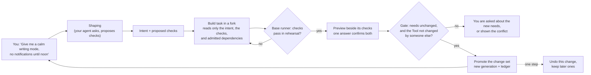
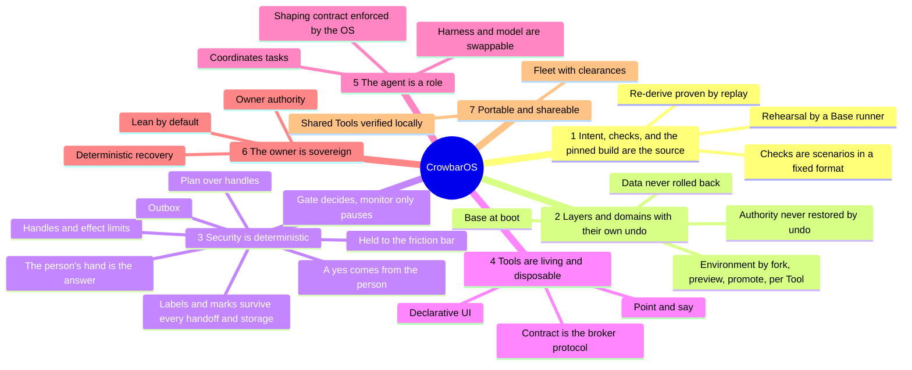
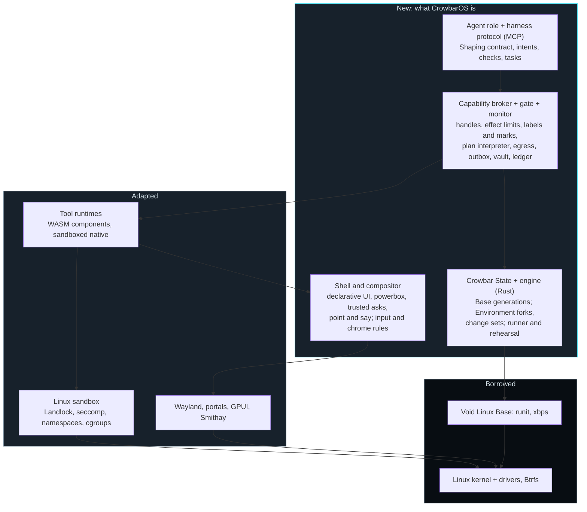
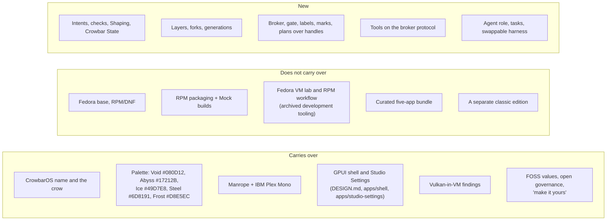
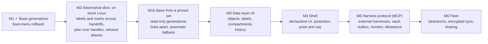

# CrowbarOS: vision

**Status:** working direction agreed by Jim Martin and Jason Alexander, November 2026.
Revised November 14, 2026, five times: after the design review (ADRs 0001–0006),
after [council round 1](reviews/council-round-1.md) (ADRs 0001, 0003, and 0004
rewritten; ADRs 0007–0012 added), after
[council round 2](reviews/council-round-2.md) (ADRs 0001, 0004, 0007, 0008, 0011,
and 0012 revised; ADRs 0013 and 0014 added), after
[council round 3](reviews/council-round-3.md) (ADRs 0001, 0003, 0004, 0006, 0007,
0008, 0011, 0013, and 0014 revised), and after
[council round 4](reviews/council-round-4.md), a confirmation round that closed
gaps in the same ADRs. Jim Martin made the decisions in the council rounds.
Revised November 15, 2026: the compositor is decided (ADR 0015 added).
Revised November 16, 2026, after [council round 5](reviews/council-round-5.md):
the friction bar ranks with the attack list (ADRs 0024, 0025, and 0026 added;
ADRs 0001, 0003, 0004, 0007, 0008, 0011, 0013, 0014, and 0017 to 0022 revised).
Decisions are in [`docs/adr/`](../../adr/). Terms are defined in the
[glossary](GLOSSARY.md). What the design defends against, and what it does
not, is in the [threat model](threat-model.md).

This is the plan of record. It replaced the Fedora-based curated desktop, which
is kept, unmaintained, in the [archive](../fedora-blueprint/README.md). The
brand, the design system, and the GPUI shell work carry over: see
[What carries over and what changes](#what-carries-over-and-what-changes). The
one-page [pitch](pitch.html) is the short version of this document.

## Thesis

People increasingly **build small software instead of installing it.** Today that
is mostly developers working with agents. The cost of a small tool that fits one
person exactly is falling fast, and within a few years most people will make
software this way.

Bespoke software wins the **long tail**: the writing mode, the notification rule,
the photo sorter. It does not replace the browser, a video editor, or a game.
Nobody describes a browser into existence, and the browser is where a person's
logins live and where most acting on their behalf happens. So installed software
is first-class in CrowbarOS: native apps and the browser run under the same
authority rules as generated Tools.

When much of a person's software is something they describe, the operating system
has a different job. A curated set of default apps matters less. What matters is
the **substrate**:

- a small, stable base that stays out of the way;
- an agent that helps you work out what you want, then builds and changes it
  **safely, without babysitting**;
- a way to keep, undo, carry, and share what you make.

So CrowbarOS ships the ability to make an OS, not a finished desktop. It starts
lean. Each person shapes it into their own OS with their agent, and it stays as
lean or grows as heavy as they choose.

**Security and low friction both have to pass.** Agents read content written by
strangers and act with a person's authority, so deterministic parts decide what
can happen, and no model is on the trust path. A person who is asked too often
turns the guards off, so every rule is also held to the friction bar. A rule that
misses the bar is redesigned. Each redesign says what it gives up and gets an
attack that shows what still holds. Where no design passes both, the Agent hands
that work back to the person. What a person does with their own hand is never
refused.

## First principles

### 1. Intent, checks, and the pinned build are the source

A person's OS starts from their **intents**. An intent is the person's words plus
the **checks** they confirmed. The intents are a curated, living set. When the
person asks for something new, the agent merges it into the existing intents as a
diff the person can see. The ledger keeps the history.

**A check is a scenario in a fixed data format**: the events the broker delivers at
stated simulated times, and the effects the Tool must and must not ask for. The
person confirms it in plain language that fixed templates produce from the
scenario, for example "a notification from Sam at 9:00 shows up; one from Slack at
9:00 waits until noon." No model writes or translates that wording, and a scenario
that expects nothing is rejected. A check that needs logic the format cannot
express may be written as code, and is then shown marked "wording not verified". A
confirmed check is frozen in the Crowbar State. A re-derive can never change it.
Changing one is an intent edit.

Checks run in **rehearsal**: the Tool runs against simulated time, simulated
events, and recorded inputs, with no real effects. Every interface the broker
offers a Tool has a simulated form and a record-and-replay form, so "waits until
noon" can be tested in a second. A **runner** in Base runs the checks, not the task
that built the Tool. It signs the result together with the content hash of the
build and of every check, and a promote accepts only a build whose hash carries a
passing result. What passed is what goes live.

The words and the checks are not the whole source. The first build makes many
choices the person never stated and then comes to rely on. So the source of a
person's OS is three things together: the **intent**, its **checks**, and the
**pinned build** the person accepted. The **Crowbar State** is the lockfile that
pins them: a package repository snapshot for each Base generation, a content hash
for every Tool, and every frozen check. **Generations** are builds of the State.

Compiling happens only when an intent changes or the person asks to **re-derive**.
A better model never rewrites the OS silently. A re-derive is accepted only when:

1. every frozen check passes in rehearsal, and
2. replaying the Tool's recorded inputs through the new build gives the same
   results as the old one, apart from differences the person accepts.

Passing the checks is necessary evidence. It is not proof that nothing the person
relies on has changed, which is why the replay and the pinned build exist.

Decision: [ADR 0001](adr/0001-intent-is-the-source.md).

### 2. Layers and domains that change on their own

| Layer | What it holds | How it changes |
| --- | --- | --- |
| **Base** | Kernel, drivers, core services. Built with `xbps`. | Rarely. Each generation is built from a complete pinned package set and takes effect at boot. [Milestone 1](milestones/milestone-1.md) built the generation layout, boot menu, and rollback; the pinned build comes in Milestone 1b. |
| **Environment** | Tools, services, desktop, automations. | Often. It changes by **fork, verify, promote**, one Tool at a time. |
| **Data** | The person's own things. | Has its own history and undo window. Rolling back Base or Environment never rolls it back. |

**Fork, verify, promote.** Nothing is applied to the live Environment and undone
later. A task that changes installed behaviour works in a **fork**: a
copy-on-write copy of the Environment. The task builds there, and the runner
proves the checks in rehearsal. The person sees a **preview**: the forked Tool
running in the fork, marked as a preview, with no effects outside the fork. The
checks are shown in plain words beside it. One plain answer in trusted UI freezes
the checks and **promotes** exactly the build that was previewed. The preview
stays open while the person asks for further changes, and one answer at the end
promotes the last build. Nothing unconfirmed goes live.

**The unit of change is the Tool.** A promote carries a **change set**: the Tools
it changes, and the build of each that the task started from. Two tasks on
unrelated Tools both promote. The runner re-runs the checks of every Tool the
combined result could affect, and the person is asked only when two change sets
touch the same Tool or a check fails. **Undo** reverts one change set and keeps
later changes to other Tools. It is a change like any other: the checks of every
Tool it could affect run again, and the person confirms it. **Rolling back** the whole Environment to an earlier
generation remains as a recovery action.

**Most tasks change no software.** Sorting photos or preparing tax documents
changes Data, not the Environment. Every task has a **workspace**: a private
scratch area and a view of the Data it was given. Its writes to Data are staged
there and committed together when the task finishes, inside its effect limits, as
one entry in the Data history. Only a task that changes installed behaviour also
gets a fork.

Undo only protects a person who notices a problem. A preview shows the change
before it is live.

`xbps` packages live only in Base. An agent request reaches Base only when the
person really needs to get close to the metal (a driver, a kernel feature, a core
service). That is a deliberate change that needs a reboot, and it is always
possible.

The Data layer holds **objects with provenance, labels, stable ids, and history**.
Files stay the truth for software that expects them, and the typed layer starts as
an index over them. Schemas are data that Tools can add and map, not a fixed
vocabulary in Base.

**Authority and memory are separate domains.** Besides the three layers, four
things have their own history and are never rolled back with software:

| Domain | Holds | Rule |
| --- | --- | --- |
| **Authority** | Standing grants, standing rules, effect limits, Allowances, clearances | Undoing software never restores a revoked grant. It never transfers when sharing. |
| **Vault** | Secret values | Never in the State, never in a generation. |
| **Ledger** | The history of every change and decision | Append-only. |
| **Agent memory** | What the Agent has learned about the person | The person's Data, not the harness's. It survives a change of harness. |

The State says what each Tool *needs*. The authority domain records what the
person *granted*.

Decisions: [ADR 0002](adr/0002-three-layers.md),
[ADR 0007](adr/0007-fork-verify-promote.md),
[ADR 0009](adr/0009-base-from-a-pinned-package-set.md),
[ADR 0012](adr/0012-authority-outside-the-state.md).

### 3. Security is deterministic

**Deterministic parts decide what can happen.** No model is on the trust path:
State, promote, rollback, handles, and the gate all work with no model at all.

**Every rule is also held to the friction bar**: the most asks and refusals a
person may meet in one task and in one day. An ordinary day costs at most five
asks, a day that makes a Tool or sets up a project at most eight, and no day
refuses what the person did by hand. A rule that misses the bar is redesigned,
and where no design passes both, the Agent hands that work back to the person.
[ADR 0024](adr/0024-the-friction-bar-ranks-with-the-attack-list.md) has the
numbers.

- **Handles.** No ambient authority. A principal can reach only what it holds an
  unforgeable, scoped, expiring handle for. Only the capability broker issues them.
- **Effect limits.** Every task and every grant states what it may affect: which
  objects, how many, for how long, at what cost, and how often. "Sort my photos" is
  a task on the photos, not on the disk. Limits are a ceiling: the gate refuses
  anything outside them, and a task cannot widen its own. The Agent proposes each
  task's limits (a lookup's are a fixed default), so they bound a task's
  mistakes, not a steered Agent. What bounds
  the Agent is that it holds no standing authority, that a conversation changes
  only by the person's act, and that there is a ceiling on tasks that do not
  cross: a task proposed above it is authorized at its start.
- **The gate.** A deterministic rules engine checks each operation against handles,
  effect limits, standing grants, and standing rules, and signs what it allows.
  It is the only thing that allows. It checks every broker operation and every
  commit of staged writes. Inside a native sandbox, the kernel enforces the view
  the gate allowed.
- **The monitor.** A model, isolated from the Agent, reviews actions against the
  person's intents and the task. It sees the action, never the Agent's argument.
  It can pause a task and raise a surprise. It can never allow anything, so the
  system is sound without it.

**The undo boundary is the default for autonomy, not a safety property.** It
answers "does this need the person?", and the answer is no only when all three
hold:

1. the effect is within the task's limits;
2. the system holds a tested way to undo it, for a stated window;
3. it stays inside the fleet.

Being inside the fleet does not make an effect undoable. A notification held past
the moment it mattered, a delete after its undo window, and a command to a device
on the home network cannot be taken back. Those are treated as crossing. A read
cannot be taken back either. A read inside a task's limits does not ask; instead
the reader takes on the label and mark of what it read, and those decide where
anything it writes may go.

Anything that crosses is allowed only by standing authority or the person's
answer. A **standing grant** gives access to a thing. A **standing rule** lets a
kind of act happen without asking, and carries a rate limit ("at most five emails
an hour to new recipients"). An act that crosses needs both. Standing authority
binds to a Tool, to a **standing task** the person defined by name with a fixed
objective and limits, to a workbench, or to installed software. It never binds to
the Agent. A model request does not ask while its provider is cleared for what
the compartment holds and the model budget is not spent, and installed software
does not ask for what its approval showed.

A task asks once for what it does across the boundary, and never twice for one
act. Where the exact content of an act is known when the task starts, the person
sees it then. Where the task composes the act later, it starts with no ask, and
the act asks with its exact content when it is ready. A rule with a cap, such as
"pay the electric bill, up to $150", fires without an ask when the amount is under
the cap.

**A "yes" comes from the person.** Every crossing the gate does not already allow
ends in the person's answer, so nothing else may be able to produce one:

- Only the shell delivers input. No principal can synthesize it. Agents operate
  Tools through the UI description, never through input events. Base has to close
  every Linux route around this: a shared X11 server, the accessibility bus,
  virtual input and input-method protocols, the remote desktop portal, input
  devices, and a terminal that reaches owner authority.
- **An ask waits for the person.** It never takes the keyboard from their work.
  The bar shows how many are waiting, and the one ask that opens by itself is the
  one for what the person just asked for, in the conversation they are in.
  Nothing is refused for asking too often: a flood is held in one line the
  person can dismiss whole. One ask can
  hold a list of acts of one kind, such as three drafted replies.
- **Three answers, by what is at stake.** What stays inside the undo boundary,
  such as keeping a preview, takes a **plain answer**: any ordinary input in
  trusted UI. Anything that crosses, and authority that lasts only for this run,
  takes the **confirm gesture**: a secure key press the compositor takes and
  never delivers to a Tool. An ask ignores input for a moment after it
  appears, whichever answer it takes.
- Authority that lasts (a new grant, rule, or standing task, wider
  limits on one, a higher ceiling, a higher clearance, a
  declassify, a refilled Allowance, owner authority) needs a passkey, a security
  key, or approval on the phone, as a **signature** over the exact content shown.
  It is asked for the first time something needs it, not up front, and a list the
  person put together takes one signature.
- **What the person does by hand is the answer.** A paste, a drop, a pick, and
  a link they click in an app are never refused, and are never followed by an
  ask about that same act. A request they type starts with no ask: it starts a
  lookup, or points a conversation at a source, as it stands. What the Agent
  then does across the boundary to carry it out asks once. A value moved by
  hand is released to where the person put it, and keeps its mark.
- Voice never counts as confirmation, because a speaker can produce it. Words
  that arrive by voice are marked until the person makes the confirm gesture.
- The trusted UI and the confirm gesture are part of Base. They cannot be themed
  or rebound.

**The outbox.** Acts sent on the person's behalf under a standing rule (messages,
posts, purchases where the seller allows it) do not leave at once. They wait in
the broker's outbox for a delay the person can see, and can be cancelled until
they leave. The Agent keeps working while they wait, and the person reviews them
in batches. An act the person answered leaves at once.

**Labels, marks, and compartments.**

- **Labels.** Data carries a label that comes from where it came from. Labels are
  ordered: public, personal, private. Messages, health, and finance are private by
  default, and private data also carries its category. The agent may make a label
  stricter. Only the person can **declassify**.
- **Untrusted input and marks.** Content written by strangers is untrusted input.
  It is **admitted** when it comes from a pinned set the person admitted in advance
  (the Base package snapshot, the dependency set for build tasks). Everything else
  is **open**: web pages, mail, shared intents, files from outside. Reading open
  input **marks** a context.
- **Compartments.** A model's context cannot keep private and public apart, or a
  stranger's instructions and the person's. So labels and marks apply to whole
  execution contexts. A **compartment** is a conversation, a task's model context
  and workspace, or a Tool's sandbox. Once it reads a value it is at that value's
  label and carries its mark, and so is everything it emits: files, messages,
  logs, and model calls. A value the person moved in by hand is the exception:
  the compartment takes its mark and not its label.
- **Nothing a model does removes a label or a mark, and nothing crosses freely.**
  Summarizing does not clean a value, a new task does not, and passing through the
  Agent does not. Marks persist in storage: a Tool's source and an entry in Agent
  memory keep the mark of whatever wrote them.
- **Plan over handles.** We assume most people's Agent thinks with a cloud model.
  The Agent writes a **plan**: a small program whose variables are handles. A
  deterministic interpreter in the fleet runs it and moves the actual values
  between Tools, broker operations, and model calls. The Agent can draft "Hi
  {name}, your appointment is {date}" without seeing either value. The interpreter
  is not a model, so it tracks the label and mark of every result, including
  handles and **bounded results** (a choice from a fixed list, a number in a fixed
  range). A plan may branch on a bounded result, and everything after the branch
  carries its label and mark. An act that depends on a result from a marked task
  counts as marked, so a steered choice cannot spend a standing rule. What can be
  observed about a result is a result too: its size, how many handles came back,
  whether a step was refused.
- **Conversations.** Each exchange between the person and the Agent is a
  **conversation**, a compartment of its own. It starts **clean**: personal and
  unmarked. It changes only by the person's act: they put a value in, which is
  released and brings its mark with it, or they point it at a source such as
  their mail, and it rises to that source's label and mark. Then it may read
  and discuss what it was given. A value with no mark, such as the person's
  own note, leaves it clean. Once it is marked or above personal, it is no
  longer clean for as long as it lives,
  and every act of its that crosses asks with the exact content, a link it
  shows included. The one thing it sends to the open web with no ask is the
  turn the person just typed, as a lookup. The Agent cannot mark or raise its own conversation, the frame
  shows the label and mark, and a clean conversation is one action away. The
  first time a conversation is pointed at a category of private data, one
  signature clears the model provider for that category.
- **What reaches a clean conversation.** A clean conversation does
  not read a result from a marked task. The plan branches on it inside the
  interpreter, and the shell shows it to the person. A private result reaches it
  only by a **release** (the person lets one exact value pass to one named
  destination, by answering an ask that shows it or by moving it there by hand)
  or inside a budget for that category, counted in bits across all tasks, which
  stays at zero. The shell can always show the person a result directly. A value
  put into a conversation goes to its model provider too.
- **Lookups.** A **lookup** answers a question from the open web. It holds only
  the words the person typed, exactly as typed, and what it found. It holds
  nothing the Agent remembers and nothing a conversation read, so it starts and
  takes follow-ups with no ask. That holds from a conversation that is no
  longer clean too, where a turn the person typed about private data may itself
  say something private. A turn leaves once. A compartment
  that holds only public data and no login may reach any host on the open
  internet.
- **Only the person's own words are theirs.** What the person types reaches the
  Agent as theirs. What they paste or drop into a conversation enters it, and
  the conversation takes its mark. Every other string that the person did not type and
  a fixed template did not produce is data with its origin's label and mark: a
  file name, a mail subject, error text from a server. The Agent sees what the OS
  states about a handle, not a stranger's name for it.
- **Clearance.** The fleet is not one flat perimeter. Each machine has a
  clearance: the highest label it may hold. A rented cloud machine does not get
  what the desk gets, and a machine whose disk is not encrypted gets nothing
  private. Every outside party has a clearance too. A model provider's default
  is personal, and the person can raise it one category at a time. A web site's
  default is public; it may also receive back what it supplied and what the person
  released to it. A compartment may connect only to parties cleared for everything
  it holds. The broker builds every model request itself, with the provider's own
  tools and retention off. The phone is an approval device.
- **What a marked task loses.** It keeps thinking, through that broker-built model
  request. It loses its standing grants and rules to cross the undo boundary. The
  one exception is a standing rule the person wrote for
  that source, carried out by a broker adapter that knows the operation.
- **Build tasks are clean.** A task that writes a Tool's code reads only the
  intent, the checks, the Tool's source, and admitted input. It has no web access,
  and it sees results on synthetic inputs only: a replay of real inputs reaches it
  as pass or fail. A grant binds to the Tool's identity, the needs the person saw,
  and a clean build. A rebuild that changes the needs, or that read open input,
  asks the person again, and its source stays marked until the Tool is re-derived
  from the intent and checks alone.
- **The browser.** The person's own browser profile is never driven by an agent.
  A task that needs the web gets a **task browser context**: fresh, for that
  task, with logins by approved fill and the session cookie kept in the broker.
  On a logged-in site the person answers once for each task and each site. The
  ask names the site, what the task may do, and the exact values it may send, and
  the answer covers the task's requests to that one site until the task ends.
  The Allowance is the only payment credential the task can supply, and the
  person can watch the window. A payment method the site already stores is in
  the site's hands.
  Banks, mail providers, and identity providers are adapter-only: with no
  adapter, the Agent hands the errand back. An act happens with no ask at all
  only through a broker adapter that knows the operation, under a standing rule
  for it.

**Egress and secrets.**

- **The broker owns all egress.** Everything leaving the fleet goes through the
  broker, which makes the outbound connection itself and checks labels. Calling a
  cloud model is egress like any other, checked against the provider's clearance.
- **Secrets live in a vault.** Agents, harnesses, models, and Tools never see secret
  values. API secrets appear as placeholders that the broker fills in only for the
  hosts they are tied to. Logins use an approved fill: the person approves in
  trusted system UI, and the OS fills the form. A token obtained with a secret is
  a secret: the adapter stores it in the vault and returns a handle. Existing
  password managers such as 1Password or Bitwarden can be the vault's backend.

**Notify only on surprises**: something a background task did that the person did
not directly ask for, anything blocked or refused, anything the monitor paused,
and requests to cross the boundary. A notice never takes the keyboard or covers
the person's work. Everything else is in the ledger. Entries that
matter for security are rendered by the OS in fixed words, not summarized by the
Agent they describe.

**Money crosses the boundary.** A budget for cloud model use is a cap the person
sets in the authority domain; reaching the cap asks. For spending, the person can
set aside an **Allowance**: a standing amount of money in a separately funded
account whose limit the card issuer or wallet enforces. A Tool, a standing task,
or a task the person authorized spends inside it without asking (a marked task
only through an adapter rule),
and refilling it always asks. The bound is as strong as the account behind it: a
card's authorization cap is not an exact settlement limit, which is why the
Allowance is funded separately. Prior art:
[agent payments research](../../research/agent-payments-prior-art.md).

Decisions: [ADR 0003](adr/0003-security-is-deterministic.md),
[ADR 0006](adr/0006-broker-owns-all-egress.md),
[ADR 0008](adr/0008-private-values-stay-out-of-the-agent-context.md),
[ADR 0011](adr/0011-task-principals.md),
[ADR 0013](adr/0013-agents-never-drive-the-persons-browser.md),
[ADR 0014](adr/0014-a-yes-comes-from-the-person.md),
[ADR 0015](../../adr/0015-our-own-compositor-on-smithay.md),
[ADR 0024](adr/0024-the-friction-bar-ranks-with-the-attack-list.md),
[ADR 0025](adr/0025-what-the-person-does-by-hand-is-the-answer.md),
[ADR 0026](adr/0026-asks-wait-and-take-one-of-three-answers.md). Prior art:
[agent credentials research](../../research/agent-credentials-prior-art.md).

### 4. Tools are living and disposable

The unit of generated software is a **Tool**: something derived from intents that
may have a UI, a schedule, both, or neither. A writing surface, a rule that holds
notifications until noon, and a photo sorter are all Tools.

- **The contract is the broker protocol.** A Tool starts with nothing and gets
  everything through the broker: Data, network, devices, time. That is what makes
  it capability-safe, and it is the same for every runtime. A Tool can be a WASM
  component or a native process in a Linux sandbox that holds only a broker
  connection. WASM gives determinism, replay, and one build for an x86 laptop and
  an ARM inference machine. Native code gives the whole Linux ecosystem and the
  GPU, and is routine, not an escape hatch.
- **Native code is promised only what Linux can enforce.** A native sandbox has a
  label fixed when it starts and a view of the Data it was given. The kernel
  enforces the view. Limits on how many and how often hold on broker operations,
  and on the commit of staged writes, not on each write inside the view. Revoking
  access means stopping the sandbox. [ADR 0004](adr/0004-capability-safe-tools.md)
  lists which mechanism enforces which limit.
- **Installed software uses the same rules.** A native app or a browser runs in the
  sandbox with broker-owned egress. For software the broker cannot see inside, the
  checks are per principal and per destination, not per value. We say so plainly.
- **Installing is painless.** Installed software comes from CrowbarOS's own pinned
  catalog, filled mostly from nixpkgs, with vendor artifacts as the fallback, and
  the person can add an entry for anything. One approval installs an app, and an
  update that asks for nothing new goes live by itself. Dev tools run in a
  **workbench**: a changeable Linux system for one project, approved once, where
  package managers work without asking. A workbench for a project the person
  declared public may reach any host on the open internet, and a host a private project needs for one
  run is added with the confirm gesture.
  [ADR 0017](adr/0017-a-pinned-catalog-and-workbenches.md).
- **Declarative UI.** A Tool describes its UI, and a trusted shell draws it inside
  system chrome a Tool cannot imitate. Every Tool is themed and accessible, and can
  render on any machine in the fleet. The UI description is also the Tool's
  interface for agents: what a person can point at, a task can call. The
  **powerbox** is part of the shell: choosing a file in system UI is the grant.
- **Living.** The person can point at any part of any Tool and say what to change:
  "sort this by date", "move this up here". That becomes an edit to the intent, and
  the checks keep earlier behavior intact. The agent can also run a design session
  with the person for larger UI work.
- **Local-first perception.** The OS does speech-to-text and resolves pointing on
  the fleet. The harness receives the words plus a structured reference ("Tool:
  Morning Pages, element: sort control, intent #12"), not a stream of pixels and
  audio. Pixels are sent only for native windows, and only when the person allows
  it. A visible indicator shows whenever the OS is listening or watching.

Decision: [ADR 0004](adr/0004-capability-safe-tools.md).

### 5. The agent is a role

- The **Agent** is the person's own principal. The OS defines the role: it has an
  identity, signs its ledger entries, and is the only principal that edits
  intents, and only with the person.
- **The Agent coordinates; tasks do the work.** Each piece of work is a **task**: a
  fresh principal with a stated objective, effect limits, a budget, and an expiry.
  The Agent keeps the person's history and starts tasks. It does not collect the
  authority of every task it has ever run. A task ends, and its handles end with
  it. Each exchange with the person is a **conversation**, a compartment of its
  own, so what one conversation read does not mark the next.
- A **harness** fills the role: the loop, tools, and conversation around a model.
  CrowbarOS ships a default harness. An external harness, such as Grok Bot, can
  replace it.
- A **model** is what a harness thinks with: a cloud model, which we assume is the
  common case, or open weights on the person's own hardware.

All authority stays with the role. A harness can only propose. External harnesses
connect through one open **harness protocol** built on MCP, and get no more trust
than the default harness. The protocol is built for agents: a "would this be
allowed?" dry run with no side effects, refusals that name the rule and the limit,
idempotency keys so a resumed task knows what already happened, and a way to read
a handle's label and mark without reading its value. A harness that runs in someone else's cloud is outside the
fleet, so everything it sees is egress.

**Shaping** is the conversation in which the agent helps the person work out what
they want before it builds. Its depth scales with how unclear and how far-reaching
the request is. "Build me a budgeting system" gets real questions. The person can
always say "just build it" or "ask me more". The OS enforces the Shaping contract;
the harness decides how the conversation goes:

- Every intent has checks, and the person confirms them in trusted UI. A harness
  cannot assert "the person confirmed".
- Every change is shown as a **preview** beside its checks, and one plain answer
  confirms the checks and promotes exactly what was previewed. Nothing goes live
  unconfirmed, however small.
- An edit that asks for **new authority** needs the authority change confirmed as
  well, with a signature.

Other agents (background workers, agents that come with shared Tools) are principals
with handles. They can never edit intents. The person's Agent may propose a new
intent ("You've muted Slack every morning this week. Make it an intent?") but never
adopts one silently.

### 6. The owner is sovereign

- **Owner authority.** The owner can always take full control of their machine: a
  root shell, Base changes, any guard turned off. It is a deliberate step, it is
  recorded in the ledger, and it can never be held by an agent. CrowbarOS never locks
  out its owner.
- **Lean by default.** There is no minimum hardware spec. The system is sound with
  no model at all. Privacy does grow with hardware: with no model in the fleet,
  private values are processed by Tools, or by a cloud model only where the person
  has cleared its provider for that category. One capable inference machine in the
  fleet lets a model work on them without their leaving.
- **Recovery never depends on a model.** A new Base generation boots once on
  probation and becomes the default only after a health check passes; otherwise the
  machine falls back to the previous one on its own. Environment safe mode starts the
  last good Environment with the default harness, so a broken external harness can
  never lock the person out. A plain recovery screen lists recent changes in words
  ("Tuesday: added writing mode") and undoes them newest first.
- **One person per machine first.** The first version supports one owner per
  machine. Everything is tied to an explicit person, so several people on one
  machine stays possible later. Decision:
  [ADR 0005](adr/0005-one-person-first.md).

### 7. Your OS is portable and shareable

- **One OS, many machines.** Base is per machine. The Environment is shared across
  the fleet, built from the same intents and State. Data syncs local-first and
  end-to-end encrypted, to machines whose clearance allows its label: the person's
  machines hold the keys, and any relay or backup service sees only ciphertext.
- **One machine leads.** In the first version the **lead machine** holds the
  authority domain and puts promotes in order. The others work on leases from it
  that expire, so a revoked grant stops working everywhere within a known time.
- **Sharing.** A person shares a Tool as its **pinned build together with its
  intent and checks**. The recipient's OS runs the checks in rehearsal, shows what
  the Tool needs, and the recipient grants that fresh. Someone else's words are
  untrusted input: they are never handed to the recipient's Agent as instructions.
  A Tool from a stranger runs only as WASM. Rebuilding it locally stays possible:
  that build is marked, so it gets no grant without the person's answer. The
  author's reason for each need is shown as the author's claim, next to the need
  itself in the OS's fixed words. Standing grants and standing rules never transfer. Data transfers only when
  explicitly included. Secrets are named, never included.
- The **Community Gallery** shares Tools and whole OS definitions on those terms.

Decisions: [ADR 0010](adr/0010-share-the-pinned-build.md),
[ADR 0012](adr/0012-authority-outside-the-state.md).

## The stack: invent the top, borrow the bottom

Nothing in this design needs a new Wi-Fi driver, and drivers are what kill new
operating systems. We choose Linux for its drivers. Linux is also part of what we
trust: the broker decides, and Linux namespaces, Landlock, and seccomp enforce.

### Why Void Linux for Base

- **Small and plain.** The Milestone 1 lab root, `base-minimal` plus kernel, GRUB,
  Btrfs tools, SSH, and DHCP, is 114 packages. A complete package set that small
  can be pinned and read by a person.
- **Easy to drive from a program.** `xbps` installs into any root
  (`xbps-install -r`), which is how the engine builds a new Base generation next to
  the running one.
- **No opinions to work around.** We build our own declarative layer and rollback
  instead of adopting NixOS's. That keeps the State small enough for an agent and a
  person to read, and keeps a Base rollback to a plain Btrfs snapshot plus a boot
  entry.

`xbps` builds Base only. Tools and the Environment do not use it, and installed
software comes from the catalog ([ADR 0017](adr/0017-a-pinned-catalog-and-workbenches.md)). Whether runit can
carry what the Environment needs is an open question below.

### Microsoft's October 2026 agent announcements

Microsoft's announcements cover the same problem space. We evaluate them; we do not
copy them.

- **Microsoft Execution Containers (MXC)** are composable sandboxes for agent work,
  reported to run on Linux. MXC could be a backend for the native sandbox. Check its
  real specification and license first.
- MXC's stated principle, "an agent cannot be its own security authority", is the
  same as ours: policy lives outside the agent.

## What carries over and what changes

| Area | Fedora blueprint | CrowbarOS now |
| --- | --- | --- |
| Core idea | A calm, curated desktop for creative people | A lean substrate each person shapes into their own OS with their agent |
| Source of truth | Installed packages and settings | The person's intents, their checks, and the pinned build; the Crowbar State is the lockfile |
| Base | Fedora, non-Atomic, DNF | Void Linux (runit, xbps), Base layer only |
| Change model | Packages and settings, changed in place | Base at boot; Environment by fork, preview, promote, per Tool; Data with its own history |
| Software | Five essentials plus Flathub | Tools built on request for the long tail; native apps and the browser first-class, under the same broker, from a pinned catalog filled mostly from nixpkgs; dev tools in workbenches |
| Security | SELinux, signed RPMs | Handles, effect limits, a deterministic gate, labels and marks that survive handoffs, broker-owned egress, a vault |
| AI | Neutral; no bundled AI | One edition, model-neutral; the person picks the harness and models, and the system is sound with none |
| Customizing | Settings panels, themes, Community Gallery | Say or point at what you want; share Tools and OS definitions |

Notes:

- **One edition.** There is no separate classic edition. AI
  neutrality is kept a different way: no model is on the trust path, the person
  chooses the harness and models, and intents and the State can be edited by hand.
- **GPUI** ([`apps/gpui-probe`](../../../apps/gpui-probe/README.md)) is the candidate
  toolkit for the shell that draws Tool UI. Its RPM packaging does not carry over.
- **Desktop design:** Jason Alexander's design system ([`DESIGN.md`](../../../DESIGN.md)),
  the GPUI desktop shell ([`apps/shell`](../../../apps/shell/README.md)), and Studio
  Settings ([`apps/studio-settings`](../../../apps/studio-settings/README.md)) are the
  visual and interaction starting point for the M4 shell and system chrome. The
  source, tokens, fonts, and review captures carry over. Their RPM packaging,
  Fedora VM scripts, and Hyprland session wiring do not.
- **The Fedora VM workflow** is [archived](../fedora-workflow/README.md).
  The [Void lab](../../../lab/void/README.md) builds the compositor, shell, and Settings
  and checks them in a fresh guest. The [Alpha acceptance record](../../development/void-desktop-smoke-2026-11-15.md)
  covers separate service identities, launch/focus/workspaces, Settings Save,
  restart, and clean reboot. This follows ADR 0016's Alpha exception, not the
  production Warden model. Existing Void VM state and dated evidence are preserved.
- **Vulkan in a VM:** the Intel VirtIO native-context findings in
  [`gpu-vulkan.md`](../../development/gpu-vulkan.md) depend on the host and Mesa build,
  not on Fedora. Porting that accelerated path remains separate work; the
  current compositor guest uses software rendering.
- **Compositor:** Hyprland was chosen for the Fedora plan and does not carry
  over. CrowbarOS has its own compositor, written in Rust on Smithay, as part of
  Base. It is where "only the shell delivers input", the confirm gesture, and
  system chrome are enforced. Decision:
  [ADR 0015](../../adr/0015-our-own-compositor-on-smithay.md). Wayland and portals are
  fixed requirements. What the first compositor has, what it leaves out on
  purpose, and where its work sits among the milestones are in
  [ADR 0020](adr/0020-the-first-compositor-is-small-on-purpose.md).

## Roadmap

Each milestone removes the riskiest assumption that is left. Council round 1 found
that Milestone 1 tested the least risky layer. Council round 2 found that the
information-flow rules are the riskiest assumption left and need nothing from
Base. So the adversarial slice comes next, on stock Linux, and the Base rework
(M1b) follows it. The milestone names are kept; the order changed.

| Milestone | Scope | Proves |
| --- | --- | --- |
| **M1** (done) | State → apply → Base generation → broken change → boot-menu rollback, in a Void VM on Btrfs. See [Milestone 1](milestones/milestone-1.md). | The generation layout, boot menu, and rollback |
| **M2** (next) | The security rules, built to be attacked, on stock Linux with no CrowbarOS Base. First: a broker and gate, task principals in Linux sandboxes, labels and marks, and a plan over handles run by a deterministic interpreter with a cloud model as the Agent. It passes when every named attack ends as its row says, which for most is a refusal, and a fixed set of ordinary tasks meets the friction bar. Second, and cut if the milestone slips: checks as scenarios with the Base runner, fork, preview, promote, undo, and grants across rebuilds. Scope and acceptance tests: [Milestone 2](milestones/milestone-2.md). | ADRs 0003, 0008, 0011 first; then 0001 and 0007. No model on the trust path. |
| **M1b** | Build each Base generation from empty out of a complete pinned package set, with the State owning every package. Read-only generations. Data and machine state on their own subvolumes, so an apply never drops what was written before the reboot. Automatic fallback when a new generation fails to boot. Crash safety during an apply. | "The State is a lockfile" for Base; ADR 0009 |
| **M3** | Data layer v0: objects with provenance, labels, stable ids, and history, as an index over files. Staged writes and commit. Compartments for every execution context. Label-based egress, including model calls. | Information-flow control on real Data |
| **M4** | Shell: declarative UI renderer inside system chrome, powerbox, trusted asks that wait and take one of three answers, point and say with local perception. Recovery screen. | Living software; ADR 0014 |
| **M5** | Harness protocol on MCP, external harnesses such as Grok Bot, the vault and broker adapters, task browser contexts, the outbox, the monitor, the Allowance. | The Agent role; ADRs 0006 and 0013 |
| **M6** | Fleet: a lead machine and leases, joining machines with clearances, the phone as an approval device, local-first encrypted Data sync, sharing pinned Tools verified by the recipient. | "Your OS is portable and shareable"; ADRs 0010 and 0012 |

The monitor comes late on purpose. The gate has to stand on its own first.

## Open questions

Carried forward:

- **Writing checks.** Can people who are not developers say what they rely on in
  the scenario format, and how much ends up as code marked "wording not verified"?
- **Merging intents.** How does the agent show an intent diff that a person can
  judge at a glance, and what happens when two intents conflict?
- **Promoting under a running Tool.** How does a Tool that is running move to the
  new build without losing its state?
- **Data newer than code.** When a Tool is undone, how does the earlier build handle
  Data written by the newer one?
- **Monitor model.** Which small model is good enough, what fixed test set
  (including adversarial cases) proves it, and where does it run when the fleet
  has no model?
- **Where the State lives.** The Environment's State is shared across the fleet and
  changes many times a day, so it cannot stay inside a per-machine Base generation.
- **Recorded inputs.** A re-derive replays a Tool's recorded inputs. What is
  recorded, for how long, and under which label?
- **Allowance backing.** Which mechanism backs an Allowance first, and may an
  Allowance purchase start a recurring charge? See the
  [payments research](../../research/agent-payments-prior-art.md).
- **Harness quality.** If an external harness Shapes badly but follows the contract,
  how does the person notice and compare?
- **Several people per machine.** Deferred by ADR 0005.

Raised by the council and not yet decided:

- **Livability.** Marks spread: an app that touched one outside file marks what it
  writes, and a value the person pastes carries its mark with it. If most Data
  and most tasks end up marked, every act asks, and people turn the guards off.
  Milestone 2 measures this against the friction bar.
- **Outbox answers.** When the person lets a waiting act go, how long does that
  answer last, and does it cover the next act of the same kind?
- **Admission.** Who admits the dependency set that build tasks read, how is it
  reviewed, and how does it receive updates?
- **The plan language.** How much can a plan over handles express, when the Agent
  cannot read a stranger's file name or an error message?
- **The friction bar's numbers.** Five asks on an ordinary day is a judgement,
  not a measurement. The livability review tests it, and neither day's script is
  written yet.
- **Naming a source.** The shell matches the words a person typed to one of
  their sources by fixed rules. How often does it miss, and what does a miss
  cost?
- **The chord with asks waiting.** With asks waiting and none open, the confirm
  chord locks the session. Should it open the first waiting ask instead?
- **Driving native apps.** An agent cannot send input events. Is there an
  accessibility interface, controlled by the shell, for apps with no UI
  description?
- **The declarative UI vocabulary.** A new vocabulary drawn by GPUI, or a
  constrained web subset (DOM and CSS, scripts with no network) drawn by a trusted
  engine? Agents write the second well on the first try.
- **The browser engine.** Which engine, and how a task browser context is built
  from it.
- **A stop switch.** One deterministic action that stops every task, revokes every
  handle, and shows what was running.
- **Durable tasks.** How does a task survive a reboot or a harness crash, and how
  does it learn whether an effect it started was committed, refused, or unknown?
- **Patching generated Tools.** Thousands of bespoke Tools carry their own
  dependencies. Who finds the vulnerable ones, rebuilds them, and re-runs their
  checks?
- **Base updates.** How does a pinned Base receive security updates, and how often?
- **Boot integrity.** Secure Boot and hardware-bound keys when every generation
  changes what boots. Disk encryption is required for private Data; how it is
  unlocked is open.
- **Loss and recovery.** A lost machine, a failed disk, a lost vault, a lost lead
  machine, a compromised fleet member. Sync copies deletions faithfully, so
  backups are a separate need.
- **Life without a model.** The system is sound with no model, but how does a person
  who is not a developer change anything then?
- **Init system.** Does runit give the Environment what it needs (service
  sandboxing, a health signal at boot), or is the choice open again? Resource
  limits for each compartment come from the Warden, not from runit
  ([ADR 0016](adr/0016-the-warden-starts-every-compartment.md)). Must every machine in the fleet run CrowbarOS Base?
- **The first person who is not a developer.** The thesis is about most people, and
  everyone who has used this so far is a developer.
