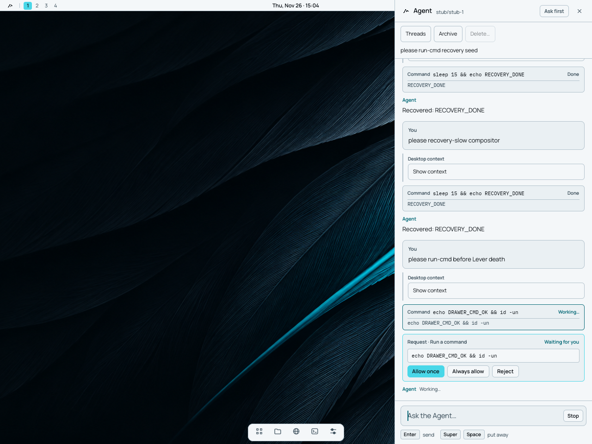
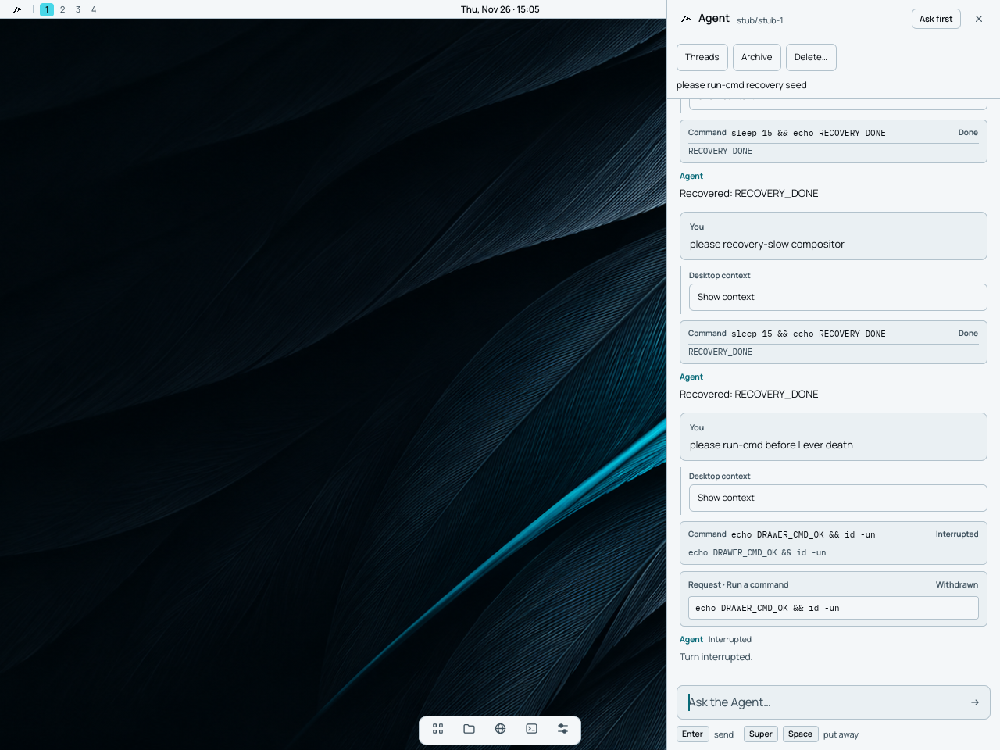

# Agent restart recovery — November 26, 2026

Issue [#384](https://github.com/crowbaros/crowbaros/issues/384) checks that a
restart of Lever, OpenCode, the shell, or Fulcrum leaves every thread readable
and the next message answerable. The verified runtime revision is
`c5db467`, based on main `a22417be3e3af564b48b0dc3e1d596b3be673ef5`.

A transient history-read failure no longer leaves the drawer disconnected from
a turn that is still working. If Lever refuses the next send as `working`, the
shell sends one `resume` to restore the history and live events. It does not
repeat the person's message. A delayed recovery reply cannot replace a later
thread selection. A failed socket clone also preserves first-connection thread
discovery for the retry.

The real-socket tests kill Lever and its stub harness separately while text is
being recorded and another thread waits for permission. They verify the
acknowledged text, completed and archived records, interrupted turns, withdrawn
requests, no automatic restart or replay, and the original session IDs loaded
for the next messages. Existing Lever recovery behavior satisfies these tests;
no persistence or ACP behavior was changed.

## Verification

- Full `python3 lab/void/desktop_check.py`: **225 passed, 0 failed**.
  [desktop.log](assets/agent-recovery-2026-11-26/desktop.log),
  [results.json](assets/agent-recovery-2026-11-26/results.json), and
  [Lever log](assets/agent-recovery-2026-11-26/agent-lever.log).
- The full check built and release-tested the image in Void: **758 tests passed**,
  including the updated Shell and Lever, then booted that rebuilt image.
- Lever: `cargo fmt --check`, `cargo clippy --locked --all-targets -- -D warnings`,
  and `cargo test --locked` passed: **137 tests**. The crash test was also rerun
  after extending it to cover an archived thread.
- Shell: `cargo test --locked` passed: **93 unit tests and 3 GPUI source tests**.
  The transient-resume test fails without re-subscription; the socket-clone test
  fails with the old ordering. Both fixes were restored, and both tests pass.
  Two further tests cover leaving a thread before its recovery reply is applied.
- Python compilation passed, as did **50 lab**, **102 Base**, **20 CI workflow**,
  and **7 Shell packaging** tests.
- A focused guest iteration passed **19 recovery checks** with the pinned
  OpenCode **2.4.1**. Its `--no-build` run was iteration only; the full run above
  is the evidence for this change.

| Restart | Observed in the full guest check |
| --- | --- |
| Shell | Lever and OpenCode keep their process IDs; the same working thread redraws and finishes. |
| Fulcrum | Work continues; a surface message sent while Fulcrum is unavailable has no desktop context. The restored drawer shows the completed turn. |
| Lever killed | Its live OpenCode processes end; the turn becomes interrupted and its request withdrawn. All records, including archived threads, remain readable. Reading starts no work. |
| OpenCode killed | Lever stays running; the turn becomes interrupted and its request withdrawn. The next message starts OpenCode on demand. |
| Next message after either kill | The original session loads, earlier act output reaches the Model, no fresh-session warning appears, and no duplicate turn is created. |

The focused iterations exposed test setup assumptions around display coordinates,
lock-screen readiness, and mode selection after a desktop restart. The final
check waits for the new shell and lock screen, sets the secondary output's
position, and sets up the permission mode through Lever's existing API. The
virtual outputs share a display identity, and the primary output's position
after restart differs from the click helper's assumption. Recovery verification
does not depend on that assumption or change display-placement behavior.
An initial full run passed 212 checks, then its process-name-only assertion
waited for another OpenCode process after the owned harness had exited. The
final check captures the owned harness and its descendants before the kill and
checks those process IDs, excluding separately started OpenCode processes.
Original local runs remain intact. The check now retains its synthetic Model
and Lever diagnostics before cleaning up its fixture.

## Captures

These unchanged guest captures show before and after a forced Lever death, and
the restored drawer after the other failures. The conversations and marker
strings are synthetic test data; there is no new visual design in this change.

| Before Lever dies | After Lever restarts |
| --- | --- |
|  |  |

[After OpenCode dies](assets/agent-recovery-2026-11-26/after-opencode-death.png) ·
[After Fulcrum restarts](assets/agent-recovery-2026-11-26/after-compositor-restart.png)

## Session history scope

This change verifies successful `session/load` with the pinned OpenCode. If a
harness cannot load a session, Lever's existing fallback still creates a new
session and explicitly says that it has none of the earlier turns; this change
does not add history replay to that fallback. Keep replacement-session history
transfer in Milestone 3's project-continuity work
([#383](https://github.com/crowbaros/crowbaros/issues/383)), where moving a thread
must preserve what came before, using either the existing session or history
handed to a replacement. ADR 0036 remains the plan of record.

Text evidence copies remove host paths, host CPU model details, terminal
color codes, and trailing whitespace. The original evidence is unchanged.

Model and harness: GPT-6-astra, Codex harness in M3 Code.
