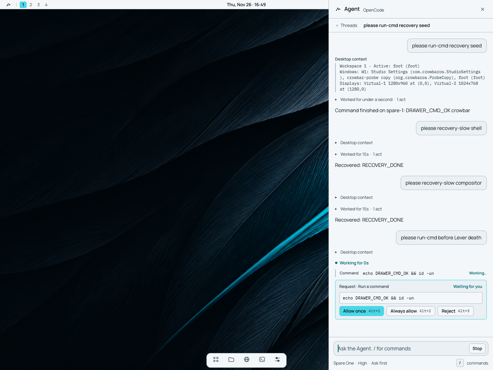
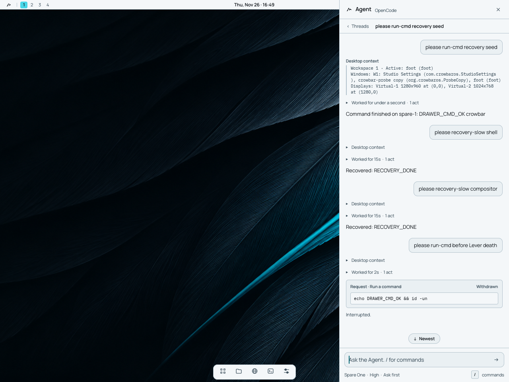

# Restart recovery with the drawer composer — November 26, 2026

The change for #384 was rebased onto main
`c375aaa9334774f51c72d803f513d09bf8277df3`, which added the drawer's slash
commands, Model picker, reasoning effort, and Markdown answers (#413).
This record supplements the [original validation](agent-recovery-2026-11-26.md);
that record and its evidence remain unchanged.

The verified runtime revision is `8aa633d`. Both sets of appended Shell and
Lever tests were retained when resolving the conflicts. The recovery test now
also verifies that the selected Model, reasoning effort, and mode survive the
history reload. The runtime recovery changes are otherwise unchanged.

## Verification

- Full `python3 lab/void/desktop_check.py`: **241 passed, 0 failed**.
  [desktop.log](assets/agent-recovery-rebase-2026-11-26/desktop.log),
  [results.json](assets/agent-recovery-rebase-2026-11-26/results.json), and
  [Lever log](assets/agent-recovery-rebase-2026-11-26/agent-lever.log).
- The full check rebuilt Base in Void and passed **807 release tests**, including
  the combined Shell and Lever, before booting that image.
- Shell: `cargo test --locked`: **126 unit tests and 3 GPUI source tests** passed.
- Lever: `cargo fmt --check`, `cargo clippy --locked --all-targets -- -D warnings`,
  and `cargo test --locked`: **153 tests** passed.
- Desktop helpers: formatting, clippy, and **47 tests** passed. Compositor
  formatting and clippy also passed.
- The remaining local CI app/library commands passed: **45 Files**, **5 Editor**,
  **39 Studio Settings**, **9 theme library**, and **6 UI library** tests.
  `packaging/prepare-gpui.py` confirmed that GPUI matched its pinned patches.
- Python compilation and **102 Base**, **50 lab**, **20 CI workflow**, and
  **7 Shell packaging** tests passed.

The full guest run includes both the new composer checks and all restart
recovery cases: continuing through Shell and Fulcrum restarts, no desktop
context while Fulcrum is away, interrupted turns and withdrawn requests after
Lever or OpenCode dies, readable archived records, and the next message using
the original OpenCode session with earlier act output. The original record's
limits on replacement-session history replay still apply.

## Captures

These unchanged captures are from the rebuilt image with the new composer.
The conversations and command markers are synthetic test data.

| Before Lever dies | After Lever restarts |
| --- | --- |
|  |  |

[After OpenCode dies](assets/agent-recovery-rebase-2026-11-26/after-opencode-death.png) ·
[After Fulcrum restarts](assets/agent-recovery-rebase-2026-11-26/after-compositor-restart.png)

Text evidence copies remove host paths, host CPU model details, terminal color
codes, and trailing whitespace. Original local evidence is unchanged.

Model and harness: GPT-6-astra, Codex harness in M3 Code.
