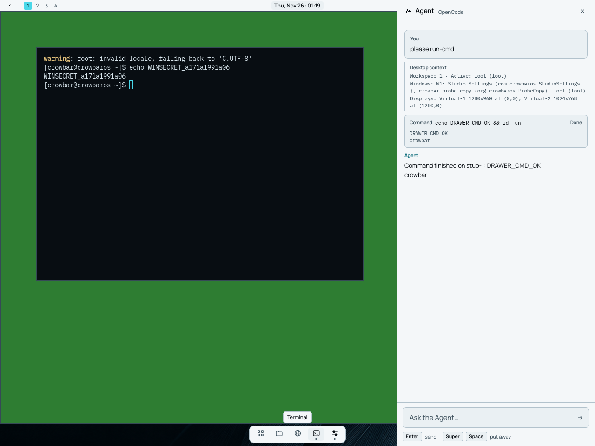
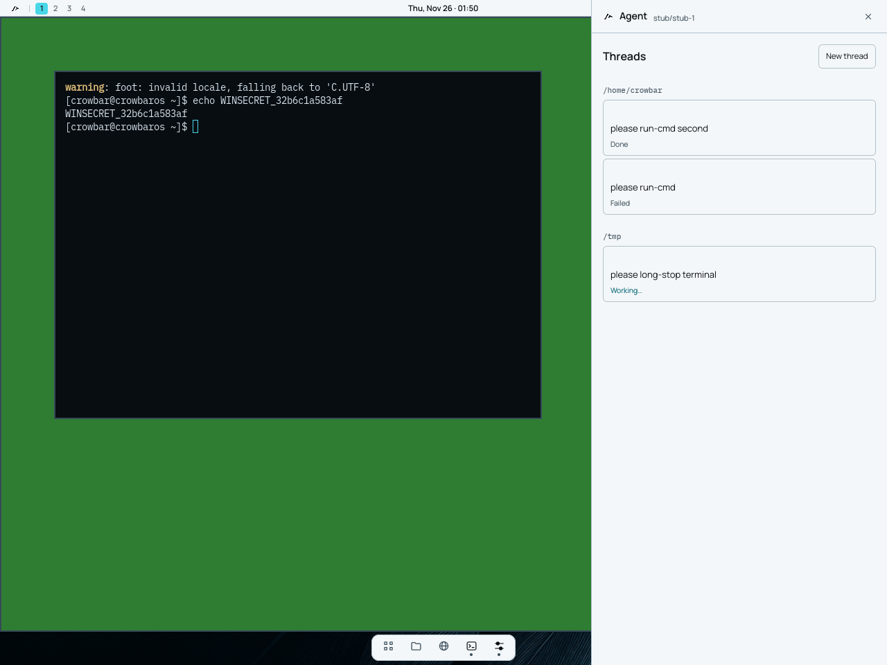
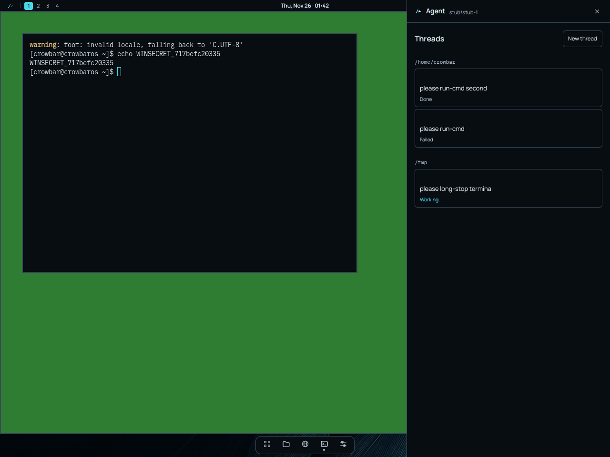
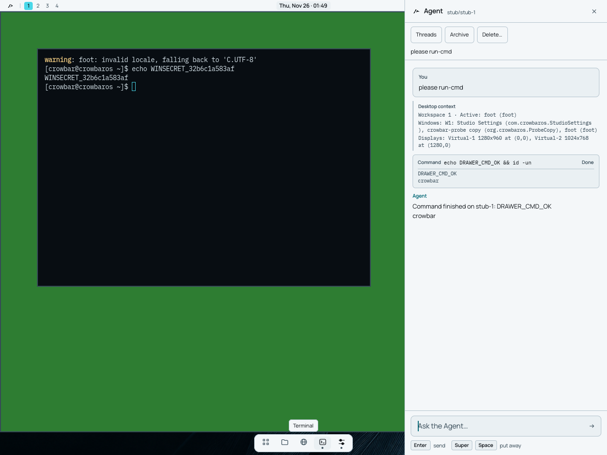
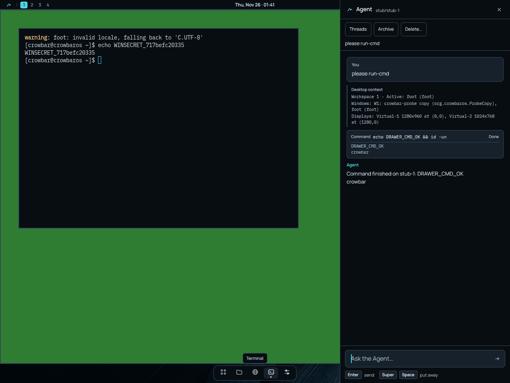
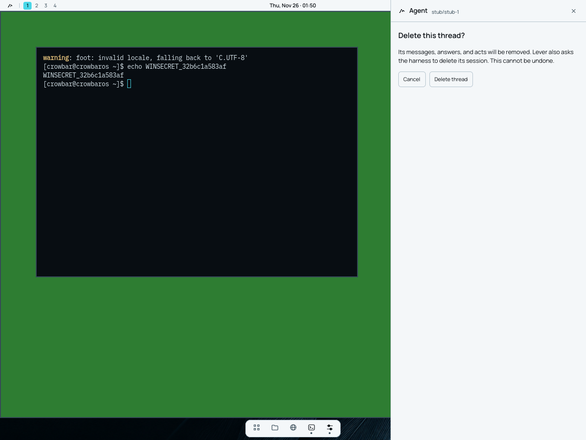
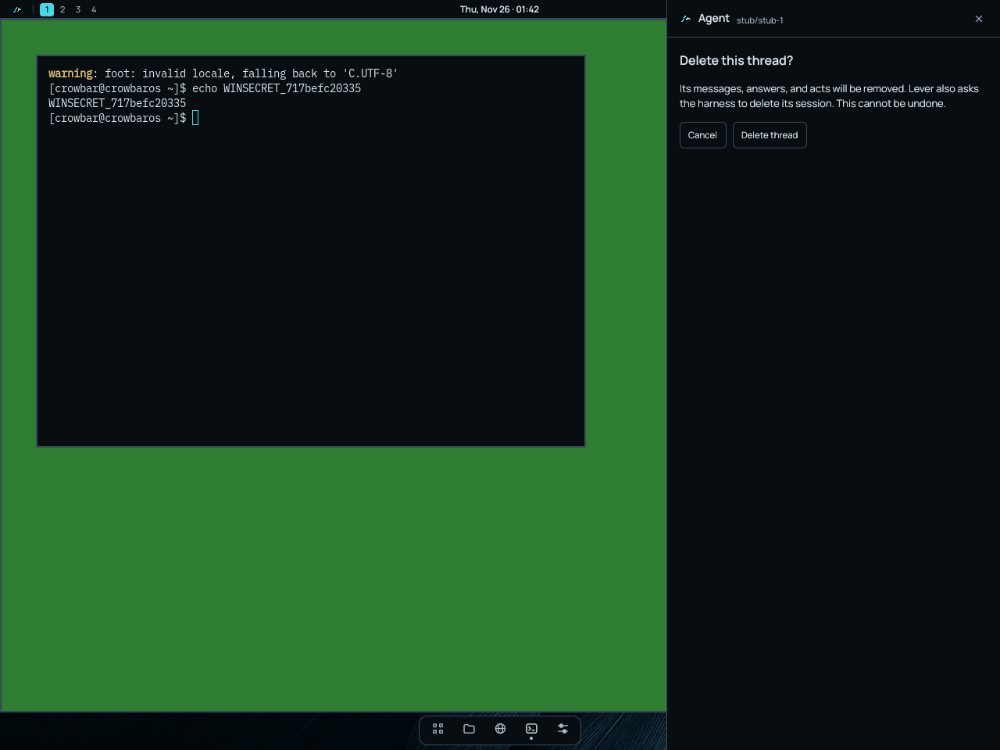

# Agent threads — November 25, 2026

[Issue #377](https://github.com/crowbaros/crowbaros/issues/377) adds the drawer's
folder-grouped thread list, New thread, Archive, and confirmed Delete. Lever's
metadata watch keeps the list and Mark current across terminal and drawer
threads, including work behind the put-away drawer. Opening a record reads
Lever's history without starting the harness.

Runtime verification ran on `1f7db1eba9c7d58c4a084289710c2563dcb8f962`, based on
main `da162fa793260a6563a50855165222764393132c`. The only uncommitted files during
the compositor run were the desktop evidence copies for this record.

## Checks

- `python3 lab/void/desktop_check.py`: **189 passed, 0 failed**.
  [desktop.log](assets/agent-threads-2026-11-25/desktop.log),
  [results.json](assets/agent-threads-2026-11-25/results.json).
- `python3 lab/void/compositor_check.py`: **46 passed, 0 failed**.
  [Compositor evidence](assets/agent-threads-2026-11-25/compositor-20261126T015131Z.log).
- Lever: `cargo fmt --check`, `cargo clippy --locked --all-targets -- -D warnings`,
  and `cargo test --locked`: **93 tests passed** across service, store, harness,
  client, and real-socket integration suites.
- Shell: `cargo test --locked`: **78 unit tests and 3 GPUI source tests passed**.
  Base's full build also built and release-tested the shell and Lever in Void.
- Python: compilation plus **102 Base, 50 lab, 20 CI classification, and 7 GPUI
  packaging tests passed**.

The desktop check starts a terminal thread in a separate folder, starts a second
thread in the drawer while the first works, and checks both list states. It
opens a record by keyboard, archives it while retaining readable history,
observes terminal Stop through the hidden Mark, and deletes from both the CLI
and drawer. Canceling the drawer confirmation retains the thread. The existing
multi-turn check also verifies that typing continues after clicking Stop.

The socket tests verify archive persistence across Lever restarts, history reads
with no harness configured, deletion through ACP after a harness restart, and
retained history when session deletion fails. State tests verify aggregate work,
folder grouping, ignored late events from an old thread, and that a background
archive cannot unlock another thread's pending history read.

An earlier compositor-check process was interrupted by SIGTERM before finishing;
the complete fresh run linked above passed. All original local logs are retained.

## Captures and visual review

The before capture is from the post-merge run on main `da162fa`. Light captures
come from the full 189-check run. Dark captures come from the same feature's
focused 17-check guest run; that focused run is iteration evidence, not a
substitute for the full run. Every image is a direct, unchanged guest capture.
The visible marker strings and conversations are synthetic test data.

| View | Light | Dark |
| --- | --- | --- |
| Thread list |  |  |
| Thread record |  |  |
| Delete confirmation |  |  |

The independent Impeccable finish review returned **ship**, with no material
fixes, for the supplied Dark captures and sampled source. Light captures were
then inspected directly. The design documentation review confirmed reuse of
existing palettes, typography, and drawer composition; design files were left
unchanged. Historical shell-brief and sidecar drift remains outside this change.
Expanded long details and mid-stream scrolling were not separately recorded.

## Evidence limits

The checks ran in QEMU with the pinned OpenCode and scripted Model, plus the
scripted ACP harness in component tests. They do not certify every external
harness. Delete requests session removal when the harness advertises that
capability; otherwise Lever removes its own record and explicitly warns that
the harness's copy may remain. A harness error retains Lever's record.

Text evidence was copied with host checkout/home paths and host CPU model names
removed, terminal color codes stripped, and trailing whitespace trimmed. Guest
account paths and QEMU guest-network addresses remain. Original evidence was
not modified.

Model and harness: GPT-6-astra, Codex harness in M3 Code.
