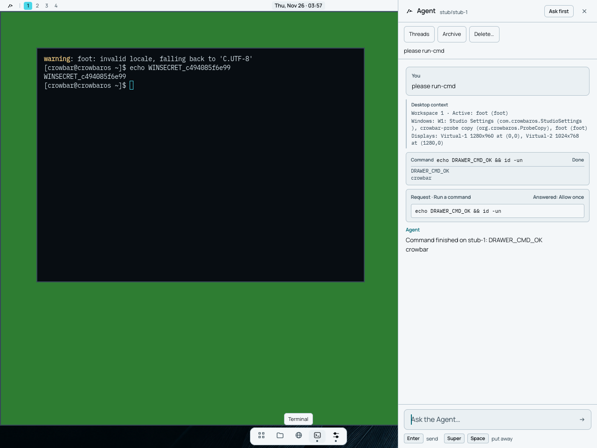
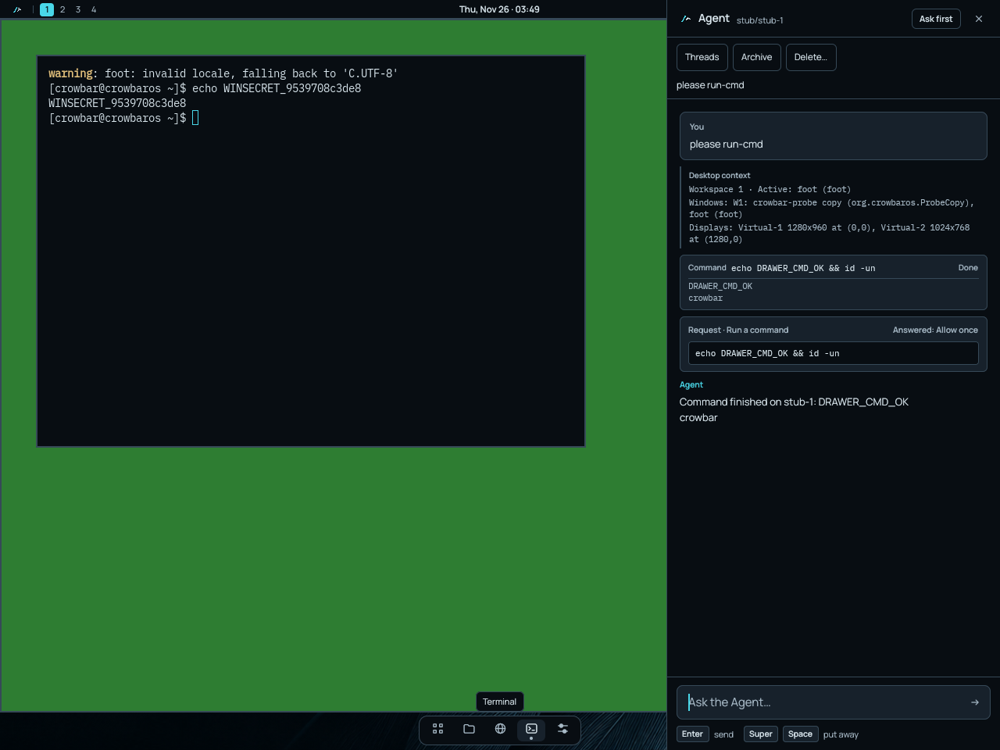
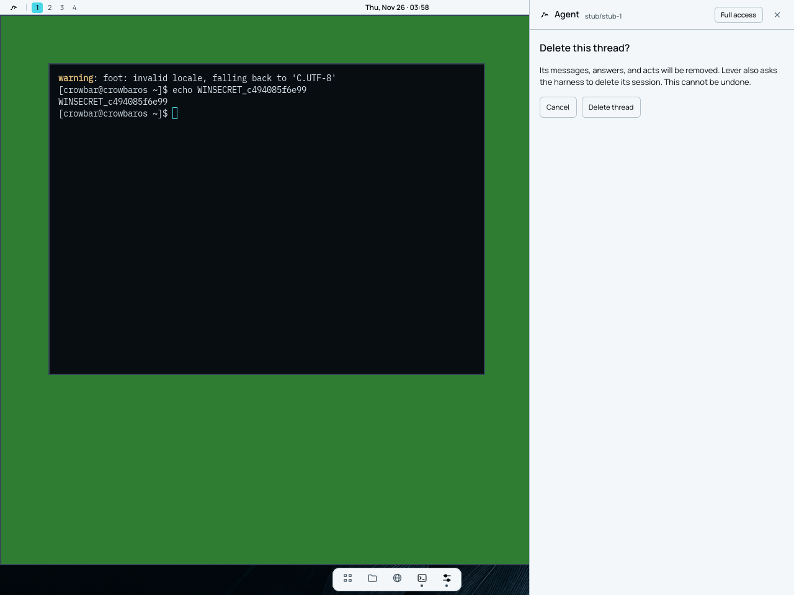
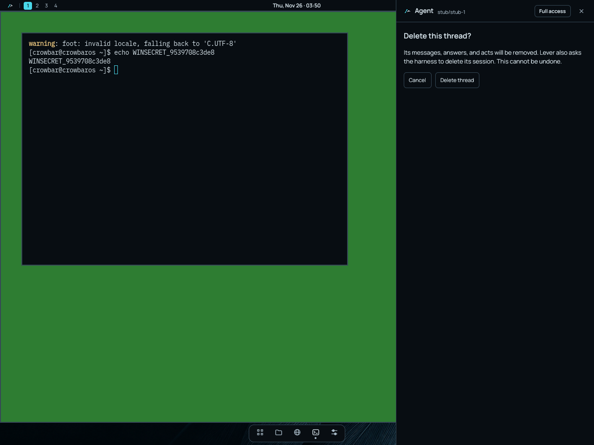

# Thread drawer with permission controls — November 25, 2026

PR #410 was ready to merge when main gained permission requests, modes, and
stronger Stop handling in `1943784a44f5c9f8d96836925b8d51591ada0b95`.
The resulting conflicts required a rebase and fresh desktop/compositor evidence.
This record supplements the [original feature validation](agent-threads-2026-11-25.md)
and [formatting correction](agent-threads-format-2026-11-25.md); neither is rewritten.

The runtime revision verified here is `c7a9c97c8b57326913ee3049c557aa0aea252132`, based on main
`1943784a44f5c9f8d96836925b8d51591ada0b95`.

The integration preserves permission requests and modes while adding the thread
list. Waiting requests take precedence in the Mark and appear as Waiting in the
list. Opening another thread clears the previous thread's mode and busy state.
A request that remains after its turn ends prevents deletion until Stop
withdraws it. List metadata retains distinct waiting, mode, and archive fields.
Navigation controls expose their bounds through the shell's existing check
interface, so guest checks click the requested control.

## Verification

- Full `python3 lab/void/desktop_check.py`: **199 passed, 0 failed**.
  [desktop.log](assets/agent-threads-rebase-2026-11-25/desktop.log),
  [results.json](assets/agent-threads-rebase-2026-11-25/results.json).
- Full `python3 lab/void/compositor_check.py`: **46 passed, 0 failed**.
  [Evidence log](assets/agent-threads-rebase-2026-11-25/compositor-20261126T035855Z.log).
- Lever: `cargo fmt --check`, `cargo clippy --locked --all-targets -- -D warnings`,
  and `cargo test --locked` passed; **136 tests passed**.
- Shell: `cargo test --locked`: **89 unit tests and 3 GPUI source tests passed**.
- Python compilation, **50 lab tests**, and **102 Base tests** passed.
- The full guest builds compiled and release-tested the combined Shell and Lever
  in Void. A focused guest iteration passed **27 checks**; its `--no-build` run
  is not a substitute for the full evidence above.

The new thread-selection regression fails at `can_send()` without clearing the
previous thread's busy state. The extended post-turn request regression fails
without the deletion guard; it also checks that list watchers see the waiting
request, mode, and archive flag correctly. Both were run with their fixes
removed, observed failing, and restored; the complete suites pass with them.

An initial full desktop run passed 178 checks and failed while typing the next
message after answering a permission request. Restoring composer focus after
permission and mode choices corrected it. The existing guest flow reproduces
that failure without the fix and passes in the final full run. Original local
logs remain intact.

## Captures

Light captures below come from the final full desktop run. Dark captures come
from the successful focused guest iteration of the same code. The list and
delete confirmation were inspected in both themes. The original record retains
the before capture. Images are unchanged guest captures; visible marker strings
and conversations are synthetic test data.

| View | Light | Dark |
| --- | --- | --- |
| Thread list |  |  |
| Thread with answered request |  |  |
| Delete confirmation |  |  |

Text evidence copies remove host paths, host CPU model details, terminal color
codes, and trailing whitespace. No original evidence was modified. The original
record's limits on external harnesses and unrecorded expanded-detail/scrolling
interactions still apply.

Model and harness: GPT-6-astra, Codex harness in M3 Code.
