# The drawer's slash commands and Model picker — November 25, 2026

[Issue #411](https://github.com/crowbaros/crowbaros/issues/411) has the person
drive a thread from the drawer's message box. A `/` lists slash commands: the
drawer's own, and the ones the thread's harness offers. `/model` is a Model
picker, with the providers on a rail, a search, and then the effort levels of
the Model picked. An answer shows as the Markdown it is, and a turn's acts fold
into one line once it has ended. Lever carries the harness's slash commands,
each Model's provider, and a thread's effort.

The checks ran on `0f4581f52bd0511ed3eb20ccfaadf8cc053f0659`, on main
`5644d9f7f1590563f33592745ef66bb66ec80914`, with nothing uncommitted.

## Checks

- `python3 lab/void/desktop_check.py`: **215 passed, 0 failed**.
  [desktop.log](assets/drawer-slash-commands-2026-11-25/desktop.log),
  [results.json](assets/drawer-slash-commands-2026-11-25/results.json).
- Lever, in `lever/`: `cargo fmt --check`, `cargo clippy --locked --all-targets
  -- -D warnings`, and `cargo test --locked`: **152 tests passed**, 86 of them
  over Lever's real sockets against the stub harness.
- Shell, in `apps/shell/`: `cargo test --locked`: **121 unit tests and 3 GPUI
  source tests passed**. Base's build also built and tested the shell and
  Lever in Void.
- Python: **102 Base, 50 lab, 20 CI, and 7 GPUI packaging tests passed**.

The desktop check now drives the drawer with slash commands where it clicked
controls that are gone. In the guest, with the pinned OpenCode 2.4.1 against
the stub Model, it:

- finds a slash command of OpenCode's by its name, takes it into the message
  box, and sends nothing;
- submits a harness slash command (`/init`) from the drawer with desktop
  context attached, and confirms OpenCode expands and runs it as a command
  (with desktop context sent as ACP assistant-audience context) and shows its
  turn in the thread;
- lists the drawer's slash commands and then OpenCode's, narrows the list by
  typing, closes it with Escape, and keeps what was typed;
- takes `/mode` with Down and Enter, picks Full access from the list, and sets
  the starting mode with `/default-mode full-access` typed whole;
- is told why `/mode nonesuch` cannot be taken, and changes nothing;
- opens `/model` on the thread's Model, moves along the rail of two
  providers, searches through both, and picks a Model;
- is offered that Model's effort levels next, picks High, and sees the next
  turn reach the stub Model on that Model with `reasoning_effort: high`;
- starts a new thread, which begins with the Model last picked while a thread
  started in a terminal works on the same harness;
- opens the fold of an ended turn's acts, and reads an answer in Markdown;
- answers a request with Alt+3, stops a turn with `/stop`, archives with
  `/archive`, and deletes with `/delete`, after its question;
- types two lines with Shift+Enter, puts the drawer away, and finds them
  there when it is summoned again.

## Two faults the run in the guest found

Both are fixed, each with a test that fails without the fix.

- **OpenCode answers a change of effort late while another of its sessions
  works.** Its answer to `session/set_config_option` then names the effort the
  session was at, and a `config_option_update` after it names the new one.
  Lever took the answer for a refusal, so a new thread that picked an effort
  failed its first turn whenever another thread was working. Lever now takes
  an answer with no error for the effort set. The stub harness answers this
  way with `effort_answer_lags`, and
  `an_effort_answered_with_the_one_before_is_taken_and_the_update_after_says_so`
  holds it.
- **A key held down repeats Enter or Alt+digit.** Fulcrum repeats a key after
  200 ms, and the lab holds each key for 150 ms, so now and then Enter came
  twice; taking `/mode` filled the message box, and the second Enter took the
  first mode with it. In the drawer, plain Enter in the message box and
  `Alt+<digit>` permission answers now ignore held key repeats via GPUI's
  `KeyDownEvent.is_held` (and `Alt+<digit>` is gated to the visible thread
  view), covered by `held_enter_and_modified_enter_are_ignored_in_composer` and
  `alt_digit_is_ignored_when_held_or_away_from_thread`. The desktop check's
  arrow keys go to the row they mean to reach, since a list goes round its ends.

## Captures

Light captures are from the full run of 215 checks (except the unchanged Light
menu captures from the earlier `184aa090` run, with `thread-light.png` updated
from the `0f4581f5` run to show the inline link destination). Dark captures are
from a run of the same drawer checks alone on a fresh boot of the `184aa090`
image, which starts in Dark: 42 checks passed. That run is not the desktop
check, and is no substitute for it. Every image is the guest's display as
captured, unchanged. The words and marks in them are the checks' own.

The drawer before this change is in the
[record of the thread list](agent-threads-2026-11-25.md#captures-and-visual-review).

| View | Light | Dark |
| --- | --- | --- |
| A slash lists the slash commands | 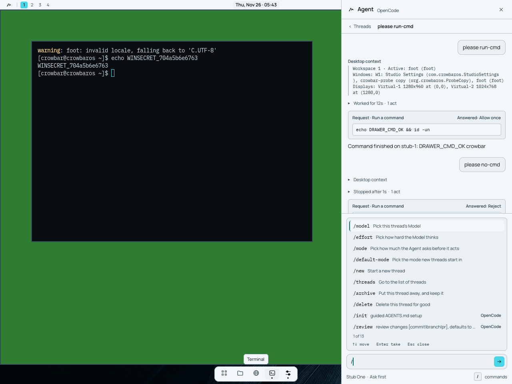 | 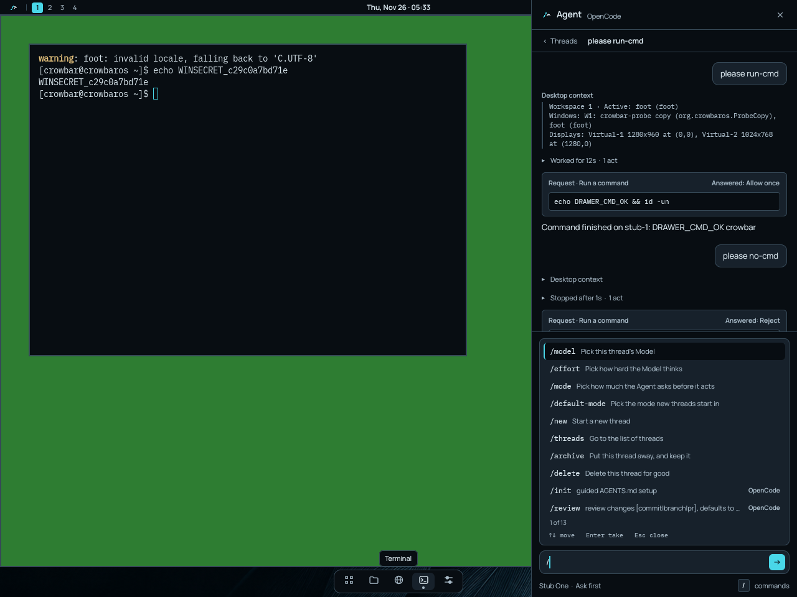 |
| Typing finds one of the harness's |  | 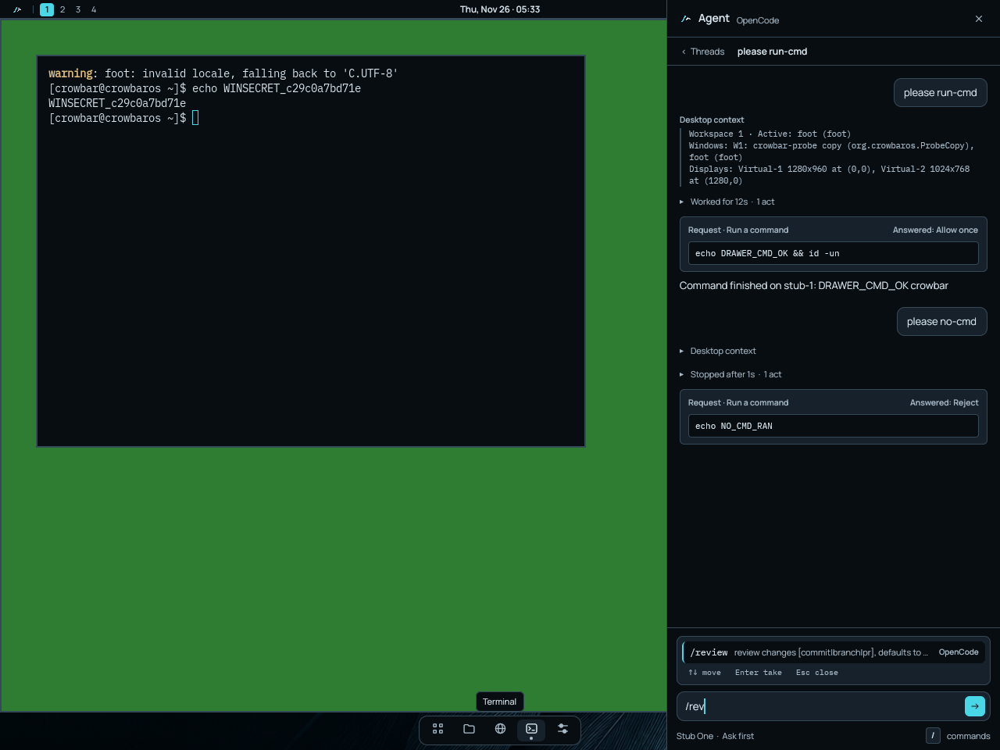 |
| `/mode` lists the modes |  | 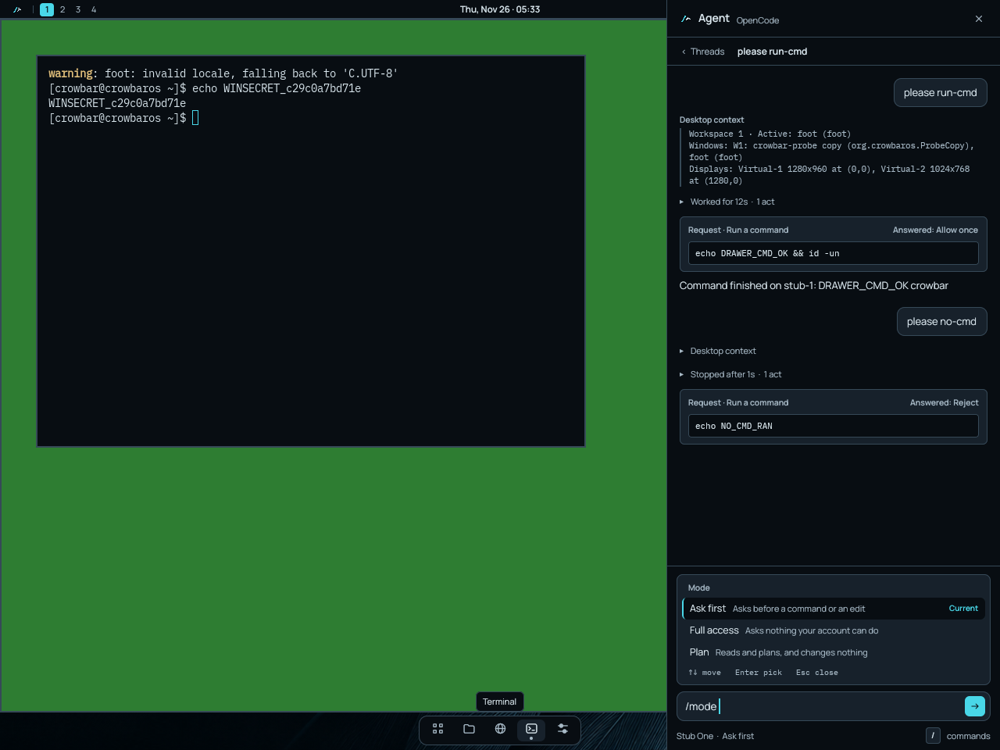 |
| `/model`: the providers and one's Models |  | 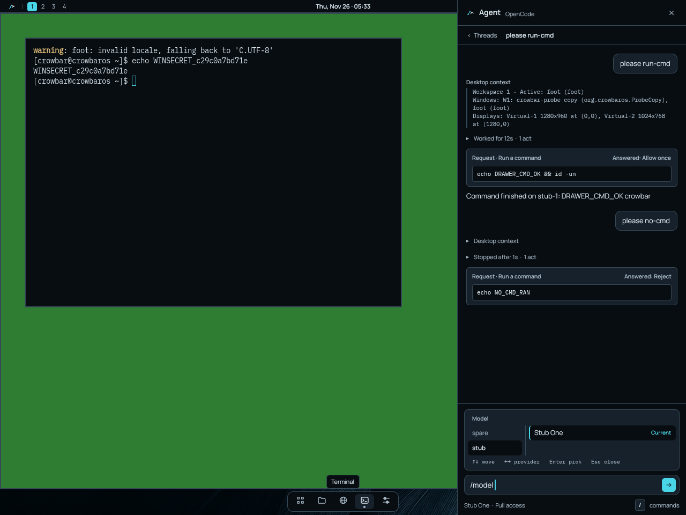 |
| `/model one`: a search through every provider | 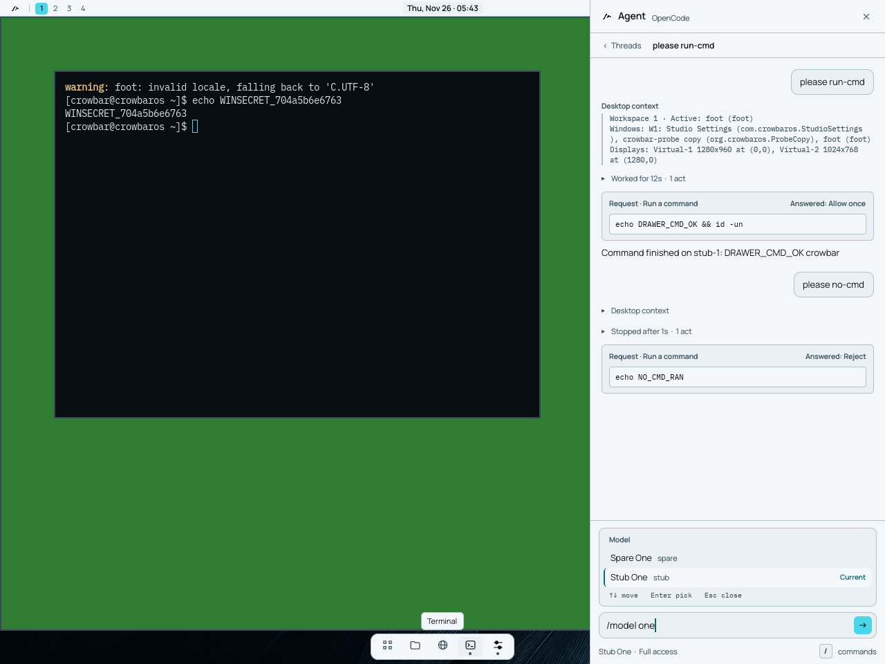 |  |
| The Model's effort levels, listed next |  | 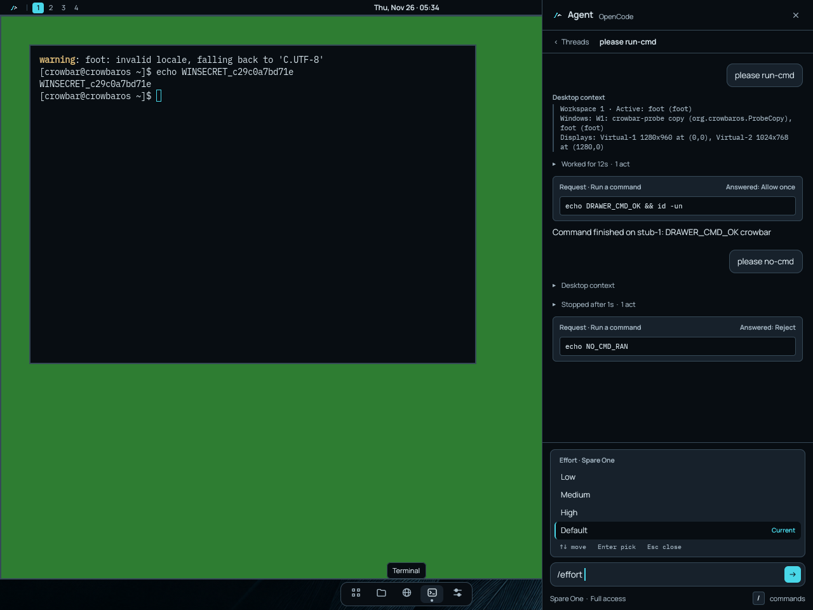 |
| A working turn, with a request that waits | 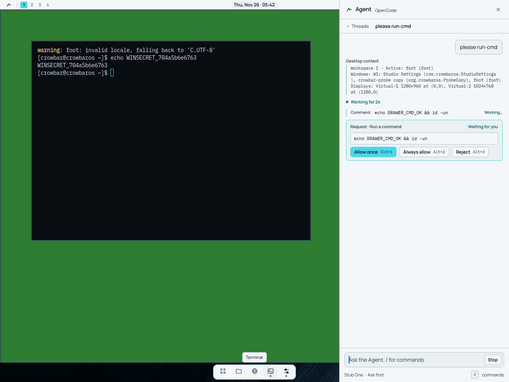 | 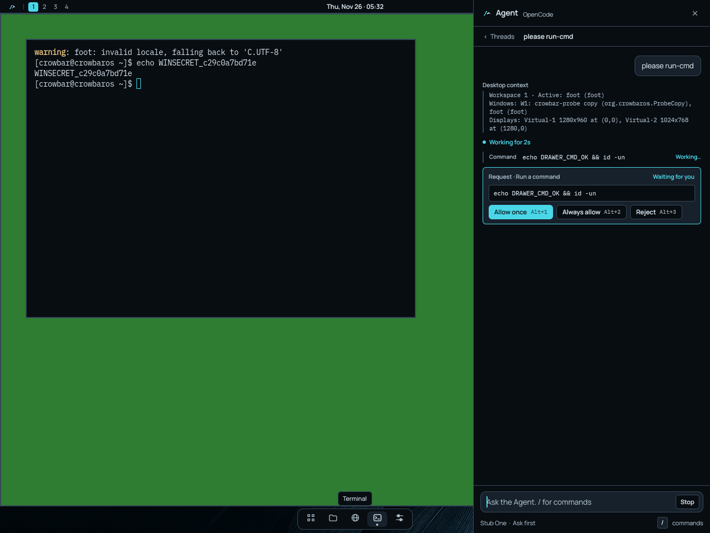 |
| A thread: folded acts and an answer in Markdown | 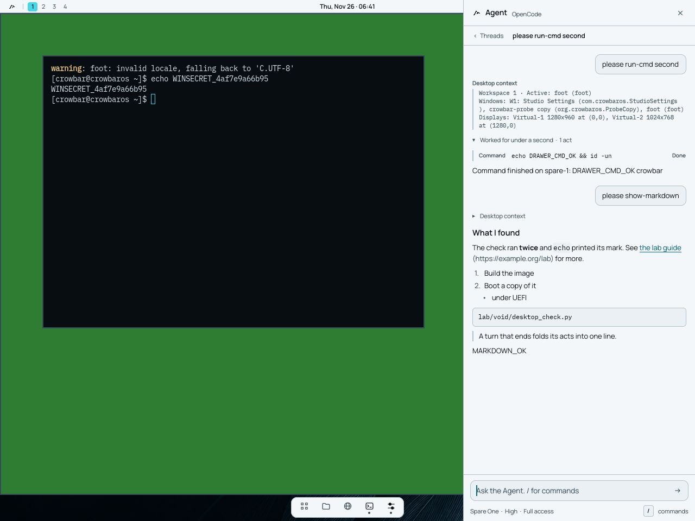 | 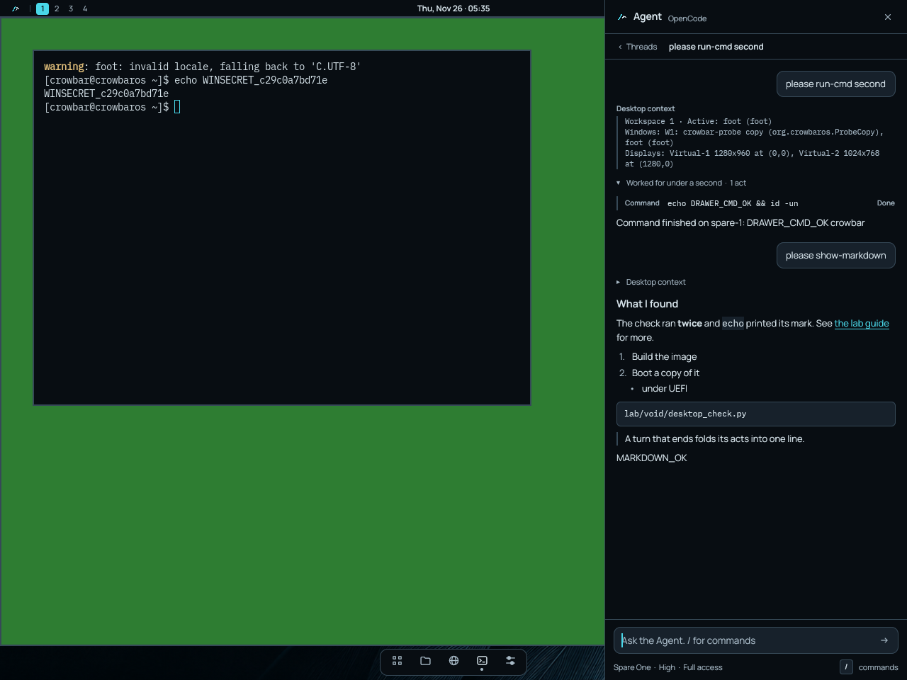 |
| Two lines in the message box, kept while put away |  |  |

## What was not run

- No turn was sent to a real Model. The effort levels, providers, and slash
  commands of OpenCode's free hosted Models were read from the pinned
  OpenCode on the host, and nothing was sent to them.
- No run on real hardware.
- Pasting many lines, the message box scrolling past eight lines, the
  **Newest** control, and a thread long enough to scroll were not driven by a
  check. The words kept for each thread across a switch of threads are held
  by the drawer's code and not by a check in the guest.
- The shell's tests cover what the drawer keeps of Lever's messages, the list
  of slash commands, and the Markdown. How the drawer draws them is seen only
  in the captures above.
- The Model and effort last picked are kept in the shell's runtime directory,
  so they outlast the shell and not a restart of the machine. That restart was
  not run.

The text evidence was copied with the host's checkout and home paths taken
out, terminal color codes stripped, and trailing whitespace trimmed. The
guest's own account paths and QEMU's guest addresses remain.
