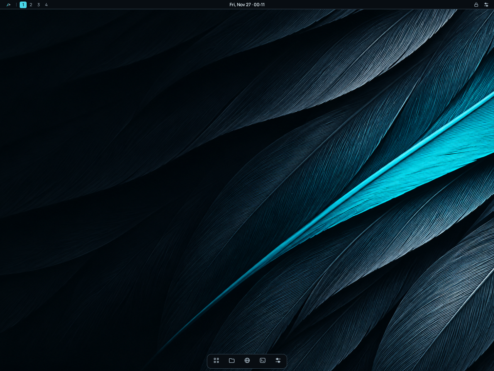
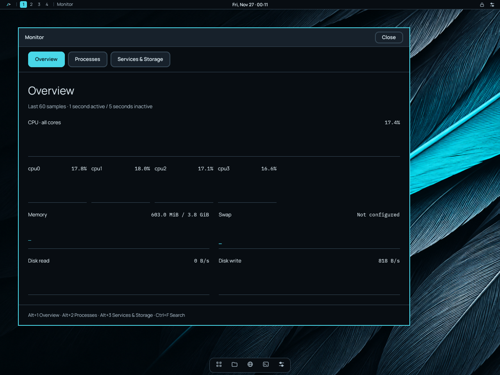
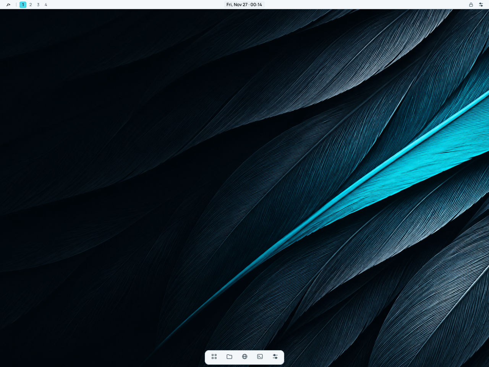
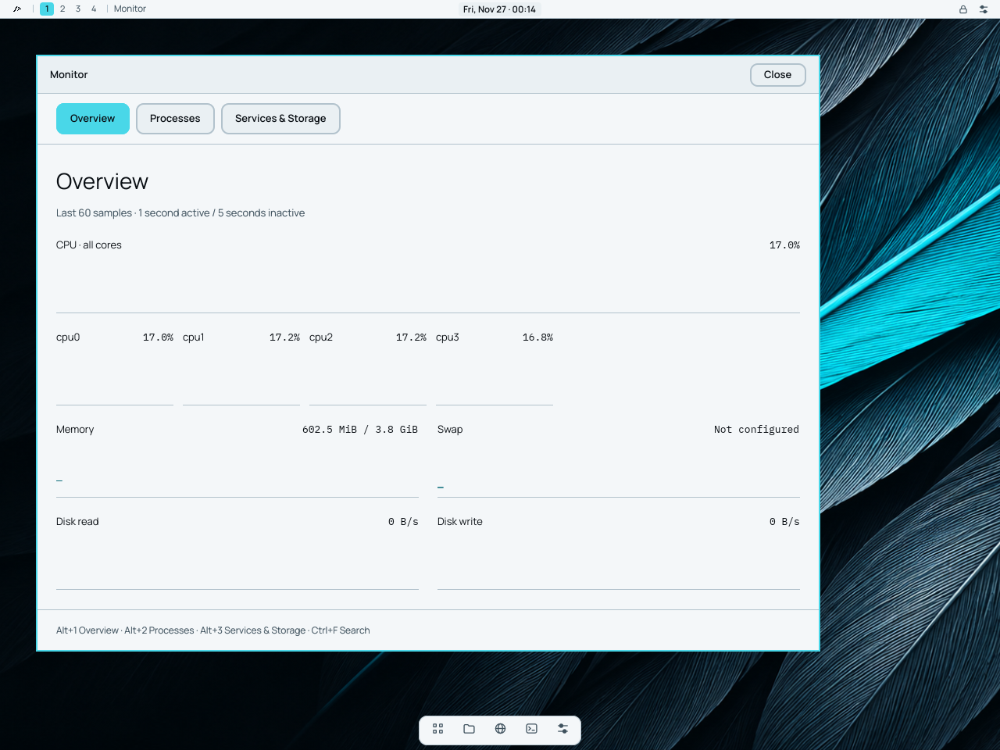

# Monitor review evidence

These are publication copies from the full Void desktop run
`20261126T170933-cj25i3gd`, described in the
[validation record](../../monitor-validation-2026-11-26.md).
The runtime implementation was `258f582974dc199bc84a42a5188f09973f915b0a`,
on `main` commit `e1cdaafea15b89b1aeb8977649e4c3d5b3be8d9e`.

The original local evidence remains unchanged. In the published text logs,
the host checkout path is replaced by `/workspace/crowbaros`.
Guest paths and QEMU's own network addresses are retained. The synthetic
`CLIPSECRET_` and `WINSECRET_` values are disposable test markers, not credentials.
The build's documented lab password is for the disposable guest only.
`SHA256SUMS` records the publication copies of the logs, results, and media.

- [Desktop log](desktop.log) and [results](results.json): **264 passed, 0 failed**.
- [Void build log](build.log): component builds and tests, including Monitor's
  18 library tests and 2 interface feedback tests.
- Six-second motion recordings: [Dark](monitor-dark-motion.mp4),
  [Light](monitor-light-motion.mp4).

| Theme | Before launching Monitor | Monitor Overview |
| --- | --- | --- |
| Dark |  |  |
| Light |  |  |

| View | Dark | Light |
| --- | --- | --- |
| Processes | [Capture](monitor-dark-processes.png) | [Capture](monitor-light-processes.png) |
| Force Quit confirmation | [Capture](monitor-dark-force-confirmation.png) | [Capture](monitor-light-force-confirmation.png) |
| Protected system process | [Capture](monitor-dark-system-process.png) | [Capture](monitor-light-system-process.png) |
| Services & Storage | [Capture](monitor-dark-services.png) | [Capture](monitor-light-services.png) |

Physical AMD/NVIDIA telemetry was not qualified by this virtual-machine run.
