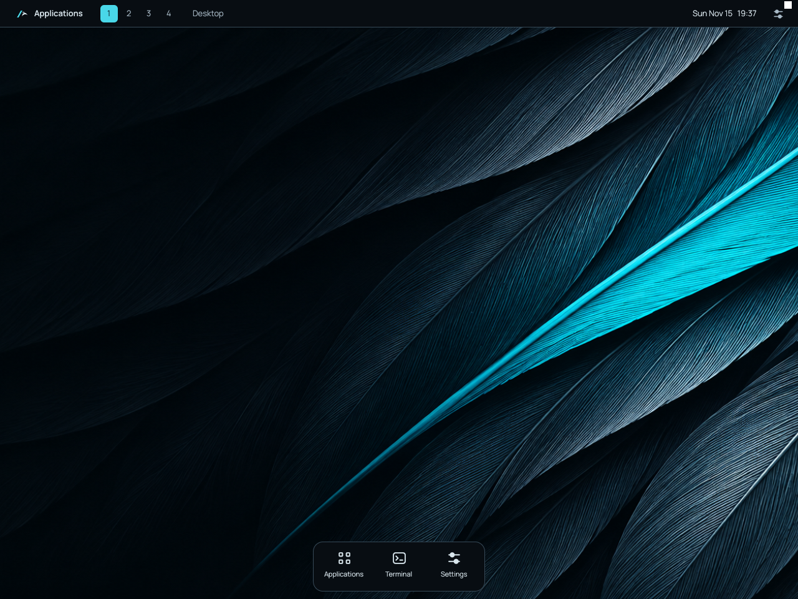

# Fedora workflow retirement preparation — 2026-11-15

Issue [#65](https://github.com/crowbaros/crowbaros/issues/65), prepared on
`codex/retire-fedora-workflow` from `e2c07ca`. This is a source/archive cleanup.
It does not complete the integrated desktop acceptance gate in
[#54](https://github.com/crowbaros/crowbaros/issues/54), and must not be used to
close that gate or claim the preserved desktop integration has landed.

## Changes and preservation

- Archived the Fedora VM scripts, RPM recipes, session hooks, and former build
  instructions under [`docs/archive/fedora-workflow/`](../archive/fedora-workflow/README.md).
  All 38 entries were compared byte-for-byte with the original commit and
  checked against the SHA-256 values in its manifest.
- Updated active app/lab documentation to the commands available on Void in
  this checkout. CI compiles the active Void scripts and retains its Rust jobs.
- Compared 375 protected source, dependency, license, branding, and dated
  evidence files against the baseline: unchanged. The GPUI backport preparer,
  portable desktop entries/icons, fonts, and application code remain active.
- Left the mixed rollback stash and preserved desktop branch untouched.
- Checked four existing Void disk files before and after: same inode and size.
  No existing disk was rebuilt, replaced, or deleted. The graphical VM stayed
  running; no new binaries were installed into it.

## Verification

| Check | Result |
| --- | --- |
| Root `cargo fmt --all --check`, workspace Clippy with warnings denied, locked offline tests | Pass; 57 tests |
| Compositor format, Clippy with warnings denied, locked offline tests | Pass; 20 tests |
| Pinned GPUI archive verification and layer-shell patch preparation | Pass |
| Void release builds and locked offline tests: compositor, shell, Settings, GPUI probe | Pass; 20, 15, 4, and 0 tests respectively |
| Void headless app `--version` runs | Pass: shell 0.1.1, Settings 0.1.3, probe 0.1.1 |
| Isolated Void Base milestone: boot, apply, broken boot/manual rollback, drift, failed apply | Pass; 22/22 checks |
| `python3 -m py_compile lab/void/*.py` | Pass |
| Archive integrity, protected files, changed documentation links, disk metadata | Pass |
| `git diff --check` | Pass |

App builds used the existing Void glibc build root with Rust 1.99.0 and the
cached dependencies. The checkout, target directory, and Cargo caches were
mounted into a temporary user/mount namespace; this did not alter VM disks.
GPUI and `proc-macro-error2` emitted existing compatibility warnings. This
change does not update those dependencies.

The Base milestone ran through the unchanged `void_lab.milestone()` function
using a separate `.lab/issue-65/base/` workspace, fresh key/disks/sockets, and
SSH port 22234. Only the existing rootfs input was reused; image assembly copies
it to the isolated staging tree. The test guest was stopped after the run.
The existing `.lab/void/` and `.lab/void-graphical/` guests were not restarted.

Build logs and the milestone evidence are in
[`assets/fedora-retirement-2026-11-15/`](assets/fedora-retirement-2026-11-15/).
Those copies omit trailing whitespace and final blank lines; raw output remains
in `.lab/issue-65/`.

## Desktop preservation captures

These captures show the already-running local preview from the preserved
desktop work, not newly deployed binaries from this branch. They establish
that its shell stayed visible through the cleanup. They do not test Settings
Save, app launch, cold boot, recovery, or current-main GUI acceptance. No motion
or interface behavior changed, so no motion recording was made.

| Before | After |
| --- | --- |
|  |  |

## Remaining gates

The retained source adapters are explicitly bounded by existing issues:
[#136](https://github.com/crowbaros/crowbaros/issues/136) for shell process/session
integration, following [#39](https://github.com/crowbaros/crowbaros/issues/39);
[#38](https://github.com/crowbaros/crowbaros/issues/38) for Settings Save/motion;
and [#71](https://github.com/crowbaros/crowbaros/issues/71) for the production
shell control protocol and legacy fallback removal.

The app tests and version commands passed in Void, but the freshly built apps
were not installed into or interactively exercised in the preserved VM. The
replacement session must still pass #54 before #65 is merged and closed.
