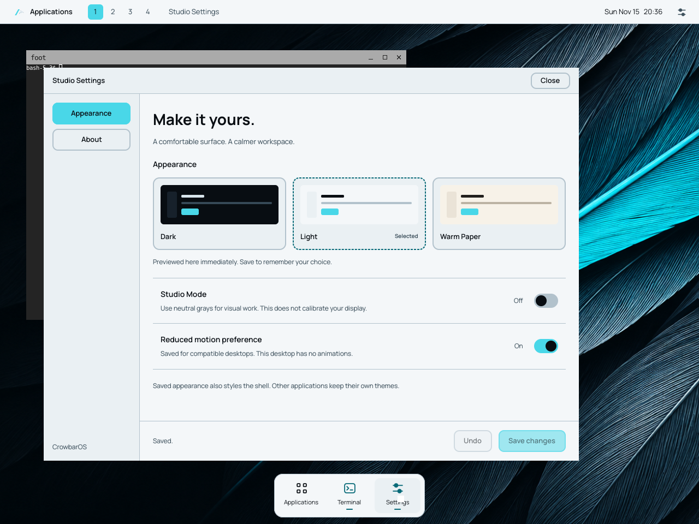
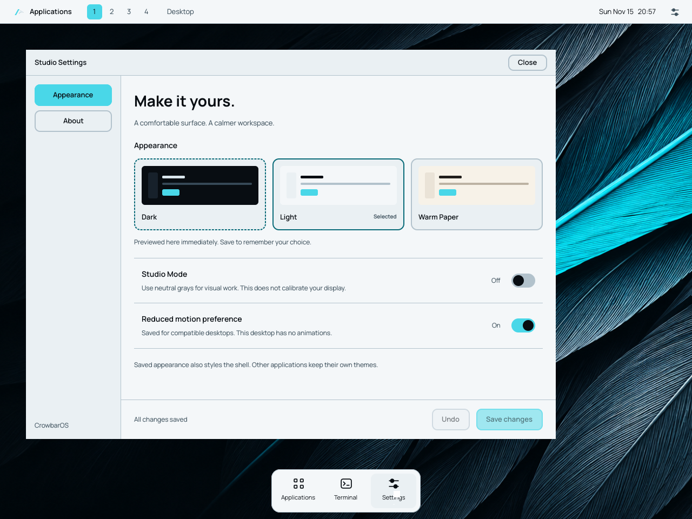

# Fedora workflow retirement acceptance — 2026-11-15

The desktop prerequisite for [#65](https://github.com/crowbaros/crowbaros/issues/65)
landed in [PR #159](https://github.com/crowbaros/crowbaros/pull/159), main commit
`ac7bdac57361002844708f699ddf2d2e11676481`, after all four CI jobs passed.
That closed #54, #136, and #38. This record verifies the retirement branch on
that baseline. The [earlier preparation record](fedora-retirement-2026-11-15.md)
remains unchanged and describes the state before the desktop prerequisite landed.

## Scope and preservation

The [workflow archive](../archive/fedora-workflow/README.md) contains 38 files
from `e2c07cab37f381a3754e190a0a932e725ba41290`, each verified byte-for-byte and
against its manifest SHA-256. Active Fedora scripts, RPM recipes, and
systemd/Hyprland session hooks are retired. CI compiles only active Void scripts.
Current app, lab, product, and development guides describe the integrated Void
Alpha session, its smoke command, and its limits. ADR 0016 and ADR 0017 are intact.

Compared with the desktop baseline, 391 application/workspace/compositor source,
dependency, license, branding, font/asset, and dated evidence files are unchanged.
The portable GPUI preparer, desktop entries, and icons remain active. No runtime
Rust or Void lab code changes are part of retirement. Local link checks passed
for the updated guides; archived copies retain links describing their old layout.

All four existing Void image files kept their inode and size. The original
preview VM remained running as PID 1188853, confirmed by QMP. No existing VM was
stopped, restarted, or deleted. Preserved branch `codex/void-desktop-preview`
and mixed rollback stash `940c29914bfed32d97a4447cdfef135e41093177` remain intact.
No unrelated branding changes were taken from that stash.

## Verification after retirement

| Check | Result |
| --- | --- |
| Fresh Void desktop acceptance | **37/37 passed** |
| Separate Base boot/apply/manual-rollback milestone | **22/22 passed** |
| Root workspace format, Clippy with warnings denied, locked tests | Pass; 57 tests |
| Compositor format, Clippy with warnings denied, locked tests | Pass; 22 tests |
| Void release builds and tests: compositor / shell / Settings | Pass; 22 / 15 / 5 tests |
| Python isolation and appearance-file regressions | Pass; 7 tests |
| Active Python compilation, archive integrity, documentation links, whitespace | Pass |

The desktop command was:

```sh
python3 lab/void/compositor_guest.py desktop-check --build-cache .lab/void-graphical
```

Run `.lab/void-desktop-checks/20261115T135453-ttufdh29/` created a new guest root,
disk, key, SSH port, and Unix VNC sockets. Only the existing build root and Cargo
target were reused. It rebuilt all three projects inside Void glibc with Rust
1.99.0, booted Void kernel 6.18.63_1 under runit, exercised keyboard/pointer input,
and powered off its test guest. Launch, focus, workspaces, preview/Save/Undo,
shell restart, clean reboot, restored appearance, UID/seat/descriptor checks,
linked libraries, and active rendering all passed after the Fedora files moved.

The unchanged `void_lab.milestone()` ran with all writable lab paths redirected
to `.lab/issue-65/final-base/` and SSH port 22238. It tested successful apply,
a deliberately broken generation, boot-menu rollback, persistent rollback,
drift, and failed-apply cleanup, then stopped only that test guest.

Host sandbox restrictions initially prevented socket/special-file fixtures in
the Python and root Rust tests; both suites passed when rerun with the required
local access. No test failure was waived. Existing GPUI compatibility warnings
remain in the build log. Hardware GPU qualification and production compartment
security were not tested by these software-rendered Alpha VM checks.

## Captures and evidence

[Evidence files](assets/fedora-retirement-completion-2026-11-15/) include the
result list, desktop/build logs, process identities, preservation checks, Base
milestone log, and captures. Published log copies trim trailing whitespace;
raw logs, private keys, and disks remain under `.lab/`. Keys and disks are not
published.

| Before retirement, saved Light | After retirement, saved Light |
| --- | --- |
|  |  |



The captures were inspected at 1280×960: Settings, bar, and dock retain their
appearance, text fits, and saved Light returns after reboot. Retirement changes
no motion or interface code, so no new motion recording is needed.

## Bounded follow-up

The Alpha session bypasses retained legacy source adapters. Production shell
IPC work [#71](https://github.com/crowbaros/crowbaros/issues/71) must remove the
shell's Hyprland fallback and `systemd-run`/`systemctl` helpers, and retire the
Settings Hyprland motion adapter/`--apply-session` helper with regressions for
launch, persistence, truthful motion state, and shell restart. The archived
hooks are not installed. This is a source cleanup boundary, not a second
supported desktop workflow.

The root launch stand-in, shared app UID, and public ordinary Wayland socket
remain the explicitly documented Alpha exception. Production Warden and
per-compartment compositor enforcement remain separate work. #65 closes only
when this retirement change lands through its own green PR.
