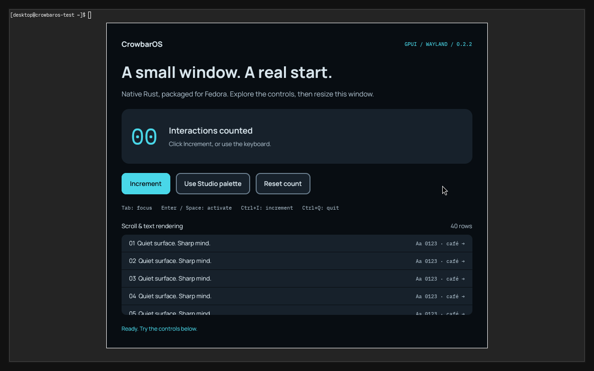
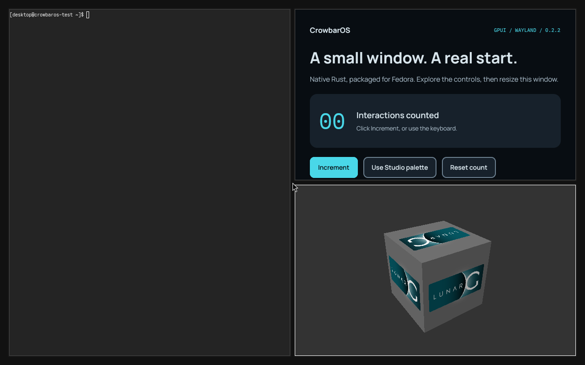

# Hardware Vulkan validation — November 14, 2026

**Result: hardware-accelerated Vulkan works in the Fedora test VM.** The Vulkan
cube and CrowbarOS GPUI probe rendered through the workstation's Intel integrated
GPU using VirtIO DRM native contexts. GPUI passed the same input/redraw checks as
the earlier software-rendered run. Hardware enumeration and GPUI launch also
passed after a graceful shutdown and cold boot.

The [reproduction and recovery workflow](gpu-vulkan.md) includes the RPM build,
VM configuration, explicit driver selection, and fallback commands. The test VM
was kept visible in Virt Viewer on the same host workspace as Codex.



## Tested stack

| Layer | Tested value |
| --- | --- |
| Host GPU | Intel Raptor Lake-S integrated GPU, PCI `8086:a788`, `0000:00:02.0` |
| Host kernel/driver | `7.2.15-1-omarchy`, `i915` |
| Host render node | `/dev/dri/by-path/pci-0000:00:02.0-render` → `/dev/dri/renderD129` |
| QEMU / libvirt | `11.1.2-1` / `12.8.0-1` |
| Host virglrenderer | `1.3.0-2`, including `i915-experimental` |
| Host Mesa / Intel Vulkan | `26.2.5-1` |
| Guest | Fedora 45 conventional RPM/DNF, kernel `7.2.11-300.fc45.x86_64` |
| Compositor | Hyprland `0.57.2-1.fc45`, VirGL OpenGL |
| Guest stock Mesa | `26.2.6-1.fc45`, retained |
| Guest Vulkan loader / libdrm | `1.4.350.0-2.fc45` / `2.4.134-2.fc45` |
| Private Vulkan RPM | `crowbaros-mesa-intel-virtio-26.2.6-1.fc45.x86_64` |
| GPUI RPM | `crowbaros-gpui-probe-0.1.1-1.fc45.x86_64`, GPUI 0.2.2 |
| Guest security | SELinux enforcing; GUI user `desktop`, UID 1001, no sudo |
| QEMU security | seccomp mode 2; `spawn=deny` retained |

## What changed

The VM now has blob resources, `hostmem=1073741824`, and
`drm_native_context=true`. Venus remains disabled. This is shared GPU access
through VirtIO; no PCI device was detached or passed through, and the host's
NVIDIA configuration was not changed.

Fedora's stock Intel Vulkan driver lacked the experimental VirtIO backend.
The builder compiled verified upstream Mesa 26.2.6 with that backend enabled,
using a clean Fedora 45 Mock buildroot and no Mesa source patches. The resulting
signed RPM installs only into a private lab prefix plus its license directory.
DNF checked both RPM and repository-metadata signatures. `rpm -V` passed for the
driver and GPUI packages. No compiler was added to the test guest.

The host-specific settings are saved in `.local/vms/config.local.json`:

```json
{
  "venus_enabled": false,
  "drm_native_context_enabled": true,
  "gpui_vulkan_driver": "intel-virtio"
}
```

The repository's base configuration retains software Vulkan as the portable lab
starting point. The documented override enables the tested acceleration profile.
The private ICD is selected explicitly, not registered globally.

## Evidence and checks

| Check | Result |
| --- | --- |
| Forced-private-ICD `vulkaninfo` | One device: `Intel(R) Graphics (RPL-S)`, integrated GPU, API `1.4.354`, Mesa `26.2.6`; no CPU device |
| Wayland Vulkan cube | 1,800 frames, normal exit 0 within the 45-second timeout |
| Host GPU execution | A QEMU DRM client named `vkcube` accumulated Intel render-engine time while the cube ran |
| GPUI library selection | Private `libvulkan_intel.so` mapped; `libvulkan_lvp` absent |
| GPUI window | Native Wayland, expected title/app ID, visibly rendered |
| Controls | Mouse increment, Ctrl+I, Tab/Shift+Tab, exactly-once Enter/Space activation, reset and palette shortcuts passed |
| Redraw/layout | Scroll, both palettes, 820×700 and 640×600 windows passed; screenshots inspected |
| Exit | Ctrl+Q closed the window successfully |
| Cold boot | Graceful stop/start; forced Intel enumeration and GPUI launch passed again |
| Package/service state | Driver and app integrity checks passed; zero failed system units |

The cube's native DRM client (`drm-client-id=4357`, `drm-client-name=vkcube`)
reported `14,959,204 ns` of render-engine time at the first active sample and
`42,934,060 ns` at the next. This is separate from the VirGL compositor client.
Together with the forced hardware-only ICD and visible rendering, it establishes
actual host GPU execution. These samples are evidence of execution, not a
performance benchmark. The [raw DRM counter samples](assets/vulkan-gpu-counters-2026-11-14.json)
are retained for inspection.



The GPUI window visible beside the cube in this earlier screenshot was still
using software Vulkan. The GPUI driver was then switched, its loaded libraries
checked, and the full interaction test rerun for the hardware screenshot above.

The guest's boot journal retained the baseline TDX-unavailable and
`dracut-crypt-generator` messages. No Vulkan device-loss or renderer failure was
observed in these checks. This is not a claim that all boot diagnostics are clean.

## Artifact identity

Upstream source: `mesa-26.2.6.tar.xz`

```text
SHA-256 b9436b3e1a8be76fbd4823dc884f90596ab7c6ac5e1867a305e66ffccfb31a92
```

Signed binary: `crowbaros-mesa-intel-virtio-26.2.6-1.fc45.x86_64.rpm`

```text
SHA-256 4f3953fcc1c015f18600256efc4761fe178dfc872c824544ec65809207817eea
Development signing fingerprint B84C3D26F0D574EB5299BAE532465B0A19A1B171
```

The development key is **NOT FOR RELEASE**. Fresh lab creation generates another
key; signatures and resulting signed RPM digests will differ.

Local evidence is under `.local/gpu/`: build logs, guest Vulkan output, package
checks, GPU counters, screenshots, GPUI journals, and cold-boot checks.
The signed repository archive is `.local/vms/gpu-repo.tar.gz`. Builder artifacts
are under `~/artifacts/gpu/`. Checkpoints **`before-gpu`** and **`gpu-validated`**
preserve the pre-driver and validated guest disks/NVRAM respectively. The builder
was stopped after packaging; the test guest and accelerated probe were left open.

## Interpretation

Hardware Vulkan is available for continued CrowbarOS GPUI development on this
workstation. This closes the earlier VM acceleration gap. It does not qualify
the experimental Intel VirtIO backend for production or validate other GPUs,
Vulkan conformance, animation/launch targets, idle power, color accuracy, or
physical display/input behavior. Full GPUI shell and accessibility integration
also remain separate work.

The [workflow](gpu-vulkan.md#why-this-path) records the Venus sandbox conflict
and links the primary upstream sources. No QEMU sandbox relaxation was needed.
