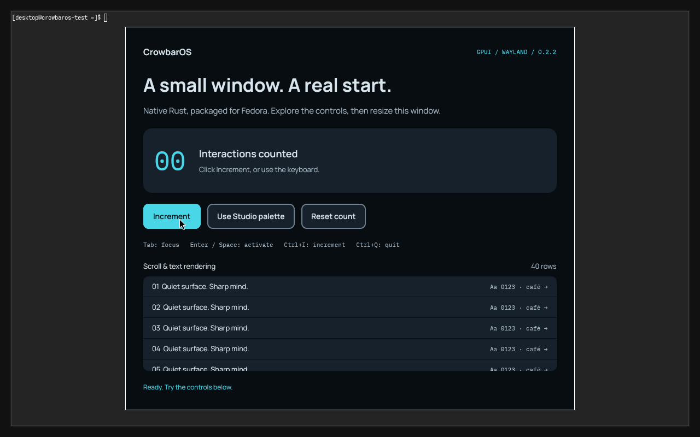
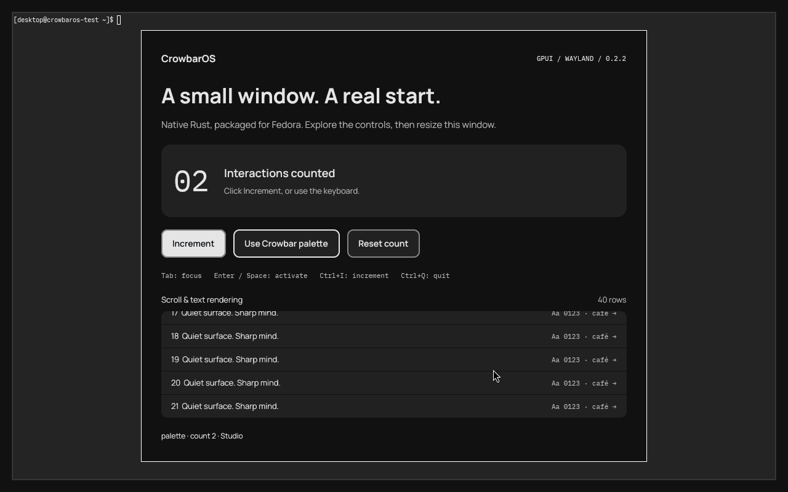

# GPUI validation — November 14, 2026

**Later follow-up:** [hardware Vulkan validation](gpu-validation-2026-11-14.md)
passed the same probe checks on the Intel GPU through VirtIO native contexts.
This report preserves the earlier software-rendered baseline.

**Result: the native application path works.** A Rust/GPUI app was built in the
Fedora builder, packaged in a clean Mock buildroot, signed, installed through DNF
in the separate test guest, and exercised as its ordinary desktop user. The test
viewer remains open with the app running. This validates a basic application on
the selected stack; the full shell and hardware performance remain separate work.



## Recorded stack and artifact

| Component | Validated version/configuration |
| --- | --- |
| Base | Fedora 45 Cloud Base 45-1.4, conventional RPM/DNF, x86_64 |
| App | `crowbaros-gpui-probe-0.1.1-1.fc45.x86_64` |
| Toolkit | Published GPUI **0.2.2**, Wayland feature; X11 backend disabled |
| Toolchain | Rust/Cargo **1.99.1-2.fc45**, edition 2024 |
| RPM builder | Mock, `fedora-45-x86_64`; vendored Cargo dependencies, `--frozen`, offline compilation |
| Compositor | Hyprland **0.57.2-1.fc45**, temporary upstream COPR baseline |
| Graphics | Vulkan loader **1.4.350.0-2.fc45**; Mesa **26.2.6-1.fc45** |
| Vulkan device | **llvmpipe**, LLVM 23.1.2, CPU device; Vulkan API 1.4.354 |
| GUI identity | User `desktop`, native Wayland, app ID `com.crowbaros.GpuiProbe` |
| Security state | SELinux **Enforcing**; signed RPM and signed repository metadata |
| Test display | 1280×800, scale 1 |

The signed RPM is **5,568,231 bytes** (about 5.31 MiB):

```text
crowbaros-gpui-probe-0.1.1-1.fc45.x86_64.rpm
SHA-256 c15e7499fdf18714e7edae6fb2bc989402e63bddeeaad262890febd2a90b31d1
Cargo.lock SHA-256 b9cda6f1928d03a759aaa4d2e83a632ffadc430c74dd000ebf650f6f9ef0da07
src/main.rs SHA-256 5c959e7660c9ee3b98f0a8a8a2844e6b3cca004a719aa3612579b3474e5bb40e
Local development signing fingerprint B84C3D26F0D574EB5299BAE532465B0A19A1B171
```

This is the lab's **NOT FOR RELEASE** signing key. The RPM contains the executable,
desktop entry/icon, embedded fonts, font/dependency notices, dependency metadata,
and build manifest. Rust and Cargo are not installed in the test VM.

## Checks that passed

| Check | Evidence |
| --- | --- |
| Clean packaging | SRPM and binary RPM built successfully in Mock; Cargo compilation offline |
| Package checks | Headless `--version` and `desktop-file-validate` passed during RPM build |
| Install and upgrade | Signed 0.1.0 installation followed by signed 0.1.1 upgrade through DNF |
| Installed integrity | `rpm -V crowbaros-gpui-probe` passed; `ldd` reported no missing libraries |
| Native window | Hyprland reported `xwayland: false`, the expected app ID and window title |
| Rendering | Inspected actual guest screenshots; Crowbar palette, fonts, glyphs and rounded controls rendered |
| Pointer | Clicking Increment changed count from 0 to 1 |
| Shortcut | Ctrl+I changed count from 1 to 2 |
| Focus | Tab/Shift+Tab moved focus; screenshot showed the Ice outline on the focused button |
| Single activation | Enter toggled the palette once; Space incremented once, from 2 to 3 |
| Scrolling | Eight guest wheel events advanced the visible list from rows 1–5 to rows 17–21 |
| Palette/reset | Studio colors rendered; Ctrl+R reset the count and Ctrl+T restored Crowbar colors |
| Resize | 820×700 and 640×600 rendered with working controls and a resized scroll area |
| Exit/relaunch | Ctrl+Q removed the window; the installed app relaunched successfully afterward |

The repeatable check uses libvirt/QEMU keyboard and pointer events delivered to
the guest. It checks the resulting application state through event logs; it does
not invoke the Rust handlers directly. Screenshot inspection supplements the
automated assertions. No error/panic entries appeared in the captured app journal.



## Integration findings and fixes

- **Use the published API deliberately.** GPUI's development branch has already
  split platform initialization differently from 0.2.2. The probe uses the
  [0.2.2 API](https://docs.rs/gpui/0.2.2/gpui/) and a committed Cargo lockfile.
- **Pin the compatible Rust FFI crate.** GPUI's dependency chain includes
  `xattr 0.2.3`, which references `ENOATTR`; `libc 0.2.190` removed that alias.
  Pinning the Rust `libc` crate to **0.2.189** fixes compilation. Fedora's glibc
  remains unchanged. Revisit this pin when updating GPUI or its tar dependency.
- **Declare the keyboard development library.** This GPUI build needs
  `libxkbcommon-x11-devel` even with GPUI's X11 window backend disabled. Both the
  builder provisioning recipe and the RPM BuildRequires now declare it.
- **Avoid duplicate keyboard activation.** Focused GPUI `on_click` controls
  already handle Enter/Space. Removing the probe's extra activation action fixed
  double callbacks; the input check verifies exact counter/palette state.
- **Embed explicit font weights.** The original variable Manrope source rendered
  as its default ExtraLight face. Separate Regular, SemiBold and Bold instances
  corrected the typography. The source, OFL notice and
  [regeneration procedure](../../apps/gpui-probe/fonts/README.md) are retained.
- **Set the Linux title explicitly.** `window.set_window_title(...)` supplies the
  title observed by Hyprland. Titlebar options alone left it empty in this probe.
- **Upgrade explicitly.** DNF `install` retained the installed 0.1.0 package.
  Deployment now refreshes repository metadata and performs an explicit upgrade
  after ensuring the package is installed.

The compiler also reported a future-compatibility warning in upstream
`proc-macro-error2 2.0.1`. It did not fail this build; include it in dependency
maintenance before changing compiler/toolkit versions.

## Reproduce and inspect

Follow the [probe README](../../apps/gpui-probe/README.md) for build/install/run
commands and the [VM workflow](local-vms.md) for lifecycle and recovery. Keep the
active VM viewer open on the Codex workspace while working.

```sh
rtk python3 infra/vm/check_gpui.py
rtk python3 infra/vm/lab.py gpui-run test
```

Local evidence is in `.local/gpui/validation/`: input/full journals, screenshots,
window metadata and package checks. `.local/gpui/` also holds the signed RPM,
Mock logs and build manifest. The transferable signed repository is
`.local/vms/gpui-repo.tar.gz`. The builder retains SRPM/source archives under
`~/artifacts/gpui/`. The test guest's **`before-gpui`** offline checkpoint preserves
its pre-installation baseline. The existing builder `provisioned` checkpoint
predates the added keyboard development package; rerun builder provisioning after
restoring it.

## What this does not establish

This baseline run used **software Vulkan**, not accelerated Venus. VirGL acceleration of
Hyprland's OpenGL path does not make GPUI's Vulkan rendering hardware accelerated.
These results do not establish animation performance, launch latency targets,
idle power, color accuracy, or physical GPU/driver compatibility.

The probe has no production text field/IME implementation, accessibility tree,
custom window decorations, multi-monitor handling, portals, layer-shell panels,
reserved screen areas, greeter, or secure session lock. Those remain explicit
integration gates. Live Fedora package repositories also mean these recipes are
repeatable development builds, not byte-for-byte reproducible release artifacts.
