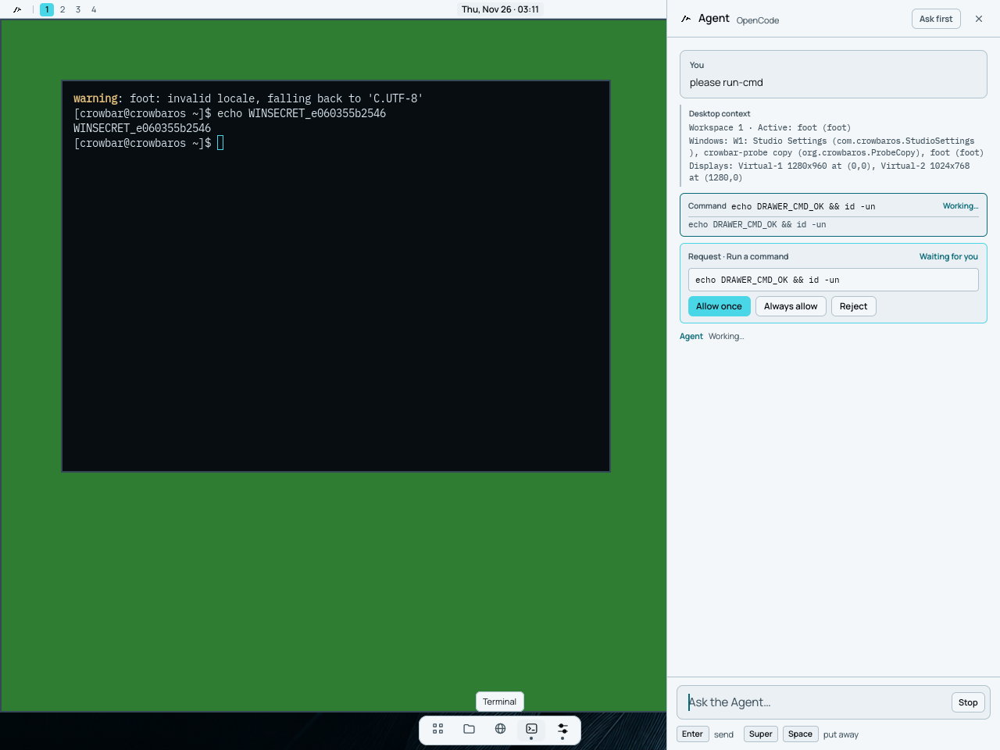
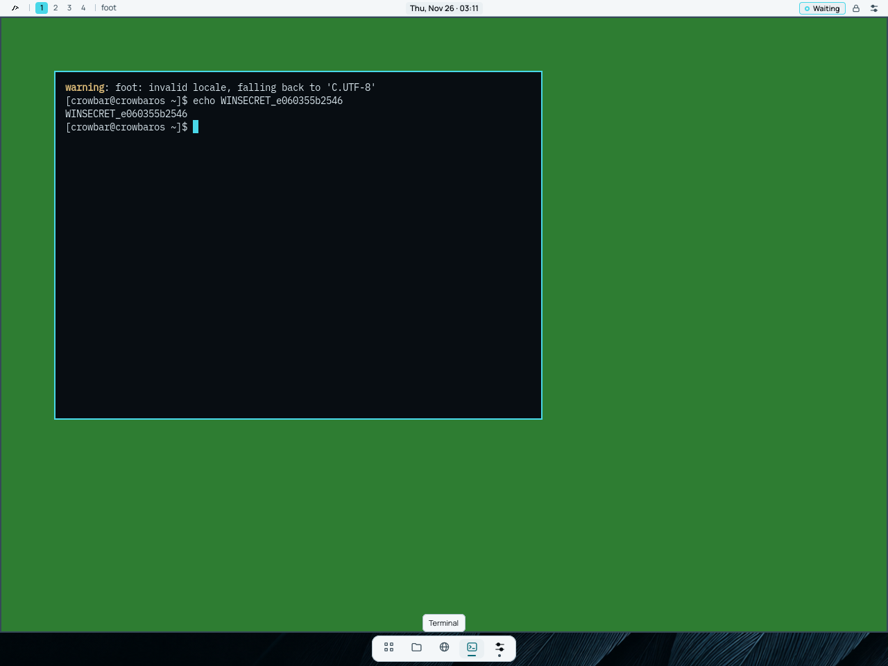
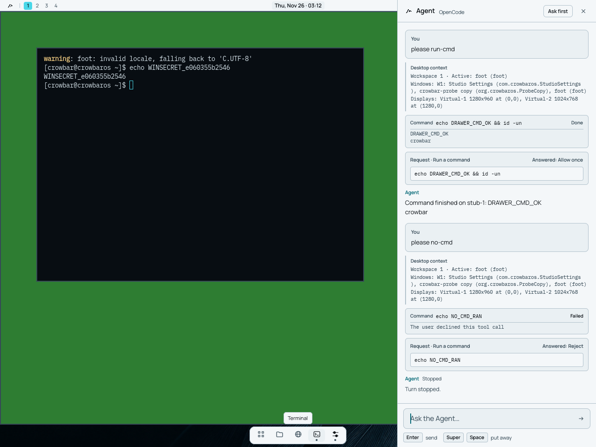
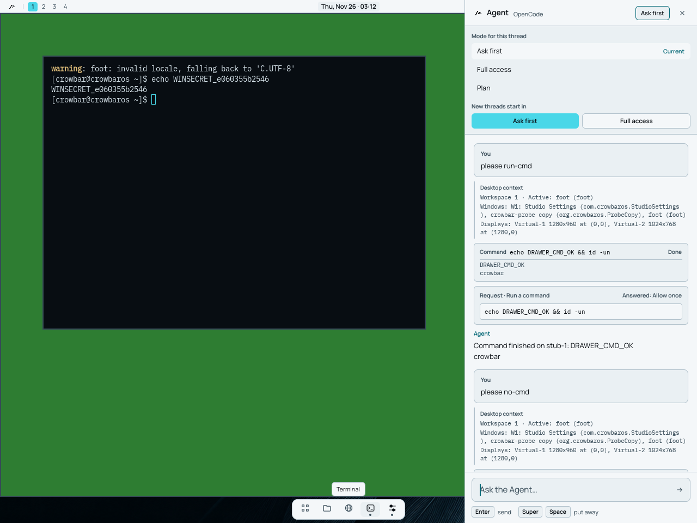
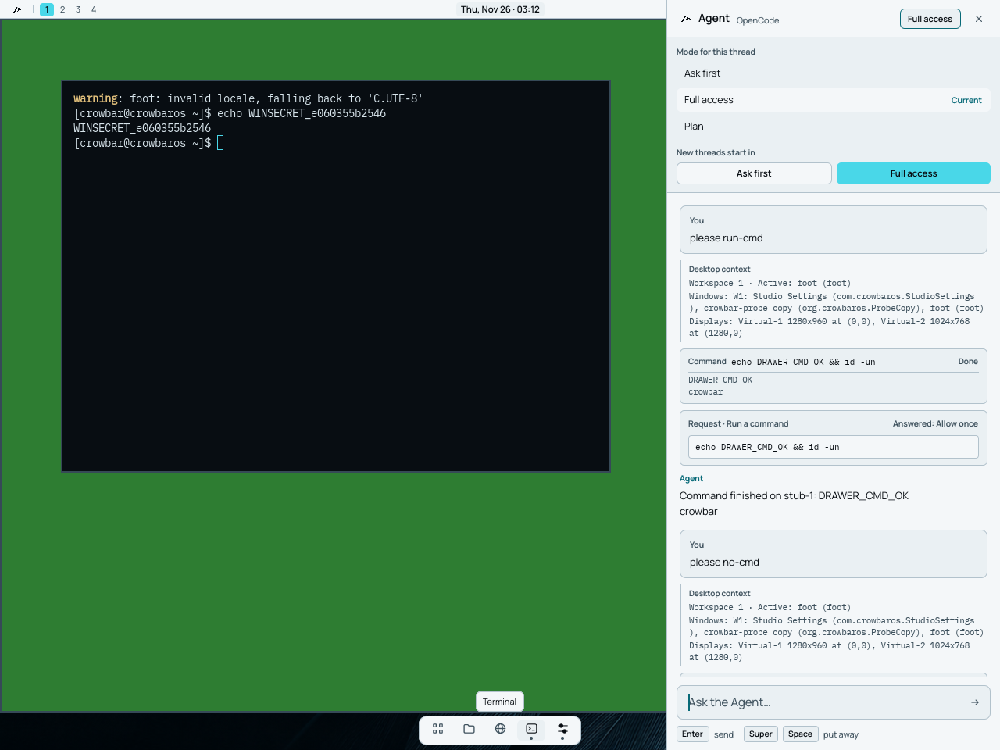

# Lever requests and modes — November 25, 2026

Issues #378 and #406: a thread asks before a command or an edit, the person
picks its mode, and a Stop the harness ignores is carried out by Lever.
Verification ran on `df1b87f2a3db48545abe79b7d0dddfde45d7b5e4`, based on main
`da162fa7` (#408).

## Checks

- `lab/void/desktop_check.py`: **190 passed, 0 failed**.
  [desktop.log](assets/lever-requests-and-modes-2026-11-25/desktop.log),
  [results.json](assets/lever-requests-and-modes-2026-11-25/results.json).
- Lever and `crowbar-agent` (`lever/`): `cargo fmt --check`,
  `cargo clippy --locked --all-targets -- -D warnings`, and
  `cargo test --locked`: 23 and 11 unit tests, 71 Lever and 27
  `crowbar-agent` integration tests.
- Shell: 85 unit tests and 3 GPUI source tests.
- Python: the Base and lab unit tests.

The desktop check drives OpenCode with the stub Model. In it, a new thread in
Ask first asks before its command with the exact command, and the request
waits through the drawer put away and the desktop locked while the mark shows
waiting. Once is answered in the drawer and the command runs; no refuses the
next, and the Model is told. Full access and the starting mode are chosen
from the drawer's mode menu, where the same command runs with no request.
A command the person's own OpenCode settings refuse (`echo DENIED_*`) is
refused in Ask first with no request to allow it, and their settings file is
unchanged.

The text evidence is copied from the run with checkout paths removed, terminal
color codes stripped, and trailing whitespace trimmed. Guest paths and QEMU's
guest addresses remain. The original local evidence is unchanged.

## Captures

| Step | Capture |
| --- | --- |
| A request with the exact command |  |
| The bar's mark waiting, the drawer put away |  |
| The request after the desktop was locked |  |
| A request answered no |  |
| The mode menu |  |
| The starting mode |  |

Model and harness: Claude Opus 5.5 in Claude Code.
