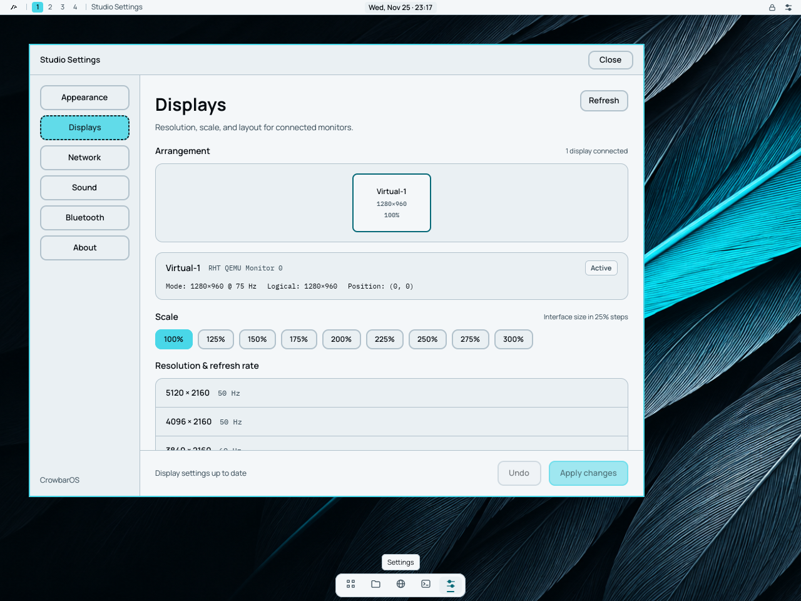
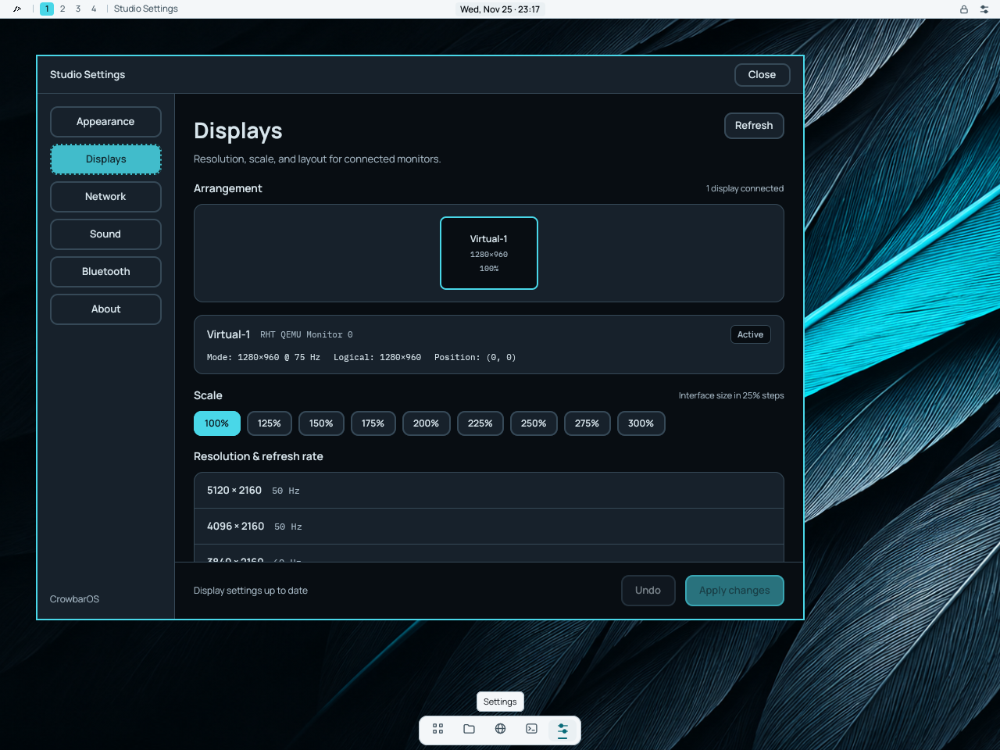
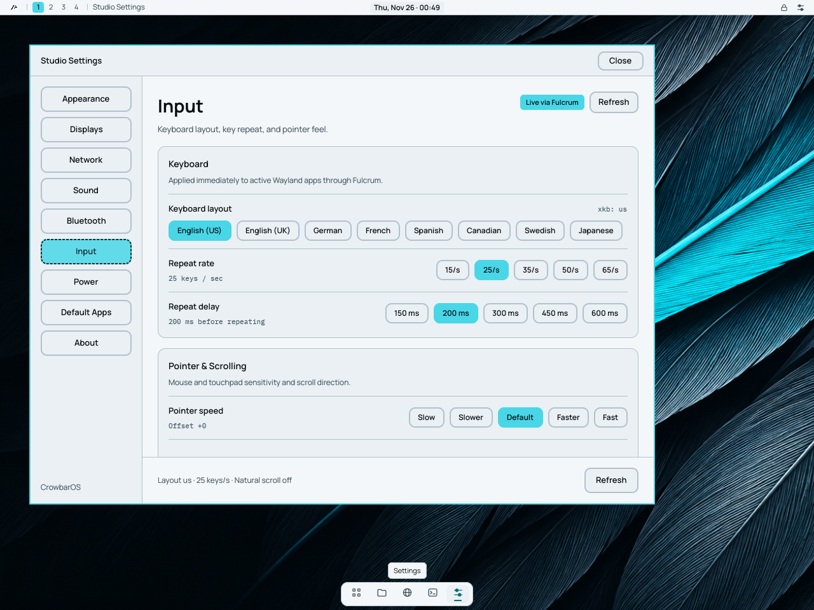
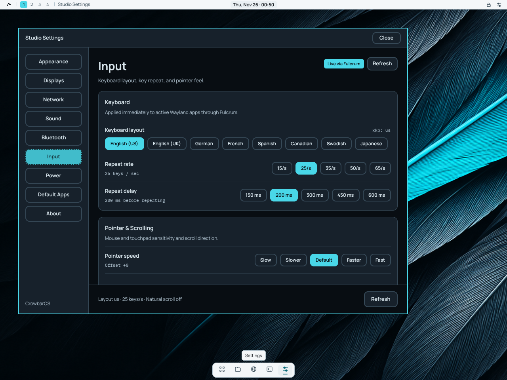
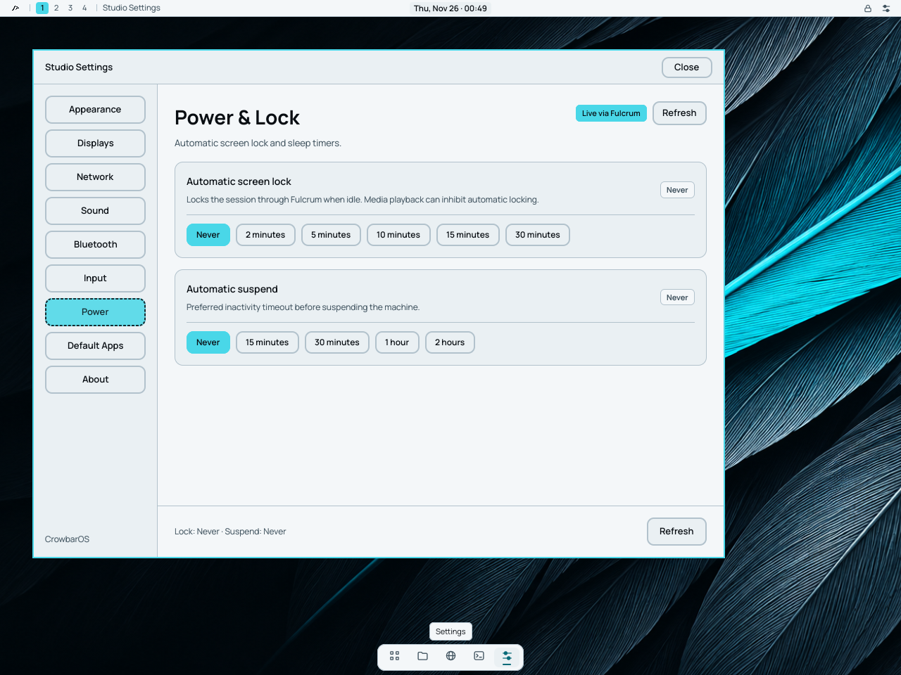
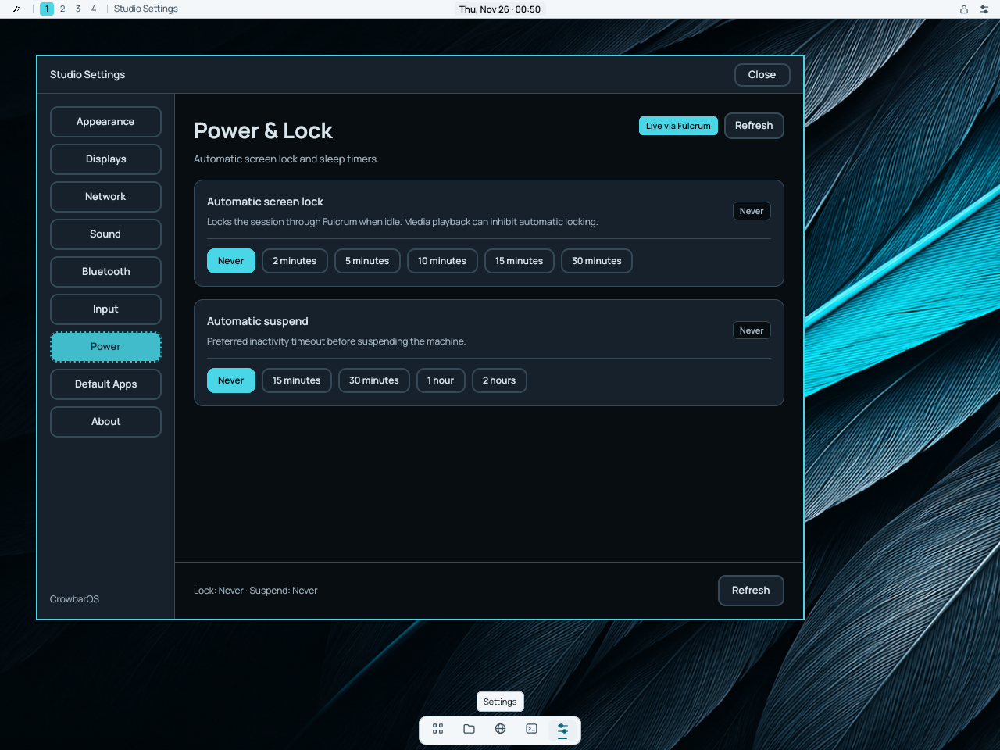
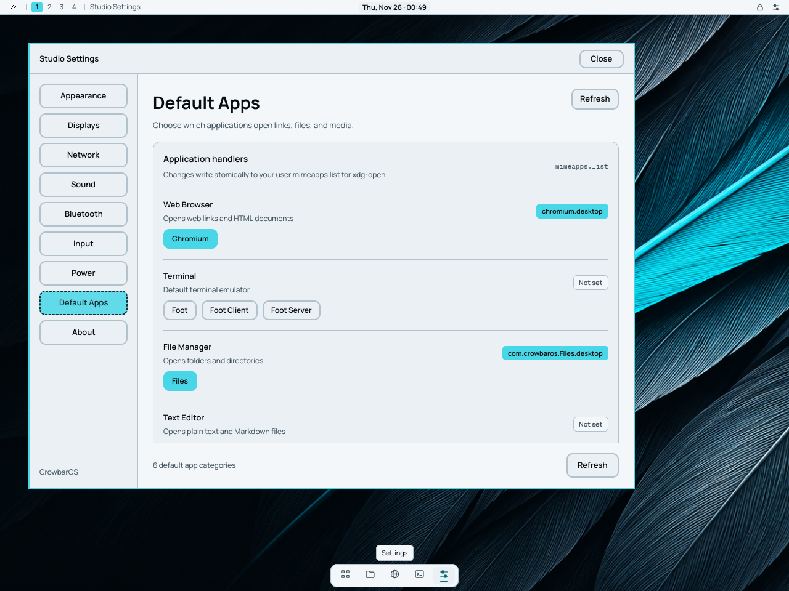
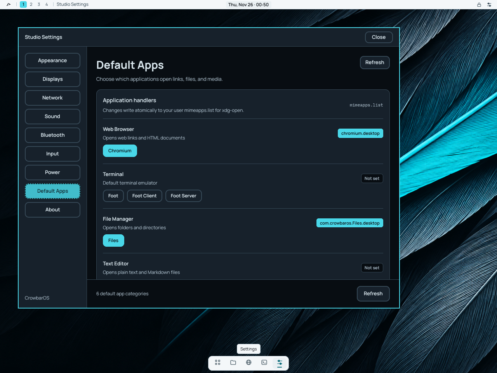
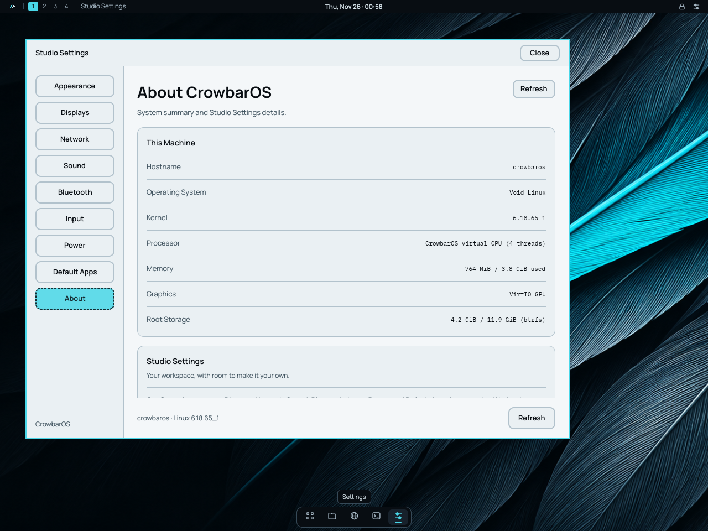
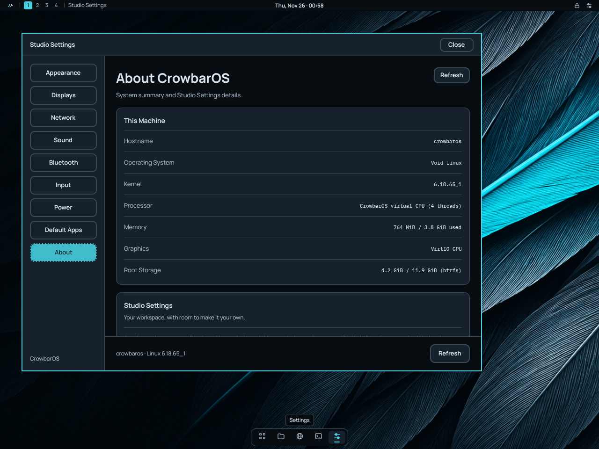

# Studio Settings system pages — November 25, 2026

Issue #358 adds Input, Power, and Default Apps, expands About, and keeps the
existing Displays page. Verification ran on `9a3983e8ce6f514e8b3cf61c811b69d710ccb6af`,
based on main `295e7b22f2ef223fde9e5b8646116454e954620a`.

## Checks

- `python3 lab/void/desktop_check.py`: **180 passed, 0 failed**.
  [desktop.log](assets/studio-settings-system-2026-11-25/desktop.log),
  [results.json](assets/studio-settings-system-2026-11-25/results.json).
- `python3 lab/void/compositor_check.py`: **46 passed, 0 failed**.
  [Compositor evidence](assets/studio-settings-system-2026-11-25/compositor-20261126T005222Z.log).
- Studio Settings: Clippy with warnings denied, release build, and release
  and debug tests (39 passed each).
- Shell: 75 unit tests and 3 GPUI source tests. Files: 45 tests.
  Shared UI: 6 tests. Shared theme: 9 tests.
- Desktop helpers: formatting, Clippy with warnings denied, and 47 tests.
- Compositor: formatting, normal and nested Clippy, and both full test suites.
  A stale local code-generation test artifact was rebuilt before the suites passed.
- Python compilation and Base, lab, CI classification, and GPUI packaging tests
  passed. The lab suite has 50 tests.

The reboot check writes non-default Input and Power settings, reboots, and
verifies every value is live before Settings opens. A helper regression test
also fails when the new preference-reading operations are removed. The settings
bridge continues to refuse general compositor operations and malformed fields.

The text evidence is copied from the original run, with checkout paths and any
host CPU model removed, terminal color codes stripped, and trailing whitespace
trimmed. Guest account paths and QEMU's guest addresses remain.
The original local evidence has not been changed. The checks ran in QEMU;
physical keyboard/touchpad behavior and a real suspend cycle were not exercised.

## Captures

Before captures show the existing Displays page and sidebar on main `0b7812e`.
Input, Power, and Default Apps captures come from the full desktop check above.
About was captured separately from the same built image, with QEMU configured
as `-cpu host,model-id=CrowbarOS virtual CPU`, so the live system summary reports
a generic virtual CPU name. These are direct guest captures.

| Page | Light | Dark |
| --- | --- | --- |
| Before |  |  |
| Input |  |  |
| Power |  |  |
| Default Apps |  |  |
| About |  |  |

Model and harness: GPT-6-astra, Codex harness in M3 Code (rebase, startup
restoration fix, and re-verification); original feature implementation inherited
from the handoff.
