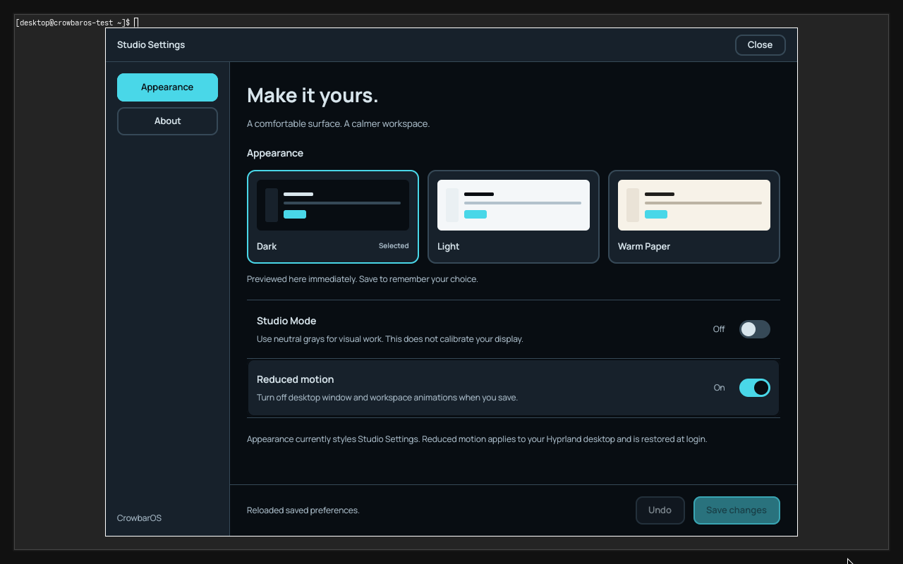
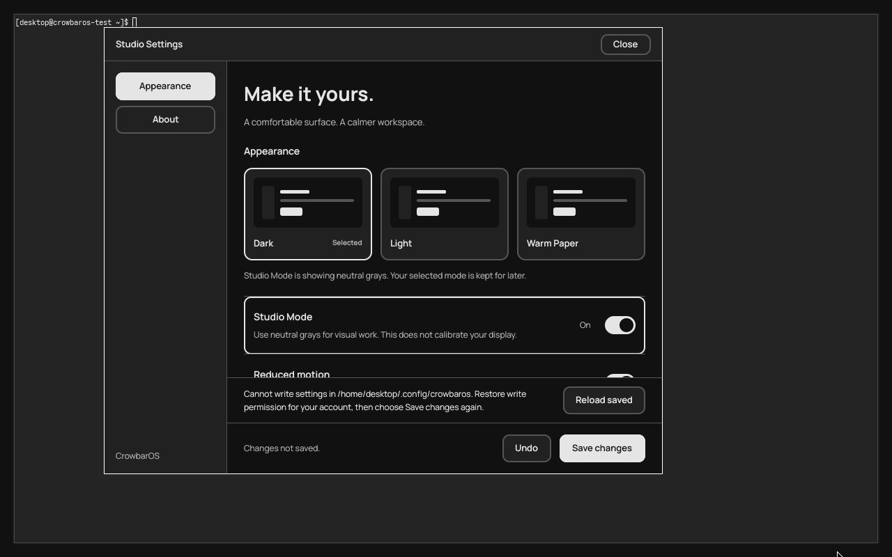

# Studio Settings validation — November 14, 2026

**Result: the first Studio Settings slice is built, installed, and tested.** It
implements **Appearance + reduced motion** in Rust and GPUI. It is built in the
Fedora builder and installed as a signed RPM
in the separate test VM. The active VM is kept visible beside Codex throughout
development. The application runs as the ordinary `desktop` user.

Appearance previews currently style **Studio Settings itself**. Reduced motion
changes the actual Hyprland session when saved. This is an application milestone,
not the complete CrowbarOS shell or a desktop-wide theme engine.



## Implemented behavior

- Dark, Light, and Warm Paper modes preview immediately, using Manrope and the
  approved CrowbarOS palette. A neutral Studio Mode override retains the chosen
  base mode; it makes no display-calibration claim.
- Save commits versioned per-user preferences and applies reduced motion to
  Hyprland. Undo restores the last loaded or saved values.
- Tab, Shift+Tab, Enter, Space, Ctrl+S, Ctrl+Z, Ctrl+Q, and Escape support the
  settings flow. Keyboard focus remains distinct from theme selection.
- Both the app Close button and a compositor close request protect unsaved work.
- Save errors preserve the draft and offer Reload saved. Permission errors name
  the affected directory and explain how to retry.
- The installed session hook restores saved motion without launching the GUI.
  Its Rust helper retries transient startup-readiness failures; journal identifier
  `crowbaros-settings-session` records the outcome.

## Stack and package

| Component | Value |
| --- | --- |
| Base | Fedora 45, conventional RPM/DNF, x86_64 |
| App | `crowbaros-studio-settings-0.1.3-1.fc45.x86_64` |
| UI | GPUI 0.2.2, Wayland backend; X11 feature disabled |
| Toolchain | Rust/Cargo 1.99.1-2.fc45, edition 2024 |
| Builder | Clean Fedora 45 Mock buildroot; vendored Cargo graph; offline `--frozen` compilation |
| Compositor | Hyprland 0.57.2-1.fc45, temporary upstream COPR baseline |
| Graphics | Private Mesa 26.2.6 Intel VirtIO Vulkan driver; host Intel RPL-S GPU |
| Identity | `desktop`, UID 1001; `com.crowbaros.StudioSettings`; title `Studio Settings` |
| Display | 1280×800, scale 1; app tested floating at 980×720 and 800×640 |

The signed RPM is **5,643,613 bytes** (about 5.38 MiB):

```text
SHA-256 8c4e1ef16a7f6f351f4d45a061ae662f5ab164eb65928ad8513c9fcaef35a86a
Cargo.lock SHA-256 d1cd9934a63573b457d65a1144a574f16228739218693d2691b228b777038642
```

The current Rust source files and lockfile match the packaged build manifest.

The RPM includes the executable, desktop entry, icon, embedded static fonts,
license notices, dependency inventory, source hashes, and optional Hyprland hook.
The application code is GPL-3.0-or-later; retained probe code is MIT and the fonts
carry their OFL notices. The development signing fingerprint is
`B84C3D26F0D574EB5299BAE532465B0A19A1B171` (**NOT FOR RELEASE**).

## Behavior and integrity checks

| Check | Evidence |
| --- | --- |
| Persistence tests | Four tests: round-trip/stale-window rejection, compositor failure, unknown schema/corruption, and rename-failure motion rollback |
| Package checks | CLI version and desktop-entry validation in `%check`; signed install and upgrades through DNF |
| Guest integrity | `rpm -V` passed, no missing linked libraries or failed system units, SELinux Enforcing; no Rust/Cargo packages in the test guest |
| Native rendering | Expected Wayland title/app ID; private `libvulkan_intel.so` loaded and lavapipe absent |
| Preview | Theme and Studio changes redraw without writing the saved file |
| Save/Undo | Saved JSON and live Hyprland state checked after real input; Undo restores the saved preview |
| Motion timing | Compositor motion remains unchanged until Save; both enabled and reduced states exercised |
| Relaunch | Saved appearance, Studio, and motion values reload correctly |
| Reboot | Saved `reduced_motion: false` restored animations to true despite the lab's false default; startup journal confirmed restoration; no GUI autostarted |
| Keyboard | Focus traversal, Enter/Space, save/undo/quit shortcuts, and Escape cancellation exercised |
| Unsaved close | Alt+Q compositor request shows confirmation; Escape, Undo, and Quit remain usable afterward |
| Error recovery | A real write-permission failure leaves the saved file intact; full message, Reload saved, and fixed footer fit both sizes |
| Layout | Dark, Light, Warm Paper, Studio, About, close confirmation, focus, and error captures inspected |

The full interaction check passed on the final 0.1.3 RPM. Preferences were mode
0600 inside a mode 0700 directory owned by the ordinary desktop account.

The repeatable GUI check sends keyboard and pointer events through libvirt/QEMU;
it does not invoke application callbacks directly. It reads preferences and
Hyprland state to verify effects. The permission test temporarily changed only
the disposable guest's `~/.config/crowbaros` directory from mode 0700 to 0500,
attempted a save, compared the saved preferences, captured the error, and restored
0700 in a `finally` block. No host configuration was changed.



## Integration findings

The visual review identified an empty native Wayland title, insufficient
distinction between keyboard focus and selection, and an unhelpful filesystem
error. These were corrected. The longer recovery text exposed a flex-width issue;
the text now wraps while the recovery button keeps its width. A follow-up review
accepted the corrected 980×720 and 800×640 captures.

The initial reboot test found that `hyprland.start` can run the helper before
`hyprctl` returns a usable JSON response. Manual application after startup worked.
Startup restoration now retries for up to 10 seconds, plus any in-flight bounded
command; interactive saves retain their prompt failure behavior. The hook follows
[Hyprland's documented autostart event](https://wiki.hypr.land/configuring/core/autostart/)
and routes its output to the journal. The corrected 0.1.3 reboot passed: the
boot ID changed, the GUI remained closed, the compositor reported animations
enabled, and its startup journal recorded
`STUDIO event=session-restored reduced_motion=false`. No manual application
occurred during that check. Hyprland reported no configuration errors.

The build retains upstream `proc-macro-error2` future-compatibility warnings and
an RPM changelog-timestamp warning. Neither failed the package checks. The
published GPUI dependency graph still needs the earlier probe's `libc 0.2.189`
pin; Fedora's glibc is unchanged.

## Reproduce and inspect

Follow the [application README](../../apps/studio-settings/README.md) and
[VM workflow](local-vms.md#studio-settings-first-application-slice). Keep the
active viewer open on the Codex workspace. Once installed:

```sh
rtk python3 lab/fedora/lab.py studio-run test intel-virtio
rtk python3 lab/fedora/check_studio.py
rtk python3 lab/fedora/lab.py ssh test sudo journalctl -b -t crowbaros-settings-session --no-pager
```

The GUI check intentionally changes the lab user's preferences and finishes with
Dark, Studio Mode off, and reduced motion on. Pause manual interaction during it.
For login restoration, save **Reduced motion off**, close the app, and reboot the
test guest while its viewer remains visible. Before opening Studio Settings,
check that the saved file still has `reduced_motion: false` and the compositor
reports `animations:enabled` as true. This opposes the lab config's false default
and therefore checks that restoration actually ran. Return to reduced motion on
through the app afterward.

Local evidence lives under `.local/studio/`: Mock logs, signed RPM, build manifest,
deployment logs, GUI checks, screenshots, window metadata, and reboot evidence.
The transferable signed repository is `.local/vms/studio-repo.tar.gz`; the builder
retains sources and SRPMs under `~/artifacts/studio/`. The `before-studio-settings`
checkpoint preserves the guest before installation. Live Fedora repositories and
development-key generation make this a repeatable workflow, not a byte-identical
release build.

The screenshots in this report are unedited `grim` captures of the actual guest,
copied over SSH. Their provenance is runtime validation, not generated artwork.

## Remaining gates

This slice does not validate text fields/IME, screen-reader semantics, fractional
scaling, multi-monitor behavior, portals, color accuracy, idle power, launch or
animation performance targets, or physical hardware. The Intel VirtIO driver
remains an experimental lab profile. Desktop-wide appearance propagation,
GTK/Qt integration, shared GPUI controls, and the complete shell remain future
work. Persistence and compositor changes use best-effort rollback; they are not
a crash-proof transaction across both systems.
