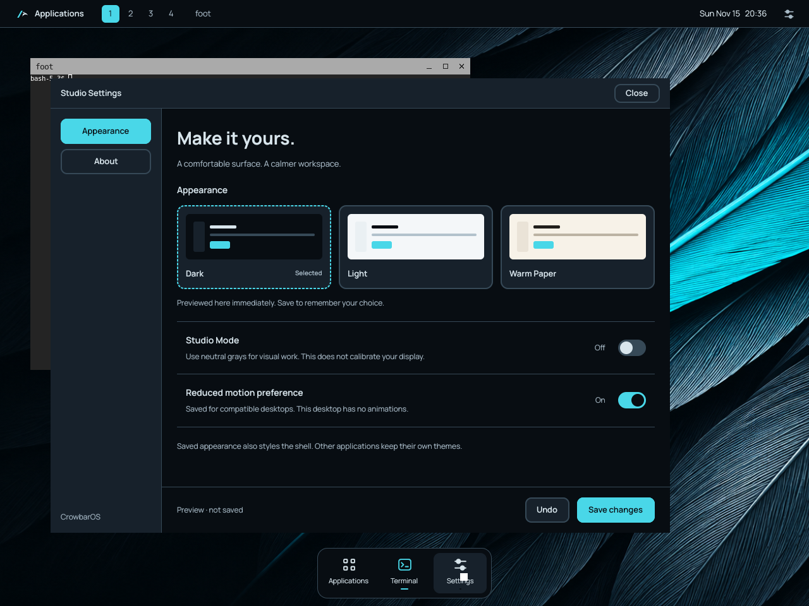
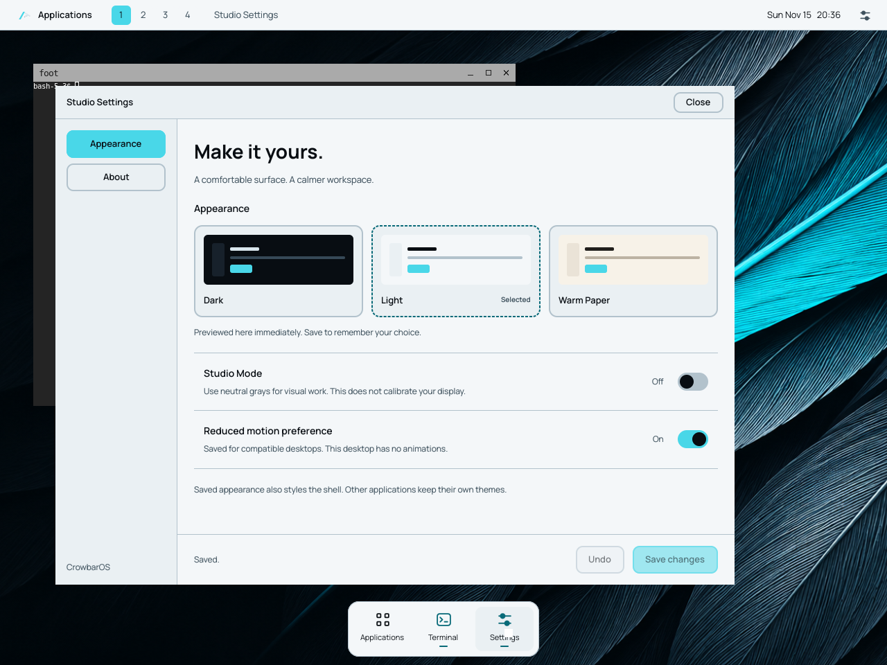
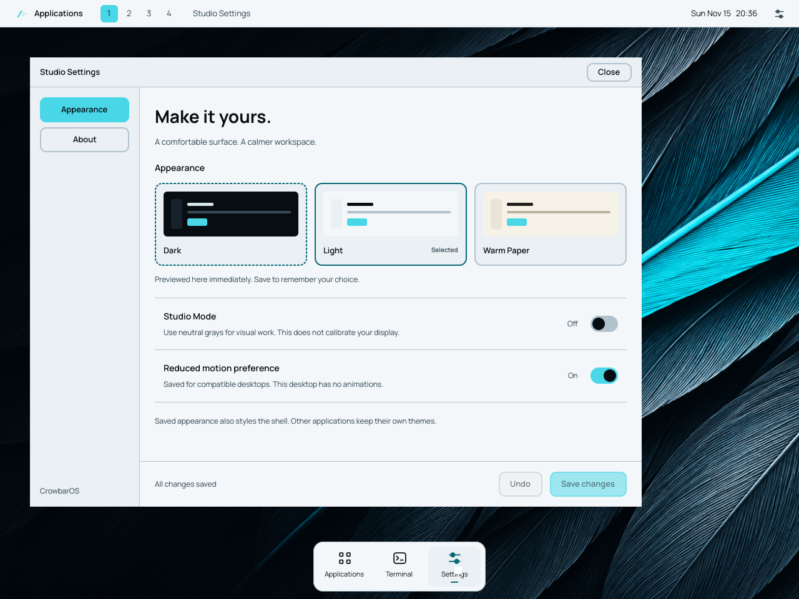

# Void Alpha desktop smoke — 2026-11-15

Issue [#54](https://github.com/crowbaros/crowbaros/issues/54) now has a repeatable
fresh-guest smoke command. This branch also supplies its session and Settings
prerequisites, [#136](https://github.com/crowbaros/crowbaros/issues/136) and
[#38](https://github.com/crowbaros/crowbaros/issues/38), under the Alpha rules
accepted in [ADR 0016](../archive/substrate-vision/adr/0016-the-warden-starts-every-compartment.md).
The work is based on main `0c164dd`. It is not a production Warden or a claim of
per-compartment isolation.

## What was reused and changed

Reviewed preserved commit `250915a` and reused its Void package lists, build
helper, image integration, viewer support, and graceful guest shutdown. The
shared-user session and direct shell-to-GIO launch were replaced: the compositor
and shell are independent runit services with different UIDs, and only the
compositor belongs to `_seatd`. A small root stand-in starts apps and their
children under a third UID, clears supplementary groups and inherited
descriptors, fixes the environment, and sets `no_new_privs`.

Private compositor and shell sockets check the connecting UID. The compositor
can replace a disconnected shell control channel without an old reader closing
the replacement. The stand-in accepts installed, root-owned desktop entries
from the shell UID alone. Its separate appearance-read operation uses bounded,
no-follow reads and rejects symlinks, other owners, hard links, FIFOs, and
oversized files. Preferences remain private to the app account; the shell reads
them through that operation.

Settings uses the existing persistence model. In the Alpha session it saves
appearance without calling Hyprland. The motion preference is retained for
compatible desktops, while the interface explicitly says this compositor has
no animations. The shell follows saved appearance and reloads it after restart.
The legacy Hyprland adapter and inherited spike interfaces remain for their
separate retirement/production integration work.

## Reproduce

```sh
python3 lab/void/compositor_guest.py desktop-check
# Optional: reuse only an already provisioned build root and Cargo target.
python3 lab/void/compositor_guest.py desktop-check --build-cache .lab/void-graphical
```

See the [lab guide](../../lab/void/README.md#full-desktop-smoke-check) for
dependencies, evidence layout, and the precise isolation limits. Every run gets
a new guest root, disk, key, SSH port, and Unix VNC sockets. The build-cache
option never selects that cache's guest disk. Do not run simultaneous builds
against one build cache.

## Results

The complete run was `.lab/void-desktop-checks/20261115T133434-27sww_s1/`.
It built the current sources inside Void glibc with Rust 1.99.0. The guest ran
kernel `6.18.63_1`, runit, seatd, virtio-gpu, Mesa software rendering, and GPUI's
software Vulkan path. Binary hashes in the guest matched the just-built files.

| Verification | Result |
| --- | --- |
| Fresh desktop smoke | **37/37 passed** |
| Root workspace format, Clippy with warnings denied, locked offline tests | Pass; 57 tests |
| Compositor format, Clippy with warnings denied, locked offline tests | Pass; 22 tests |
| Void release builds and tests: compositor, shell, Settings | Pass; 22 / 15 / 5 tests |
| Python isolation and preference-file regressions | Pass; 7 tests |
| Separate Base milestone | **22/22 passed** |
| Python compilation, shell-script syntax, diff whitespace | Pass |

The desktop run exercises real keyboard and pointer input through QEMU:
Terminal/Settings launch, focus without duplicates, workspace switching,
preview without a write, successful Save, Undo, close/relaunch, shell restart
while an app remains alive, and a clean guest reboot with saved appearance
restored. It also verifies the three process identities, ordinary app children,
seat group membership, no-new-privileges, absence of inherited trusted sockets
and seat devices, resolved shared libraries, and advancing render counters.
App attempts at trusted sockets are refused even when their paths and Unix
permissions are deliberately exposed for the test, then restored.

The initial development runs exposed and fixed the separate app user's access
to the Alpha public Wayland socket. They also found test defects in service
status counting, QMP diagnostic reuse, partial snapshot reads, and render-label
matching. Those failed runs retained their diagnostics and disks separately.
The passing run includes the fixes; none of their failures were waived.

The Base regression used `.lab/issue-54/base/`, separate disks/sockets and SSH
port 22236, invoking the unchanged `void_lab.milestone()` function with isolated
work paths. Both test guests powered off. All four existing Void disk files
retained their inode and size, and the original preview VM remained running as
PID 1188853. The saved desktop branch, mixed rollback stash, branding, and old
dated evidence were not changed.

## Evidence and visual check

The [evidence directory](assets/void-desktop-smoke-2026-11-15/) contains the
result list, desktop/build/service logs, process identities, Base evidence,
and captures. Log copies trim trailing whitespace and final blank lines;
original output remains under `.lab/`. SSH private keys and VM disks are not
included. Captures were inspected at the native 1280×960 output with the
980×720 Settings window; the changed text fits, saved appearance reaches the
bar/dock, and Light appearance returns after reboot. No animations were added
or claimed, so there is no motion recording.

| Before Save | Saved appearance |
| --- | --- |
|  |  |



Design context tooling reported a stale sidecar and no Linux platform enum.
The native design and existing tokens were preserved; metadata migration was
not part of this functional change. Upstream GPUI/Rust compatibility warnings
remain in the build log and are not new test failures.

## Boundaries and tracker state

Apps still share an Alpha app UID and can reach one another. The spike still
has its ordinary public Wayland socket and security-context behavior. There
are no production namespaces, cgroup budgets, broker-mediated starts, or
per-compartment principals in this stand-in. Those remain the Warden and
production compositor work; these results do not close their security gates.
The Settings stale-write/corruption/rollback cases are unit regressions, not
all additional graphical scenarios.

The implementation and evidence are local until pushed and merged. #54 and its
open prerequisites should be closed through their reviewed changes landing;
only then is [#65](https://github.com/crowbaros/crowbaros/issues/65) unblocked in
GitHub. The local Fedora-retirement branch remains separate.
