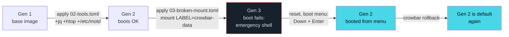
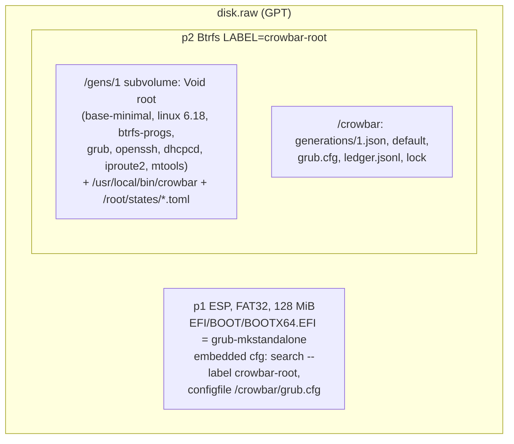

# Milestone 1: state → apply → generation → broken change → boot-menu rollback

**Result (November 14, 2026): the full loop works in a Void Linux VM on Btrfs.**
The scripted run passed **22 of 22 checks**. Its log is in
[`evidence/milestone-1-2026-11-14.log`](evidence/milestone-1-2026-11-14.log), a
byte-for-byte copy of the log the run wrote. This page states exactly what was
verified and what was not.

[Council round 1](../reviews/council-round-1.md) reviewed this milestone the same day.
It found defects that the first run did not exercise, and
[round 2](../reviews/council-round-2.md) and [round 3](../reviews/council-round-3.md) found more in the fixes. Twenty-one are fixed, and the run above was made after the fixes. [Round 4](../reviews/council-round-4.md) found one of those fixes unsafe, and it is corrected. The rest come from the engine's model of
converging a copy of the running root, which Milestone 1b replaces
([ADR 0009](../adr/0009-base-from-a-pinned-package-set.md)). See
[Known limitations](#known-limitations-of-the-milestone-1-engine).

Milestone 1b is not the next milestone. Council round 2 put Milestone 2 first: the
adversarial slice, on stock Linux, which needs nothing from Base. See
[Milestone 2](milestone-2.md).

## Goal

A Void Linux VM on Btrfs where:

1. a TOML state file is edited,
2. the Rust apply engine applies it as a new bootable generation,
3. a deliberately broken change is applied,
4. the system is recovered by choosing the previous generation in the boot menu.



## How to run it

Requirements: QEMU with `/dev/kvm`, OVMF at the paths in
[`lab/void/config.json`](../../lab/void/config.json), `unshare`,
`mkfs.btrfs` with `--subvol` (btrfs-progs 6.11 or later), `mkfs.vfat`, `sfdisk`, a
Rust toolchain with the `x86_64-unknown-linux-musl` target, and network access to
the Void repository. **No sudo is needed.** Work that needs root runs as fake root
in an `unshare -r` user namespace.

```sh
lab/void/void_lab.py milestone   # build everything, run the loop, record evidence
```

Or step by step:

```sh
lab/void/void_lab.py fetch       # static xbps, pinned SHA-256, into ~/.cache/crowbaros/void
lab/void/void_lab.py rootfs      # Void root via xbps-install.static (rootless)
lab/void/void_lab.py image       # musl crowbar binary + bootable GPT/ESP/Btrfs disk
lab/void/void_lab.py start       # boot a fresh copy of the base disk
lab/void/void_lab.py ssh crowbar generations
lab/void/void_lab.py stop
```

Downloads go to `~/.cache/crowbaros/void`. The rootfs, disk images, VM sockets,
and evidence logs go to `.lab/void/`. Both locations are outside git
(`.lab/` is in `.gitignore`). The raw disk is 8.2 GiB sparse, about 1.4 GiB on disk.

The lab uses fixed ports and one `.lab/void/` directory, so only one run can go at
a time on a machine.

### What the image is



- The image is built with no root and no loop devices. `xbps-install.static`
  installs the root in a user namespace. `mkfs.btrfs --rootdir … --subvol rw:gens/1`
  creates the filesystem from a directory, `sfdisk` and `dd` assemble the GPT disk,
  and GRUB and `mtools` from the guest root (run with `chroot` in the user
  namespace) build the ESP.
- The same `crowbar` binary registers generation 1 at build time
  (`crowbar --top <staging> init-image`) and runs in the guest. It is a static musl
  executable.
- QEMU runs directly, not through libvirt. The script needs the serial console as
  a socket so it can read boot output and press keys in GRUB. It also uses a
  monitor socket for `system_reset`, and forwards host port `127.0.0.1:22230` to
  guest SSH. Like `lab/fedora/lab.py`, the script uses only the Python standard
  library, reads a JSON config, and keeps local state out of git.

### The three states

| File | Change | Expected |
| --- | --- | --- |
| [`01-base.toml`](../../lab/void/states/01-base.toml) | Base image: hostname and services | Generation 1 |
| [`02-tools.toml`](../../lab/void/states/02-tools.toml) | Adds `jq`, `htop`, and a managed `/etc/motd` | Generation 2 boots |
| [`03-broken-mount.toml`](../../lab/void/states/03-broken-mount.toml) | Adds an fstab mount of `LABEL=crowbar-data`, a disk that does not exist | Generation 3 does not boot: Void's stage 1 runs `mount -a … \|\| emergency_shell` |

## Verified

The final run (`void_lab.py milestone`, 20:44–20:46 local time, about 2 minutes
31 seconds) had these results. Every row is one automated check in the log.

| # | Check | Evidence |
| --- | --- | --- |
| 1 | The GRUB menu, generated by `crowbar`, lists generation 1 | Serial console |
| 2 | Generation 1 boots on UEFI (OVMF) from Btrfs subvolume `gens/1` | SSH up about 25 s after the boot started |
| 3 | The booted generation is known | `/proc/cmdline` has `crowbar.generation=1` |
| 4 | No drift on a fresh image | `crowbar drift` exit 0 |
| 5 | `crowbar apply 02-tools.toml` builds generation 2 and `jq` stays absent on the running generation 1 | `command -v jq` fails after the apply. This is the only thing the check tests; see "Not verified" |
| 6 | Generation 2 boots by default | SSH up |
| 7 | The booted generation is 2 | `/proc/cmdline` |
| 8 | `jq` works in generation 2 | `jq --version` |
| 9 | `/etc/motd` is the declared content | File content |
| 10 | No drift on generation 2 | `crowbar drift` exit 0 |
| 11 | `crowbar plan 03-broken-mount.toml` flags the change as boot-affecting | The plan contains `! managed mounts: 0 -> 1` |
| 12 | **Generation 3 genuinely fails to boot** | Serial: `mount: /srv/data: can't find LABEL=crowbar-data.` then `Cannot continue due to errors above, starting emergency shell.` |
| 13 | SSH is unreachable while generation 3 is stuck | Connection attempt fails |
| 14 | After a reset, the GRUB menu shows generation 2 | Serial console |
| 15 | **Choosing generation 2 in the boot menu** (Down, Enter over the serial console; the default was generation 3) boots it | SSH up |
| 16 | The booted generation is the one picked | `/proc/cmdline` has `crowbar.generation=2` |
| 17 | The broken mount is absent in generation 2 | `/etc/fstab` |
| 18 | After `crowbar rollback`, an untouched reboot comes up | SSH up |
| 19 | That reboot is on generation 2 | `/proc/cmdline`; `crowbar generations` shows `default,booted` |
| 20 | Drift detects a hand edit made outside the engine | `echo … >> /etc/motd`, then `crowbar drift` exits 2 and reports `/etc/motd` |
| 21 | An apply that fails inside real `xbps` (nonexistent package) fails | `ERROR: Package 'crowbar-no-such-package' not found` |
| 22 | That failed apply leaves no generation and keeps the default | `gens/` has only 1–3; default is 2; ledger records `apply failed gen 4` |

The ledger at the end of the run, with the long `xbps` error shortened:

```text
2026-11-15T02:44:16Z  init     ok      gen 1    registered base image as generation 1
2026-11-15T02:45:07Z  apply    ok      gen 2    install packages: htop, jq; write file /etc/motd (mode 0644)
2026-11-15T02:45:38Z  apply    ok      gen 3    managed mounts: 0 -> 1
2026-11-15T02:46:10Z  rollback ok      gen 2    boot default 3 -> 2 (booted: 2)
2026-11-15T02:46:39Z  apply    failed  gen 4    "xbps-install" ... ERROR: Package 'crowbar-no-such-package' not found
```

Earlier complete runs the same day: two with 18 of 18 checks, before the drift and
failed-apply checks were added; one with 21 of 21, before the council fixes; and
three with 22 of 22, after the round 1, round 2, and round 3 fixes. The committed log from the 21-check run had been stripped of colour
codes by hand, which damaged one line, so it has been replaced by the log of the
run above.

Unit tests: `cargo test --workspace` runs 57 tests: 12 in `crowbar-state` for
parsing, validation, protected paths, and fingerprints, and 45 in `crowbar-apply`.
The `crowbar-apply` tests run the full loop on a scratch tree with fake xbps and a
copy-based snapshotter, and cover failed applies, removals, the fstab block, the
GRUB menu, cmdline parsing, version ordering, and time formatting. Thirty-nine of
the 57 were added with the council fixes: path confinement, failures before and
after the commit point, the apply lock, damaged ledger lines, boot-file checks,
mount validation, path characters, and cleanup of the build mounts. All
pass. `cargo clippy --workspace --all-targets -- -D warnings` and
`cargo fmt --check` are clean.

Environment: host kernel 7.2.15 (Omarchy), QEMU 11.1.3 with KVM, edk2 OVMF
`OVMF_CODE.4m.fd` (non-Secure-Boot), btrfs-progs 7.3, Rust 1.99.1. Guest: Void
`current` as of today, kernel 6.18.63_1, GRUB 2.12, xbps 0.60.

## Fixed after council rounds 1, 2, and 3

The VM run shows the main loop still works after these fixes. It does not exercise
the fixes themselves; the unit tests do.

| Defect | Fix |
| --- | --- |
| A managed file path through an absolute symlink was written outside the new generation, into the running system. | Every in-system path now resolves inside its generation, the way a chroot would. The protected-path check runs again on the resolved path. |
| A failure after the boot default was written deleted the new generation and left the boot menu pointing at it. | Apply has a build phase and a publish phase. The commit point is the rename of `grub.cfg`. Before it, a failure restores the previous default and removes the generation. After it, nothing deletes the generation: if a later step fails, such as writing the ledger entry, `crowbar` says so and exits with status 3. Round 2 found that a failed directory sync after the rename still deleted the generation; the engine now reads the menu on disk before it undoes anything. Round 3 found that this reading took words in a menu title for an entry, so a declared path such as `/etc/--id gen-3 x` made a failed publish of generation 3 count as committed; only a real `menuentry` line or the `set default` line counts now. |
| A mount target with whitespace or a newline added fields or lines to `/etc/fstab`. | All four mount fields reject whitespace, control characters, and backslashes. |
| A mount device beginning with `#` was written as an fstab comment, and a mount target could be a protected location such as `/boot`. (Round 2) | Both are rejected. |
| The kernel and initramfs were checked against the host root, and a boot path containing a newline could add entries to the boot menu. (Round 2) | Both files are resolved inside the generation and must be regular files. A boot path outside a strict character set is refused. |
| The host's `/dev`, `/proc`, and `/sys` were mounted through a symlink if the generation had one in their place. (Round 2) | The three must be real directories. |
| Nothing flushed the new generation to disk before the boot menu named it. (Round 2) | The generation is synced before publish. |
| A declared file named like the engine's temporary files could be deleted silently. (Round 2) | Such names are rejected. |
| `plan` and `drift` read a managed path through a final symlink, with no check that it was a regular file. (Round 2) | For a `[[file]]` path they look at the entry itself and never open anything that is not a regular file. Round 3 found that `/etc/hostname`, `/etc/fstab`, and the recorded State were still read through symlinks, so a FIFO there hung `plan`. They now follow the same rule: anything but a regular file at `/etc/hostname` counts as no hostname and is replaced, and at the other two it is refused. |
| A newline in a `[[file]]` path printed a forged line in the plan. (Round 3) | A managed path with a control character or a line break is rejected. |
| A long plan summary with a non-ASCII path made the apply panic after it had built the generation, leaving the subvolume with no ledger entry. (Round 3) | The summary is cut on a character boundary. |
| If binding the host's `/dev`, `/proc`, or `/sys` succeeded and the next mount step failed, the bind was never unmounted, and unmount failures were discarded. (Round 3) | A bind is unmounted on failure once it has been made a slave of the host's mount, and a mount that cannot be undone is reported in the error. A bind that could not be made a slave is left mounted and reported: round 4 found that unmounting it could unmount the host's own submounts. |
| A managed file with mode 0600 was briefly 0644. (Round 2) | The mode is set before the rename. |
| The ledger reader silently repaired invalid bytes. (Round 2) | A line with an invalid byte is reported as damaged. |
| One torn line made the ledger unreadable for good. | The reader skips damaged lines and reports them. An append after a torn line starts on a new line. |
| Two applies at once could choose the same generation id. | `init`, `apply`, `rollback`, and `render-boot-menu` hold a lock on `/crowbar/lock`. A second caller fails at once. |
| The boot-affecting flag was printed, not checked. | It is check 11. |
| The committed evidence log had been edited. | It is a byte-for-byte copy of the run log. |

## Not verified (yet)

- **That an apply leaves the running system untouched.** Check 5 tests only that
  `jq` is still absent. Package install scripts run with the host's `/dev`,
  `/proc`, and `/sys` bound into the build root, so a script could change the
  running system.
- **Package removal and service enable/disable on a real guest.** The states in the
  run only add packages and files. Removing a declared package, and enabling or
  disabling a runit service, are covered only by unit tests with fakes.
- **A kernel update inside a generation.** The engine selects the newest
  `vmlinuz`/`initramfs` pair in the new generation, but no run installed a new
  kernel, so the in-chroot dracut hook was not exercised.
- **Boot-menu selection on a graphical console.** GRUB was driven over the serial
  console only. The menu is configured for both serial and console output, but the
  VM ran with `-display none`, so no one looked at a screen.
- **Real hardware, Secure Boot, other firmware.** Only OVMF in QEMU, with Secure
  Boot off.
- **Nightly drift detection.** `crowbar drift` works on demand. Nothing schedules it.
- **Power loss during an apply.** Failures before and after the commit point are
  covered by unit tests that inject errors. Power loss and `kill -9` were not
  tested, and no stale-subvolume cleanup exists yet.
- **The lock, in the VM.** Two applies at once are covered by a unit test only.
- **The round 2 and round 3 fixes, in the VM.** The sync before publish, the
  boot-file checks, the chroot mounts and their cleanup, and the reads of
  `/etc/hostname`, `/etc/fstab`, and the recorded State ran in the VM as part of
  the normal loop, but no VM check tries to break them. A FIFO at those paths is
  not tested even in the unit tests, which use a symlink and a socket.
- **Rootless-build artifacts.** Because the image is built in a user namespace:
  every file in the image is owned by root (a `chown` to `_dhcpcd` failed during
  the rootfs install), and the base initramfs was built without `/dev` nodes
  (`mknod` is not permitted). Both were harmless in this run: DHCP and SSH worked
  and the guest booted every time. Generations built *inside* the guest do not have
  this limitation.
- **Everything beyond the apply engine**: the agent, gate, capability broker,
  sandboxes, and desktop exist only as design documents.

## Known limitations of the Milestone 1 engine

The engine snapshots the running root and converges the copy toward a State that
lists only some of what is in it. These limitations follow from that model, and
Milestone 1b removes them by building each generation from empty out of a complete
pinned package set.

- **An apply leaves behind what was written after it.** `/var` and `/home` live
  inside each generation. The new generation holds them as they were at the moment
  of the apply, so anything written between the apply and the reboot stays in the
  old generation. A rollback rolls user data back the same way.
- **Taking over a base file or package and later dropping it deletes it.**
  Declaring `/etc/sudoers` or `openssh` and then removing the declaration removes
  the file or the package.
- **A declared package that is already installed is never recorded as owned**, so
  dropping it later does not remove it.
- **Omitting `[services]` plans to disable every service.**
- **A successful apply is not checked afterwards.** A package script that changes a
  managed file after the plan was made goes unnoticed.
- **Drift sees only declared items**, and accepts a service link that is broken or
  points at the wrong service.
- Changes take effect only after a reboot, and nothing falls back on its own when
  a new generation fails to boot.
- `xbps` installs the current repository versions. Generations are not
  reproducible from the state alone, and there is no way to update Base packages.
- **The lock only stops two applies from running at once.** Two applies before a
  reboot both start from the booted generation, and the second drops the first's
  changes without a warning.
- Two declared paths that reach one file through a symlinked directory never
  converge, and a `[[file]]` can land in a directory another section owns through
  a symlink.
- No garbage collection of old generations. A generation id is reused after a
  cleanly failed apply. `crowbar ledger` exits 0 when it finds damaged lines.

## Code

| Path | What it is |
| --- | --- |
| [`crates/crowbar-state`](../../crates/crowbar-state/src/lib.rs) | The Crowbar State schema, parsing, and validation |
| [`crates/crowbar-apply`](../../crates/crowbar-apply/src/) | Plan, apply, generations, confined path resolution, GRUB menu, fstab block, ledger, and the `crowbar` command |
| [`lab/void/void_lab.py`](../../lab/void/void_lab.py) | VM lab: fetch, rootfs, image, start, ssh, stop, milestone |
| [`lab/void/host/`](../../lab/void/host/) | Rootless rootfs and disk-image build scripts (run inside `unshare -r`) |
| [`lab/void/states/`](../../lab/void/states/) | The three Milestone 1 states |

Design background: [state and apply engine](../architecture/state-and-apply-engine.md).
