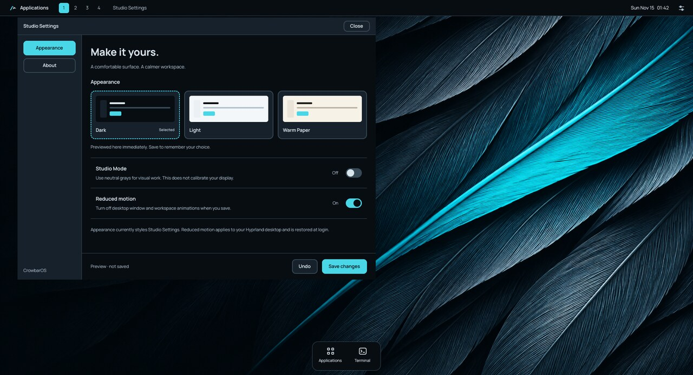

# Compositor spike: a Smithay compositor runs the shell and enforces ADR 0014

**Result (November 15, 2026): nothing that was run gives a reason to reopen
[ADR 0015](../adr/0015-our-own-compositor-on-smithay.md).** A compositor started
from Smithay's `smallvil` example runs the GPUI shell and Studio Settings,
keeps layer-shell for the shell alone, withholds a key chord from every client,
and runs on a TTY in a Void guest with seatd and no systemd.

*Read this with the [Council review](#council-review) at the end. Three
reviewers found that the title and several claims below say more than was
shown, and that section corrects them: the result stands provisionally, and
"enforces ADR 0014" covers part of two of the ADR's five rules.*

**Three things were not run**, and the record does not cover them: the
compositor on an NVIDIA card through DRM (it ran on NVIDIA only nested in a
window), Void's `nvidia` package, and suspend and resume. See
[NVIDIA](#nvidia) and [Not run](#not-run).

This is the record that [issue 3](https://github.com/crowbaros/crowbaros/issues/3)
asks for. The spike's code is in [`compositor/`](../../compositor/README.md) and
is throwaway. The evidence is in
[`evidence/compositor-spike-2026-11-15/`](evidence/compositor-spike-2026-11-15/):
four logs, copied byte for byte from the logs the runs wrote, and five
captures.

**Time box.** The issue left it "to be set by Jim and Jason" and none was
recorded there. Asked at the start, Jim chose one working session with the
hours recorded. [Cost](#cost) has them.

## Summary

| Item in the issue | Result | Evidence |
| --- | --- | --- |
| Runs nested in a window on the development host | Shown | `nested-protocols.log`, `nested-apps.log` |
| Bar, dock, launcher, and wallpaper as layer surfaces, with correct exclusive zones | Bar, dock, wallpaper, and their exclusive zones shown with the real shell. The launcher shown by a test only | Capture below, `nested-apps.log`, `tests/layers.rs` |
| Studio Settings opens as a floating window through GPUI's Vulkan path | Shown | Capture below, `nested-apps.log` |
| The two Hyprland socket uses replaced by an interface we define | Replaced and tested on both sides. The window list was seen working in the real shell. The two focus calls were not clicked in the real shell | [The control channel](#the-control-channel) |
| A key chord is intercepted; a focused client sees neither press nor release | Shown, with real key events in the Void guest. Two leaks were found on the way and closed | `void-tty.log`, `tests/confirm.rs` |
| Layer-shell offered to the shell and not to a second client | Shown | `nested-protocols.log` |
| Input, clipboard-manager, and capture globals absent from `wayland-info` | Shown | `nested-protocols.log`, `void-tty.log` |
| A security-context client sees the reduced set | Shown | `nested-protocols.log`, `void-tty.log` |
| `backend_libei` off in the build | Shown, with one caveat about what Cargo still compiles | [Build](#the-build) |
| The same binary on a TTY in a Void guest: udev, libinput, libseat on seatd, DRM, no systemd | Shown | `void-tty.log` |
| Two outputs with different scales, and one hotplug | Shown | `void-tty.log`, captures below |
| NVIDIA with Void's `nvidia` package | **Not run.** A nested run on NVIDIA showed no first-frame freeze | [NVIDIA](#nvidia) |
| Lines written, Smithay commit, hours | Recorded | [Cost](#cost) |

## What was run on

- **Host:** Arch-based (Omarchy), Linux 7.2.15, Hyprland 0.57.2, one GPU: an
  NVIDIA GeForce RTX 4090 on driver 615.78.08 with the open kernel modules.
  Rust 1.99.1.
- **Guest:** Void Linux (glibc), Linux 6.18.63, runit, seatd 0.9.3, Mesa
  26.2.7, in QEMU 11.1.3 with KVM. Built by
  [`lab/void/compositor_guest.py`](../../lab/void/compositor_guest.py).
- **Smithay:** commit `fd8e3f50f9556aa6c0485989d1d49ff2c5eefae1` of `master`
  (14 November 2026).
- **Apps:** `apps/shell` and `apps/studio-settings`, built on the host from
  their pinned lockfiles (GPUI 0.2.2, blade).
- **`wayland-info`:** 1.3.0, from Arch's `wayland-utils` on the host and Void's
  `wayland-utils` in the guest.

**One binary did every run on a display.** It was built inside a Void build
root, so it links Void's libraries. Its SHA-256 is
`3ad4637587371adad2792937d3631c0f3d4d908b56b34c895cc7d847f36016a3`. The two
nested logs name it, and `void-tty.log` shows `sha256sum` printing the same
value for the file inside the guest. It ran unchanged on the host (nested) and
in the guest (on a TTY).

## It runs our apps



*The compositor's own window on the host, captured by the host. The bar, the
dock, and the wallpaper are the shell's layer surfaces. Studio Settings is an
ordinary window.*

**Run:** `compositor/checks/nested-apps.sh` starts the compositor in a window
on the host's Hyprland session, with the shell as the shell and Studio Settings
as an ordinary client. It runs for a minute.

**Seen:**

- The compositor starts on the host's NVIDIA EGL and offers linux-dmabuf.
- The shell connects through the socket the compositor hands it. Its three
  layer surfaces appear: `crowbaros-wallpaper` (background), `crowbaros-bar`
  (top), `crowbaros-dock` (top).
- Studio Settings opens as a window and draws. Its log names the adapter
  `NVIDIA GeForce RTX 4090`, so it rendered through Vulkan on the GPU.
- When the host resized the compositor's window from 1896 to 941 pixels wide
  and back, the bar and the dock were laid out again for the new width
  ([capture](evidence/compositor-spike-2026-11-15/nested-resized.jpg)).
- The shell needed nothing beyond the globals in
  [the table below](#which-client-sees-which-global). It ran without
  xdg-decoration, cursor-shape, xdg-activation, and text-input.

**Exclusive zones.** The shell's bar reserves 44 pixels and its dock 96. With
the real shell on the 1896 by 1030 output, the compositor logged the room left
for windows as `1896x986 at 0,44` once the bar was up and `1896x890 at 0,44`
once the dock was (`nested-apps.log`). 1030 less 44 less 96 is 890.
`tests/layers.rs` shows the client's side of the same thing on a 1280 by 800
output: the bar is configured at 1280 by 44, and a maximized window at 1280 by
660.

In the capture Studio Settings starts 4 pixels below the bar by accident of
timing. It connected before the shell's layers existed, so it was placed 48
pixels into the full output. The spike does not move windows when the usable
area changes.

**The launcher** was not opened with the real shell, because the host's
keyboard and pointer cannot be driven from a script without touching the
person's session. `tests/layers.rs` covers its Wayland behaviour: an overlay
layer surface that asks for the keyboard exclusively gets every key, the
window under it gets none, and the window gets the keyboard back when the
layer surface closes.

### The control channel

The issue asks for the apps' two uses of the Hyprland socket (focus a
workspace, focus a window) to be replaced by an interface we define, and for
the choice to be written down.

**The choice: a socket pair the compositor makes and hands to the shell.** The
compositor starts the shell, and passes it one end in the
`CROWBAR_SHELL_CONTROL_FD` environment variable. Nothing is bound in the
filesystem, so no other process can open it. The wire format is one JSON
object per line. The set of requests is fixed:

```text
-> {"op":"snapshot"}
<- {"reply":"snapshot","workspace":1,"active":"0x2","windows":[{"id":"0x1","app_id":"…","title":"…","workspace":1}]}
-> {"op":"focus_workspace","id":2}
<- {"reply":"ok"}
-> {"op":"focus_window","id":"0x1"}
<- {"reply":"ok"}
<- {"event":"confirm"}
```

Anything else gets `{"reply":"error",…}`, including a known request with an
unknown field. There is no request that runs a command, evaluates code, or
loads anything. The compositor names windows itself (`0x1`, `0x2`, …); a client
never chooses its id.

**Why not a private Wayland protocol.** A private global, filtered to the shell
like layer-shell is, would need no second socket. GPUI 0.2.2 owns the shell's
Wayland connection and gives the app no way to bind a global of its own, so
the shell would need a second connection, and that connection would have to be
handed over the same way. That is the same plumbing with code generation on
top. Revisit this when the shell moves to a GPUI that exposes the connection,
or when the real compositor is started. The final interface is a decision that
is hard to reverse, so it wants its own ADR then.

**What it replaced.** `apps/shell/src/session.rs` had three kinds of call to
the Hyprland socket, one more than the issue counts: the two focus calls, and
three queries (`j/activeworkspace`, `j/clients`, `j/activewindow`) that fill the
bar. All of them now go to the control channel. The shell makes the inherited
descriptor close-on-exec before it starts anything, so a program the shell
launches does not inherit the channel.

**Requests carry no id.** A reply that came after the shell stopped waiting
(it waits half a second) would be read as the answer to the next request. A
test found exactly that. The shell now closes the channel when an exchange
fails, and its bar goes back to "Connecting to the compositor…". The real
interface wants ids, or one request in flight at a time by construction.

**One thing the issue did not ask for:** the compositor tells the shell when it
takes the confirm chord (`{"event":"confirm"}`). ADR 0014 has the shell answer
an ask, so the shell has to hear of the gesture somehow, and this showed the
channel can carry it. It is three lines and can go.

**Tested:** `compositor/tests/control.rs` (five tests) drives the compositor's
end with the literal lines above. `apps/shell/src/session.rs` has five tests
that drive the shell's end against a scripted peer.

**Seen in the real shell:** the bar shows workspace 1 as active and "Studio
Settings" as the active window (capture above). Both come from `snapshot`.
[Before the adapter changed](evidence/compositor-spike-2026-11-15/nested-shell-before-adapter.png),
the same bar under the same compositor read "Connecting to Hyprland…".

**Not seen in the real shell:** a click on a workspace number or a dock entry.
Those calls are covered by the tests on both sides only.

**Left on Hyprland, and not counted by the issue:**

- `apps/studio-settings/src/session.rs` runs `hyprctl` to read and set
  Hyprland's animations for "Reduced motion". It is unchanged. Studio Settings
  is not the shell, so by ADR 0015 it cannot reach the control channel, and
  the compositor draws no animations to turn off. Where that setting lives is
  a design question, not a wiring one.
- The shell starts programs with `systemd-run` and `gio launch`, and its
  `--start-session` uses `systemctl`. Void has no systemd. None of this was
  touched.

**A consequence to decide before merging.** With this change the shell no
longer works under Hyprland: in the Fedora lab its bar shows "Connecting to the
compositor…" and the workspace and focus buttons do nothing. ADR 0015 says the
Hyprland wiring does not carry over, and the issue says the spike need not
merge. If the Fedora lab must keep a working shell for interface work, leave
`apps/shell` out of what merges.

*Decided later the same day: the shell keeps a Hyprland adapter. See
[After the record](#after-the-record).*

## It enforces ADR 0014

### How the compositor tells the shell apart

**By how the connection was made, never by anything the client says.**

| Kind | How the connection is made |
| --- | --- |
| Shell | The compositor makes a socket pair, registers one end as the shell, and passes the other to the shell process it starts, in `WAYLAND_SOCKET` |
| Ordinary | The client connects to the public socket in `XDG_RUNTIME_DIR` |
| Security-context | The client connects to a listener that an ordinary client registered through security-context |

There is no lookup of a process id, an executable path, or an app id, so there
is nothing for a client to forge and no race to win. `WAYLAND_SOCKET` is the
standard variable, and GPUI's Wayland client reads it, removes it from the
environment, and marks the descriptor close-on-exec. The programs the shell
starts therefore arrive on the public socket as ordinary clients.

"Kind" is the spike's word for how a client reached the compositor. It is not
the glossary's Principal. Mapping a surface to the principal that owns it is
not built.

### Which client sees which global

**One table decides it, and it denies by default.**
[`compositor/src/policy.rs`](../../compositor/src/policy.rs) lists the globals
each kind may see. Every global the compositor creates passes through that
table, including the ones whose Smithay constructor takes no filter. A global
that is in no list is invisible to every client, the shell included.

That works because Smithay now routes every global through one pair of traits
(`Dispatch2`, `GlobalDispatch2`). The spike writes by hand the two `impl`
blocks that `smithay::delegate_dispatch2!` would generate, and adds one check
to `can_view`. This is cheaper and stricter than passing the same closure to
each constructor, which is what the research describes niri doing.

**Run:** `compositor/checks/nested.sh` asks `wayland-info` three times: as the
shell (run in the shell's place, so it gets the shell's socket), as an ordinary
client, and through `crowbar-probe security-context`, which registers a
security context and runs `wayland-info` inside it.

**Seen** (`nested-protocols.log`):

| Global | Shell | Ordinary | Security-context |
| --- | --- | --- | --- |
| `wl_compositor`, `wl_subcompositor`, `wl_shm`, `wl_seat`, `wl_output`, `xdg_wm_base`, `zxdg_output_manager_v1`, `zwp_linux_dmabuf_v1`, `wp_viewporter`, `wp_fractional_scale_manager_v1` | yes | yes | yes |
| `wl_data_device_manager` (the clipboard between windows) | yes | yes | no |
| `wp_security_context_manager_v1` | yes | yes | no |
| `zwlr_layer_shell_v1` | yes | no | no |
| Total | 13 | 12 | 10 |

For comparison, the host's Hyprland offers 73 globals to every client.

**Absent for all three kinds:** `zwp_virtual_keyboard_manager_v1`,
`zwlr_virtual_pointer_manager_v1`, `zwp_input_method_manager_v2`,
`zwp_input_method_v1`, `zwlr_data_control_manager_v1`,
`ext_data_control_manager_v1`, `ext_image_copy_capture_manager_v1`,
`ext_output_image_capture_source_manager_v1`,
`ext_foreign_toplevel_image_capture_source_manager_v1`,
`zwlr_screencopy_manager_v1`, and `zwlr_export_dmabuf_manager_v1`. The
compositor does not construct them.

**A hidden global cannot be bound by guessing.** An ordinary client that asks
for a layer surface is told `zwlr_layer_shell_v1 is not offered to this
client`. `tests/globals.rs` goes further: an ordinary client that binds
layer-shell by its number, without it being advertised, is disconnected with a
protocol error. In the shell's place the same probe gets its layer surface.

**Open choices in this table.** Whether an ordinary client should be able to
register a security context at all, or only the broker. Whether a
security-context client gets no clipboard, as here. Whether the shell itself
should lose the clipboard global. None of these was a question for the spike.

### The confirm chord

The spike's stand-in for the confirm gesture is **Ctrl+Alt+Enter**. Which key
the real gesture uses is not decided here.

**Run, in the Void guest:** QEMU presses and releases keys on the guest's
virtio keyboard. They pass through the guest kernel, libinput, and the
compositor to a test client that has a window and the keyboard focus and
prints every keyboard event it is sent.

**Seen** (`void-tty.log`): the client printed `key 30 pressed` and `key 30
released` for the letter A. For the chord it printed the press and release of
Ctrl (29) and Alt (56), which shows it held the keyboard throughout, and
nothing for Enter (28). The compositor logged `confirm chord taken by the
compositor`.

**Tested** (`tests/confirm.rs`, six tests through the one function both
backends call): a plain key arrives; the chord's key does not; Enter without
the modifiers is an ordinary key; a client that gains the focus while the
chord is held is not told that Enter is down, and neither is a keyboard object
a client creates while it is held. The shell is told on the control channel,
and no client is.

**Two leaks were found and closed.** Both came from using Smithay's key filter
(`FilterResult::Intercept`), which is the mechanism the research and ADR 0015
name.

1. *The release.* Smithay forwards a key release unless the filter intercepts
   the release too, whatever happened to the press. Releasing Ctrl or Alt
   before Enter sent the focused client a release for Enter with no press. A
   test found it.
2. *A new keyboard object.* Smithay records an intercepted key as pressed. A
   client that already has the focus and asks the seat for another keyboard
   object while Enter is held was told, in that object's `enter` event, that
   key 28 is down. The review of this branch found it by reading Smithay, and
   a test then reproduced it.

The fix for both is to stop using the filter for this. The compositor now
decides before Smithay's keyboard sees the key: if the press completes the
chord, the key is never given to Smithay at all, and its release is dropped the
same way. Smithay has nothing to forward and nothing to report. The Void run
above was made with this version.

**This is the main lesson for the real compositor.** "Smithay's keyboard input
can withhold a key from every client" is true of the key event and not of
everything Smithay later says about the keyboard. The confirm gesture needs to
be taken ahead of the seat, and it needs adversarial tests, as ADR 0015 says.
Two holes in about forty lines is the evidence.

**What the client still learns.** It sees Ctrl and Alt go down and up, so it
can tell that a chord may have been made. A gesture on a single dedicated key
would tell it nothing.

### The build

`compositor/Cargo.toml` sets `default-features = false` on Smithay and names
the features it wants. `backend_libei` is not among them, and neither are
`xwayland`, `backend_x11`, and `backend_vulkan`.

**The caveat.** At this commit Smithay still depends on the `reis` crate (the
libei protocol) without a feature gate and re-exports it, so Cargo compiles it.
The backend module is the only Smithay code that uses it, and that module is
compiled out. `nm` finds six symbols in the release binary that carry the
crate's name; they are hash-table code instantiated in that crate. The binary
holds no `libei` or `ei_handshake` string, and the compositor opens no libei
socket. Removing the crate from the build needs a change in Smithay.

## It runs on Base

**Run:** `lab/void/compositor_guest.py check`. It builds the compositor inside
a Void build root, makes a guest disk, boots it, and starts the compositor on
virtual terminal 2 as the ordinary user `crowbar`, whose only extra group is
`_seatd`. It passed **20 of 20 checks** (`void-tty.log`).

**Seen:**

- PID 1 is `runit`. There is no `/run/systemd` and no systemd or elogind
  process. `seatd` runs as a runit service.
- The compositor opens its seat through libseat with `LIBSEAT_BACKEND=seatd`,
  finds the GPU through udev, opens `/dev/dri/card0` (driver `virtio_gpu`),
  and brings up `Virtual-1` at 1280 by 800.
- Keys reach it through libinput (the chord check above).
- `wayland-info` inside the guest shows the same globals as on the host.

**Two outputs, two scales, one hotplug.** The guest's GPU has two connectors
and starts with one monitor. The lab plugs a second monitor in through QEMU.
The compositor logged `udev says the DRM device changed; scanning connectors`
and then `output connected name=Virtual-2 width=1024 height=768 scale=2.0`.
`wayland-info` then listed `Virtual-1` at scale 1 and `Virtual-2` at scale 2,
at x = 1280. A window opened on `Virtual-2` was sent
`preferred_buffer_scale 2`; the window on `Virtual-1` was sent no scale, which
means 1.

| `Virtual-1`, scale 1 | `Virtual-2`, scale 2 |
| --- | --- |
|  |  |

*QEMU's own captures of each connector. Both test windows are 480 by 320
logical pixels. The white square is the compositor's pointer.*

Unplugging was not tried. The scales come from the command line
(`--scale Virtual-2=2`); nothing reads a monitor's size to choose one.

### Void packages it needs

To run, from what the binary links and what it loads:

| Needed for | Void packages |
| --- | --- |
| Linked libraries | `libseat`, `libinput` (which brings `libevdev`, `mtdev`, `libwacom`, `libgudev`, `glib`, `lua54`), `eudev-libudev`, `libxkbcommon`, `libgbm`, `libdrm`, `libelogind`, `libcap`, `expat`, `libffi`, `libpcre2`, `libgcc`, `glibc` |
| Loaded at run time | `libglvnd` and `mesa-dri` (EGL and the DRI driver), `xkeyboard-config` (keymaps) |
| The seat | `seatd` |
| The checks only | `wayland-utils`, `kbd` (for `openvt`) |

To build: `rust`, `cargo`, `gcc`, `pkg-config`, `libseat-devel`,
`libinput-devel`, `eudev-libudev-devel`, `libxkbcommon-devel`, `libgbm-devel`,
`libdrm-devel`, `wayland-devel`. Both lists are in
[`lab/void/config.json`](../../lab/void/config.json).

**`libelogind` is linked, and no elogind runs.** Void builds libseat with both
a seatd and an elogind backend, so the library comes along. To keep it out of
Base, Base would build its own libseat.

### What Base has to do that a systemd desktop does for free

- **Make `XDG_RUNTIME_DIR`.** Nothing creates `/run/user/1000` without logind.
  The lab makes it by hand.
- **Put the person in `_seatd`, and in nothing else.** That group is what lets
  a process open the seat. The compositor needed neither `input` nor `video`:
  seatd opens the devices for it. So the person's programs can be kept from
  reading `/dev/input` directly, which ADR 0014 lists ("creating or reading
  input devices"). But anything in `_seatd` can ask seatd for those same
  devices when no session holds the seat, so who is in that group matters just
  as much. The spike does not close that.

## NVIDIA

**Not run: the item as the issue states it.** The development host has one
GPU, the RTX 4090, and the host's own session is using it. Giving it to a Void
guest would take the host's display away. So there was no run on Void's
`nvidia` package, no run of the compositor on NVIDIA through DRM, and no
suspend and resume. Suspending this workstation was also not acceptable while
other work ran on it.

**Run instead: the GPUI 0.2.2 apps under the compositor, nested, on this
NVIDIA card** (`compositor/checks/nested-apps.sh`). The known failure is that
the first frame draws and then nothing updates, with the app's log full of
`Acquire failed because the surface is out of date`. A client that has stopped
drawing stops committing, so the compositor counted commits per surface every
five seconds for a minute.

**Seen** (`nested-apps.log`): the bar, the dock, the wallpaper, and Studio
Settings each committed about 60 times a second in all twelve intervals, with
none stalled. Both apps ran with their logs at `info`, where blade's warning
would show, and logged no `out of date` and no `Acquire failed`. Both named
the adapter `NVIDIA GeForce RTX 4090`. A resize in the middle did not change
any of that.

**What this does and does not say.** The freeze did not happen here: blade on
NVIDIA 615.78.08, under this compositor, nested, with the open kernel modules
on Arch. The reports were under niri and anvil running on DRM, and this run
was not on DRM. It lowers the risk and does not close the question. It needs a
second machine, or this one with the host session stopped.

## Cost

**Smithay commit:** `fd8e3f50f9556aa6c0485989d1d49ff2c5eefae1`, pinned in
`compositor/Cargo.toml` for both `smithay` and `smithay-drm-extras`.

**Lines.** Counted with `wc -l`, comments and blank lines included.

| Part | Lines |
| --- | --- |
| The compositor (`src/`, without the probe) | 2,935 |
| … of which unchanged from `smallvil` | 1,141 |
| … of which the TTY backend, adapted from `anvil` | 422 |
| … so new or changed, outside the TTY backend | about 1,370 |
| The probe client | 674 |
| Tests | 647 |
| Check scripts and the Void lab's graphical guest | 823 |
| The shell's adapter (`session.rs`), with its tests | 284 added, 36 removed |

**Hours: about 1.2 hours of wall-clock time** (06:42 to 07:50 UTC), in one session by one coding
agent (the model and harness are named at the end), with Jim answering two
questions. That covers reading the issue, the ADRs, and the research, all the
code and scripts above, every run, and this record.

**How far that number goes.** Not far. It measures a spike by an agent, and it
leaves out everything that made niri take one developer five and a half months
to a first release: window management a person can live in, a real cursor,
popups and drag and drop done properly, output configuration, session lock,
screen capture for the shell, text input, damage and frame timing done well,
and the long tail of hardware. What the spike does show about cost is narrower
and still useful: the three ADR 0014 rules it tested cost little once a
Smithay compositor exists (about 70 lines for the table, about 40 for the
chord, about 200 for the control channel), and the Void TTY path needed no
workaround beyond the two in [Findings](#findings-to-carry-forward). It also
shows that those few lines were wrong twice before they were right. Whether
the full compositor fits two people beside Milestones 2 to 4 is a judgment for
Jim and Jason. This record does not settle it.

## Against what reopens the decision

| Condition in ADR 0015 | Reading |
| --- | --- |
| The shell's layer surfaces or GPUI's rendering cannot be made to work | Not met. Both work, nested, on NVIDIA |
| A client can still receive the confirm key, or still see a protocol it should not | Not met in what was tested. Two ways to learn of the key were found and closed, both by taking the key ahead of Smithay's keyboard. That more exist cannot be ruled out by a spike |
| The compositor cannot run on a Void guest without systemd | Not met. It runs |
| The measured cost shows the full compositor is beyond two people | Not answered by this measurement. See [Cost](#cost) |

## Findings to carry forward

1. **Take the confirm gesture before Smithay's keyboard sees it.** Do not use
   the key filter for it. See [the confirm chord](#the-confirm-chord).
2. **Filter every global in one place.** Hand-writing the two dispatch `impl`
   blocks gives a default-deny table. A new global is hidden until someone
   lists it.
3. **On a software renderer, wait for the drawing before the page flip.** The
   guest has no GPU acceleration, so Mesa renders in software and attaches no
   fence to its buffers. Without a wait on the frame's sync point, the screen
   showed a half-drawn window that stayed until something else changed.
   `anvil` hides this wait behind a feature that is off by default.
4. **Offer `wl_compositor` version 6.** Smithay's default constructor offers
   version 5, and below version 6 the compositor cannot send a surface the
   scale it should draw at.
5. **Identify the shell by a socket the compositor hands over.** It worked
   with GPUI 0.2.2 unchanged.
6. **The lab needs QEMU's `-vga none`.** QEMU's default VGA card is a second
   DRM device and the kernel marks it as the primary one, so the compositor
   opened it and never saw the virtio-gpu hotplug. On real hardware the same
   question is which GPU the compositor picks.
7. **Smithay's `Space` draws layer surfaces and arranges exclusive zones.**
   The layer-shell handler in the spike is about 130 lines.
8. **With seatd the person's account needs no `input` or `video` group.**

## Not run

- The compositor on NVIDIA through DRM, Void's `nvidia` package, and suspend
  and resume. See [NVIDIA](#nvidia).
- The GPUI apps in the Void guest. The guest has no Vulkan driver installed and
  the apps were built on the host. The Fedora lab is therefore still needed.
- The Fedora lab. AGENTS.md asks for an app's README steps when `apps/`
  changes, and the shell's are the Fedora lab under Hyprland. They were not
  run: the change removes the shell's Hyprland calls, so that run can only
  show the bar's "Connecting to the compositor…" text. The before and after
  captures in this record are under the spike's compositor instead.
- Pointer clicks and typing in the real shell and in Studio Settings. The
  host's input was not driven. In the guest the pointer was moved, not clicked.
- The launcher, with the real shell.
- A program launched from the shell.
- Unplugging a monitor, changing a mode, and a VT switch away and back. The
  code for a VT switch exists and was not exercised.
- Any real hardware. The TTY runs were in a VM on a virtual GPU.
- CI on this branch. `compositor/` and `apps/` are outside the root workspace,
  so CI builds neither and runs none of their tests. CI's own commands were
  run by hand; see [How to repeat](#how-to-repeat).

## Known defects in the spike

- The pointer is a white square. Clients' cursor images are not drawn.
- QEMU's capture of the first output still shows a pointer square in the
  corner after the pointer moves to the second output.
- A window is not moved when a layer surface changes the usable area.
- Windows have no server-side decoration, and there is no key to move, resize,
  or close one. A client that draws its own title bar can be moved by it.
- Popups are placed but not grabbed.
- On a TTY the compositor redraws every 16 ms when nothing has changed.
- `Unable to become drm master, assuming unprivileged mode` is logged at start
  in the guest. Output works all the same. `anvil` logs the same line.

## Other runs

- **The Milestone 1 loop**, because `lab/void/config.json` changed and
  AGENTS.md asks for it: `lab/void/void_lab.py milestone` passed 22 of 22
  checks. Its log is
  [`void-lab-milestone-1-rerun.log`](evidence/compositor-spike-2026-11-15/void-lab-milestone-1-rerun.log).
- **The tests:** 17 in `compositor/` and 8 in `apps/shell` (5 of them new)
  pass. `cargo clippy --all-targets -- -D warnings` is clean in `compositor/`.
- **CI's commands** for the root workspace (format, clippy, tests, and the lab
  scripts' compile step) pass.

## How to repeat

```sh
# Tests that need no display.
cd compositor && cargo test
cd ../apps/shell && python3 packaging/prepare-gpui.py && cargo test --locked

# The Void guest: builds, makes the disk, boots, and checks.
# Needs QEMU with virtio-gpu; see lab/void/README.md.
lab/void/compositor_guest.py check

# Nested on a Wayland session, with the binary the Void build made.
export CROWBAR_BIN=$PWD/.lab/void-graphical/target/release
compositor/checks/nested.sh /usr/bin/wayland-info
compositor/checks/nested-apps.sh /path/to/crowbaros-shell /path/to/crowbaros-studio-settings
```

On the host used here, two things were not installed and were not installed
for the run: `wayland-info` and QEMU's virtio-gpu modules. Both were taken
from the distribution's signed packages, unpacked into a cache directory, and
used from there (`QEMU_MODULE_DIR` for QEMU).

## After the record

Added on 2026-11-15, after Jim read the record. The text above is as it was
written.

**The shell keeps a Hyprland adapter.** Jim decided the Fedora lab must keep a
working shell. `apps/shell/src/session.rs` now picks one of two adapters when
the shell starts:

| The shell was started | It talks to |
| --- | --- |
| With `CROWBAR_SHELL_CONTROL_FD` set | The control channel, and nothing else. If the descriptor is unusable, the shell does not fall back to Hyprland |
| Without it | The Hyprland socket, with the same five calls the shell made before the spike |

So the consequence named under [the control channel](#the-control-channel) no
longer holds, and the statement under [Not run](#not-run) that the change
removes the shell's Hyprland calls is no longer true.

**Run:**

- Six new tests in `apps/shell/src/session.rs`. `apps/shell` now has 14, and
  they pass. Five were written before their code: the snapshot against a
  scripted Hyprland socket; the two focus requests against it; a broken
  control channel does not fall back; neither a control channel nor Hyprland
  gives no adapter; and the missing `id` below. The sixth, that a control
  channel descriptor is adopted and used, was written after its code.
- The three snapshot queries, once, read-only, against the host's Hyprland
  0.57.2 through the new adapter. The first try failed with "missing field
  `id`": that Hyprland lists a window whose workspace object has no `id`, and
  one such window lost the whole snapshot. The code on `main` has the same
  defect. A test that fails without the fix was added, and the fix is one
  `#[serde(default)]`. The second try returned seven windows and the active
  one.
- [The nested check again](evidence/compositor-spike-2026-11-15/nested-apps-after-fallback.log),
  with the rebuilt shell and the same compositor binary: pass, and the bar
  showed workspace 1 and "Studio Settings", so the control channel is still
  the one in use under our compositor.

**Not run:**

- The shell itself under Hyprland. It was not started on the host's session,
  because it would put a bar, a dock, and a wallpaper on a desktop in use.
- The two focus requests against a real Hyprland. They would have moved focus
  on a desktop in use, and whether Hyprland 0.57.2 accepts the `/eval
  hl.dispatch(…)` form the shell sends is not known.
- The Fedora lab. No lab VM exists on this machine.

**Also changed:** both nested checks now stop with a message when
`WAYLAND_DISPLAY` is not set. Before, `nested-apps.sh` printed its header and
stopped without one.

## Council review

Added on 2026-11-15. Three models read the branch, each alone and without
changing anything: Claude Opus 5.5, Claude Fable 5.2, and GPT-6.1 Sol. Each
was asked whether the results are solid, what is missing, and what to do next.
Each scored the spike 7 out of 10 as evidence for the decision. The text above
this section is as it was written; where the reviewers showed it claims too
much, the correction is here.

### Where the record claims too much

1. **The conclusion stands provisionally.** "Nothing that was run gives a
   reason to reopen ADR 0015" is true. Of the four conditions that reopen it:
   two were tested and not met (a client receiving the confirm key or seeing a
   protocol it should not; running on Void without systemd); one was shown
   only nested (GPUI's rendering); and one is not answered (cost). No frame
   drawn by a GPU has reached a display through this compositor: the Void
   guest drew in software, and in the NVIDIA run the host's compositor did the
   scanout.
2. **"It enforces ADR 0014" covers part of two of the ADR's five rules.** The
   spike closed the Wayland protocol routes of rule 1 and showed the key of
   rule 2 is never delivered. It did not touch the other routes rule 1 names
   (the accessibility bus, a shared X11 server, the remote desktop portal,
   tracing the shell, terminals), the ask's delay and rate limits in rule 2,
   or rules 3 to 5.
3. **Blocking the clipboard-manager protocols does not gate clipboard
   reads.** An ordinary client gets `wl_data_device_manager`, a new window
   takes keyboard focus as soon as it opens, and focus is what offers the
   current selection. So a window that opens itself can read the clipboard
   with no paste by the person. The same unasked focus gives it the keys the
   person types next.
4. **The shell's identity is only as strong as what keeps processes apart.**
   "No other process can open it" and "nothing for a client to forge" hold
   inside Wayland. On the machine, a process that may trace the shell can copy
   the shell's descriptors and become the shell, and in the Void guest the
   compositor and every client ran as one user. Also, anything that reaches
   the public socket is an ordinary client, including a confined program whose
   sandbox leaves that socket in view. Confinement is something a launcher
   opts into; it is not the default.
5. **The confirm event reaches the shell's socket, not the shell.** The shell
   reads events only while it waits for a reply, then logs and drops them.
   The event names no ask, and the compositor takes the chord whether or not
   an ask is on screen. "The channel can carry it" is shown for the
   compositor's end only.
6. **"Programs the shell starts arrive as ordinary clients" was read from
   GPUI's code, not run.** It is now partly checked; see below.
7. **The hours.** The session began at 06:39 UTC, not 06:42, and work went on
   after 07:50: the Hyprland adapter, this review, and the fixes below. To the
   end of this section it is about 1.8 hours.

### Fixed after the review

| Finding | Fix | Test that failed first |
| --- | --- | --- |
| If the release of a withheld key is lost, the next press of that key loses its release and the key sticks | A key that goes down again is no longer withheld | `compositor/tests/confirm.rs` |
| When a reply could not be written, the compositor dropped its writing end but went on reading and carrying out requests | The channel closes in both directions | `compositor/tests/control.rs` |
| The TTY backend waited for the drawing to finish before every flip, on every renderer | It waits only when Smithay's `needs_sync` says the driver cannot take the fence | None. See the runs below |
| The shell left the variables that name its channels in the environment of the programs it starts | The launcher command removes `CROWBAR_SHELL_CONTROL_FD` and `WAYLAND_SOCKET` | `apps/shell/src/session.rs` |
| The guest check for unresolved libraries filtered out the lines it looked for | It reads the whole `ldd` output | None; it is a check script |

### New checks

- **Input devices, in the Void guest.** The account that runs the clients
  cannot open `/dev/uinput` (`root:root`, mode 600) and cannot read
  `/dev/input/event*` (`root:input`, mode 660). libinput takes any input
  device that appears, so this is the route by which a program could type the
  confirm chord as the person.
- **Tracing, in the Void guest, recorded and not checked.** Yama's
  `ptrace_scope` is 1 in the guest. With that setting a process may trace
  only its own descendants, so a client could not trace the compositor or the
  shell. Nothing here tried a trace, and the setting is the kernel's own
  default, not something Base sets or checks.
- **Sockets the shell would pass on, nested.** The running shell holds four
  sockets and none can be inherited: all are close-on-exec. No program was
  launched from the shell, so its arrival as an ordinary client is still not
  seen.

### Runs after the fixes

One binary again did every run: sha256
`1abd5bb9d8d14bf13697c440f0e6cc7dc71946fcfa1ac6caf79d3bdfd90a3e03`, built in
the Void build root.

- 19 tests in `compositor/` and 15 in `apps/shell` pass.
- [The Void guest](evidence/compositor-spike-2026-11-15/void-tty-after-council.log):
  22 of 22. Both outputs were captured and each showed a whole frame. The
  guest draws in software, so the path with no wait has not run anywhere. It
  is the path a GPU takes, and [issue 5](https://github.com/crowbaros/crowbaros/issues/5)
  will be its first run.
- [The nested protocol check](evidence/compositor-spike-2026-11-15/nested-protocols-after-council.log):
  pass, with the same globals as before.
- [The nested apps check](evidence/compositor-spike-2026-11-15/nested-apps-after-council.log):
  pass.
- [The Milestone 1 loop](evidence/compositor-spike-2026-11-15/void-lab-milestone-1-after-council.log),
  which AGENTS.md asks for when `lab/void/` changes: 22 of 22.

### Not fixed: for the real compositor

These came from the review and are not spike work. Each can change the cost or
the design.

- **The process model.** Which user each principal runs as, one socket for
  each principal made by the broker or the compositor, who may hold `_seatd`,
  and the tracing policy. All three reviewers put this first or second. It
  wants an ADR before more compositor code.
- **The control interface.** Request ids, events read as they arrive, a way to
  reconnect, and a confirm that is tied to one ask. The compositor has to know
  when the ask became visible and topmost, because the delay in ADR 0014 rule
  2 depends on it.
- **Focus and the clipboard.** A focus policy that does not hand a new window
  the keyboard, and a way for a paste to need the person's say. The second
  does not fit the core clipboard protocol and may mean changes inside
  Smithay's selection code.
- **When the shell fails.** The compositor does not watch or restart the
  shell. It needs its own fallback that refuses the confirm gesture while the
  shell is dead or stalled.
- **Client pixels above the trusted UI.** Cursor and drag-icon surfaces are
  drawn by clients and usually sit above every layer. The spike draws neither.
- **Features that collide with ADR 0014.** Input methods need the
  input-method protocol the table denies. Screen readers need the
  accessibility bus the ADR closes. Screen sharing needs a portal. Each may
  need a trusted component the plan does not have.
- **Hardware.** Explicit sync (`linux-drm-syncobj-v1`), which the
  [research](compositor-smithay.md) says NVIDIA needs and the spike does not
  offer; laptops with two GPUs; switching VTs; and unplugging a display.
- **Session lock and crash recovery.** If the compositor dies, every app goes
  with it.
- **CI.** It builds neither `compositor/` nor `apps/`, so none of these tests
  guard `main`. A job was not added here because it cannot be checked without
  a push.
- **The global table holds by convention in one case.** A global whose data
  type is defined in our own crate could be given its own dispatch and skip
  the table. The tests and both display checks compare the lists a client
  sees, which would catch it.

### Round 2

Three fresh reviewers, the same three models, read the fixes and this section.
Each scored the spike 8 out of 10. They agreed the fixes were right, and found
the following. The text of round 1 above is as it was written.

**Corrections to round 1's text:**

1. **The title claims too much as well.** Item 2 above corrects the heading
   "It enforces ADR 0014". The record's title says the same and has the same
   correction. A line under the result at the top now points here.
2. **"It is the path a GPU takes" is too simple.** Smithay skips the wait only
   when the driver has sync objects, the plane takes a fence, the NVIDIA
   driver is 560.35.3 or later, and the drawing's fence can be exported. A GPU
   can still take the path that waits. The compositor now logs which path
   each output takes.
3. **"Both display checks compare the lists a client sees" was wrong.** They
   looked for the forbidden names only, so a global that no list names could
   have passed them. They now compare the whole list.
4. **The input-device checks covered opening a device directly, and the
   client ran with the `_seatd` group.** seatd opens those same devices for
   members of that group. The checks now run as an account without the group.
   The first test client is started by the compositor and still inherits it:
   the compositor does not drop the group for what it starts.
5. **Tracing is not the only way one program of the same user reaches the
   shell.** The shell's own socket, `control.sock` in the runtime directory,
   takes `quit` from any process of that user. A client can end the shell
   that way, and the compositor goes on taking the chord with no trusted UI
   to answer.
6. **The withheld key assumes one keyboard.** If a second keyboard presses
   Enter while the first still holds the withheld one, the first keyboard's
   release reaches Smithay with no press before it.
7. **Smaller.** For the shell's launcher, "failed first" means the test did
   not compile, because the function did not exist. And on Base a program
   launched from the shell would not start at all: the shell launches through
   `systemd-run`.
8. **The hours.** 06:39 to 08:33 UTC is about 1.9 hours, to the end of the
   fixes below.

**Fixed:**

| Finding | Fix | Test that failed first |
| --- | --- | --- |
| A request the shell sent before the channel closed was still carried out, when the close came from an event that could not be written | The compositor reads nothing more from a closed channel | `compositor/tests/control.rs`. Two reviewers reasoned that the first fix covered this; the test showed it did not |
| Nothing said which flip path ran | The TTY backend logs `needs_sync` for each output, and again if it changes | None |
| The device checks passed if the device was missing or the command failed | Each needs the device to exist, root to succeed, the account to be the client's, and the failure to be a refusal | None; it is a check script |
| The display checks looked for forbidden names only | Both compare the whole list each client sees with the table | None; they are check scripts |

**Runs after these fixes.** One binary did every run: sha256
`0b92eeb8d46b7540c1fbb0e62b2d6e882bfe783866e490090c4416ae7cf3fa55`.

- 20 tests in `compositor/` pass.
- [The Void guest](evidence/compositor-spike-2026-11-15/void-tty-after-council-round-2.log):
  25 of 25. Both outputs logged `needs_sync=true`, so the guest takes the path
  that waits, and the path with no wait has still not run.
  [Output 1](evidence/compositor-spike-2026-11-15/void-output-1-after-council-round-2.png)
  and [output 2](evidence/compositor-spike-2026-11-15/void-output-2-after-council-round-2.png)
  each hold only the background, the window, and the cursor: whole frames.
  The captures from round 1's run were looked at and not kept.
- [The nested protocol check](evidence/compositor-spike-2026-11-15/nested-protocols-after-council-round-2.log):
  pass. Each kind of client sees exactly the table's list.
- [The nested apps check](evidence/compositor-spike-2026-11-15/nested-apps-after-council-round-2.log):
  pass.
- [The Milestone 1 loop](evidence/compositor-spike-2026-11-15/void-lab-milestone-1-after-council-round-2.log):
  22 of 22.

**New for the real compositor's list:** who may register a security context
(every ordinary client can today); the shell's `control.sock` needs the same
care as the control channel; and Base should set and check `ptrace_scope` and
the rules that decide who may open `/dev/uinput`.

### Round 3

The last round. Three fresh reviewers, the same three models, checked that
each round 2 finding was closed. All three found each one closed and no new
defect in the spike, and each scored it 9 out of 10. Each named the same thing
as holding it below 10: no frame drawn by a GPU has reached a display through
this compositor, which is [issue 5](https://github.com/crowbaros/crowbaros/issues/5).
Nothing was changed after this round except this part and the scores.

Three notes from it, for whoever runs issue 5 or reads the above:

- The `needs_sync` line is logged only for a frame the compositor draws
  itself. A frame shown straight from a client's buffer logs nothing, so the
  run should have the shell's layers on screen.
- "One binary did every run" means the three display runs. The tests are a
  separate build on the host.
- The start time of 06:39 UTC comes from the session's own log. Nothing in
  git or the evidence shows it; the first commit is at 06:55 UTC.

### Scores

| Reviewer | Round 1 | Round 2 | Round 3 |
| --- | --- | --- | --- |
| Claude Opus 5.5 | 7/10 | 8/10 | 9/10 |
| Claude Fable 5.2 | 7/10 | 8/10 | 9/10 |
| GPT-6.1 Sol | 7/10 | 8/10 | 9/10 |

---

Work done by Claude Fable 5.2 in the Claude Code harness (through T3 Code).
