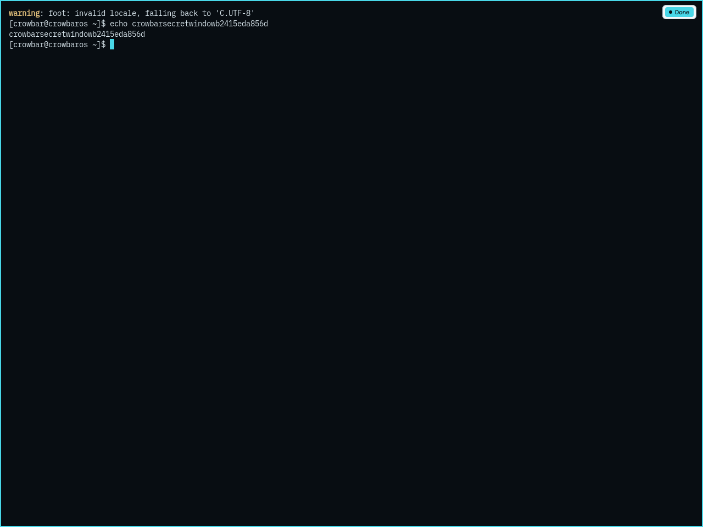
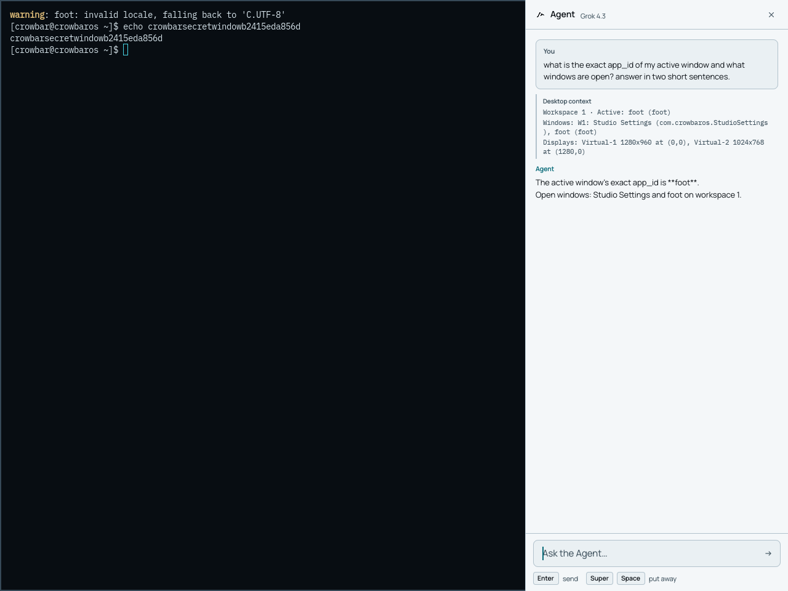

# The person talks to the Agent in the drawer, against a real Model

**Result (November 23, 2026): on real hardware, in Base built from the branch
for [issue 295](https://github.com/crowbaros/crowbaros/issues/295), a person
signed in with `crowbar-agent login`, summoned the Agent drawer with
Super+Space, and held a four-turn conversation against a real Model. Each turn
carried live desktop context from Fulcrum, followed window focus when it moved
from `foot` to `chromium`, finished behind the drawer with the bar mark moving
from working to done, and stayed readable from `crowbar-agent --resume`. In
the VM on the same commit, `lab/void/desktop_check.py` passed 143 of 143
against a second real Model (`xai` / `grok-4.3`), capturing the drawer answer
and the fullscreen mark overlay.**

This is the record issue 295 asks for: a real conversation in the drawer in
Base, against a real Model signed in with `crowbar-agent login`, with captures.
Jim Martin unlocked the machine, signed in with his own account, and drove the
four drawer turns at the machine's keyboard. A coding agent built Base, wrote
it to the machine's USB SSD, collected the logs, shell state, and SQLite audit
over SSH, and ran `lab/void/desktop_check.py` in the VM on the same commit for
the automated check and captures. The evidence is in
[`evidence/drawer-conversation-real-model-2026-11-23/`](evidence/drawer-conversation-real-model-2026-11-23/).

## The machine and the image

| | |
| --- | --- |
| Machine | Ryzen 5 7500X3D, 16 GB, UEFI, booted from a USB SSD |
| GPUs | The Ryzen's own Radeon, and a GeForce RTX 5060 with NVIDIA's open kernel module `595.112.07` |
| Monitor | One, on the RTX 5060's `HDMI-A-2`, 3840x2160 at 59.982 Hz (`1.5x` scale). Fulcrum chose `renderer=gles` on the RTX 5060 |
| Commit | `384a9b0a`, on `main` at `2aa305a4` |
| Image | Base, built with `base/void_base.py build` and an account file. `lab/void/compositor_check.py` passed 46 of 46 on `4deafb10` (no compositor changes after it), and `lab/void/desktop_check.py` passed 143 of 143 on `384a9b0a` in the VM |
| Kernel | `6.18.64_1` |
| Terminal & browser | `foot-1.28.0_1`, `chromium-158.0.8127.36_1`, `xdg-utils-1.2.1_1` |
| The Harness | As runit starts it at boot: Pi Durable 1.6.0, Node.js v26.13.1 |
| The client | `crowbar-agent 0.1.0`, at `/usr/local/bin/crowbar-agent` |

## What was done

1. The machine booted Base. Within 222 ms of startup, the Harness listened on
   the person socket (`/run/user/1003/crowbar-agent/person`) and the shell's
   surface socket (`/run/crowbar-agent/surface`). One second later the shell
   connected (`version 1`) and the Harness connected to Fulcrum's agent socket
   (`/run/crowbar-trusted/agent/compositor`).
2. Jim unlocked the desktop, summoned the drawer with Super+Space, and saw the
   calm no-Model state before signing in.
3. He opened `foot` and ran `crowbar-agent login`, signing in to OpenAI Codex
   by OAuth in Chromium (`GPT-6.2 Sol`, `gpt-6.2-sol`).
4. With `foot` focused, he summoned the drawer and sent two turns asking about
   the active window and display, then focused Chromium and sent a third turn
   asking which app had focus, then sent a fourth turn and put the drawer away
   mid-answer to verify behind-drawer completion and the bar mark.

## Results (real hardware)

| | |
| --- | --- |
| The Model | GPT-6.2 Sol (`gpt-6.2-sol`), from OpenAI Codex (`openai-codex`, OAuth) |
| Turn 1 (`foot` active, **2.73 s**) | Asked: *"what is the exact app_id of my active window, and what display am I on?"* Answered: `foot` and `HDMI-A-2` |
| Turn 2 (`foot` active, **2.58 s**) | Asked: *"what can you tell me about the foot session"*. Answered with workspace 1, title/app_id `foot`, `HDMI-A-2` (3840x2160 at 1.5x), and stated it could not see inside the terminal |
| Turn 3 (`chromium` active, **1.15 s**) | Focus moved to Chromium; asked *"what about now, what app is focused?"*. Answered: `Chromium is focused (app_id: chromium).` |
| Turn 4 (behind the drawer, **4.08 s**) | Sent at `18:13:32` (`agent-mark state=working`), drawer put away at `18:13:34` (`agent-surface up=false`), turn finished at `18:13:36` (`agent-mark state=done`), drawer reopened at `18:13:40` (`agent-mark state=idle`) |
| Shared conversation | `crowbar-agent --list` and `crowbar-agent --resume 26utzzx8` read all four turns of the drawer's conversation over the person socket |
| Stored desktop context | `harness.sqlite` holds `[Desktop context]` in the user-role Model input of every `crowbar.message` entry (turns 1–4) with the active window, windows by workspace, and display — and no window contents ([`sqlite-audit.txt`](evidence/drawer-conversation-real-model-2026-11-23/sqlite-audit.txt)) |
| Sockets & state modes | `/run/crowbar-trusted/agent/compositor` (`0660`, `crowbar-compositor:person`), `/run/crowbar-agent/surface` (`0660`, `person:crowbar-shell`), `/run/user/1003/crowbar-agent/person` (`0600`, `person`), state files `0600` in a `0700` directory ([`client.txt`](evidence/drawer-conversation-real-model-2026-11-23/client.txt)) |
| Harness memory | After sign-in and 4 turns: `Rss: 122244 kB`, `Pss: 118377 kB` ([`memory.txt`](evidence/drawer-conversation-real-model-2026-11-23/memory.txt)). In the VM on `384a9b0a`, idle `VmRSS` was `102316 kB` (within ADR 0034's 150 MiB limit) |

The raw logs and state snapshots from the real-hardware run are in
[`harness.log`](evidence/drawer-conversation-real-model-2026-11-23/harness.log),
[`shell.log`](evidence/drawer-conversation-real-model-2026-11-23/shell.log),
[`compositor.log`](evidence/drawer-conversation-real-model-2026-11-23/compositor.log),
[`agent-view.json`](evidence/drawer-conversation-real-model-2026-11-23/agent-view.json),
and [`machine.txt`](evidence/drawer-conversation-real-model-2026-11-23/machine.txt).

## Captures (VM desktop check on the same commit)

Because Fulcrum does not yet expose a Wayland capture protocol on real
hardware, the screen captures below come from `lab/void/desktop_check.py` on
the exact same commit (`384a9b0a`, `143 passed, 0 failed`), signed in against a
real Model (`xai` / `grok-4.3`) with an API key held only in guest `tmpfs` RAM
and scrubbed from all host evidence and logs.

| Mark overlay over fullscreen `foot` (turn finished behind the drawer) | Drawer reopened showing desktop context and real Model's answer |
| --- | --- |
|  |  |

In the VM run, `foot` held a random sentinel string in its terminal buffer; the
SQLite audit verified `has_conversation: true`, `has_desktop_context: true`,
`has_active_foot: true`, `has_display: true`, `has_sentinel: false`,
`has_secret_in_db: false`, and `has_secret_in_logs: false`.

## What else it showed

- **Fulcrum's `agent` socket and the shell's `surface` socket both came up at
  boot before unlock** and stayed connected through OAuth sign-in in Chromium
  and four drawer turns on the RTX 5060.
- **Per-message desktop context tracked focus switches cleanly.** Turn 2 saw
  `foot` active and Turn 3 (after clicking Chromium) saw `chromium` active,
  without restarting or reopening the conversation.
- **Putting the drawer away stopped nothing.** Turn 4 was started in the
  drawer, hidden two seconds later, completed two seconds after that with the
  bar mark turning `done`, and cleared to `idle` on reopening the drawer.

## How it was gathered

On the real machine, after Jim finished the four turns, the logs, socket modes,
`crowbar-agent` output, shell `control.sock` `agent` view, Harness `smaps_rollup`,
and `harness.sqlite` `crowbar.message` entries were read over SSH as root. On
the host, `lab/void/desktop_check.py` was run on clean commit `384a9b0a` with a
host-environment API key for `xai` (`grok-4.3`), producing the 143/143 pass and
the two QMP PNG captures above.
